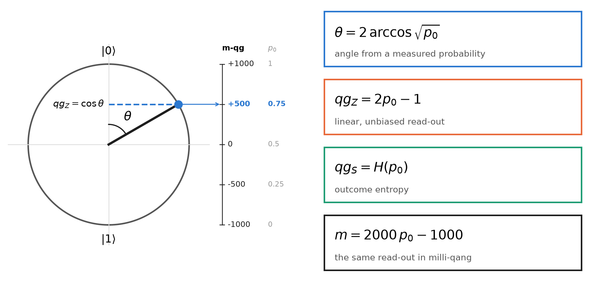
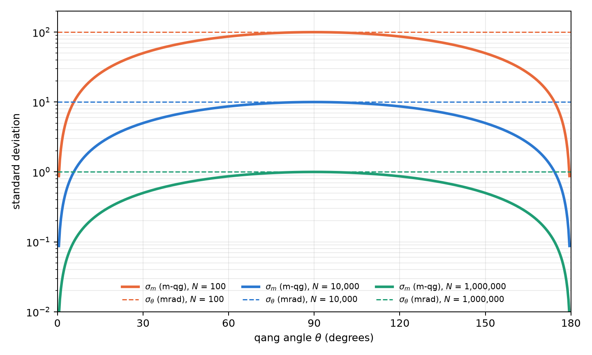
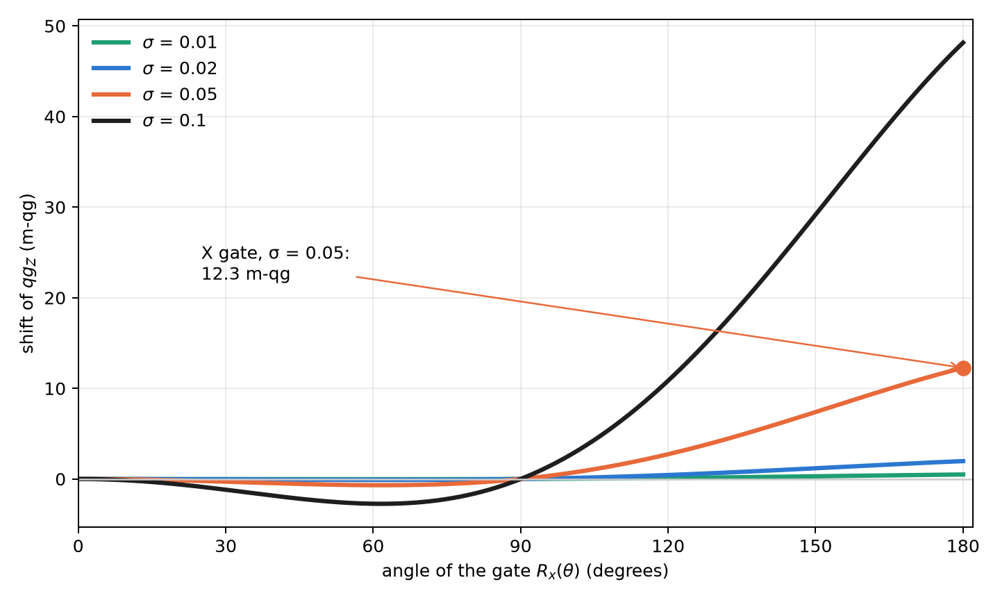
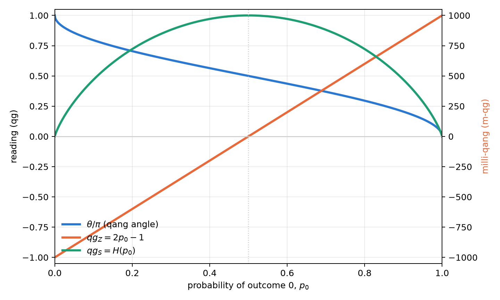

# The qang unit: definition, milli-qang and the probability equation {#sec-ch01}

A qubit is designed with angles and observed with frequencies. Whoever writes a circuit chooses rotations
$R_y(\theta)$; whoever runs it receives counts of zeros and ones. Between the two descriptions sits a trigonometric
function that is rarely named, and that is the source of several practical difficulties: gradients that diverge,
error bars that shrink or swell with the state, and parameters that cannot be read directly from the experiment.
This chapter builds the foundation of the book in three steps: the **definition** of the qang unit (qg), the
**theory of the milli-qang** (its submultiple) and the **probability equation** that ties both to what is measured.
Every result is backed by a figure computed with the package itself (`qang.probability`, §167), so the figures and
the text quote the same numbers.

## Definition of the qang {#sec-definition}

Every pure state of a qubit can be written, up to a global phase, as

$$
|\psi\rangle = \cos\frac{\theta}{2}\,|0\rangle + e^{i\varphi}\sin\frac{\theta}{2}\,|1\rangle ,
\qquad \theta\in[0,\pi],\ \varphi\in[0,2\pi).
$$

The pair $(\theta,\varphi)$ is a point on the Bloch sphere and is the natural way to *prepare* the state: a rotation
$R_y(\theta)$ followed by a phase $R_z(\varphi)$. A measurement in the computational basis does not return $\theta$:
it returns, on each shot, the outcome 0 with probability

$$
p_0 = \cos^2\frac{\theta}{2}\qquad\text{(Born's rule).}
$$

**Definition.** The qang unit takes as its primary coordinate the expectation value of $\sigma_z$, called the
*polar bias*:

$$
\boxed{\;qg_Z = \langle\sigma_z\rangle = p_0 - p_1 = 2p_0 - 1 = \cos\theta\;}\qquad qg_Z\in[-1,1].
$$

The other two readings of the unit come from the same probability: the **qang angle**
$\theta=\arccos(qg_Z)\in[0,\pi]$ and the **superposition spread** $qg_S=H(p_0)\in[0,1]$, the Shannon entropy of the
outcome (studied below). @fig-circle summarizes the definition: the point on the circle is the state, its
projection on the vertical axis is $qg_Z$, and the scale on the right gives the same reading in milli-qang and in
probability.

{#fig-circle width=100%}

Three properties make $qg_Z$ a good working coordinate:

1. **It is a bijection.** On $\theta\in[0,\pi]$, $\cos\theta$ is strictly decreasing and covers $[-1,1]$: each value
   of $qg_Z$ corresponds to a single latitude of the sphere.
2. **It is directly measurable.** $\widehat{qg}_Z = (n_0-n_1)/N$ is the average of the $\pm1$ outcomes of the shots;
   it needs no inversion and no fit.
3. **It holds for any state.** For a mixed state, $qg_Z = \operatorname{Tr}(\rho\,\sigma_z)$, which reduces to
   $\cos\theta$ when $\rho=|\psi\rangle\langle\psi|$ (§3).

The sign and range have an immediate physical reading: $qg_Z=+1$ is the pole $|0\rangle$, $qg_Z=-1$ the pole
$|1\rangle$, and $qg_Z=0$ any point of the equator, where the measurement outcome is maximally uncertain.

**An engineering unit.** A useful unit does not need to be a new physical quantity; it needs to make what is
measured legible. The decibel adds no physics to power: it expresses it on a scale that makes the gains of a chain
of amplifiers additive. The qang plays an analogous role for the qubit: it expresses its state on the scale in which
the experiment delivers it, so that preparation, noise and read-out are compared in the same units. It is an
operational convention, and like every convention it is worth what it simplifies.

## Theory of the milli-qang {#sec-milliqang}

### Definition and scale

The deviations that matter in a real qubit are small: calibration errors, drift, read-out noise. A submultiple is
convenient to express them, the **milli-qang** (m-qg):

$$
1\ \text{qg} = 1000\ \text{m-qg},\qquad m = 1000\,qg_Z\ \in[-1000,\,+1000]\ \text{m-qg}.
$$

The scale runs from $-1000$ m-qg at the pole $|1\rangle$ to $+1000$ m-qg at the pole $|0\rangle$, with zero on the
equator. A state with $qg_Z=0.5018$ sits at $501.8$ m-qg; its difference from the ideal $0.5$ is $1.8$ m-qg. The same
definition holds for the other axes, $qg_X$ and $qg_Y$, so the whole Bloch vector can be expressed in m-qg.

### Linear in probability, not linear in angle

Since $qg_Z=2p_0-1$, the milli-qang is **linear in probability**: one m-qg is always $\Delta p_0=0.0005$, that is,
0.05 percentage points, anywhere on the scale. It is **not linear in angle**:

$$
\frac{dm}{d\theta} = -1000\,\sin\theta
\qquad\Longrightarrow\qquad
\Delta\theta \approx \frac{1}{1000\,\sin\theta}\ \text{rad per m-qg}.
$$

On the equator ($\theta=90^\circ$) one m-qg is exactly one milliradian; at $\theta=30^\circ$ it is two. Near a pole
the linear relation fails and the exact one must be used: a state $\delta$ m-qg below the pole $|0\rangle$ makes
with it the angle

$$
\theta_\delta = \arccos\!\left(1-\frac{\delta}{1000}\right)\approx\sqrt{\frac{2\delta}{1000}} .
$$

One m-qg from the pole is $0.0447$ rad ($2.56^\circ$); ten m-qg, $8.1^\circ$. @fig-ruler shows the consequence: on
the milli-qang ruler the probability marks are evenly spaced and the angle marks crowd at the poles. That is why the
unit is defined on probability and not on angle: it is the scale in which the instrument delivers the data.

{#fig-ruler width=100%}

### Resolution from shots

With $N$ shots, $\widehat{qg}_Z$ has variance $\sin^2\theta/N$ (derived in the arcsine section), so the standard
deviation of the reading in milli-qang is

$$
\sigma_m = \frac{1000\,\sin\theta}{\sqrt N}\ \text{m-qg},
\qquad
N_\delta = \left(\frac{1000\,\sin\theta}{\delta}\right)^{2}
$$

where $N_\delta$ is the number of shots needed to resolve $\delta$ m-qg at one sigma. On the equator, resolving
10 m-qg takes $10^4$ shots and resolving 1 m-qg, $10^6$. At $60^\circ$ and 1000 shots, $\sigma_m=27.4$ m-qg; to get
down to 5 m-qg at that point takes 30,000 shots. @fig-noise compares $\sigma_m$ with the uncertainty of the angle,
$\sigma_\theta=1/\sqrt N$: the m-qg reading is more precise near the poles, and the angle's is the same all around
the circle. The two curves touch on the equator, where one m-qg is one milliradian.

{#fig-noise width=90%}

### Gate error budget

The scale lets a gate error be expressed in the same units as the read-out. If the amplitude of a pulse has a
random relative error of standard deviation $\sigma$, the expected polar bias after $R_x(\theta)$ is

$$
\mathbb E[qg_Z] = \cos\theta\; e^{-\theta^2\sigma^2/2}
\qquad\Longrightarrow\qquad
\varepsilon_m = 1000\cos\theta\left(e^{-\theta^2\sigma^2/2}-1\right)\ \text{m-qg}
$$

(§160). The error pulls the reading towards the equator: with $\sigma=0.05$, an $X$ gate ($\theta=\pi$) delivers
$qg_Z=-0.988$ instead of $-1$, a shift of $12.3$ m-qg. At multiples of $\pi$ the shift grows with the square of the angle, always towards the
equator; in general it goes as $\theta^2\cos\theta$ (@fig-pulse). A
$\pi/2$ rotation does not shift at all, because it already sits on the equator. Chapter 2 uses this formula to
choose, among equivalent representations of the same gate, the one with the smallest pulse area.

{#fig-pulse width=90%}

Chapters 2 and 3 use two derivatives of the reading with respect to the angle, which are worth naming here. The
**polar gradient** and the **curvature** (or *pulse impedance*) are

$$
\nabla_{qg} = \frac{dm}{d\theta} = -1000\,\sin\theta\ \ \text{m-qg/rad},
\qquad
\kappa_{qg} = \left|\frac{d^2m}{d\theta^2}\right| = 1000\,\lvert\cos\theta\rvert\ \ \text{m-qg/rad}^2 .
$$

They are not new readings: they are derivatives of $m=1000\cos\theta$. The curvature explains the budget above: to
second order in the error, $\lvert\varepsilon_m\rvert\approx\tfrac12\,\theta^2\sigma^2\,\kappa_{qg}$, so a random
amplitude error shifts the reading in proportion to $\kappa_{qg}$, which is 1000 at the poles and 0 at the equator.

## The probability equation of the qang and the milli-qang {#sec-equation}

The previous sections lead to a single statement, which is the foundation of the whole book: **every qang reading
of a qubit is an exact function of a single probability**, $p_0$:

$$
\boxed{\;
\theta = 2\arccos\sqrt{p_0},\qquad
qg_Z = 2p_0-1,\qquad
qg_S = H(p_0),\qquad
m = 2000\,p_0-1000\ \text{m-qg}
\;}
$$

and, in the other direction, the probability equation of the milli-qang:

$$
p_0 = \frac{1000+m}{2000},\qquad \theta = \arccos\frac{m}{1000}.
$$

There are no approximations: they are four readings of one number. @fig-readings shows them together. $qg_Z$ and
the milli-qang are the same straight line on two scales; the angle is monotonic but steepens at the poles; the
entropy rises up to the equator and falls again, which is why it needs a branch to be inverted. @tbl-anchors gives
the reference values.

{#fig-readings width=90%}

| $\theta$ | $p_0$ | $qg_Z$ | m-qg | state |
|---|---|---|---|---|
| $0$ | $1$ | $+1$ | $+1000$ | pole $\vert{}0\rangle$ |
| $\pi/4$ | $0.854$ | $+0.707$ | $+707$ | |
| $\pi/3$ | $0.75$ | $+0.5$ | $+500$ | |
| $\pi/2$ | $0.5$ | $0$ | $0$ | equator ($\vert{}+\rangle$, $\vert{}{+i}\rangle$, …) |
| $2\pi/3$ | $0.25$ | $-0.5$ | $-500$ | |
| $\pi$ | $0$ | $-1$ | $-1000$ | pole $\vert{}1\rangle$ |

: Anchor points of the probability equation. {#tbl-anchors}

### More than two outcomes: the statistical distance

The equation generalizes to a measurement with several outcomes. For two distributions $p=(p_k)$ and $q=(q_k)$,
**Wootters' statistical distance** [-@wootters1981], or Bhattacharyya angle [@bhattacharyya1943], is

$$
d(p,q) = \arccos\sum_k\sqrt{p_k\,q_k}.
$$

For two outcomes, the distance between $(p_0,1-p_0)$ and the pole $(1,0)$ is $\arccos\sqrt{p_0}=\theta/2$: up to the
factor 2, the qang angle is the statistical distance between what is measured and the reference state. With three
outcomes, for example, $p=(0.5, 0.3, 0.2)$ and $q=(0.4, 0.4, 0.2)$ are $0.113$ rad apart. This is the door through
which the unit leaves the qubit: Part II uses it for the Fisher information and the Fubini–Study metric, and the same
geometry holds for any measured proportion, quantum or not.

## The angular scale: the angular qang (qga) {#sec-qga}

The *Geometric and Dimensional Foundation of the Qang System* [@monteverde2026fund] proposes measuring angles on a
thousand-based scale: one full turn is 1000 units. The book adopts that scale under another name, because throughout
the book, the library and the chapters that follow, **m-qg names the reading** $m=1000\,qg_Z$, which is linear in the
probability and is not an angle (previous section). The angular scale is written **qga** (angular qang) and its
thousandth **m-qga**:

$$
1\ \text{turn} = 2\pi\ \text{rad} = 1000\ \text{qga} = 10^6\ \text{m-qga},
\qquad
\theta[\text{rad}] = \frac{2\pi}{1000}\,\theta_{qga},
\qquad 1\ \text{m-qga}\approx 6.283\cdot10^{-6}\ \text{rad}.
$$

With the Bloch polar angle in qga, the Born rule and the reading become

$$
p_0 = \cos^2\!\frac{\pi\,\theta_{qga}}{1000} = \frac{1+\cos(2\pi\theta_{qga}/1000)}{2},
\qquad
m = 1000\cos\frac{2\pi\,\theta_{qga}}{1000}\ \text{m-qg}.
$$

The pole $\vert0\rangle$ is at 0 qga, the equator at 250 qga and the pole $\vert1\rangle$ at 500 qga; the phase
$\varphi$ runs over $[0,1000)$ qga. The two scales complement each other: qga is uniform in the angle and m-qg is
uniform in the probability. The state of @fig-circle, for instance, sits at $166.667$ qga and reads $+500$ m-qg; at
the equator, one m-qg of reading equals one milliradian, that is, $0.159$ qga ($159$ m-qga).

In code, since version 0.14.0, `qang.qga` does these conversions: `p0_from_qga(250)` gives 0.5,
`milliqang_from_qga(1000/6)` gives +500 m-qg and `qga_from_milliqang(-1000)` gives 500 qga.

**The azimuthal coordinate.** The phase is read from two transverse measurements,
$\varphi=\operatorname{atan2}(qg_Y,\,qg_X)$, because $qg_X=\sin\theta\cos\varphi$ and $qg_Y=\sin\theta\sin\varphi$ and
the ratio cancels $\sin\theta$. As a fraction of a turn, $qg_\varphi=(\varphi\bmod 2\pi)/2\pi\in[0,1)$ is exactly
the azimuthal angle in qga divided by 1000. It is undefined at the poles, where $qg_X=qg_Y=0$.

**Geometry.** The Fubini–Study metric of a qubit and the Fisher information of the $Z$ measurement carry a constant
factor in qga:

$$
ds^2 = \tfrac14\left(d\theta^2+\sin^2\theta\,d\varphi^2\right)
     = \frac{\pi^2}{10^6}\left(d\theta_{qga}^2+\sin^2\theta\,d\varphi_{qga}^2\right),
\qquad
I_F(\theta) = 1\ \text{rad}^{-2} = 4\pi^2\cdot10^{-6}\ \text{qga}^{-2}.
$$

The second is the stabilization of the arcsine section in another unit: the standard deviation of the qang angle is
$159.15/\sqrt N$ qga over the whole circle ($5.03$ qga with 1000 shots). The Berry curvature,
$F=\tfrac12\sin\theta\,d\theta\wedge d\varphi$, integrated over the sphere ($\theta$ spans 500 qga and $\varphi$
1000) gives $2\pi$, that is, Chern number 1.

**Corrections to the Foundation.** Three claims of the source document are not adopted, because its own formulas
contradict them:

- It assigns $p_0=0.5$ to 125 qga. Its own equation gives $p_0(125\ \text{qga})=\cos^2(\pi/8)=0.854$ (+707 m-qg);
  $p_0=0.5$ belongs to 250 qga.
- It gives curvature $K=1$ to the metric $ds^2=\tfrac14\,d\theta^2$. That metric, with its azimuthal term, is the one
  of a sphere of radius $1/2$, whose Gaussian curvature is $K=4$; $K=1$ belongs to the Bloch sphere of radius 1.
- It suggests that a lattice in m-qga avoids barren plateaus. Changing the unit of the parameter multiplies every
  derivative by the constant $2\pi/1000$: it changes neither the ratio of gradient variance to its scale nor its decay
  with the number of qubits. The unit has no effect on plateaus. The qang tools are another matter: they do mitigate
  them in tested regimes, namely the qg local cost (@sec-geo-plateaus) and the weight filter under T1
  (@sec-qnn-training).

### Unverified proposal: energy and antimatter in qga {#sec-qga-energy}

The Foundation extends the scale to relativistic kinematics. What follows is an **unverified proposal**: the
identities are corrected, but the physical reading is unproven and the rest of the book does not use it.

**Relativistic angle.** Dividing $E^2=(mc^2)^2+(pc)^2$ by $E^2$ gives $\cos\theta_r=mc^2/E=1/\gamma$ and
$\sin\theta_r=pc/E=\beta$. The identity is exact, because $1/\gamma^2+\beta^2=1$. With $\theta_r$ in qga,
$E=mc^2/\cos(2\pi\theta_{r,qga}/1000)$: rest is at 0 qga and the ultra-relativistic limit ($E=pc$) at 250 qga. The
angle $\theta_r$ is tied to the rapidity $\eta$ by $\cos\theta_r=1/\cosh\eta$ (the Gudermann function), with no Wick
rotation needed.

**Antimatter.** The Dirac equation has two branches, $E_\pm=\pm\sqrt{(pc)^2+(mc^2)^2}=\pm\,mc^2/\cos\theta_r$. The
Foundation assigns the negative branch a shift of 500 qga, tied to CPT symmetry; that identification has no support
and is not adopted.

**Probabilities.** The Foundation equates $P_\text{rest}=(mc^2/E)^2$ with $p_0(\theta_{qga})$. There is a factor 2 in
the angle: $(mc^2/E)^2=\cos^2\theta_r$, whereas $p_0=\cos^2(\theta/2)$, so the equality holds only if the Bloch angle
is $2\theta_r$. If instead the Bloch angle is taken equal to $\theta_r$, there is a known result behind the document's
formulas $\cos^2(\pi\,\text{qg}/1000)$ and $\sin^2(\pi\,\text{qg}/1000)$: in the free Dirac spinor the large component
weighs $(E+mc^2)/2E=\cos^2(\theta_r/2)$ and the small one $\sin^2(\theta_r/2)$. But those weights are not probabilities
of "matter" and "antimatter", as the source document calls them: both belong to the same positive-energy solution.

Appendix G (@sec-appendix-g) develops this proposal. It finds an exact reading of $E=mc^2$, the expectation value of
the Dirac matrix $\beta$, which equals $mc^2/E$ and is therefore a $qg_Z$. It also shows that charge conjugation
inverts that reading.

**Proposed names.** @tbl-names-qga lists the names the Foundation introduces and how the book treats them.

| Foundation name | definition | treatment in the book |
|---|---|---|
| relativistic angle $\theta_r$ | $\cos\theta_r=mc^2/E$, $\sin\theta_r=\beta$ | exact identity; in qga, a proposal |
| $E(\text{qg})=mc^2/\cos(2\pi\,\text{qg}/1000)$ | total energy as a function of $\theta_r$ | exact, with $\theta_r$ in qga |
| $E_\pm$, matter and antimatter sheets | $\pm\,mc^2/\cos\theta_r$ | Dirac branches; the 500 qga CPT shift is not adopted |
| $P_\text{rest}$, $P_\text{kinetic}$ | $(mc^2/E)^2$, $\beta^2$ | they add to 1; they are not $p_0$, $p_1$ of the same angle (factor 2) |
| $P_\text{matter}$, $P_\text{antimatter}$ | $\cos^2$, $\sin^2$ of the half angle | weights of the spinor's large and small components, not antimatter probabilities |
| Q-Hertz (qHz) | qga per second | unit of angular frequency; a proposal |
| Q-Fisher (qFi) | Fisher information per qga² | $4\pi^2\cdot10^{-6}$ qga$^{-2}$ for a pure qubit |
| Q-Shannon ($qg_S$) | Shannon entropy of the outcome | it is $qg_S$; it is not the von Neumann entropy |
| Q-Curvature, Q-SNR, Q-Geodesic, dissipative deficit | $qg_\kappa$, $qg_{SNR}$, $qg_L$, $qg_\tau$ | defined and checked in @sec-derived |
| Q-Force, Q-Conductance, Q-Momentum | phase gradient, qga per volt, $(\pi/500)\hbar$ | proposed names, not used in the book |

: The Foundation's names for energy, antimatter and the derived units, and how the book treats them. {#tbl-names-qga}

## Why measure in qg: the geometry–probability gap {#sec-bloch}

The relation $p_0=\cos^2(\theta/2)$ between the control parameter and the observed quantity is non-linear, and its
derivative vanishes at the poles. This has concrete consequences. If a variational algorithm wants to adjust the
state according to what it measures, the chain rule introduces the factor

$$
\frac{dE}{dq} = -\frac{1}{\sin\theta}\,\frac{dE}{d\theta},
$$

which diverges at $\theta=0$ and $\theta=\pi$ (research notes, §1). And if $\theta$ is to be estimated from $N$
shots, the variance of $\hat p_0$ changes with the state, so the uncertainty of each reading depends on where the
qubit is (§5). Neither problem is exotic: both appear as soon as one reasons in terms of what the experiment
delivers, and the probability equation is the tool to handle them.

## Inversion and the branch sign {#sec-inversion}

The angle is recovered with $\theta=\arccos(qg_Z)$. The inversion has a limit: $\cos\theta$ is even, so $qg_Z$ does
not distinguish $\theta$ from $-\theta$. As long as one works on $[0,\pi]$ there is no problem, but an optimizer that
needs to cross a pole gets stuck. The remedy is to measure the sign of the sine as well: the pair $(qg_Z, s)$ with
$s=\operatorname{sign}(qg_X)$ is one-to-one on the whole circle (§65). In the H₂ molecule the variational optimum is
at $\theta\approx-0.22$; every update that uses only $qg_Z$ stops at the Hartree–Fock state, while the signed version
reaches the exact energy.

## The outcome entropy: $qg_S$ {#sec-qgs}

The polar bias says *where* the qubit points; it does not say how unpredictable the measurement is. That is the
role of the **superposition spread**, the Shannon entropy of the outcome:

$$
qg_S = H(p_0) = -p_0\log_2 p_0 - (1-p_0)\log_2(1-p_0) \in [0,1].
$$

Since $qg_Z$ and $qg_S$ depend on the same population $p_0$, they are tied by an exact, branch-free identity (§7):

$$
qg_S = H\!\left(\frac{1+qg_Z}{2}\right),
$$

valid for every single-qubit state, pure or mixed, however it was prepared. Its derivative,
$\tfrac{d\,qg_S}{d\,qg_Z}=\tfrac12\log_2\tfrac{1-qg_Z}{1+qg_Z}$, diverges at the poles: it is the entropic counterpart
of the gradient singularity. Near a pole, a minimal change of the bias produces an enormous relative change of the
entropy.

## Invertibility of $qg_S$ and its error bars {#sec-qgs-errors}

Unlike $qg_Z$, the entropy is not invertible over the whole domain: $qg_S(\theta)=qg_S(\pi-\theta)$. The population
$p_0$ decreases from 1 to 0 on $[0,\pi]$ and $H$ rises up to $p=\tfrac12$ and then falls, so $qg_S$ is strictly
increasing on $[0,\pi/2]$ and strictly decreasing on $[\pi/2,\pi]$ (@fig-readings). Inversion requires choosing one
of the two halves (§2).

Estimating $qg_S$ from finite shots raises a further problem: the entropy is flat at its maximum, and the delta
method gives a zero standard error exactly where $qg_S\approx1$. The native qang solution is to build the Wilson
interval for $qg_Z$ and map it through the identity above; since $H$ is unimodal, the image is a valid interval.
Over 2000 repetitions that interval kept a coverage of 0.90–0.99 in every case tested, even where the Wald interval
or the bootstrap fell below 0.40 (§51).

## The qang angle as the arcsine transformation {#sec-arcsine}

The central statistical property of the unit follows from propagating shot noise. With $\widehat{qg}_Z = 2\hat
p_0-1$,

$$
\operatorname{Var}(\widehat{qg}_Z)=\frac{\sin^2\theta}{N},
\qquad
\operatorname{Var}(\hat\theta)\approx \operatorname{Var}(\widehat{qg}_Z)\left(\frac{d\theta}{d\,qg_Z}\right)^2
=\frac{\sin^2\theta}{N}\cdot\frac{1}{\sin^2\theta}=\frac1N .
$$

The $\sin^2\theta$ factors cancel exactly: **the uncertainty of the qang angle does not depend on the state** (§5),
which is the horizontal dashed line of @fig-noise. It is not a coincidence. Since $p_0=\cos^2(\theta/2)$, the qang
angle is, up to the reflection $\theta\to\pi-\theta$, the classical arcsine transformation of a proportion,
$\phi=2\arcsin\sqrt p$, introduced by @bartlett1947, @anscombe1948 and @freeman1950 precisely to
stabilize the variance (§125).

The claim was checked with exact binomial sums, without simulation: with $n=100$, $(n+\tfrac12)\operatorname{Var}
(\hat\theta)$ lies between 1.000 and 1.001; the coverage of the interval $\hat\theta\pm z/\sqrt{n+1/2}$ stays between
0.930 and 0.962 for $n\in\{30,100,1000\}$. The prediction failed in one case, and it is worth saying: with
$np\approx2.5$ both the angular and the Wald intervals lose coverage. The stabilization is asymptotic, and the regime
of very few events requires the exact intervals of chapter 4.

## Mixed states and multi-qubit registers {#sec-mixed}

The definitions extend unchanged to mixed states and to registers:

- **Mixed states.** $qg_Z=\operatorname{Tr}(\rho\sigma_z)$ no longer determines the state. The classical mixture of
  $|0\rangle$ with weight 0.2 and $|1\rangle$ with weight 0.8 has $qg_Z=-0.6$ and von Neumann entropy 0.72, a
  combination no pure state reproduces (§3). The qang angle $\theta=\arccos qg_Z$ is still a
  function of $p_0$, so it keeps $\operatorname{Var}(\hat\theta)=1/N$ here too: the probability does not know whether
  the state is pure. What loses the stabilization is the estimate of the Bloch polar angle, $\arccos(qg_Z/r)$, of a
  qubit of length $r<1$: $\operatorname{Var}=\big[1+\tfrac{1-r^2}{r^2\sin^2\theta}\big]/N$, equal to the quantum
  Cramér–Rao bound $1/(Nr^2)$ on the equator (§45).
- **Registers.** Each qubit has its local profile, obtained by partial trace, and the register has a joint entropy
  normalized by the number of qubits (§4). The Bell state illustrates it: each qubit has $qg_Z=0$ and a local
  entropy of 1 bit, but the normalized joint Shannon entropy of the outcomes is 0.5 (the von Neumann entropy of the
  register is 0). The register is globally pure and locally mixed; the
  local profiles are not enough to describe it, and chapter 5 returns to this point with the Bloch radius.

## Derived quantities of the reading {#sec-derived}

The treatise's formulation [@monteverde2026fund] names, on top of this base, seven derived quantities. All of them come
from the reading —from $qg_Z$, or from the full qg vector when needed—, so they add no information to $p_0$: they name
combinations that the rest of the book uses. @tbl-derived collects them with their definition, what they are in the
usual terms of statistics or physics, and how they are treated here.

| quantity | definition | what it is | treatment in the book |
|---|---|---|---|
| Q-Hertz (qHz) | qga per second | angular frequency on the qga scale: 1 qHz $=2\pi/1000$ rad/s | unit of convenience |
| Q-Fisher (qFi) | Fisher information per qga² | $I_F=4\pi^2\cdot10^{-6}$ qga$^{-2}$ about the qang angle, for every state | exact (@sec-qga) |
| Q-Shannon ($qg_S$) | $H(p_0)=H\big((1+qg_Z)/2\big)$ | Shannon entropy of the outcome | exact (@sec-qgs) |
| Q-Curvature ($qg_\kappa$) | $-d^2qg_S/d\,qg_Z^2=1/[\ln2\,(1-qg_Z^2)]$ | Fisher information about $qg_Z$, in bits | exact; its use in optimizers, unverified |
| Q-SNR ($qg_{SNR}$) | $\lvert qg_Z\rvert/\sqrt{1-qg_Z^2}=\lvert\cot\theta\rvert$ | signal-to-noise of one shot | exact; sets the shots needed to read a sign |
| Q-Geodesic ($qg_L$) | $\arccos\big(\sqrt{p_0p_0'}+\sqrt{p_1p_1'}\big)=\lvert\theta-\theta'\rvert/2$ | Bhattacharyya angle between two readings | exact; it is the Fubini–Study distance on a common meridian |
| Dissipative deficit ($qg_\tau$) | $\sqrt{1-r^2}=\sqrt{1-qg_X^2-qg_Y^2-qg_Z^2}$ | $2\sqrt{\det\rho}$, the lack of purity | exact; measures loss of purity of any origin |

: Derived quantities of the formulation and how the book treats them. {#tbl-derived}

The first three have already appeared. On the Q-Fisher, one precision: the formulation describes its constancy as that
of a flat manifold, and it is not one. What is constant is the information about a single coordinate, the polar angle;
the Bloch sphere with the Fubini–Study metric has Gaussian curvature 4 (@sec-qga).

**Information curvature.** Differentiating twice the identity $qg_S=H((1+qg_Z)/2)$ of @sec-qgs,

$$
\frac{d\,qg_S}{d\,qg_Z}=\frac12\log_2\frac{1-qg_Z}{1+qg_Z},
\qquad
qg_\kappa=-\frac{d^2qg_S}{d\,qg_Z^2}=\frac{1}{\ln 2\,(1-qg_Z^2)} .
$$

The denominator is the variance of one shot, so $qg_\kappa=I_F(qg_Z)/\ln 2$: the curvature of the entropy is the Fisher
information that one shot carries about the polar bias, expressed in bits. It is $1/\ln2=1.443$ on the equator and
diverges at the poles, where the entropy is most sensitive. For a pure state, $1-qg_Z^2=\sin^2\theta$ and
$qg_\kappa=1/(\ln2\,\sin^2\theta)$. **Mind the notation:** $qg_\kappa$ is not the pulse curvature
$\kappa_{qg}=1000\,\lvert\cos\theta\rvert$ of @sec-milliqang. That one is the second derivative of the reading with
respect to the angle; this one, that of the entropy with respect to the reading. The formulation proposes using
$qg_\kappa$ to damp an optimizer's step near the poles. Scaling the step by the inverse Fisher information is the
natural gradient [@amari1998], and its effect on the book's optimizers has not been measured.

**Signal-to-noise per shot.** A shot is $\pm1$, with mean $qg_Z$ and standard deviation $\sqrt{1-qg_Z^2}$, for any
state, pure or mixed. Their ratio and the number of shots a sign requires are

$$
qg_{SNR}=\frac{\lvert qg_Z\rvert}{\sqrt{1-qg_Z^2}}=\lvert\cot\theta\rvert,
\qquad
N_\text{sign}=\left(\frac{z}{qg_{SNR}}\right)^{2},
$$

with $\theta=\arccos qg_Z$, the qang angle. With $N$ shots the signal-to-noise is $\sqrt N\,qg_{SNR}$, and
$N_\text{sign}$ is the number of shots for the sign of $qg_Z$ to stand $z$ standard deviations from zero: it is the
stopping criterion the formulation proposes. At $60^\circ$ ($+500$ m-qg) $qg_{SNR}=0.577$ and 27 shots are enough for a
3σ sign; at $80^\circ$ it takes 290, and at $89^\circ$, about 29 500. On the equator the signal vanishes and the
criterion never ends. Like every formula of this chapter based on the normal approximation, it holds when
$N_\text{sign}$ is not too small; with few shots the exact binomial test is used.

**Geodesic distance.** Two readings $(p_0,p_1)$ and $(p_0',p_1')$ are at Wootters' statistical distance of
@sec-equation, and for two outcomes that distance is

$$
qg_L=\arccos\big(\sqrt{p_0p_0'}+\sqrt{p_1p_1'}\big)=\frac{\lvert\theta-\theta'\rvert}{2},
$$

because $\sqrt{p_0p_0'}+\sqrt{p_1p_1'}=\cos\tfrac\theta2\cos\tfrac{\theta'}2+\sin\tfrac\theta2\sin\tfrac{\theta'}2
=\cos\tfrac{\theta-\theta'}{2}$. It is half the difference of qang angles, that is, the distance between readings on
the scale that stabilizes the variance. If both states are pure and share the meridian, $qg_L$ equals the Fubini–Study
distance $\arccos\lvert\langle\psi\vert\psi'\rangle\rvert$. With different azimuths it is a lower bound, because a
measurement cannot tell two states apart better than their overlap does. Chapter 3 uses it between the states of a
reflector (@sec-ptransition).

**Dissipative deficit.** The three readings $qg_X$, $qg_Y$ and $qg_Z$ form the qg vector $\mathbf r$, of length
$r\le1$, and

$$
qg_\tau=\sqrt{1-r^2}=2\sqrt{\det\rho},
\qquad
\operatorname{Tr}\rho^2=1-\tfrac12\,qg_\tau^2 .
$$

It is 0 for a pure state and 1 for the maximally mixed state. The 0.2/0.8 mixture of the previous section has $r=0.6$
and $qg_\tau=0.8$; each qubit of a Bell pair, $qg_\tau=1$. The formulation associates it with $T_1$ and $T_2$
relaxation, which is one of its causes, but the quantity measures the loss of purity without telling its origin apart:
an average over calibration errors produces it too (Chapter 2, @sec-area). Unlike the previous ones, it is not a
function of $p_0$: it requires measuring in three bases.

## Scope and limits of the base {#sec-scope}

It is worth stating precisely what this base brings and what it does not, before building the rest of the book on
it.

**What it is not.** The qang unit is not new physics. The polar bias is the expectation value of $\sigma_z$, the qang
angle is the arcsine transformation of a proportion and the milli-qang is, mathematically, $1000\,\langle\sigma_z\rangle$.
None of these readings holds information that the probability $p_0$ does not already have; the probability equation
says so explicitly. Nor does it reduce the shots a given precision requires (Chapter 4).

**What it is.** A working scale, in the sense of the decibel: it puts preparation, gate error, shot noise and read-out
in the same units, so that they add, compare and can be budgeted. The question that matters is then empirical: does
reasoning in milli-qang predict what a real processor does?

**First test on hardware (§168).** It was answered with a pre-registered experiment on one qubit of IQM's
superconducting Garnet processor: 26 circuits of 4000 shots, with four predictions fixed before the run. The result
was mixed, and it is reported in full:

- **The cost of a gate is measurable and budgetable in m-qg.** Chaining 3 to 41 $X$ gates, the shortfall of the
  reading (corrected for the readout errors measured at the poles) grows with a single slope: **1.64 m-qg per $X$
  gate**, with a $\chi^2$ per degree of freedom of 0.81. After 41 gates it is 63 m-qg, eight standard deviations above
  zero (@fig-hardware, left). Linear rather than quadratic growth points to incoherent error, relaxation during the
  pulses, and not to a coherent over-rotation.
- **The scale makes visible an error that the readout model hides.** The affine readout predicted from the poles
  fits at the equator, but the four intermediate angles read between 16 and 55 m-qg low (@fig-hardware, right). The
  processor calibrates the angles $0$, $\pi/2$ and $\pi$ well; the others are over-rotated by $1.3^\circ$ to $3.9^\circ$.
  The prediction passed by the 4-of-5 rule, not cleanly.
- **One prediction failed.** The ten copies of the equator circuit scattered half as much as binomial shot noise
  allows, something independent shots cannot produce and which happens by chance with probability 0.013. A single
  run does not decide whether it was a fluke or a property of how the device returns batched circuits.
- **Another prediction was badly designed.** Fitting two parameters on four points left an extrapolation band so
  wide that any reading passed. It is recorded as a design flaw, not as a success.

{#fig-hardware width=100%}

The balance: on a real chip, the milli-qang turned the error of a gate into a budgetable number and exposed an angle
error that the usual model does not see. But it was tested on one qubit, once, and shot noise did not describe the
scatter of repeated circuits. Replication on more qubits and on another day is pending, and the book treats this base
as solid mathematically and promising, but not yet consolidated, experimentally.

**Second test on hardware (§170).** On the same Garnet qubit, $E=mc^2$ was read as a reading, with the $\beta$ qubit of
Appendix G (@sec-g-garnet). The Dirac eigenstate at $0.6c$ read $+759.9\pm14.9$ m-qg, where $1000/\gamma=+800$ was
predicted, and its mirror on the negative branch read $-809.4$. The *Zitterbewegung* showed at the predicted frequency,
0.44% off. All five predictions passed. The low bias at intermediate angles appeared again, in the same direction as in
§168, which points to a feature of the device rather than a fluke of one run. Both tests are on one qubit, and replication
is still pending.

**Open proposals.** The author's working version adds three proposals to this basis, which the book records as
**unverified**:

- A regularized variational energy,
  $E_\text{total}=\langle H\rangle+\lambda_\theta L_\text{qang}(\theta)+\lambda_\varphi L_\text{qang}(\varphi)$. Here
  the energy is the expectation value of a Hamiltonian, not the relativistic energy of the previous section. The form
  of the penalties $L_\text{qang}$ and the values of the weights $\lambda$ are not defined.
- A normalized radiation function, $R(\theta,\varphi)=N\,[\,p_1+\alpha\cos\varphi\,]$, with the excited population
  $p_1=\sin^2(\theta/2)$ as the emitting power. Neither $N$ nor $\alpha$ is fixed, and it is not checked against an
  emission model.
- Mechanisms against barren plateaus (local costs in m-qg, minimum-curvature $\kappa_{qg}$ compilation, initialization
  with the branch sign). Two qang tools are already tested on the book's networks. The **qg local cost**,
  $(1-\overline{qg_Z})/2$, the idea of @cerezo2021 written as a reading, has 470 times more gradient variance than the
  global cost with 10 qubits and shallow circuits (@sec-geo-plateaus). The **weight filter** returns, under T1, exactly
  the noiseless gradient, to $10^{-16}$, against a noise-induced plateau (@sec-qnn-training; pre-registered prediction,
  §112). Both have measured limits: with deep circuits the local cost also decays exponentially and, where it escapes
  the plateau, it is classically simulable; and the weight sector itself flattens the gradient as the register grows,
  with or without the filter: like a polynomial at weight 1, which is simulable, and exponentially at half filling.
  Chapter 23 gathers the three sources of a plateau and what qang does with each (@sec-geo-three). Compilation by
  $\kappa_{qg}$ and initialization with the branch sign have not been tested
  against plateaus.

## Without qang and with qang {#sec-comparison01}

| action | without qang | with qang | difference |
|---|---|---|---|
| describe the outcome of a qubit | the probability $p_0$ (or $\langle Z\rangle$) | $qg_Z$, the angle $\theta$, $m$ and $qg_S$, all exact functions of $p_0$ | **none in content**: the same information; qang gives it a working scale from $-1000$ to $+1000$ |
| error bar of a reading | $\sqrt{p_0(1-p_0)/N}$, different for each state | the angle has variance $1/N$ for every state; in m-qg, $1000\sin\theta/\sqrt N$ | **convenience**: the variance-stabilized coordinate of classical statistics (the arcsine) is the gate parameter |
| compare a gate error with shot noise | infidelity on one side, binomial deviation on the other, in different units | both in m-qg (on Garnet, 1.64 m-qg per $X$ gate against the run's shot noise) | **in favour**: one scale for the error budget |
| decide how many shots the sign of a reading needs | binomial test or normal approximation | $N=(z/qg_{SNR})^2$, with $qg_{SNR}=\lvert\cot\theta\rvert$ | **convenience**: it is the normal approximation written with the reading |
| express a gate or phase angle | radians, with factors of $\pi$ | qga: 1000 per turn ($X$ = 500 qga, equator = 250 qga) | **convenience**: the same information without factors of $\pi$; it changes neither gradients nor plateaus |
| improve the device | — | — | **none**: the scale measures, it does not correct; prediction M2 of §168 failed |

: The chapter's actions without the qang scale and with it. {#tbl-comparison01}

**Balance.** The base adds no information to $p_0$: it reorganizes it. What it gains is a uniform error bar in the
angle and a common unit for gate errors and shot noise, which are exactly the two things the rest of the book uses.

## In code {#sec-code01}

The `qang.probability` module is this chapter's analysis tool: it reads counts and returns every reading, each with
its interval.

```python
import math
from qang import probability as pb

pb.readings_from_p0(0.75)        # theta = 1.047 (60°), qg_Z = 0.5, qg_S = 0.811, 500 m-qg

# 750 zeros in 1000 shots, against a target qg_Z = 0.5
r = pb.analyze(750, 1000, target_qg_z=0.5)
r.milliqang                      # (500.0, 444.5, 551.7) m-qg: estimate and Wilson interval
r.theta                          # (1.047, 0.986, 1.110) rad = 60.0°, 56.5°, 63.6°
r.qg_s                           # (0.811, 0.768, 0.852)
r.deviation_milliqang            # 0.0 m-qg from the target

pb.angle_per_milliqang(math.pi / 2)        # 0.001 rad: one m-qg is one milliradian on the equator
pb.pole_angle(1.0)                         # 0.0447 rad: one m-qg below the pole
pb.shots_for_resolution(10, math.pi / 2)   # 10000 shots to resolve 10 m-qg
pb.pulse_error_milliqang(math.pi, 0.05)    # 12.3 m-qg: X gate with a 5 % amplitude error
pb.statistical_angle([0.5, 0.3, 0.2], [0.4, 0.4, 0.2])   # 0.113 rad

# derived quantities
pb.quantum_snr(0.5)                        # 0.577: signal-to-noise of one shot at 60°
pb.shots_for_sign(0.5)                     # 27 shots for a 3σ sign
pb.information_curvature(0.0)              # 1.443 = 1/ln 2, the minimum curvature (equator)
pb.dissipative_deficit(0.0, 0.0, -0.6)     # 0.8: the 0.2/0.8 mixture
```

The figures of this chapter are generated by `tools/make_cap01_figures.py`, which uses the same functions.

## Summary {#sec-summary01}

- **Definition.** The polar bias $qg_Z=\langle\sigma_z\rangle=2p_0-1=\cos\theta$ is bijective, directly measurable and
  valid for mixed states; the qang angle $\theta=\arccos qg_Z$ and the entropy $qg_S=H(p_0)$ complete the unit.
- **Milli-qang.** $1\ \text{qg}=1000$ m-qg; the scale is linear in probability (1 m-qg $=\Delta p_0=0.0005$) and not
  linear in angle (1 mrad on the equator, $2.56^\circ$ next to the pole). Resolving $\delta$ m-qg takes
  $(1000\sin\theta/\delta)^2$ shots, and gate errors are budgeted in the same units.
- **Probability equation.** $\theta$, $qg_Z$, $qg_S$ and $m$ are exact functions of a single probability $p_0$; with
  several outcomes, the qang angle generalizes to Wootters' statistical distance.
- **Angular scale.** The angular qang measures angles with 1000 qga per turn and is distinct from m-qg, which is a
  reading: $p_0=\cos^2(\pi\theta_{qga}/1000)$ and $I_F=4\pi^2\cdot10^{-6}$ qga$^{-2}$. The extension to relativistic
  energy and antimatter is an unverified proposal, with three errors of the source document corrected.
- **Statistics.** The qang angle is the arcsine transformation of a proportion: its variance is $1/N$ for every
  state, pure or mixed; what needs a correction in a mixed state is the estimate of the Bloch angle.
- **Derived quantities.** $qg_\kappa$ is the Fisher information about $qg_Z$ in bits (and not the pulse curvature
  $\kappa_{qg}$); $qg_{SNR}=\lvert\cot\theta\rvert$ sets the shots needed to read a sign; $qg_L=\lvert\theta-\theta'\rvert/2$
  is Wootters' distance between two readings; $qg_\tau=\sqrt{1-r^2}$ measures the lack of purity and is the only one
  that needs three bases.
- **Scope.** The unit is not new physics but a working scale. On real hardware (§168) it measured a cost of 1.64 m-qg
  per $X$ gate, linear in the number of gates, and exposed reading shifts of 16–55 m-qg (over-rotations of $1.3^\circ$–$3.9^\circ$); a prediction about shot noise
  failed and replication is pending.

## Bibliographic notes {.unnumbered}

The Born rule [@born1926] and the Bloch sphere [@bloch1946] are the starting point; for states, measurements and
channels in general, see @nielsen2010. Wootters' statistical distance [-@wootters1981] and its relation to Fisher
information are in @braunstein1994; the Cramér–Rao bound, in @cramer1946 and @rao1945. The arcsine transformation that
stabilizes the binomial variance comes from @bartlett1947, @anscombe1948 and @freeman1950, and the score interval is
that of @wilson1927. The binary entropy behind $qg_S$ is that of @shannon1948; the natural gradient, against which the information
curvature $qg_\kappa$ is compared, is that of @amari1998. The numbered research notes (§) cited in
this chapter and the scripts that check it are in the repository [@qangrepo]; the definition of the qang unit is in
@monteverde2026. The angular qga scale and the relativistic proposal come from the working document
@monteverde2026fund; the free Dirac spinor and its components are in any text on relativistic quantum mechanics.
