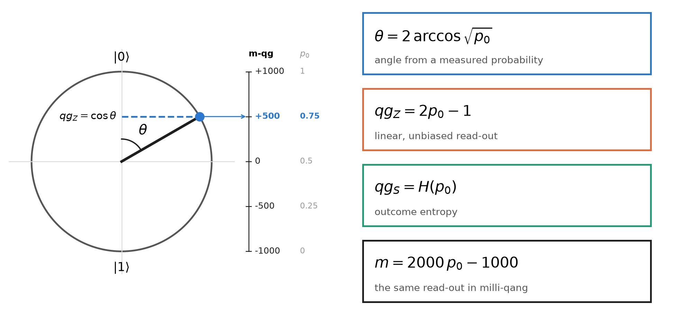
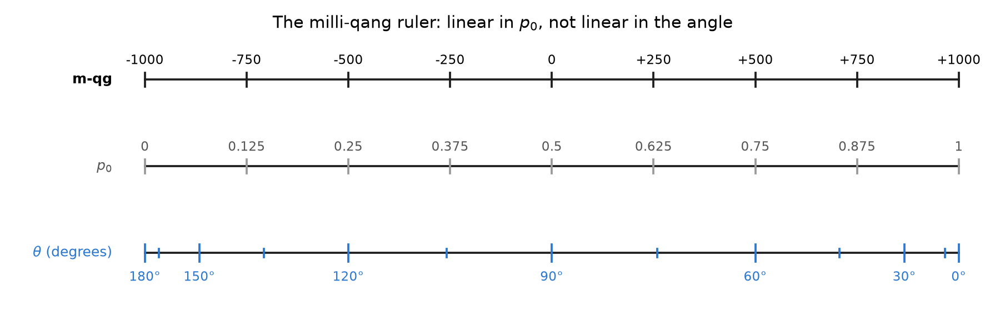
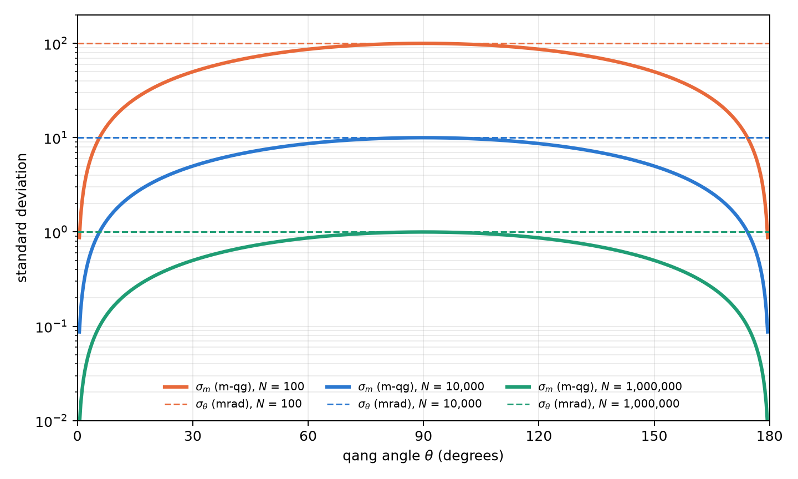
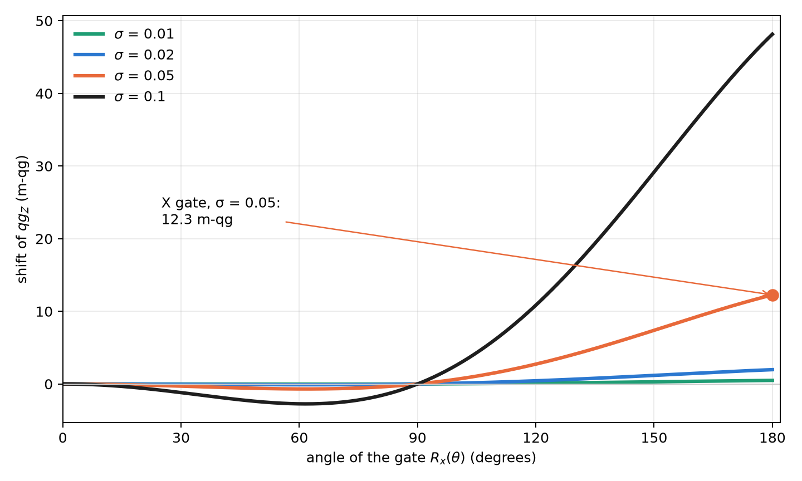
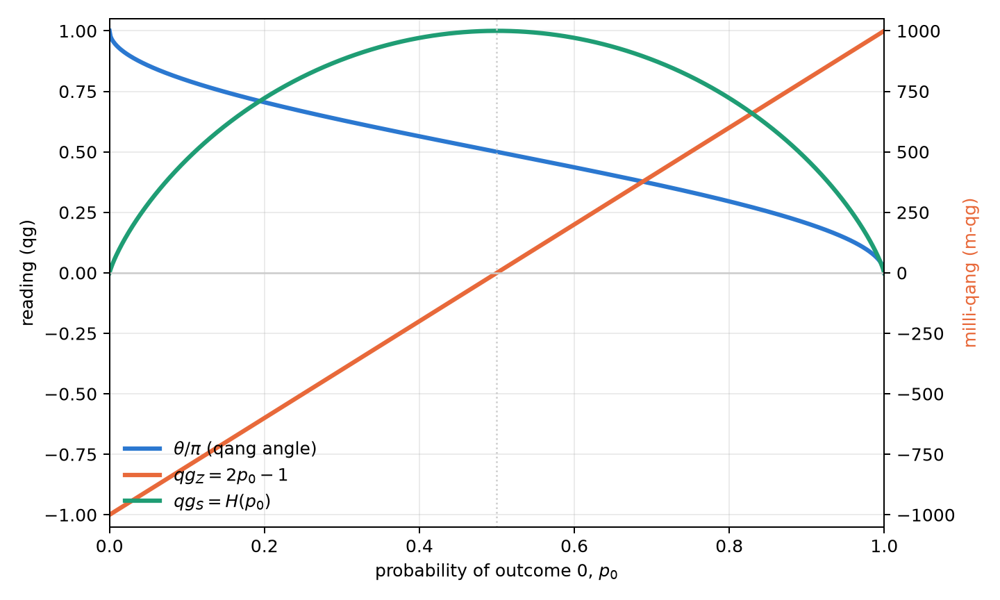

# The qang unit: definition, milli-qang and the probability equation {#sec-ch01}

A qubit is designed with angles and observed with frequencies. Whoever writes a circuit chooses rotations
$R_y(\theta)$; whoever runs it receives counts of zeros and ones. Between the two descriptions sits a trigonometric
function that is rarely named, and that is the source of several practical difficulties: gradients that diverge,
error bars that shrink or swell with the state, and parameters that cannot be read directly from the experiment.
This chapter builds the foundation of the book in three steps: the **definition** of the qang unit (qg), the
**theory of the milli-qang** (its submultiple) and the **probability equation** that ties both to what is measured.
Every result is backed by a figure computed with the package itself (`qang.probability`, §167), so the figures and
the text quote the same numbers.

## Definition of the qang {#sec-definition}

Every pure state of a qubit can be written, up to a global phase, as

$$
|\psi\rangle = \cos\frac{\theta}{2}\,|0\rangle + e^{i\varphi}\sin\frac{\theta}{2}\,|1\rangle ,
\qquad \theta\in[0,\pi],\ \varphi\in[0,2\pi).
$$

The pair $(\theta,\varphi)$ is a point on the Bloch sphere and is the natural way to *prepare* the state: a rotation
$R_y(\theta)$ followed by a phase $R_z(\varphi)$. A measurement in the computational basis does not return $\theta$:
it returns, on each shot, the outcome 0 with probability

$$
p_0 = \cos^2\frac{\theta}{2}\qquad\text{(Born's rule).}
$$

**Definition.** The qang unit takes as its primary coordinate the expectation value of $\sigma_z$, called the
*polar bias*:

$$
\boxed{\;qg_Z = \langle\sigma_z\rangle = p_0 - p_1 = 2p_0 - 1 = \cos\theta\;}\qquad qg_Z\in[-1,1].
$$

The other two readings of the unit come from the same probability: the **qang angle**
$\theta=\arccos(qg_Z)\in[0,\pi]$ and the **superposition spread** $qg_S=H(p_0)\in[0,1]$, the Shannon entropy of the
outcome (studied below). @fig-circle summarizes the definition: the point on the circle is the state, its
projection on the vertical axis is $qg_Z$, and the scale on the right gives the same reading in milli-qang and in
probability.

{#fig-circle width=100%}

Three properties make $qg_Z$ a good working coordinate:

1. **It is a bijection.** On $\theta\in[0,\pi]$, $\cos\theta$ is strictly decreasing and covers $[-1,1]$: each value
   of $qg_Z$ corresponds to a single latitude of the sphere.
2. **It is directly measurable.** $\widehat{qg}_Z = (n_0-n_1)/N$ is the average of the $\pm1$ outcomes of the shots;
   it needs no inversion and no fit.
3. **It holds for any state.** For a mixed state, $qg_Z = \operatorname{Tr}(\rho\,\sigma_z)$, which reduces to
   $\cos\theta$ when $\rho=|\psi\rangle\langle\psi|$ (§3).

The sign and range have an immediate physical reading: $qg_Z=+1$ is the pole $|0\rangle$, $qg_Z=-1$ the pole
$|1\rangle$, and $qg_Z=0$ any point of the equator, where the measurement outcome is maximally uncertain.

**An engineering unit.** A useful unit does not need to be a new physical quantity; it needs to make what is
measured legible. The decibel adds no physics to power: it expresses it on a scale that makes the gains of a chain
of amplifiers additive. The qang plays an analogous role for the qubit: it expresses its state on the scale in which
the experiment delivers it, so that preparation, noise and read-out are compared in the same units. It is an
operational convention, and like every convention it is worth what it simplifies.

## Theory of the milli-qang {#sec-milliqang}

### Definition and scale

The deviations that matter in a real qubit are small: calibration errors, drift, read-out noise. A submultiple is
convenient to express them, the **milli-qang** (m-qg):

$$
1\ \text{qg} = 1000\ \text{m-qg},\qquad m = 1000\,qg_Z\ \in[-1000,\,+1000]\ \text{m-qg}.
$$

The scale runs from $-1000$ m-qg at the pole $|1\rangle$ to $+1000$ m-qg at the pole $|0\rangle$, with zero on the
equator. A state with $qg_Z=0.502$ sits at $501.8$ m-qg; its difference from the ideal $0.5$ is $1.8$ m-qg. The same
definition holds for the other axes, $qg_X$ and $qg_Y$, so the whole Bloch vector can be expressed in m-qg.

### Linear in probability, not linear in angle

Since $qg_Z=2p_0-1$, the milli-qang is **linear in probability**: one m-qg is always $\Delta p_0=0.0005$, that is,
0.05 percentage points, anywhere on the scale. It is **not linear in angle**:

$$
\frac{dm}{d\theta} = -1000\,\sin\theta
\qquad\Longrightarrow\qquad
\Delta\theta \approx \frac{1}{1000\,\sin\theta}\ \text{rad per m-qg}.
$$

On the equator ($\theta=90^\circ$) one m-qg is exactly one milliradian; at $\theta=30^\circ$ it is two. Near a pole
the linear relation fails and the exact one must be used: a state $\delta$ m-qg below the pole $|0\rangle$ makes
with it the angle

$$
\theta_\delta = \arccos\!\left(1-\frac{\delta}{1000}\right)\approx\sqrt{\frac{2\delta}{1000}} .
$$

One m-qg from the pole is $0.0447$ rad ($2.56^\circ$); ten m-qg, $8.1^\circ$. @fig-ruler shows the consequence: on
the milli-qang ruler the probability marks are evenly spaced and the angle marks crowd at the poles. That is why the
unit is defined on probability and not on angle: it is the scale in which the instrument delivers the data.

{#fig-ruler width=100%}

### Resolution from shots

With $N$ shots, $\widehat{qg}_Z$ has variance $\sin^2\theta/N$ (derived in the arcsine section), so the standard
deviation of the reading in milli-qang is

$$
\sigma_m = \frac{1000\,\sin\theta}{\sqrt N}\ \text{m-qg},
\qquad
N_\delta = \left(\frac{1000\,\sin\theta}{\delta}\right)^{2}
$$

where $N_\delta$ is the number of shots needed to resolve $\delta$ m-qg at one sigma. On the equator, resolving
10 m-qg takes $10^4$ shots and resolving 1 m-qg, $10^6$. At $60^\circ$ and 1000 shots, $\sigma_m=27.4$ m-qg; to get
down to 5 m-qg at that point takes 30,000 shots. @fig-noise compares $\sigma_m$ with the uncertainty of the angle,
$\sigma_\theta=1/\sqrt N$: the m-qg reading is more precise near the poles, and the angle's is the same all around
the circle. The two curves touch on the equator, where one m-qg is one milliradian.

{#fig-noise width=90%}

### Gate error budget

The scale lets a gate error be expressed in the same units as the read-out. If the amplitude of a pulse has a
random relative error of standard deviation $\sigma$, the expected polar bias after $R_x(\theta)$ is

$$
\mathbb E[qg_Z] = \cos\theta\; e^{-\theta^2\sigma^2/2}
\qquad\Longrightarrow\qquad
\varepsilon_m = 1000\cos\theta\left(e^{-\theta^2\sigma^2/2}-1\right)\ \text{m-qg}
$$

(§160). The error pulls the reading towards the equator: with $\sigma=0.05$, an $X$ gate ($\theta=\pi$) delivers
$qg_Z=-0.988$ instead of $-1$, a shift of $12.3$ m-qg, and it grows with the square of the angle (@fig-pulse). A
$\pi/2$ rotation does not shift at all, because it already sits on the equator. Chapter 2 uses this formula to
choose, among equivalent representations of the same gate, the one with the smallest pulse area.

{#fig-pulse width=90%}

## The probability equation of the qang and the milli-qang {#sec-equation}

The previous sections lead to a single statement, which is the foundation of the whole book: **every qang reading
of a qubit is an exact function of a single probability**, $p_0$:

$$
\boxed{\;
\theta = 2\arccos\sqrt{p_0},\qquad
qg_Z = 2p_0-1,\qquad
qg_S = H(p_0),\qquad
m = 2000\,p_0-1000\ \text{m-qg}
\;}
$$

and, in the other direction, the probability equation of the milli-qang:

$$
p_0 = \frac{1000+m}{2000},\qquad \theta = \arccos\frac{m}{1000}.
$$

There are no approximations: they are four readings of one number. @fig-readings shows them together. $qg_Z$ and
the milli-qang are the same straight line on two scales; the angle is monotonic but steepens at the poles; the
entropy rises up to the equator and falls again, which is why it needs a branch to be inverted. @tbl-anchors gives
the reference values.

{#fig-readings width=90%}

| $\theta$ | $p_0$ | $qg_Z$ | m-qg | state |
|---|---|---|---|---|
| $0$ | $1$ | $+1$ | $+1000$ | pole $|0\rangle$ |
| $\pi/4$ | $0.854$ | $+0.707$ | $+707$ | |
| $\pi/3$ | $0.75$ | $+0.5$ | $+500$ | |
| $\pi/2$ | $0.5$ | $0$ | $0$ | equator ($|+\rangle$, $|{+i}\rangle$, …) |
| $2\pi/3$ | $0.25$ | $-0.5$ | $-500$ | |
| $\pi$ | $0$ | $-1$ | $-1000$ | pole $|1\rangle$ |

: Anchor points of the probability equation. {#tbl-anchors}

### More than two outcomes: the statistical distance

The equation generalizes to a measurement with several outcomes. For two distributions $p=(p_k)$ and $q=(q_k)$,
**Wootters' statistical distance** [-@wootters1981], or Bhattacharyya angle [@bhattacharyya1943], is

$$
d(p,q) = \arccos\sum_k\sqrt{p_k\,q_k}.
$$

For two outcomes, the distance between $(p_0,1-p_0)$ and the pole $(1,0)$ is $\arccos\sqrt{p_0}=\theta/2$: up to the
factor 2, the qang angle is the statistical distance between what is measured and the reference state. With three
outcomes, for example, $p=(0.5, 0.3, 0.2)$ and $q=(0.4, 0.4, 0.2)$ are $0.113$ rad apart. This is the door through
which the unit leaves the qubit: Part II uses it for the Fisher information and the Fubini–Study metric, and the same
geometry holds for any measured proportion, quantum or not.

## Why measure in qg: the geometry–probability gap {#sec-bloch}

The relation $p_0=\cos^2(\theta/2)$ between the control parameter and the observed quantity is non-linear, and its
derivative vanishes at the poles. This has concrete consequences. If a variational algorithm wants to adjust the
state according to what it measures, the chain rule introduces the factor

$$
\frac{dE}{dq} = -\frac{1}{\sin\theta}\,\frac{dE}{d\theta},
$$

which diverges at $\theta=0$ and $\theta=\pi$ (research notes, §1). And if $\theta$ is to be estimated from $N$
shots, the variance of $\hat p_0$ changes with the state, so the uncertainty of each reading depends on where the
qubit is (§5). Neither problem is exotic: both appear as soon as one reasons in terms of what the experiment
delivers, and the probability equation is the tool to handle them.

## Inversion and the branch sign {#sec-inversion}

The angle is recovered with $\theta=\arccos(qg_Z)$. The inversion has a limit: $\cos\theta$ is even, so $qg_Z$ does
not distinguish $\theta$ from $-\theta$. As long as one works on $[0,\pi]$ there is no problem, but an optimizer that
needs to cross a pole gets stuck. The remedy is to measure the sign of the sine as well: the pair $(qg_Z, s)$ with
$s=\operatorname{sign}(qg_X)$ is one-to-one on the whole circle (§65). In the H₂ molecule the variational optimum is
at $\theta\approx-0.22$; every update that uses only $qg_Z$ stops at the Hartree–Fock state, while the signed version
reaches the exact energy.

## The outcome entropy: $qg_S$ {#sec-qgs}

The polar bias says *where* the qubit points; it does not say how unpredictable the measurement is. That is the
role of the **superposition spread**, the Shannon entropy of the outcome:

$$
qg_S = H(p_0) = -p_0\log_2 p_0 - (1-p_0)\log_2(1-p_0) \in [0,1].
$$

Since $qg_Z$ and $qg_S$ depend on the same population $p_0$, they are tied by an exact, branch-free identity (§7):

$$
qg_S = H\!\left(\frac{1+qg_Z}{2}\right),
$$

valid for every single-qubit state, pure or mixed, however it was prepared. Its derivative,
$\tfrac{d\,qg_S}{d\,qg_Z}=\tfrac12\log_2\tfrac{1-qg_Z}{1+qg_Z}$, diverges at the poles: it is the entropic counterpart
of the gradient singularity. Near a pole, a minimal change of the bias produces an enormous relative change of the
entropy.

## Invertibility of $qg_S$ and its error bars {#sec-qgs-errors}

Unlike $qg_Z$, the entropy is not invertible over the whole domain: $qg_S(\theta)=qg_S(\pi-\theta)$. The population
$p_0$ decreases from 1 to 0 on $[0,\pi]$ and $H$ rises up to $p=\tfrac12$ and then falls, so $qg_S$ is strictly
increasing on $[0,\pi/2]$ and strictly decreasing on $[\pi/2,\pi]$ (@fig-readings). Inversion requires choosing one
of the two halves (§2).

Estimating $qg_S$ from finite shots raises a further problem: the entropy is flat at its maximum, and the delta
method gives a zero standard error exactly where $qg_S\approx1$. The native qang solution is to build the Wilson
interval for $qg_Z$ and map it through the identity above; since $H$ is unimodal, the image is a valid interval.
Over 2000 repetitions that interval kept a coverage of 0.90–0.99 in every case tested, even where the Wald interval
or the bootstrap fell below 0.40 (§51).

## The qang angle as the arcsine transformation {#sec-arcsine}

The central statistical property of the unit follows from propagating shot noise. With $\widehat{qg}_Z = 2\hat
p_0-1$,

$$
\operatorname{Var}(\widehat{qg}_Z)=\frac{\sin^2\theta}{N},
\qquad
\operatorname{Var}(\hat\theta)\approx \operatorname{Var}(\widehat{qg}_Z)\left(\frac{d\theta}{d\,qg_Z}\right)^2
=\frac{\sin^2\theta}{N}\cdot\frac{1}{\sin^2\theta}=\frac1N .
$$

The $\sin^2\theta$ factors cancel exactly: **the uncertainty of the qang angle does not depend on the state** (§5),
which is the horizontal dashed line of @fig-noise. It is not a coincidence. Since $p_0=\cos^2(\theta/2)$, the qang
angle is, up to the reflection $\theta\to\pi-\theta$, the classical arcsine transformation of a proportion,
$\phi=2\arcsin\sqrt p$, introduced by @bartlett1947, @anscombe1948 and @freeman1950 precisely to
stabilize the variance (§125).

The claim was checked with exact binomial sums, without simulation: with $n=100$, $(n+\tfrac12)\operatorname{Var}
(\hat\theta)$ lies between 1.000 and 1.001; the coverage of the interval $\hat\theta\pm z/\sqrt{n+1/2}$ stays between
0.930 and 0.962 for $n\in\{30,100,1000\}$. The prediction failed in one case, and it is worth saying: with
$np\approx2.5$ both the angular and the Wald intervals lose coverage. The stabilization is asymptotic, and the regime
of very few events requires the exact intervals of chapter 4.

## Mixed states and multi-qubit registers {#sec-mixed}

The definitions extend unchanged to mixed states and to registers:

- **Mixed states.** $qg_Z=\operatorname{Tr}(\rho\sigma_z)$ no longer determines the state. The classical mixture of
  $|0\rangle$ with weight 0.2 and $|1\rangle$ with weight 0.8 has $qg_Z=-0.6$ and von Neumann entropy 0.72, a
  combination no pure state reproduces (§3). For a qubit of Bloch length $r<1$, the cancellation of the previous
  section is no longer exact: $\operatorname{Var}(\hat\theta)=\big[1+\tfrac{1-r^2}{r^2\sin^2\theta}\big]/N$, equal to
  the quantum Cramér–Rao bound $1/(Nr^2)$ on the equator (§45).
- **Registers.** Each qubit has its local profile, obtained by partial trace, and the register has a joint entropy
  normalized by the number of qubits (§4). The Bell state illustrates it: each qubit has $qg_Z=0$ and a local
  entropy of 1 bit, but the normalized joint entropy is 0.5. The register is globally pure and locally mixed; the
  local profiles are not enough to describe it, and chapter 5 returns to this point with the Bloch radius.

## Scope and limits of the base {#sec-scope}

It is worth stating precisely what this base brings and what it does not, before building the rest of the book on
it.

**What it is not.** The qang unit is not new physics. The polar bias is the expectation value of $\sigma_z$, the qang
angle is the arcsine transformation of a proportion and the milli-qang is, mathematically, $1000\,\langle\sigma_z\rangle$.
None of these readings holds information that the probability $p_0$ does not already have; the probability equation
says so explicitly. Nor does it reduce the shots a given precision requires (Chapter 4).

**What it is.** A working scale, in the sense of the decibel: it puts preparation, gate error, shot noise and read-out
in the same units, so that they add, compare and can be budgeted. The question that matters is then empirical: does
reasoning in milli-qang predict what a real processor does?

**First test on hardware (§168).** It was answered with a pre-registered experiment on one qubit of IQM's
superconducting Garnet processor: 26 circuits of 4000 shots, with four predictions fixed before the run. The result
was mixed, and it is reported in full:

- **The cost of a gate is measurable and budgetable in m-qg.** Chaining 3 to 41 $X$ gates, the shortfall of the
  reading (corrected for the readout errors measured at the poles) grows with a single slope: **1.64 m-qg per $X$
  gate**, with a $\chi^2$ per degree of freedom of 0.81. After 41 gates it is 63 m-qg, eight standard deviations above
  zero (@fig-hardware, left). Linear rather than quadratic growth points to incoherent error, relaxation during the
  pulses, and not to a coherent over-rotation.
- **The scale makes visible an error that the readout model hides.** The affine readout predicted from the poles
  fits at the equator, but the four intermediate angles read between 16 and 55 m-qg low (@fig-hardware, right). The
  processor calibrates the angles $0$, $\pi/2$ and $\pi$ well; the others carry a rotation error of tens of m-qg.
  The prediction passed by the 4-of-5 rule, not cleanly.
- **One prediction failed.** The ten copies of the equator circuit scattered half as much as binomial shot noise
  allows, something independent shots cannot produce and which happens by chance with probability 0.013. A single
  run does not decide whether it was a fluke or a property of how the device returns batched circuits.
- **Another prediction was badly designed.** Fitting two parameters on four points left an extrapolation band so
  wide that any reading passed. It is recorded as a design flaw, not as a success.

{#fig-hardware width=100%}

The balance: on a real chip, the milli-qang turned the error of a gate into a budgetable number and exposed an angle
error that the usual model does not see. But it was tested on one qubit, once, and shot noise did not describe the
scatter of repeated circuits. Replication on more qubits and on another day is pending, and the book treats this base
as solid mathematically and promising, but not yet consolidated, experimentally.

## Without qang and with qang {#sec-comparison01}

| action | without qang | with qang | difference |
|---|---|---|---|
| describe the outcome of a qubit | the probability $p_0$ (or $\langle Z\rangle$) | $qg_Z$, the angle $\theta$, $m$ and $qg_S$, all exact functions of $p_0$ | **none in content**: the same information; qang gives it a working scale from $-1000$ to $+1000$ |
| error bar of a reading | $\sqrt{p_0(1-p_0)/N}$, different for each state | the angle has variance $1/N$ for every pure state; in m-qg, $1000\sin\theta/\sqrt N$ | **in favour**: a single, state-independent bound for planning shots |
| compare a gate error with shot noise | infidelity on one side, binomial deviation on the other, in different units | both in m-qg (on Garnet, 1.64 m-qg per $X$ gate against the run's shot noise) | **in favour**: one scale for the error budget |
| improve the device | — | — | **none**: the scale measures, it does not correct; prediction M2 of §168 failed |

: The chapter's actions without the qang scale and with it. {#tbl-comparison01}

**Balance.** The base adds no information to $p_0$: it reorganizes it. What it gains is a uniform error bar in the
angle and a common unit for gate errors and shot noise, which are exactly the two things the rest of the book uses.

## In code {#sec-code01}

The `qang.probability` module is this chapter's analysis tool: it reads counts and returns every reading, each with
its interval.

```python
import math
from qang import probability as pb

pb.readings_from_p0(0.75)        # theta = 1.047 (60°), qg_Z = 0.5, qg_S = 0.811, 500 m-qg

# 750 zeros in 1000 shots, against a target qg_Z = 0.5
r = pb.analyze(750, 1000, target_qg_z=0.5)
r.milliqang                      # (500.0, 444.5, 551.7) m-qg: estimate and Wilson interval
r.theta                          # (1.047, 0.986, 1.110) rad = 60.0°, 56.5°, 63.6°
r.qg_s                           # (0.811, 0.768, 0.852)
r.deviation_milliqang            # 0.0 m-qg from the target

pb.angle_per_milliqang(math.pi / 2)        # 0.001 rad: one m-qg is one milliradian on the equator
pb.pole_angle(1.0)                         # 0.0447 rad: one m-qg below the pole
pb.shots_for_resolution(10, math.pi / 2)   # 10000 shots to resolve 10 m-qg
pb.pulse_error_milliqang(math.pi, 0.05)    # 12.3 m-qg: X gate with a 5 % amplitude error
pb.statistical_angle([0.5, 0.3, 0.2], [0.4, 0.4, 0.2])   # 0.113 rad
```

The figures of this chapter are generated by `tools/make_cap01_figures.py`, which uses the same functions.

## Summary {#sec-summary01}

- **Definition.** The polar bias $qg_Z=\langle\sigma_z\rangle=2p_0-1=\cos\theta$ is bijective, directly measurable and
  valid for mixed states; the qang angle $\theta=\arccos qg_Z$ and the entropy $qg_S=H(p_0)$ complete the unit.
- **Milli-qang.** $1\ \text{qg}=1000$ m-qg; the scale is linear in probability (1 m-qg $=\Delta p_0=0.0005$) and not
  linear in angle (1 mrad on the equator, $2.56^\circ$ next to the pole). Resolving $\delta$ m-qg takes
  $(1000\sin\theta/\delta)^2$ shots, and gate errors are budgeted in the same units.
- **Probability equation.** $\theta$, $qg_Z$, $qg_S$ and $m$ are exact functions of a single probability $p_0$; with
  several outcomes, the qang angle generalizes to Wootters' statistical distance.
- **Statistics.** The qang angle is the arcsine transformation of a proportion: its variance is $1/N$ for every pure
  state, with a known correction for mixed states.
- **Scope.** The unit is not new physics but a working scale. On real hardware (§168) it measured a cost of 1.64 m-qg
  per $X$ gate, linear in the number of gates, and exposed angle errors of 16–55 m-qg; a prediction about shot noise
  failed and replication is pending.

## Bibliographic notes {.unnumbered}

The Born rule [@born1926] and the Bloch sphere [@bloch1946] are the starting point; for states, measurements and
channels in general, see @nielsen2010. Wootters' statistical distance [-@wootters1981] and its relation to Fisher
information are in @braunstein1994; the Cramér–Rao bound, in @cramer1946 and @rao1945. The arcsine transformation that
stabilizes the binomial variance comes from @bartlett1947, @anscombe1948 and @freeman1950, and the score interval is
that of @wilson1927. The binary entropy behind $qg_S$ is that of @shannon1948. The numbered research notes (§) cited in
this chapter and the scripts that check it are in the repository [@qangrepo]; the definition of the qang unit is in
@monteverde2026.
