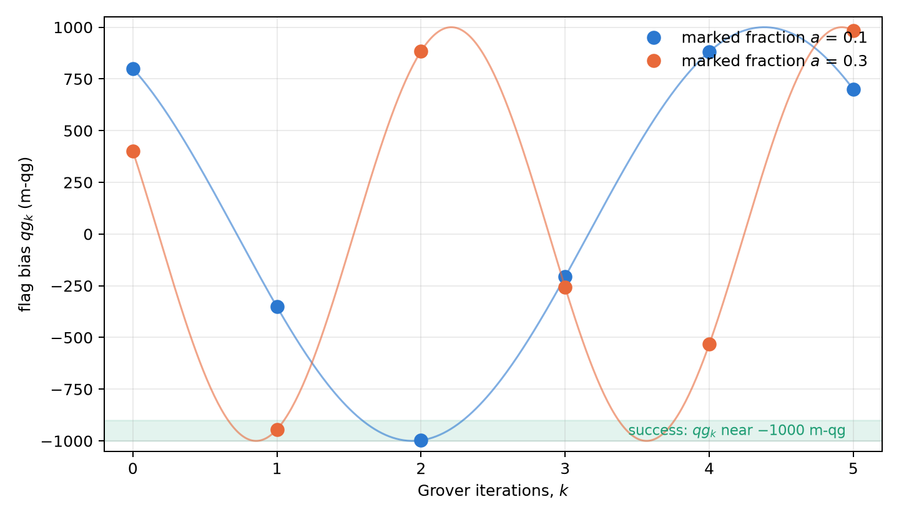

# Reflections, Householder and Grover dynamics {#sec-ch03}

Grover's algorithm is, at heart, a sequence of reflections. Written in qg units, each reflection is an algebraic
matrix in the polar bias, the trajectory of the algorithm is a Chebyshev polynomial and the information each
iteration brings has a closed form. Everything rests on the base of Chapter 1: the transition probability between
two states is a probability like $p_0$, with its own qang angle and m-qg reading, and the bias of Grover's flag is read
on the same scale. This chapter develops that reading and sets it against what happens when the gates are noisy,
where the qg reading loses to the simplest tool.

## Transition matrices without transcendental functions {#sec-transition}

Chapter 2 showed that every single-qubit gate has the transition matrix

$$
T(q)=\begin{pmatrix}\tfrac{1+q}{2}&\tfrac{1-q}{2}\\[0.5ex]\tfrac{1-q}{2}&\tfrac{1+q}{2}\end{pmatrix},
$$

doubly stochastic and rational in $q$. By construction it is *unistochastic*: it comes from a unitary. Its
composition shows the difference between classical probability and quantum amplitude. Two classical channels with
biases $q_1$ and $q_2$ compose by multiplication: $T(q_1)T(q_2)=T(q_1q_2)$. Two successive quantum rotations instead give

$$
q_{12}=\cos(\theta_1+\theta_2)=q_1q_2-\sqrt{(1-q_1^2)(1-q_2^2)} .
$$

The term $-\sqrt{(1-q_1^2)(1-q_2^2)}$ is the interference: the transverse part of each state, invisible in $T$, adding
up in amplitude. With $q_1=0.3$ and $q_2=-0.5$, the classical composition gives $-0.15$ and the quantum one $-0.976$:
in milli-qang, $-150$ against $-976$, an interference of 826 m-qg, close to half the scale. The transition matrix
describes each gate on its own, but not the sequence: that needs the phases.

## The Householder reflector in qg space {#sec-householder}

A reflection with respect to the state $|\psi\rangle$ is the Householder operator $I-2|\psi\rangle\langle\psi|$. For
$|\psi(q)\rangle=\sqrt{\tfrac{1+q}{2}}|0\rangle+\sqrt{\tfrac{1-q}{2}}|1\rangle$ it is

$$
H(q)=I-2|\psi(q)\rangle\langle\psi(q)|=-q\,\sigma_z-\sqrt{1-q^2}\;\sigma_x ,
$$

a Hermitian, unitary matrix with $H(q)^2=I$, whose coefficients are the state's own qg values: $q$ on $\sigma_z$ and
its transverse part $\sqrt{1-q^2}$ on $\sigma_x$ (§166). On the Bloch sphere it is the rotation by $\pi$ about the axis
of the state, together with an overall sign change.

## The Grover diffuser as a qg reflection {#sec-diffuser}

The Grover diffuser reflects about the initial state: $D=2|\psi\rangle\langle\psi|-I$. Comparing with the previous
section,

$$
D(q)=-H(q)=q\,\sigma_z+\sqrt{1-q^2}\;\sigma_x .
$$

In the two-dimensional plane of the algorithm (the "good" state being searched for and the "bad" one, its
complement), the oracle is the reflection about the bad axis and the diffuser the reflection about the initial state.
The product of two reflections is a rotation by twice the angle between their axes: that is the whole of Grover's
dynamics.

## Transition probability between qg states {#sec-ptransition}

The fidelity of two pure states is written with their qg vectors $\mathbf r=(qg_X,qg_Y,qg_Z)$:

$$
|\langle\psi_1|\psi_2\rangle|^2=\frac{1+\mathbf r_1\cdot\mathbf r_2}{2}.
$$

If the two states share a meridian (the same azimuthal phase), it depends on the polar biases alone:

$$
P(q_1\to q_2)=\frac{1+q_1q_2+\sqrt{(1-q_1^2)(1-q_2^2)}}{2}.
$$

The condition matters: with different azimuths the polar biases are not enough and the full transverse part is
needed. The formula was checked against the inner product on 200 random pairs (§166).

**The transition probability in the equation of Chapter 1.** $P$ is a probability, so it has its own qang readings.
If $\gamma$ is the angle between the two Bloch vectors, $\mathbf r_1\cdot\mathbf r_2=\cos\gamma$ and $P=\cos^2(\gamma/2)$: it is
Born's rule with $\gamma$ in place of $\theta$. Therefore

$$
2\arccos\sqrt P=\gamma,\qquad m_P = 2000\,P-1000 = 1000\;\mathbf r_1\cdot\mathbf r_2\ \text{m-qg}:
$$

the qang angle of the transition probability is the angle between the states, and its milli-qang reading is a
thousand times the dot product of their qg vectors. It is Chapter 1's Wootters statistical distance applied to two
states (@sec-equation). With $q_1=0.3$ and $q_2=-0.5$ on the same meridian, $P=0.838$, $m_P=+676$ m-qg and
$\gamma=0.828$ rad, which is exactly $|\theta_1-\theta_2|=|\arccos 0.3-\arccos(-0.5)|$.

## The Grover trajectory as a Chebyshev polynomial {#sec-chebyshev}

Let $a=\sin^2 t$ be the fraction of good states, read with a flag qubit whose initial bias is $qg_0=1-2a=\cos 2t$. Each
iteration advances the amplitude angle by $2t$, so after $k$ iterations the angle is $(2k+1)t$ and

$$
qg_k=\cos\big((2k+1)\,2t\big)=T_{2k+1}(qg_0),
$$

with $T_m$ the Chebyshev polynomial of the first kind, $T_m(\cos x)=\cos mx$ (§37). By the probability equation, the
success probability is $P_k=(1-qg_k)/2$, and certain success is the pole at $-1000$ m-qg. For instance, with $a=0.1$,
$qg_0=0.8$ and the successive iterations give $+800$, $-352$, $-997$ and $-206$ m-qg: the bias crosses the pole at
$k=2$ ($P_2=0.9986$) and then moves away (@fig-grover).

{#fig-grover width=90%}

The Chebyshev structure yields for free the one-shot Fisher information at depth $m=2k+1$. Since $T_m'=mU_{m-1}$ and
$1-T_m^2=(1-q^2)U_{m-1}^2$,

$$
F_m=\frac{m^2}{1-qg_0^2}:
$$

depth multiplies the qg information of Chapter 1 by $m^2$, uniformly along the fringe. It is the qg form of the known
factor $4m^2$ for the angle (Suzuki and co-workers, 2020). On the milli-qang scale, the resolution on $qg_0$ with $N$
shots at depth $m$ is $1000\sqrt{1-qg_0^2}/(m\sqrt N)$ m-qg: with $a=0.1$ and 100 shots, 60 m-qg without iterating and
12 m-qg at depth $m=5$.

## Analytic limits: coarse angles and overshoot {#sec-limits}

The optimal number of iterations is $k^\ast=\operatorname{round}\!\big(\tfrac{\pi}{4t}-\tfrac12\big)$. When the searched
fraction $a=M/N$ is small, $t$ is small, $k^\ast\approx\tfrac{\pi}{4}\sqrt{N/M}$ and the rounding hardly matters. When
$M/N$ is not negligible, the angle per iteration is *coarse*: the bias jumps in large steps along the curve
$\cos((2k+1)2t)$ and can overshoot the pole. Iterating more does not help; it hurts, because the rotation keeps going.
The qg reading makes this behaviour visible: $qg_k$ samples a cosine at odd points. With $a=0.3$, $k^\ast=1$ gives
$-944$ m-qg ($P=0.972$) and one more iteration jumps to $+884$ m-qg ($P=0.058$), the orange curve of @fig-grover.

### Grover with noise

With noisy gates the picture changes, and it is worth recording as it came out (§63). In searches on 4 to 6 qubits,
with each multi-controlled Z compiled to 14, 36 and 84 CNOTs and depolarizing noise on every CNOT:

- **Noise moves the best iteration earlier and eats the speed-up.** With $n=6$ and $p_2=0.005$ the best iteration
  drops from 4 to 1 and the cost per verified success rises from 6.1 to 27.6 oracle calls, against 32 for classical
  search.
- **The qg formula fails under gate noise.** If the unmarked outcomes were uniform, each qubit would have
  $qg_{Z,i}=\pm(NP-1)/(N-1)$, and the signs would give the answer and the magnitude the success probability without
  knowing it. Depolarizing noise is not uniform after the diffuser, and the label-free estimate was worse than the
  frequency of the most common outcome in every case.
- **Reading the answer from signs loses.** With $n=5$, 100 shots find the marked item 66% of the time with the qg
  signs and 91% with the most frequent bitstring.

The honest balance: in Grover search the outcome histogram is a better estimator than the per-qubit qg reading. qg
provides the Chebyshev picture and the information factor, not a better estimator.

## Amplitude estimation {#sec-amplitude}

Where the Chebyshev structure does pay off is in *amplitude estimation*: using increasing depths to estimate $a$ with
fewer oracle queries than direct sampling. With maximum-likelihood estimation (depths 0, 1, 2, 4, …, 100 shots each),
without noise, the error falls as queries$^{-0.93\ldots-1.12}$ against queries$^{-0.5}$ for Monte Carlo, and is 8.4–9.3
times lower at 26 200 queries (§37).

Noise sets limits. With depolarization $p=0.01$ per iteration, a likelihood that ignores the noise ends worse than
Monte Carlo ($6.8\cdot10^{-3}$ against $2.7\cdot10^{-3}$), while one that includes it keeps a 4× advantage. With
$p=0.05$, not even the noise-aware likelihood beats Monte Carlo: beyond a depth of order $1/p$ the iterations carry
almost no signal.

On IonQ's calibrated noisy simulator (3 qubits, $a=0.3$, 36 000 queries), the estimate was accurate, with an RMS
error of 0.0005–0.0015 and a fitted visibility of 0.965–0.985 per iteration, and 7 to 30 times better than a realistic
Monte Carlo, whose depth-zero circuit is biased by the device noise (§39).

## Without qang and with qang {#sec-comparison03}

| action | without qang | with qang | difference |
|---|---|---|---|
| transition probability between two states | $\lvert\langle\psi\vert\phi\rangle\rvert^2$ | $(1+\mathbf r_1\cdot\mathbf r_2)/2$, with qang angle equal to the angle between the states and reading $1000\,\mathbf r_1\cdot\mathbf r_2$ m-qg | **none in value**; qang makes it geometric |
| Grover trajectory | $\sin^2((2k+1)\theta_0)$ | $qg_k=T_{2k+1}(qg_0)$, success at $-1000$ m-qg | **equivalent**; the Chebyshev form shows that the m-qg resolution improves by a factor $m$ with depth |
| read the search with noise | bit-string histogram | per-qubit qg reading | **against**: the qg reading loses to the histogram |
| estimate an amplitude with noise | maximum likelihood on counts | the same, with the noise written into the qg likelihood | **in favour** up to a depth near $1/p$, not beyond |

: The chapter's actions without the qang scale and with it. {#tbl-comparison03}

**Balance.** The chapter's identities are exact, but none gives a number that the usual amplitude does not. The only
comparison with real noise in the chapter is unfavourable to the qg reading, and it is written down as such.

## In code {#sec-code03}

```python
from qang import algebra, probability

algebra.householder_qg(0.45)        # -0.45 Z - 0.893 X, a reflection: H @ H = I
algebra.grover_diffuser_qg(0.45)    # +0.45 Z + 0.893 X
P = algebra.transition_probability(0.3, -0.5)        # 0.838, same meridian
algebra.transition_probability(0.3, -0.5, 0.0, 1.2)  # different azimuths
probability.readings_from_p0(P)     # theta = 0.828 rad (the angle between the states), +676 m-qg
```

## Summary {#sec-summary03}

- The transition matrix of a gate is rational in $q$, but it does not compose like the gate: the difference between
  $q_1q_2$ and $\cos(\theta_1+\theta_2)$ is the interference.
- The Householder reflector and the Grover diffuser are $\mp(q\,\sigma_z+\sqrt{1-q^2}\,\sigma_x)$.
- The transition probability between two states is $(1+\mathbf r_1\cdot\mathbf r_2)/2$; on a common meridian it depends on
  the polar biases alone. Read with the equation of Chapter 1, its qang angle is the angle between the states and its
  reading is $1000\,\mathbf r_1\cdot\mathbf r_2$ m-qg.
- The Grover trajectory is $qg_k=T_{2k+1}(qg_0)$, with certain success at $-1000$ m-qg, and the Fisher information at
  depth $m$ is $m^2/(1-qg_0^2)$: the m-qg resolution improves by a factor $m$.
- With noise, the per-qubit qg reading loses to the histogram in search; in amplitude estimation the advantage holds
  if the noise enters the likelihood, and ends near depth $1/p$.
