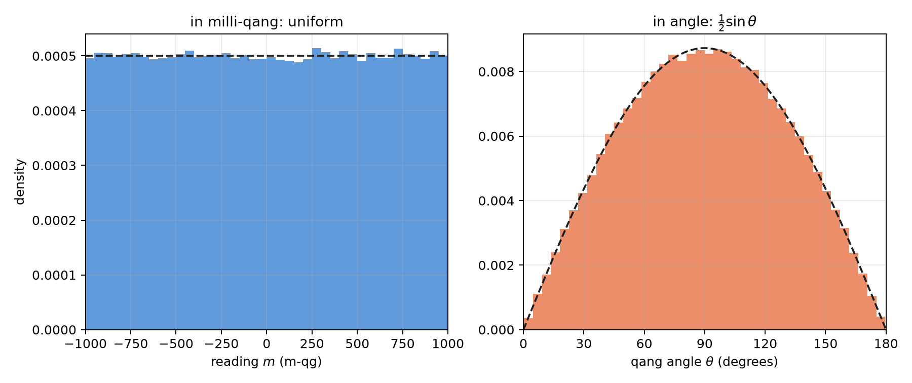
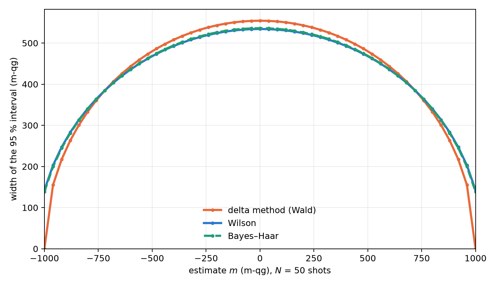

# Sampling statistics, Bayesian inference and the Haar distribution {#sec-ch04}

Every number a quantum processor delivers is an estimate made from a finite number of shots. This chapter gathers
the statistical tools of the qg unit: how shot noise propagates, which prior is the natural one for an unknown qubit,
how to build intervals that do not collapse near the poles, how to correct the bias of quadratic quantities and how
many shots to plan for. All of them rest on the base of Chapter 1: what is estimated is always the probability $p_0$,
and since the milli-qang is linear in it, every interval and every shot plan is stated directly in m-qg. It closes with
the mathematical foundation that explains why $qg_Z$ is the canonical read-out.

## Propagating shot noise {#sec-delta}

With $N$ shots and $k_0$ outcomes 0, the natural estimator is $\widehat{qg}_Z=2k_0/N-1$. It is unbiased and its
variance is exactly

$$
\operatorname{Var}(\widehat{qg}_Z)=\frac{1-qg_Z^2}{N}=\frac{\sin^2\theta}{N},
$$

which attains the Cramér–Rao bound for the parameter $qg_Z$: no unbiased estimator does better with the same
information. In milli-qang it is the resolution $\sigma_m=1000\sqrt{1-qg_Z^2}/\sqrt N$ of Chapter 1 (@fig-noise). Propagated to the angle by the delta method, the variance becomes constant, $\operatorname{Var}(\hat\theta)
\approx1/N$, as seen in Chapter 1 (§5). The two statements are compatible: $qg_Z$ is the *curved* coordinate, with
Fisher information $1/(1-qg_Z^2)$ per shot, and $\theta$ the *flat* one, with information 1 (Chapter 23).

The delta method is a first-order approximation and fails where the derivative vanishes. Near a pole,
$\widehat{qg}_Z$ is exactly $\pm1$ in a sizeable fraction of experiments, and the estimated standard error
$\sqrt{(1-\widehat{qg}_Z^2)/N}$ becomes zero: the interval collapses exactly where the state is most extreme.

## The Haar distribution in qg space {#sec-haar}

What is known about a qubit before it is measured? If its state is "any state", the natural distribution is the Haar
measure, the only one invariant under rotations. In qg units it takes a remarkable form: **$qg_Z$ is uniform on
$[-1,1]$**. This is Archimedes' hat-box theorem: the area of a band of the sphere between two latitudes is
proportional to the difference of heights, not of angles. It was checked on 200 000 Haar states (§15).

The statistical consequence is direct. A uniform prior on $qg_Z$ is equivalent to $p_0\sim\mathrm{Beta}(1,1)$, and
with $k_0$ zeros in $N$ shots the posterior is

$$
p_0\mid k_0\ \sim\ \mathrm{Beta}(k_0+1,\ N-k_0+1),
$$

from which a credible interval for $qg_Z=2p_0-1$ follows with a beta function alone (`bayes_qg_estimate`, implemented
without external dependencies and checked against `scipy.stats.beta`).

The probability equation of Chapter 1 explains why this prior is so simple. Since $m=2000\,p_0-1000$ is linear, a
distribution uniform in $qg_Z$ is uniform in milli-qang and uniform in $p_0$: the three statements are one. In the
angle, by contrast, the same measure has density $\tfrac12\sin\theta$ and piles up at the equator (@fig-haar). The
"uninformative" prior depends on the scale it is written in, and Haar's is flat exactly on the scale that is measured.

{#fig-haar width=100%}

## Exact intervals near the poles {#sec-intervals}

The comparison with 50 shots shows where the choice of interval matters (§15):

| case | delta method | Wilson | Bayes–Haar |
|---|---|---|---|
| near a pole ($\theta=0.08$): coverage of the 95% interval | 7.6% | 92.4% | 92.4% |
| Haar-random states: coverage | 89.8% | 95.1% | 94.9% |

: Coverage of 95% intervals with 50 shots. {#tbl-coverage}

Near the pole the delta method covers the true value in fewer than one experiment in ten; Wilson and the Haar
posterior recover the nominal coverage. On Haar states the posterior mean has a 4% lower mean squared error than the
raw frequency.

@fig-intervals shows the cause in milli-qang. With 50 shots, the width of the delta-method interval drops to zero at
the ends of the scale: with 50 zeros in 50 shots it gives $[+1000,+1000]$ m-qg, an interval with no width. With 48
zeros it gives $[+811,+1029]$ m-qg, which runs off the top of the scale. Wilson gives $[+731,+978]$ and Bayes–Haar
$+885$ $[+731,+975]$ m-qg: widths that do not collapse and stay inside $[-1000,+1000]$.

{#fig-intervals width=90%}

The honest reading of the table has two parts. The Haar prior repairs the collapse of the delta method and has a
clean geometric justification; but the Wilson interval, standard in statistics, achieves the same coverage, and the
gain over good frequentist practice is in the point estimate and is modest. **The qg unit does not reduce the number
of shots a given precision requires**; what it brings is making the cost explicit and choosing the interval well.

## Second-order unbiased estimators {#sec-qg2}

Quadratic quantities have a systematic bias. The plug-in estimator $\widehat{qg}^{\,2}$ overestimates $qg^2$ by
$(1-qg^2)/N$, because shot noise always adds variance. The correction is exact:

$$
\widehat{qg^2}=\frac{N\,\widehat{qg}^{\,2}-1}{N-1},\qquad \mathbb E\big[\widehat{qg^2}\big]=qg^2 ,
$$

valid for $N\ge2$ (`qg2_unbiased`). It can go negative when $qg\approx0$, the price of being unbiased. With $N=20$ and
$qg=0.6$, the plug-in estimator averages 0.390 and the corrected one 0.358, against the true value 0.36.

It matters because the Bloch radius of Chapter 5, $r^2=qg_X^2+qg_Y^2+qg_Z^2$, is a sum of squares: without the
correction each axis adds its bias, and an entangled state looks purer than it is (§97). The same correction enters
the reading of the gravitational redshift with two clocks (§126, Chapter 8).

## Planning the shots {#sec-plan}

The inverse relation, how many shots a given error needs, is the one used when preparing an experiment. `plan_shots`
turns a target standard error of the filtered $qg_Z$ into shots and estimated processor seconds, taking into account
the fraction of shots the filter will keep (§143). For a target of 0.02 (20 m-qg) on two circuits per device it
planned 3000–3400 shots, and over 30 repetitions the error of the worst qubit was 0.021–0.023 (21–23 m-qg): the plan
held. For reference, Chapter 1's formula without the filter gives $N=(1000\sin\theta/\delta)^2=2500$ shots for 20 m-qg
on the equator; the plan asks for more because it discounts the shots the filter will discard.

The per-qubit prediction, however, was 1.4–1.6 times optimistic on average, and its analysis is instructive: the
qubits that missed were those near a pole ($|qg|>0.8$, with ratios of 2.4–3.1), whose $qg_Z$ the noise pulls away from
$\pm1$ and whose real variance is larger than the ideal one. The plan uses the worst qubit and therefore holds; the
safe option, assuming no value of qg, is to plan for the worst case, $qg=0$.

## Few-shot tomography and classical shadows {#sec-tomography}

The full Bloch vector is $(qg_X,qg_Y,qg_Z)$, one per measurement axis. With 10 shots per axis, six estimators were
compared on 2000 states (§35). The qg version applies the Haar prior axis by axis, $\hat r_a=(2k_a-N)/(N+2)$, and
projects onto the ball:

| ensemble | linear inversion | LI + projection | max. likelihood | **qg-Haar** | Jeffreys |
|---|---|---|---|---|---|
| Haar pure | 0.203 | 0.157 | 0.150 | 0.165 | 0.159 |
| uniform mixed | 0.247 | 0.211 | 0.210 | **0.185** | 0.196 |
| pure near a pole | 0.199 | 0.159 | 0.109 | 0.163 | 0.159 |
| strongly mixed ($|r|<0.3$) | 0.298 | 0.293 | 0.293 | **0.208** | 0.245 |

: Mean squared Bloch-vector error with 10 shots per axis. {#tbl-tomography}

Linear inversion gives unphysical states in 52–88% of the runs on pure states. On mixed states the qg-Haar estimator
is the best closed form (12–29% below maximum likelihood); on pure states its shrinkage towards the centre is a
mistake, and it loses to maximum likelihood, by up to 50% near a pole. The right prior depends on which states are
expected.

Would *classical shadows* (random Pauli measurements) do better than measuring the bases directly? For the
quantities qang uses, no (§62). With exact per-shot variances on 6-qubit states, shadows need 3–41 times more shots
for the same error: 3.0–4.3× for all the $qg_Z$, 5.8–8.1× for the register-mean weight witness, 9–12.6× for all the
$ZZ$ correlators and 41× for the filtered imbalance. They only match direct measurement when the target is all one-
and two-qubit quantities at once. And the shot-level filter does not exist with shadows: only $3^{-6}=0.14\%$ of the
random shots have every qubit measured in $Z$.

## The foundation: Riesz–Fréchet {#sec-riesz}

A conceptual question remains: why $qg_Z$ and not some other function of the populations? The operators of an
$n$-qubit register form a finite-dimensional Hilbert space under the Hilbert–Schmidt product
$\langle A,B\rangle=\operatorname{Tr}(A^\dagger B)$, and density matrices live in it. The Riesz–Fréchet representation
theorem says that every continuous linear functional $f$ on a Hilbert space has the form $f(x)=\langle y_f,x\rangle$ for a
unique $y_f$; in finite dimension continuity is automatic and the theorem reduces to linear algebra (Appendix F).

The application is immediate. $\rho\mapsto qg_Z(\rho)=\operatorname{Tr}(\rho\,\sigma_z)$ is linear in $\rho$, so it has a
unique representative, $\sigma_z$. Every linear read-out of a state (an expectation value, a population, a per-shot
average) has that form, and $qg_Z$ is the one whose representative is the $Z$ observable. By contrast,
$qg_S(\rho)=H(\langle0|\rho|0\rangle)$ is strictly concave in $\rho$: no operator represents it. Two properties already seen
follow from this structural fact: linear functionals have unbiased sample-mean estimators and the entropy does not
(Jensen's inequality), and the identity $qg_S=H((1+qg_Z)/2)$ shows that $qg_S$ carries no information about the state
beyond what the representative of $qg_Z$ already extracts.

The milli-qang inherits this property: $m(\rho)=1000\,\operatorname{Tr}(\rho\,\sigma_z)$ is linear too, with representative
$1000\,\sigma_z$, which is why its estimator is the shot average, without bias. It is the underlying reason Chapter 1
defined the unit on probability and not on angle: $\theta=\arccos(qg_Z)$ is not linear in $\rho$, has no representative
and its direct estimator is biased.

## Without qang and with qang {#sec-comparison04}

| action | without qang | with qang | difference |
|---|---|---|---|
| confidence interval near a pole | delta method: coverage below 10% | Bayes–Haar, $\mathrm{Beta}(1,1)$: uniform in m-qg, nominal coverage | **in favour of the method, not only of qang**: the Wilson interval, without qang, also recovers it; qang justifies the prior (Haar is uniform in m-qg) |
| quadratic quantities (radii, $qg^2$) | square the estimate: biased upward | $(N\widehat{qg}^{\,2}-1)/(N-1)$ | the **standard unbiased estimator**; qang packages it and applies it in every chapter |
| how many shots to take | binomial variance of the state | $N=(1000\sin\theta/\delta)^2$ to resolve $\delta$ m-qg | **equivalent**; the m-qg formula is the one used for planning |
| measure qang quantities | classical shadows | direct $Z$ measurement | 3–41 times fewer shots, but it is a **measurement choice**, not an effect of the unit |
| justify the reading | — | Riesz–Fréchet: $qg_Z$ is the canonical linear reading | **in favour**: explains why $qg_Z$ is averaged and not the angle |

: The chapter's actions without the qang scale and with it. {#tbl-comparison04}

**Balance.** The chapter's statistics are the classical statistics of proportions. qang contributes the choice of
coordinate (uniform under Haar, linear by Riesz–Fréchet) that says which prior to use and what to average; the
coverage improvement exists without qang too.

## In code {#sec-code04}

```python
import math
from qang import probability, statistics

statistics.bayes_qg_estimate(48, 50)     # Haar posterior: qg_Z 0.885, interval [0.731, 0.975]
statistics.wilson_qg_estimate(48, 50)    # the frequentist alternative
statistics.qg2_unbiased(16, 20)          # qg^2 without the (1 - qg^2)/N bias

probability.analyze(48, 50).milliqang    # (920.0, 730.8, 977.9) m-qg with the Wilson interval
probability.shots_for_resolution(20, math.pi / 2)   # 2500 shots for 20 m-qg on the equator
```

## Summary {#sec-summary04}

- $\widehat{qg}_Z$ is unbiased and attains the Cramér–Rao bound; the delta method collapses near the poles, where its
  m-qg interval loses its width or runs off the scale.
- Under the Haar measure $qg_Z$ is uniform on $[-1,1]$, that is, uniform in milli-qang and in $p_0$; the matching prior
  is $\mathrm{Beta}(1,1)$ and gives exact intervals with a beta function.
- Wilson and Bayes–Haar recover the nominal coverage where the delta method covers less than 10%; neither reduces the
  shots required.
- Quadratic quantities need the correction $(N\widehat{qg}^{\,2}-1)/(N-1)$; without it, Bloch radii are overestimated.
- Planning on the worst qubit meets the target; the qubits near a pole are the ones the noise pulls away most.
- For qang's quantities, measuring directly in $Z$ costs 3–41 times fewer shots than classical shadows.
- $qg_Z$, and with it the milli-qang, is the canonical linear read-out by the Riesz–Fréchet theorem; $qg_S$ and the
  angle are not linear and have no representative.
