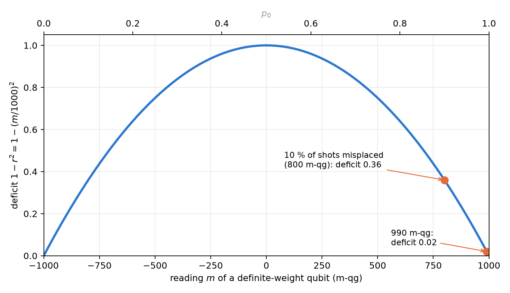
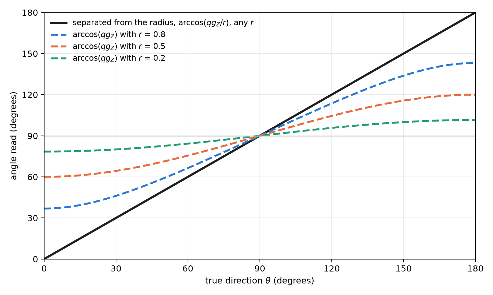
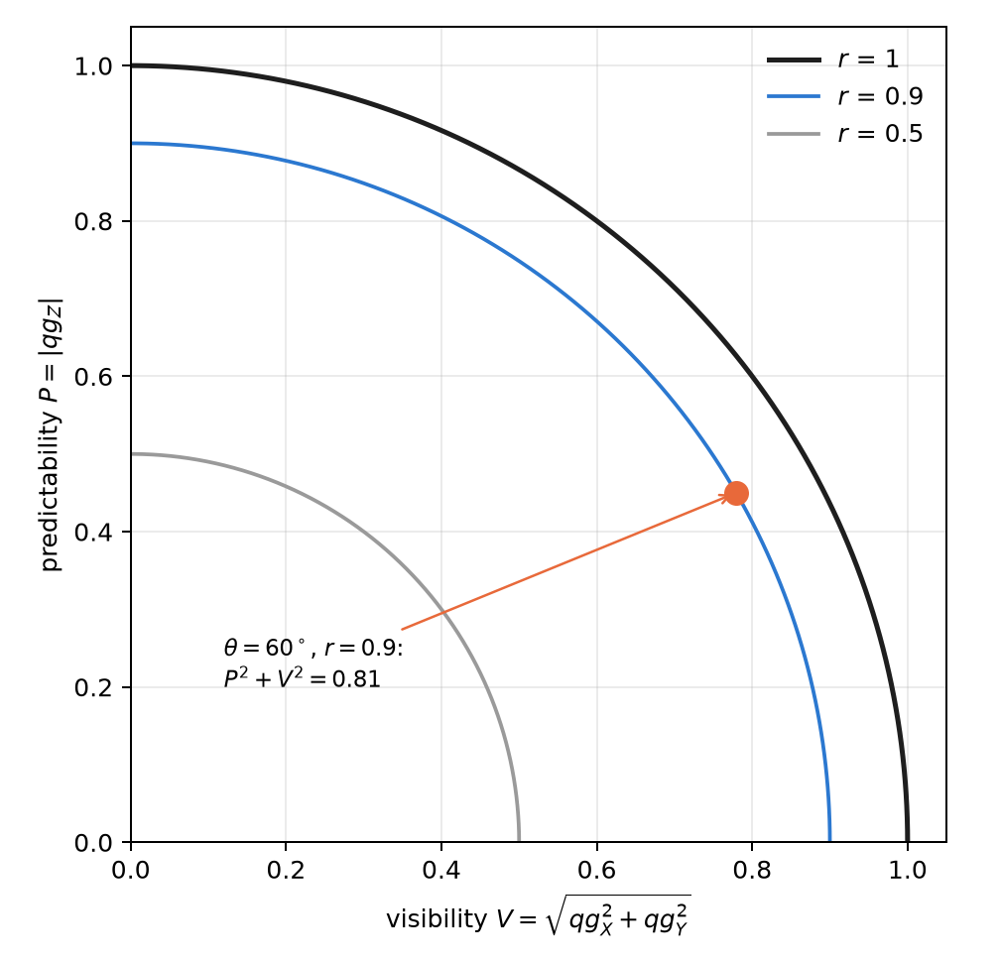

# The local Bloch radius as a measure of purity and entanglement {#sec-ch05}

Part I treated the qubit as a point on the surface of the sphere: a pure state, a probability $p_0$ and its four
readings. A qubit that belongs to a register is almost never pure: it is mixed by noise or by its entanglement with the
others, and it sits *inside* the sphere. This chapter adds to the base of Chapter 1 the missing quantity, the **local
radius** $r$, and shows that the probability equation still holds with a single change: the polar bias is no longer
$\cos\theta$ but $r\cos\theta$. From the radius come an entanglement measure, a way to separate the direction of the
state from its purity, and wave–particle duality, all read in qg units.

## The probability equation with a radius {#sec-radius-equation}

For a qubit in a mixed state, its Bloch vector $(qg_X,qg_Y,qg_Z)$ has length $r\le1$, and Born's rule in the $Z$ basis
reads

$$
p_0=\frac{1+qg_Z}{2}=\frac{1+r\cos\theta}{2}.
$$

It is the probability equation of Chapter 1 with the radius inside: the readings $qg_Z=2p_0-1$ and $m=2000\,p_0-1000$
m-qg do not change, but they no longer fix the angle, because the same $p_0$ can come from a tilted pure state or from a
mixed one closer to the pole. Each axis has its own probability, $p_0^{(a)}$ in the basis $a\in\{X,Y,Z\}$, and the
squared radius is the sum of the three readings squared (§97):

$$
r^2=qg_X^2+qg_Y^2+qg_Z^2=\frac{m_X^2+m_Y^2+m_Z^2}{10^6}=2\operatorname{Tr}\rho^2-1 .
$$

The radius is linear in the purity $\operatorname{Tr}\rho^2$: it is 1 on the surface (pure state) and 0 at the centre
(maximally mixed state). The sphere of radius $r$ has area $4\pi r^2$, and the **surface deficit** $4\pi(1-r^2)$ is
the area the qubit has lost; the library works with $1-r^2$, which carries the same information.

## The deficit as an entanglement measure {#sec-deficit}

If the whole register is in a pure state, all the radius a qubit lacks is due to its entanglement with the rest. Then
$1-r_q^2=4\det\rho_q$ is the *one-tangle* of qubit $q$, which for two qubits is the squared concurrence [@coffman2000], and its mean over the qubits is the global entanglement of @meyer2002:

$$
Q=\frac1n\sum_q\left(1-r_q^2\right).
$$

Two examples set the scale. In the Bell state each qubit sits at the centre of its sphere, $r=0$, and $Q=1$. In the
3-qubit W state each has $r^2=1/9$ and $Q=0.889$. If the global state is mixed, the deficit mixes entanglement and
noise and cannot separate them: the radius measures entanglement only when the register is known, or guaranteed, to be
pure. Reading $r^2$ takes three measurement settings for the whole register (every qubit in $X$, in $Y$ and in $Z$),
not three per qubit.

## The radius under gates and algorithms {#sec-radius-gates}

A single-qubit gate rotates the sphere and preserves the radius, also for mixed qubits. SWAP exchanges the radii of
two qubits. CNOT, CZ, iSWAP, Toffoli and Fredkin can take a qubit of a product input to the centre ($r=0$, from inputs
of the type $|{+}0\rangle$ or $|{+}{+}\rangle$) and can also bring it back to the surface; on computational-basis states they
create no deficit, because they act as classical permutations (§97). In algorithms, the radius of the read-out qubits
says where the answer is:

| algorithm | $r^2$ of the read-out qubits | reading |
|---|---|---|
| Bernstein–Vazirani, constant Deutsch–Jozsa | 1 on every qubit | product output: the local $qg_Z$ is the whole answer |
| Simon ($s=110$) | 0 on every qubit | the answer lies entirely in the correlations |
| Grover ($n=5$), $k=0\ldots4$ | $1\to0.82\to0.66\to0.84\to0.998$ | entangles and disentangles; back to 1 at the optimum |
| counting ($N=16$, $M=3$) | $(1-2M/N)^2=0.39$ | deficit $4(M/N)(1-M/N)=0.61$ |
| QAOA, ring of 4, $p=1$ | 0.25 | the cost lives in $ZZ$ |

: The radius of the read-out qubits in standard algorithms (§97). {#tbl-radius-algorithms}

## Definite weight: the radius from the Z basis {#sec-weight-radius}

In a state of definite Hamming weight every local $qg_X$ and $qg_Y$ is zero, so $r_q=|qg_Z^{(q)}|$ and the radius is
read from $Z$ shots alone. With the probability equation, the deficit becomes

$$
1-r^2=1-\left(\frac{m}{1000}\right)^2=4\,p_0\,(1-p_0):
$$

**four times the binomial variance of the outcome**, the same $p_0(1-p_0)$ that governs the shot noise of Chapter 1.
@fig-deficit shows it on the milli-qang scale. The deficit is zero at the poles, largest on the equator and very
sensitive near a pole: a qubit at 990 m-qg has a deficit of 0.02, and one at 800 m-qg, which is what 10 % of misplaced
shots on a basis state gives, already reads 0.36.

{#fig-deficit width=90%}

This is where the symmetry filter (Chapters 20–21) and the radius meet. Under equal T1 on every qubit the filtered
state is the noiseless pure state, so the filtered deficit is an exact entanglement measure. The predictions were
committed before running (§98); on RBS circuits of 4 and 6 qubits:

| noise | exact error of the deficit, with qang | without qang | filter MSE lower |
|---|---|---|---|
| equal T1 | $<3\cdot10^{-15}$ | 0.061–0.370 | 30 of 30 |
| unequal T1 | 0.013–0.045 | 0.070–0.342 | 30 of 30 |
| dephasing 0.01 | 0.031–0.307 | 0.080–0.352 | 24 of 30 |

: The deficit as an entanglement measure under noise, with and without the qg filter (§98). {#tbl-deficit-noise}

On product states the filtered deficit is exactly 0 under all three noise models, while the raw read-out shows
0.60–0.95 on every excited qubit from decay alone: false entanglement. One prediction failed: the raw error was expected
to be smaller at half filling, and it was larger (0.177 against 0.074), because the first-order cancellation holds only
at exactly $p=1/2$.

On noise models of real devices (three from IBM and two from IonQ, §100), the filter cut the error of the deficit
3.2–4.0× where the deficit is large, but it did not work as a test of "no entanglement": on a product state it removed
only 15–33 % of the false deficit. The cause is the one in @fig-deficit: errors inside the sector leave 10–21 % of
misplaced shots, and near the pole that already reads as 0.36. A small deficit needs an echo calibration before it is
interpreted.

## Direction and radius apart {#sec-direction}

The polar bias $qg_Z=r\cos\theta$ mixes the direction of the vector with its length. The usual reading
$\theta=\arccos(qg_Z)$ drifts towards the equator whenever noise shortens the vector. With the radius the two separate
(§102):

$$
\theta=\operatorname{atan2}\!\left(\sqrt{qg_X^2+qg_Y^2},\,qg_Z\right)=\arccos\frac{qg_Z}{r}.
$$

A state at $30^\circ$ shortened to $r=0.8$ by depolarizing noise has $qg_Z=0.693$: $\arccos(qg_Z)$ reads $46.1^\circ$,
and the separated angle reads the true $30^\circ$. @fig-direction shows the effect for several radii: the naive angle
flattens towards $90^\circ$, and the separated one does not depend on $r$.

{#fig-direction width=90%}

The separation has a cost and does not always win. With the same total number of shots split over three bases:

- **Depolarizing:** the separated angle is exact and $\arccos(qg_Z)$ errs by up to 0.70 rad near the poles; with shots,
  the root-mean-square error drops 5.8×.
- **Dephasing:** this is where it loses. Dephasing does not shorten $qg_Z$, so $\arccos(qg_Z)$ is exact, and the
  separated angle is pulled 0.03–0.12 rad towards the poles.
- **No noise:** measuring three bases costs 1.6× in root-mean-square error.
- **Devices:** on the IBM models the vector shrinks almost uniformly and the separated angle is 5–9× more accurate. On
  IonQ, $\arccos(qg_Z)$ won at first, because the compiler had removed pairs of identical CX gates; in the native gate
  set the separated angle wins there too, 8.7–9.0× (§103).

The practical rule: if the measured radius is close to 1, use $\arccos(qg_Z)$ with all shots in $Z$; if it is clearly
below 1 and the noise is not pure dephasing, use the separated angle.

## Wave–particle duality and entropic uncertainty {#sec-duality}

The radius also orders a classical result of the foundations. The **predictability** $P=|qg_Z|=|m|/1000$ measures how
much is known about the path (particle) and the **visibility** $V=\sqrt{qg_X^2+qg_Y^2}$ measures the contrast of the
interference (wave). Their relation is exactly the radius [@greenberger1988; @englert1996]:

$$
P^2+V^2=r^2\le1 .
$$

The duality inequality is, in qg units, the statement that the state lies inside the sphere, and it is an equality
for pure states (@fig-duality). A state at $60^\circ$ with $r=0.9$ has $P=0.45$, $V=0.779$ and $P^2+V^2=0.81$. It was
checked on 2000 random states with a largest deviation of $2.2\cdot10^{-16}$ (§127).

{#fig-duality width=60%}

The entropic version uses Chapter 1's spread $qg_S$ in two bases. The Maassen–Uffink relation, with the correction of
Berta and co-workers for mixed states, says

$$
qg_S(Z)+qg_S(X)\ \ge\ 1+S(\rho),\qquad S(\rho)=H\!\left(\frac{1+r}{2}\right).
$$

For the state above the sum is 1.349 and the bound 1.286. The bound is tight: the state $|0\rangle$ meets it with
equality. That gives a practical warning. With plain (uncorrected) entropy estimates, a pure state seems to violate the
relation in 93 % of runs at 100 shots, because the estimated entropy is biased downwards; with the Miller–Madow
correction, in 37 %. A test of the bound needs corrected estimators or intervals, like those of Chapter 4.

## Estimating the radius from shots {#sec-radius-shots}

Since $r^2$ is a sum of squares, it inherits the bias of the quadratic estimators of Chapter 4 (@sec-qg2): each axis
adds $(1-qg^2)/N$, and an entangled state looks purer than it is. The exact correction $(N\widehat{qg}^{\,2}-1)/(N-1)$ is
applied axis by axis (`radius2_estimate`), and in a definite-weight state the $Z$ axis is enough.

## Without qang and with qang {#sec-comparison05}

| action | without qang | with qang | difference |
|---|---|---|---|
| measure local purity | tomography in three bases and $\operatorname{Tr}\rho^2$ | $r^2=qg_X^2+qg_Y^2+qg_Z^2$; at definite weight, $1-r^2=4p_0(1-p_0)$ from **a single basis** | **in favour**: one basis instead of three, thanks to the probability equation together with the definite weight |
| measure the entanglement of a pure register | one-tangle and Meyer–Wallach by definition | the deficit $1-r^2$, averaged | **none in value**; with a mixed global state the deficit mixes entanglement and noise, like the one-tangle |
| direction of a noisy state | $\theta=\arccos qg_Z$ | $\theta=\arccos(qg_Z/r)$ | **in favour** with depolarizing noise; **against** with pure dephasing |
| wave–particle duality | visibility and predictability separately | $P^2+V^2=r^2$ | **reformulation**: the same relation |

: The chapter's actions without the qang scale and with it. {#tbl-comparison05}

**Balance.** The practical difference is reading purity at definite weight with a single measurement basis. The rest
are known identities written on the qang scale, and the direction–radius split wins or loses depending on the noise.

## In code {#sec-code05}

```python
import math
import numpy as np
from qang import complementarity, formulation, statistics

bell = np.array([1, 0, 0, 1]) / math.sqrt(2)
formulation.radius_profile(bell, 2)          # [0.0, 0.0]: each qubit at the centre
w = np.zeros(8); w[[1, 2, 4]] = 1 / math.sqrt(3)
formulation.meyer_wallach(w, 3)              # 0.889: global entanglement of the W state
formulation.weight_sector_radius([0.99, 0.8])    # [0.0199, 0.36]: deficit from qg_Z (990 and 800 m-qg)

formulation.direction_from_qg(0.4, 0.0, 0.6928)  # (0.524, 0.0, 0.8): θ = 30° separated from r = 0.8
complementarity.duality_sum(0.779, 0.0, 0.45)    # 0.81 = P² + V² = r²
complementarity.entropic_sum(0.45, 0.779)        # 1.35 ≥ bound 1.29
```

The figures are generated by `tools/make_cap05_figures.py`.

## Summary {#sec-summary05}

- For a mixed state, Chapter 1's probability equation still holds with $qg_Z=r\cos\theta$; the local radius
  $r^2=qg_X^2+qg_Y^2+qg_Z^2=2\operatorname{Tr}\rho^2-1$ is the missing reading.
- If the register is pure, the deficit $1-r^2$ is the one-tangle and its mean is the Meyer–Wallach measure; with a mixed
  global state, it mixes entanglement and noise.
- At definite weight, $1-r^2=4p_0(1-p_0)$ is read in $Z$ alone, and with the filter under equal T1 it is exact; near a
  pole a few misplaced shots inflate it, and on devices a small deficit needs calibration.
- $\theta=\arccos(qg_Z/r)$ separates direction from purity: it wins under depolarizing noise and loses under pure
  dephasing.
- Wave–particle duality is $P^2+V^2=r^2$, and entropic uncertainty bounds $qg_S(Z)+qg_S(X)$ by $1+S(\rho)$.

## Bibliographic notes {.unnumbered}

The one-tangle and the concurrence are from @coffman2000, and global entanglement, from @meyer2002. Wave–particle
duality is @greenberger1988 and @englert1996; entropic uncertainty, @maassen1988 and, with quantum memory, @berta2010.
The Deutsch–Jozsa, Bernstein–Vazirani, Simon and Grover algorithms are @deutsch1992, @bernstein1997, @simon1997 and
@grover1996. The numbered research notes (§) cited in this chapter and the scripts that check it are in the repository
[@qangrepo]; the definition of the qang unit is in @monteverde2026.
