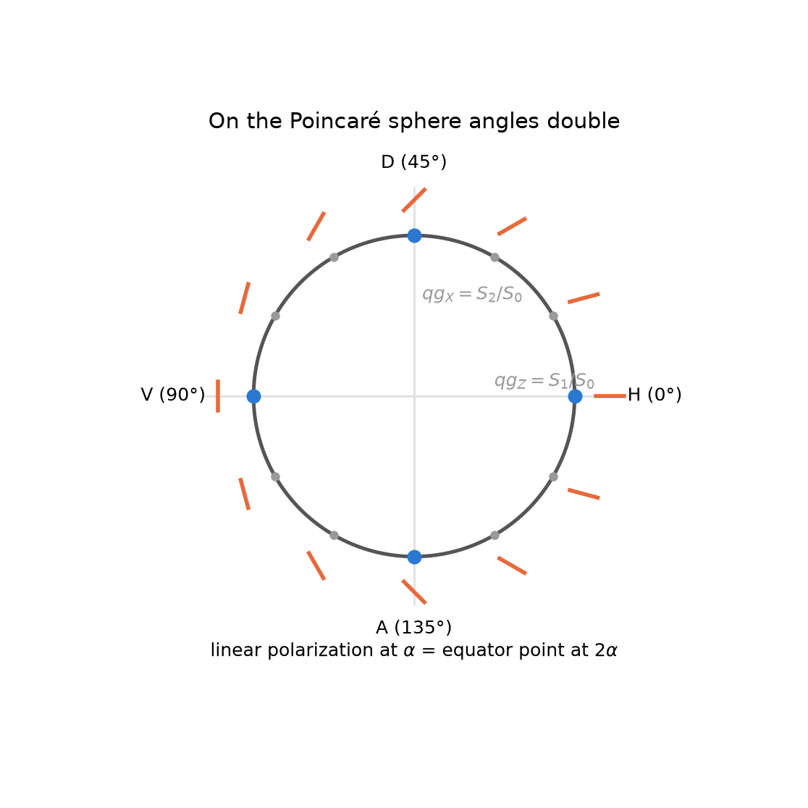
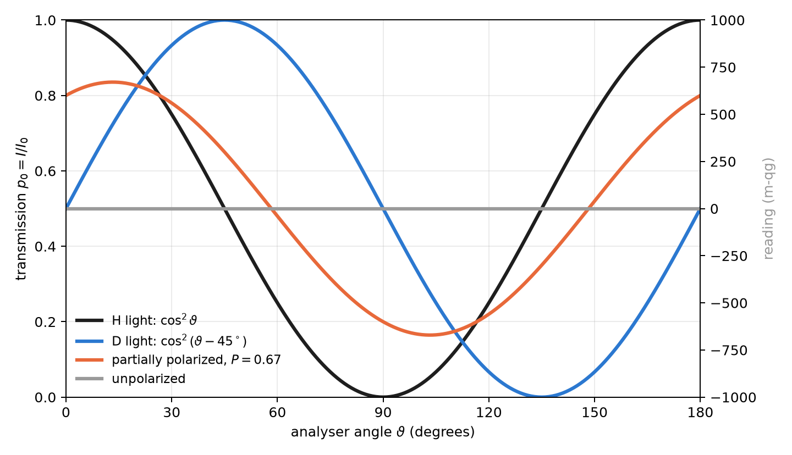
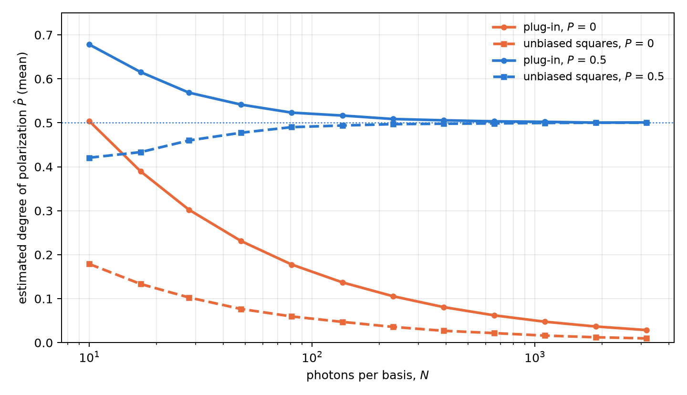

# Optical polarization and Stokes parameters in qg units {#sec-ch06}

The polarization of a photon is a qubit, and classical polarization optics is, unchanged, the physics of a qubit
written with other names. This chapter reads that optics with the base of Chapter 1. The key piece is that a polarizer
is a two-outcome measurement, pass or block, and its transmission is exactly the probability $p_0$ of the qang
equation. From there follow Malus's law, the Stokes parameters, the degree of polarization and photon-counting
polarimetry, all in qg and in milli-qang (§83).

## Malus's law as a probability equation {#sec-malus}

Light linearly polarized at an angle $\alpha$ goes through a polarizer set at $\vartheta$. With $\Delta=\vartheta-\alpha$, the
transmitted fraction is Malus's law, which for a single photon is a probability:

$$
p_0=\cos^2\Delta .
$$

The comparison with Born's rule in Chapter 1, $p_0=\cos^2(\theta/2)$, is immediate: **the qang angle is twice the
physical angle**, $\theta=2\Delta$, and the milli-qang reading is $m=1000\cos2\Delta$. That is why two orthogonal
polarizations, H and V, $90^\circ$ apart in the laboratory, are opposite points of the sphere, $180^\circ$ apart
(@fig-angles). An analyser turned $30^\circ$ from the light transmits $p_0=0.75$: it is the state at $\theta=60^\circ$
and $+500$ m-qg of Chapter 1's qang circle (@fig-circle).

{#fig-angles width=62%}

For light with any polarization, pure or partial, the transmission through a linear polarizer at $\vartheta$ is

$$
p_0=\frac{1+qg_Z\cos2\vartheta+qg_X\sin2\vartheta}{2}=\frac{1+\mathbf r\cdot\mathbf a}{2},
\qquad \mathbf a=(\sin2\vartheta,\,0,\,\cos2\vartheta),
$$

with $\mathbf r=(qg_X,qg_Y,qg_Z)$ the qg vector of the light and $\mathbf a$ that of the state the analyser lets through.
It is Chapter 3's transition probability between two qg vectors (@sec-ptransition), and its milli-qang reading is
$m=1000\,\mathbf r\cdot\mathbf a$. @fig-malus shows four cases: H light ($\cos^2\vartheta$), D light (the same curve shifted
$45^\circ$), unpolarized light (always $\tfrac12$, that is, 0 m-qg) and partially polarized light with $qg_Z=0.6$ and
$qg_X=0.3$. The last transmits 0.80 at $0^\circ$, a maximum of 0.835 at $13.3^\circ$ and a minimum of 0.165 at
$103.3^\circ$; the difference between maximum and minimum, 0.671, is its degree of polarization.

{#fig-malus width=90%}

## The Stokes parameters are qg values {#sec-stokes}

The Poincaré sphere is the Bloch sphere. With $|H\rangle=|0\rangle$ and $|V\rangle=|1\rangle$, the normalized Stokes parameters
are the three qg values, each the difference of the two probabilities of an analyser:

| qg value | Stokes | analyser | reading |
|---|---|---|---|
| $qg_Z$ | $S_1/S_0$ | H / V | $p_H-p_V$ |
| $qg_X$ | $S_2/S_0$ | D / A, at $\pm45^\circ$ | $p_D-p_A$ |
| $qg_Y$ | $S_3/S_0$ | R / L, circular | $p_R-p_L$ |

: The normalized Stokes parameters as qg values (§83). {#tbl-stokes}

The convention for right circular light varies between texts; here $R=(|H\rangle+i|V\rangle)/\sqrt2$, so $S_3>0$ means
$qg_Y>0$ (the library takes the opposite convention with `circular_sign=-1`). Since each parameter is $2p_0-1$ in its
own basis, each is expressed in milli-qang with the equation of Chapter 1.

The polarization ellipse is read from the angles of the qg vector, halved: its orientation is
$\psi=\tfrac12\operatorname{atan2}(qg_X,qg_Z)$ and its ellipticity $\chi=\tfrac12\arcsin(qg_Y/P)$. For the partial light of
the example, $\psi=13.3^\circ$: the angle where @fig-malus has its maximum.

## Degree of polarization and purity {#sec-degree}

Partially polarized light is a mixed state. Its degree of polarization is the length of the qg vector, the radius of
Chapter 5 (@sec-radius-equation):

$$
P=\sqrt{qg_X^2+qg_Y^2+qg_Z^2}=r,\qquad \operatorname{Tr}\rho^2=\frac{1+P^2}{2}.
$$

Unpolarized light sits at the centre of the sphere. An ideal depolarizer has Mueller matrix
$\operatorname{diag}(1,d,d,d)$: it shortens the vector by a factor $d$ and does not change its direction. It is the case in
which Chapter 5 separates direction and radius (@sec-direction): with $d=0.7$, the light of the example goes from
$P=0.671$ to $P=0.470$, and the orientation of its ellipse stays at $13.3^\circ$.

## Lossless elements: the Mueller matrix is the gate rule {#sec-mueller}

A Mueller matrix acts on $(S_0,S_1,S_2,S_3)$; in the order $(I,Z,X,Y)$ it is the Pauli transfer matrix. For a lossless
element, with a unitary Jones matrix $U$, it is exactly qang's gate rule:

$$
qg'_P=qg_{U^\dagger P U}.
$$

Wave plates are single-qubit gates, and Chapter 2 applies as is (@sec-gate-probability): a half-wave plate with its axis
at $22.5^\circ$ takes H to D ($qg_X=1$), because it turns the physical polarization by $45^\circ$ and the point on the
sphere by $90^\circ$; a quarter-wave plate at $45^\circ$ takes H to a circular polarization ($qg_Y=-1$ with the
convention above). The polarizer, by contrast, is not unitary: it is the measurement. All these identities are checked
numerically in `tests/test_polarization.py`.

## Photon-counting polarimetry {#sec-polarimetry}

With weak or single-photon sources, the Stokes parameters are estimated by counting: $n_H,n_V$ in the H/V basis,
$n_D,n_A$ in the diagonal one and $n_R,n_L$ in the circular one. Each pair gives a qg value with its interval, just
like a qubit measurement (Chapter 4). With 1000 photons per basis and counts $(800,200)$, $(650,350)$ and $(500,500)$:

$$
qg_Z=0.599\ [0.548,\,0.647],\quad qg_X=0.299\ [0.240,\,0.358],\quad qg_Y=0.000\ [-0.062,\,0.062],
$$

95 % Bayes–Haar intervals. In milli-qang, $qg_Z$ is $+599$ m-qg with a resolution of
$\sigma_m=1000\sin\theta/\sqrt N=25$ m-qg.

The degree of polarization needs more care. $P$ is the square root of a sum of squares, and each square inherits the
bias $(1-qg^2)/N$ of Chapter 4 (@sec-qg2): with few photons, unpolarized light looks polarized. @fig-degree quantifies
it with a simulation from this chapter (4000 repetitions per point). With unpolarized light, the plug-in estimator
averages $\hat P\approx0.50$ with 10 photons per basis, $0.16$ with 100 and $0.05$ with 1000. Using the unbiased squares
brings it down about three times ($\approx0.18$, $0.055$ and $0.017$), but does not remove it: the square root and the
clipping at zero leave a residual bias. With light of $P=0.5$, the plug-in estimator overestimates at few photons and
the unbiased one slightly underestimates; from about 200 photons per basis both match the true value.

{#fig-degree width=90%}

The practical consequence: to claim that a source is polarized from few photons, one needs an interval for $P$ or a
threshold calibrated with unpolarized light, not the point value.

## Without qang and with qang {#sec-comparison06}

| action | without qang | with qang | difference |
|---|---|---|---|
| transmission of a polarizer | Malus's law, $I=I_0\cos^2\Delta$ | $p_0=\cos^2\Delta$ with $\theta=2\Delta$; reading $1000\,\mathbf r\cdot\mathbf a$ m-qg | **none in value**; qang ties it to the transition probability of Chapter 3 |
| describe the polarization | normalized Stokes parameters $S_1,S_2,S_3$ | they are $qg_Z$, $qg_X$, $qg_Y$ | **identity**: the same numbers under another name |
| degree of polarization with few photons | $\sqrt{S_1^2+S_2^2+S_3^2}$: biased upward | the unbiased squares of Chapter 4 | **in favour**: the bias drops about three times, without vanishing |
| wave plates | Mueller matrices | the gate rule $qg'_P=qg_{U^\dagger PU}$ | **reformulation** |

: The chapter's actions without the qang scale and with it. {#tbl-comparison06}

**Balance.** Polarization optics already works with qg values under another name (Stokes). The measurable difference
is statistical: correcting the squares reduces the bias of the degree of polarization with few photons.

## In code {#sec-code06}

```python
import math
import numpy as np
from qang import polarization as pz

light = {"Z": 0.6, "X": 0.3, "Y": 0.0}
pz.malus_intensity(light, 0.0)                    # 0.80: transmission at 0°
pz.malus_intensity(light, math.radians(13.28))    # 0.835: the maximum, at the orientation of the ellipse

H = np.array([1, 0])
pz.jones_to_qg(pz.half_wave_plate(math.radians(22.5)) @ H)   # {'X': 1.0, ...}: H → D
pz.jones_to_qg(pz.quarter_wave_plate(math.radians(45)) @ H)  # {'Y': -1.0, ...}: H → circular

c = pz.qg_from_counts(800, 200, 650, 350, 500, 500, method="bayes")
c["Z"], c["X"], c["P"]                            # 0.6, 0.3, 0.671 and the intervals in c["intervals"]
```

The figures are generated by `tools/make_cap06_figures.py`.

## Summary {#sec-summary06}

- A polarizer is a two-outcome measurement: its transmission is $p_0=\cos^2\Delta$, Chapter 1's probability equation
  with the qang angle equal to twice the physical one, $\theta=2\Delta$.
- For any light, Malus's law is the transition probability $(1+\mathbf r\cdot\mathbf a)/2$ between the light and the
  analyser; its reading is $1000\,\mathbf r\cdot\mathbf a$ m-qg.
- The normalized Stokes parameters are $qg_Z$, $qg_X$ and $qg_Y$; the ellipse is read from half the angles of the qg
  vector.
- The degree of polarization is the radius of Chapter 5; a depolarizer shortens it without turning the ellipse.
- Wave plates are gates: the lossless Mueller matrix is the rule $qg'_P=qg_{U^\dagger PU}$.
- From photon counts each parameter has its interval; the degree of polarization is biased upwards at few photons,
  and the unbiased squares cut that bias about three times without removing it.

## Bibliographic notes {.unnumbered}

The polarization parameters are those of @stokes1852. Malus's law, the Poincaré sphere and the Mueller calculus follow
the classical treatment of @bornwolf1999. The numbered research notes (§) cited in this chapter and the scripts that
check it are in the repository [@qangrepo]; the definition of the qang unit is in @monteverde2026.
