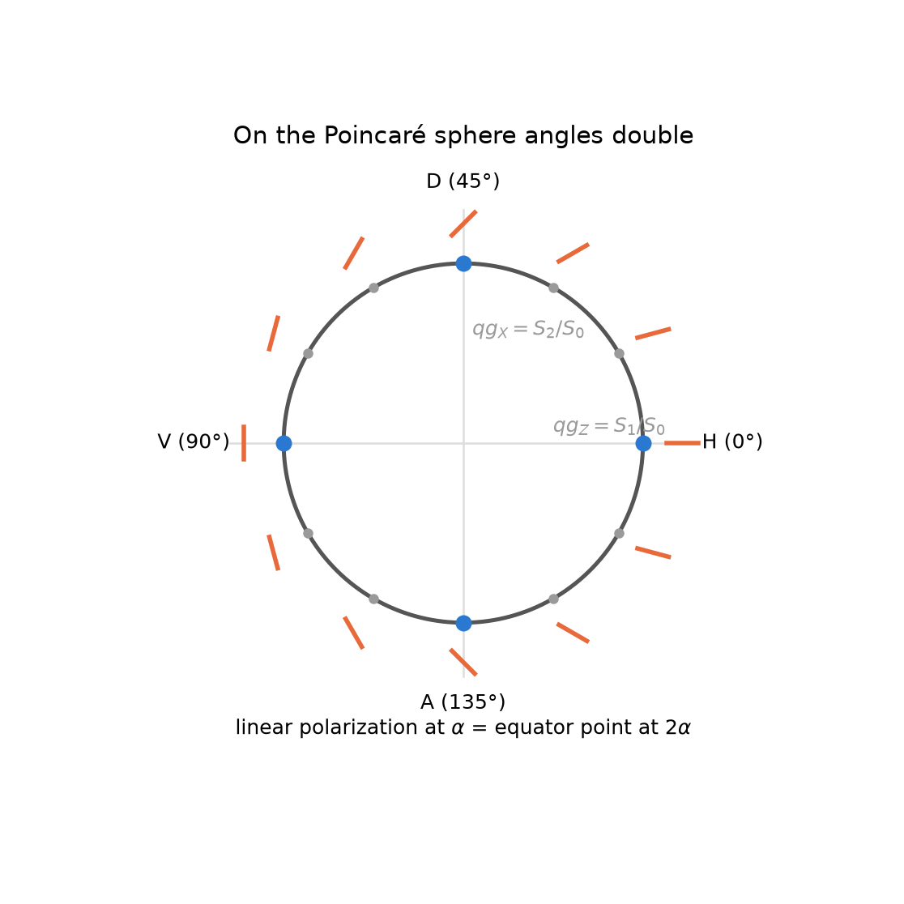
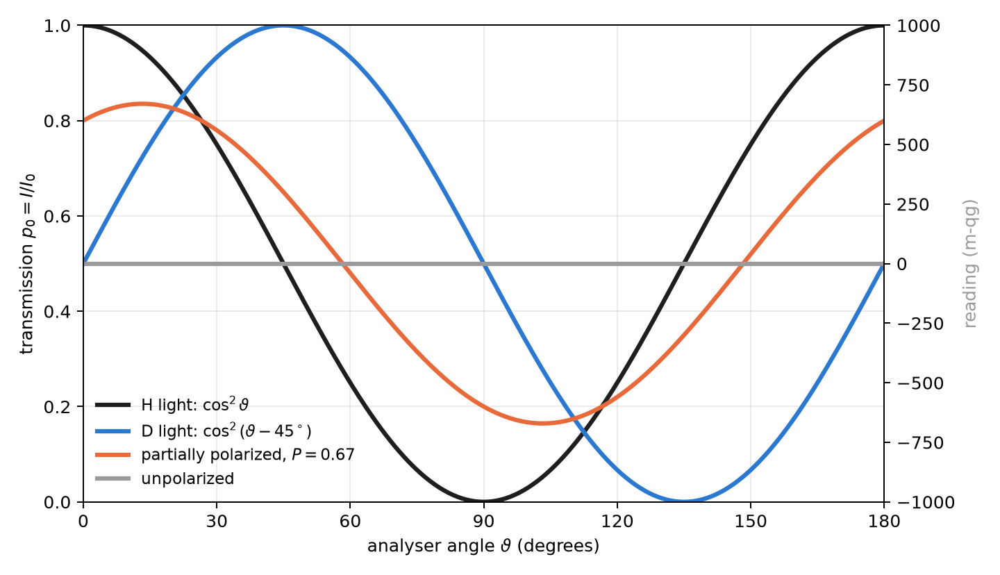
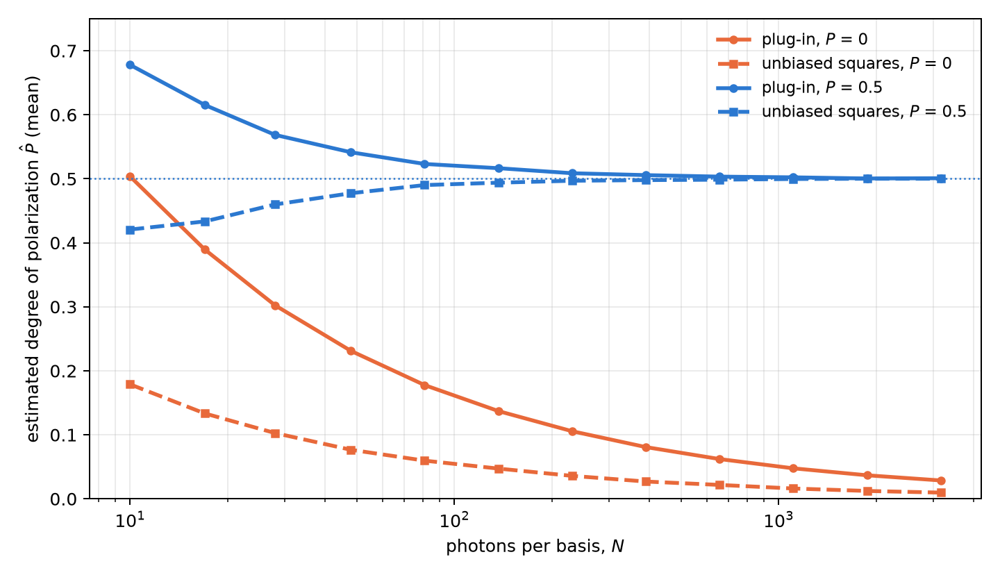

# Optical polarization and Stokes parameters in qg units {#sec-ch06}

**Updated:** November 22, 2026

The polarization of a photon is a qubit, and classical polarization optics is, unchanged, the physics of a qubit
written with other names. Chapters 1 to 5 built that physics from four pieces: the probability equation
$p_0=\cos^2(\theta/2)$ and its reading $qg_Z=2p_0-1$ (Chapter 1), the gate rule and the transition probability between
two qg vectors (Chapters 2 and 3), the statistics of counts (Chapter 4) and the local radius that separates direction
from purity (Chapter 5). This chapter adds no new piece: it shows that the optics laboratory already uses all of them.

The central idea is that a polarizer is a two-outcome measurement, pass or block, and its transmission is exactly the
probability $p_0$ of the qang equation. From there follow, in this order, Malus's law (@sec-malus), the Stokes
parameters (@sec-stokes), the degree of polarization (@sec-degree), Mueller calculus (@sec-mueller) and photon-counting
polarimetry (@sec-polarimetry), all in qg and in milli-qang (§83). Each identity is derived here step by step; the
chapter closes with the balance of what changes and what does not when the qang scale is used (@sec-comparison06).

## The polarized photon as a qubit {#sec-qubit-photon}

**Intuition.** A plane wave travelling in a fixed direction has its electric field in the transverse plane, and that
plane has two dimensions. Two complex amplitudes, one per transverse direction, describe the polarization completely:
that is the definition of a qubit.

**Formalism.** In the horizontal–vertical basis, the Jones vector is

$$
|E\rangle=E_H|H\rangle+E_V|V\rangle,\qquad |H\rangle\equiv|0\rangle,\quad |V\rangle\equiv|1\rangle,
$$

normalized to $\langle E|E\rangle=1$ for one photon. Real light fluctuates, and what is measured are quadratic averages
of the field. Those averages form the coherence matrix, which, normalized by the intensity, is the density operator of
the earlier chapters:

$$
\rho=\frac{\langle\,|E\rangle\langle E|\,\rangle}{\operatorname{Tr}\langle\,|E\rangle\langle E|\,\rangle}
=\frac{1}{2}\left(\mathbb 1+qg_X\,\sigma_x+qg_Y\,\sigma_y+qg_Z\,\sigma_z\right)
=\frac{1}{2}\left(\mathbb 1+\mathbf r\cdot\boldsymbol\sigma\right),
$$

with $\mathbf r=(qg_X,qg_Y,qg_Z)$ the qg vector of the light and $qg_P=\operatorname{Tr}(\rho\,\sigma_P)$, as in
Chapter 5 (@sec-radius-equation).

**Angle doubling.** Light linearly polarized at an angle $\alpha$ from the horizontal is
$|\alpha\rangle=\cos\alpha\,|H\rangle+\sin\alpha\,|V\rangle$. Its qg values are

$$
qg_Z=\cos^2\alpha-\sin^2\alpha=\cos2\alpha,\qquad qg_X=2\sin\alpha\cos\alpha=\sin2\alpha,\qquad qg_Y=0 .
$$

The state lies on the meridian $qg_Y=0$ of the sphere, at polar angle $\theta=2\alpha$: **the qang angle is twice the
physical angle**. That is why two orthogonal polarizations, H and V, $90^\circ$ apart in the laboratory, are opposite
points of the sphere, $180^\circ$ apart, that is, 500 qga (@fig-angles). The doubling is not a convention: rotating a
polarizer by $180^\circ$ leaves it unchanged, while a point on the sphere needs $360^\circ$ to return to its place.

{#fig-angles width=62%}

## Malus's law as a probability equation {#sec-malus}

### Linearly polarized light {#sec-malus-pure}

An ideal polarizer oriented at $\vartheta$ passes the component of the field along its axis and absorbs the
perpendicular one. As an operator it is the projector $\Pi_\vartheta=|\vartheta\rangle\langle\vartheta|$, with
$\Pi_\vartheta^2=\Pi_\vartheta$: it is not a gate, it is a measurement with two outcomes. For linear light at $\alpha$
and $\Delta=\vartheta-\alpha$, the transmitted fraction is

$$
p_0=\lVert\Pi_\vartheta|\alpha\rangle\rVert^2=\lvert\langle\vartheta|\alpha\rangle\rvert^2
=\left(\cos\vartheta\cos\alpha+\sin\vartheta\sin\alpha\right)^2=\cos^2\Delta .
$$

This is Malus's law. For an intense beam it is a fraction of intensity, $I=I_0\cos^2\Delta$; for a single photon it is
a probability. The comparison with the Born rule of Chapter 1, $p_0=\cos^2(\theta/2)$, is immediate: $\theta=2\Delta$,
and the milli-qang reading is

$$
m=1000\,qg_Z=1000\cos2\Delta .
$$

An analyzer turned $30^\circ$ from the light transmits $p_0=0.75$: it is the state of $\theta=60^\circ$ (166.7 qga) and
$+500$ m-qg of the qang circle of Chapter 1 (@fig-circle). Here it is worth recalling the distinction of Chapter 1: the
$60^\circ$ are an angle and are expressed in qga; the $+500$ is a reading, linear in the probability, and is expressed
in m-qg.

### Light of any polarization {#sec-malus-general}

For pure or partially polarized light the transmission is $p_0=\operatorname{Tr}(\rho\,\Pi_\vartheta)$. The projector has
the same form as $\rho$, with the qg vector of the state that the analyzer lets through,

$$
\Pi_\vartheta=\frac12\left(\mathbb 1+\mathbf a\cdot\boldsymbol\sigma\right),\qquad
\mathbf a=(\sin2\vartheta,\,0,\,\cos2\vartheta),
$$

and with $\operatorname{Tr}(\sigma_i\sigma_j)=2\delta_{ij}$ and $\operatorname{Tr}\sigma_i=0$ one gets

$$
p_0=\frac14\operatorname{Tr}\!\left[(\mathbb 1+\mathbf r\cdot\boldsymbol\sigma)(\mathbb 1+\mathbf a\cdot\boldsymbol\sigma)\right]
=\frac{1+\mathbf r\cdot\mathbf a}{2}
=\frac{1+qg_Z\cos2\vartheta+qg_X\sin2\vartheta}{2}.
$$ {#eq-malus-general}

It is the transition probability of Chapter 3 between two qg vectors (@sec-ptransition), and its milli-qang reading is
$m=1000\,\mathbf r\cdot\mathbf a$. The circular component $qg_Y$ does not appear: a linear polarizer, at any
orientation, is blind to it.

**Maximum, minimum and contrast.** With $P_{\text{lin}}=\sqrt{qg_Z^2+qg_X^2}$ and $\tan2\psi=qg_X/qg_Z$, the scalar
product is $\mathbf r\cdot\mathbf a=P_{\text{lin}}\cos(2\vartheta-2\psi)$, so that

$$
p_0^{\max}=\frac{1+P_{\text{lin}}}{2}\ \text{at}\ \vartheta=\psi,\qquad
p_0^{\min}=\frac{1-P_{\text{lin}}}{2}\ \text{at}\ \vartheta=\psi+90^\circ,\qquad
p_0^{\max}-p_0^{\min}=P_{\text{lin}} .
$$

The contrast of the curve as the polarizer turns measures the linear part of the polarization, not the total degree of
polarization; the two coincide only if $qg_Y=0$.

@fig-malus shows four cases: H light ($\cos^2\vartheta$), D light (the same curve shifted by $45^\circ$), unpolarized
light (always $\tfrac12$, that is, 0 m-qg) and partially polarized light with $qg_Z=0.6$ and $qg_X=0.3$. The last one
transmits 0.80 at $0^\circ$, a maximum of 0.835 at $13.3^\circ$ and a minimum of 0.165 at $103.3^\circ$. Since it has no
circular component, the difference between maximum and minimum, 0.671, is its degree of polarization. If $qg_Y=0.4$ is
added to that same light, the curve does not change and the contrast stays at 0.671, but the degree of polarization
rises to 0.781: seeing it takes a quarter-wave plate in front of the polarizer (@sec-mueller).

{#fig-malus width=90%}

## The Stokes parameters are qg values {#sec-stokes}

### Operational definition {#sec-stokes-def}

Stokes defined his four parameters as sums and differences of intensities behind six analyzers:

$$
S_0=I_H+I_V,\qquad S_1=I_H-I_V,\qquad S_2=I_D-I_A,\qquad S_3=I_R-I_L .
$$

Dividing by $S_0$ turns each intensity into a probability, and each difference into a $2p_0-1$ in its own basis. With
$|H\rangle=|0\rangle$ and $|V\rangle=|1\rangle$, the normalized Stokes parameters are then the three qg values, and the
Poincaré sphere is the Bloch sphere:

| qg value | Stokes | analyzer | reading |
|---|---|---|---|
| $qg_Z$ | $S_1/S_0$ | H / V | $p_H-p_V$ |
| $qg_X$ | $S_2/S_0$ | D / A, at $\pm45^\circ$ | $p_D-p_A$ |
| $qg_Y$ | $S_3/S_0$ | R / L, circular | $p_R-p_L$ |

: The normalized Stokes parameters as qg values (§83). {#tbl-stokes}

The first row is the probability equation of Chapter 1. The second is @eq-malus-general evaluated at
$\vartheta=\pm45^\circ$: $p_D-p_A=qg_X$. The third needs the circular basis, and the convention for right circular
changes from one text to another; here $|R\rangle=(|H\rangle+i|V\rangle)/\sqrt2$, so that $S_3>0$ means $qg_Y>0$ (the
library accepts the opposite convention with `circular_sign=-1`). Since each parameter is $2p_0-1$ in its own basis,
each is expressed in milli-qang with the equation of Chapter 1.

### The polarization ellipse {#sec-ellipse}

The tip of the electric field traces an ellipse, with orientation $\psi$ of its major axis and ellipticity $\chi$
($\tan\chi$ is the ratio of the semi-axes). In terms of those two angles, the qg vector is

$$
qg_Z=P\cos2\chi\cos2\psi,\qquad qg_X=P\cos2\chi\sin2\psi,\qquad qg_Y=P\sin2\chi ,
$$

with $P$ the length of the vector (@sec-degree). Inverting,

$$
\psi=\tfrac12\operatorname{atan2}(qg_X,qg_Z),\qquad \chi=\tfrac12\arcsin\frac{qg_Y}{P} .
$$

The ellipse is read with the angles of the qg vector divided by two: it is the doubling of @sec-qubit-photon in both
directions. For the partially polarized light of the example, $\psi=13.3^\circ$, the angle where @fig-malus has its
maximum, and $\chi=0$; with $qg_Y=0.4$ added, $\chi=15.4^\circ$.

A remark on the two spheres. They are the same, but each tradition picks a different pole: optics puts the circular
polarizations at the poles and measures $2\chi$ as latitude; qang puts at the poles the two outcomes of the
measurement, H and V. The qang polar angle of pure light is therefore $\cos\theta=\cos2\chi\cos2\psi$, and it equals
$2\psi$ only for linear light.

## Degree of polarization and purity {#sec-degree}

### The degree of polarization is the radius {#sec-degree-radius}

Partially polarized light is a mixed state. Its degree of polarization is the length of the qg vector, the radius of
Chapter 5 (@sec-radius-equation):

$$
P=\sqrt{qg_X^2+qg_Y^2+qg_Z^2}=r,\qquad \operatorname{Tr}\rho^2=\frac{1+P^2}{2}.
$$

The second equality follows from $(\mathbf r\cdot\boldsymbol\sigma)^2=P^2\,\mathbb 1$:

$$
\operatorname{Tr}\rho^2=\frac14\operatorname{Tr}\!\left[\mathbb 1+2\,\mathbf r\cdot\boldsymbol\sigma+P^2\,\mathbb 1\right]
=\frac{2+2P^2}{4}.
$$

The eigenvalues of $\rho$ are $(1\pm P)/2$, and with $\mathbf n=\mathbf r/P$ the spectral decomposition rearranges as

$$
\rho=P\,\frac{\mathbb 1+\mathbf n\cdot\boldsymbol\sigma}{2}+(1-P)\,\frac{\mathbb 1}{2} :
$$

a fraction $P$ of fully polarized light in direction $\mathbf n$ and a fraction $1-P$ of unpolarized light. It is the
classical decomposition of optics, and here it is the reading of $r$ as a radius: unpolarized light is at the center of
the sphere, fully polarized light on its surface.

### The depolarizer separates direction and radius {#sec-depolarizer}

An ideal depolarizer has Mueller matrix $\operatorname{diag}(1,d,d,d)$: it shortens the vector by a factor $d$ and does
not change its direction. It is the case in which Chapter 5 separates direction and radius (@sec-direction): with
$d=0.7$, the light of the example goes from $P=0.671$ to $P=0.470$, and the orientation of its ellipse stays at
$13.3^\circ$. The polar bias, in contrast, falls from 0.60 to 0.42, and the naive reading $\arccos(qg_Z)$ goes from
$53.1^\circ$ to $65.2^\circ$: a false broadening of $12^\circ$ attributable to noise. The separated angle
$\arccos(qg_Z/P)=26.57^\circ$ (73.8 qga on the scale of Chapter 1) does not change.

| reading | before | after $d=0.7$ | does it change? |
|---|---|---|---|
| degree of polarization $P$ | 0.671 | 0.470 | yes: it is what the depolarizer does |
| polar bias $qg_Z$ | 0.60 (600 m-qg) | 0.42 (420 m-qg) | yes |
| naive angle $\arccos(qg_Z)$ | $53.1^\circ$ | $65.2^\circ$ | yes: $12^\circ$ false |
| separated angle $\arccos(qg_Z/P)$ | $26.57^\circ$ (73.8 qga) | $26.57^\circ$ (73.8 qga) | no |
| ellipse orientation $\psi$ | $13.3^\circ$ | $13.3^\circ$ | no |

: A depolarizer on the light of the example: which readings mix direction and purity. {#tbl-depolarizer}

### Complementarity {#sec-complementarity06}

The predictability in the H/V basis, $P_Z=\lvert qg_Z\rvert$, says how much can be anticipated about whether the photon
will pass a horizontal polarizer. The fringe visibility in the transverse bases, $V=\sqrt{qg_X^2+qg_Y^2}$, says how
much coherence is left between H and V. By the definition of $P$, they satisfy exactly

$$
P_Z^2+V^2=P^2\le1 .
$$

The Greenberger–Yasin–Englert inequality is here the condition that the Stokes vector lie inside the Poincaré sphere,
with equality for fully polarized light.

The entropic version uses the measurement entropy $qg_S$ of Chapter 1. The H/V and R/L bases are mutually unbiased, so
the Maassen–Uffink bound is 1 bit; for a mixed state the entropy of the state itself is added [@berta2010], which by
the eigenvalues $(1\pm P)/2$ is $S(\rho)=H\big((1+P)/2\big)$:

$$
qg_S(Z)+qg_S(Y)\ \ge\ 1+H\!\left(\frac{1+P}{2}\right).
$$

It is the duality of Chapter 5 (@sec-duality) read in polarimetry: the less polarized the light, the more uncertain
both analyzers are at once.

## Lossless elements: the Mueller matrix is the gate rule {#sec-mueller}

### From Jones to Mueller {#sec-jones-mueller}

A linear optical element acts on the Jones vector with a matrix $J$, and therefore on the coherence matrix as
$\rho\mapsto J\rho J^\dagger$. Writing $\rho$ in the basis $(\mathbb 1,\sigma_z,\sigma_x,\sigma_y)$, which is the Stokes
order $(S_0,S_1,S_2,S_3)$, the action on the four parameters is the Mueller matrix

$$
M_{\mu\nu}=\frac12\operatorname{Tr}\!\left(\sigma_\mu\,J\,\sigma_\nu\,J^\dagger\right).
$$

In that order, it is the Pauli transfer matrix of quantum information. For a lossless element $J=U$ is unitary, the
first row and first column are $(1,0,0,0)$ and the remaining block gives exactly the qang gate rule:

$$
qg'_P=qg_{U^\dagger P U}.
$$

### Wave plates are rotations of the sphere {#sec-plates}

A wave plate with retardance $\delta$ and fast axis at an angle $\varphi$ delays one linear component with respect to the
perpendicular one. Up to a global phase, its Jones matrix is

$$
U(\delta,\varphi)=\exp\!\left(-\,i\,\frac{\delta}{2}\,\mathbf n\cdot\boldsymbol\sigma\right),\qquad
\mathbf n=(\sin2\varphi,\,0,\,\cos2\varphi),
$$

and therefore **it rotates the qg vector by an angle $\delta$ about the axis $\mathbf n$**, which is the point of the
sphere corresponding to the linear polarization of the fast axis. Wave plates are one-qubit gates, and Chapter 2 applies
as it stands (@sec-gate-probability):

| element | action on the qg vector | example |
|---|---|---|
| half-wave plate, axis at $\varphi$ | $180^\circ$ turn (500 qga) about $\mathbf n$: $\mathbf r'=2(\mathbf n\cdot\mathbf r)\mathbf n-\mathbf r$ | at $22.5^\circ$ takes H to D ($qg_X=1$) |
| quarter-wave plate, axis at $\varphi$ | $90^\circ$ turn (250 qga) about $\mathbf n$ | at $45^\circ$ takes H to circular ($qg_Y=-1$) |
| rotator of angle $\vartheta$ (optical activity) | turn of $2\vartheta$ about $qg_Y$ | keeps the ellipticity and rotates the ellipse by $\vartheta$ |
| ideal depolarizer | $\mathbf r'=d\,\mathbf r$ | not unitary: shortens the radius |
| polarizer at $\vartheta$ | $S_0'=\tfrac12(1+\mathbf r\cdot\mathbf a)\,S_0$, $\mathbf r'=\mathbf a$ | not unitary: it is the measurement |

: Optical elements as operations on the qg vector. {#tbl-elements}

The half-wave plate with its axis at $22.5^\circ$ takes H to D because it rotates the physical polarization by $45^\circ$
and the point of the sphere by $90^\circ$. The quarter-wave plate at $45^\circ$ turns by $90^\circ$ about the $qg_X$ axis
and takes the H pole to the circular axis; the sign, $qg_Y=-1$, depends on the convention of @sec-stokes-def. That same
plate, placed in front of a polarizer, takes the circular axis to the H/V pole: it is what allows $qg_Y$ to be measured
with a linear analyzer and completes the third row of @tbl-stokes.

The polarizer, in contrast, is not unitary. Its Mueller matrix is

$$
M_{\text{pol}}=\frac12\begin{pmatrix}1&\mathbf a^{\mathsf T}\\ \mathbf a&\mathbf a\,\mathbf a^{\mathsf T}\end{pmatrix},
$$

with $\mathbf a$ in the order $(Z,X,Y)$: the transmitted intensity is @eq-malus-general and the outgoing light is fully
polarized along $\mathbf a$, whatever came in. It is the projection postulate written in Stokes parameters. All these
identities are checked numerically in `tests/test_polarization.py` and in `tools/verify_cap06_expansion.py`.

## Photon-counting polarimetry {#sec-polarimetry}

### One qg value per basis {#sec-counting}

With weak or single-photon sources, the Stokes parameters are estimated by counting: $n_H,n_V$ in the H/V basis,
$n_D,n_A$ in the diagonal one and $n_R,n_L$ in the circular one. Each pair is a binomial experiment and gives a qg value
with its interval, just like a one-qubit measurement (Chapter 4):

$$
\widehat{qg}_Z=\frac{n_H-n_V}{n_H+n_V},\qquad
\operatorname{Var}\big(\widehat{qg}_Z\big)=\frac{1-qg_Z^2}{N},
$$

and the same for the other two bases. With 1000 photons per basis and counts $(800,200)$, $(650,350)$ and $(500,500)$:

$$
qg_Z=0.599\ [0.548;\,0.647],\quad qg_X=0.299\ [0.240;\,0.358],\quad qg_Y=0.000\ [-0.062;\,0.062],
$$

95 % Bayes–Haar intervals. In milli-qang, $qg_Z$ is $+599$ m-qg with a resolution of
$\sigma_m=1000\sin\theta/\sqrt N=25$ m-qg.

### The bias of the degree of polarization {#sec-degree-bias}

The degree of polarization needs more care. $P$ is the root of a sum of squares, and the square of an unbiased
estimator is not unbiased. From $E[\hat q^{\,2}]=q^2+\operatorname{Var}(\hat q)$,

$$
E\big[\widehat{qg}^{\,2}\big]=qg^2+\frac{1-qg^2}{N},
$$

which is the bias of Chapter 4 (@sec-qg2), and the estimator that cancels it is $(N\,\widehat{qg}^{\,2}-1)/(N-1)$. The
bias is largest where it matters most: at $qg=0$. With few photons, unpolarized light looks polarized.

For unpolarized light the effect is computed in closed form. Each $\widehat{qg}$ is approximately normal with zero mean
and variance $1/N$, so that $\hat P\sqrt N$ is the length of a three-component Gaussian vector and follows the Maxwell
distribution:

$$
E\big[\hat P\big]\approx\sqrt{\frac{8}{\pi N}}\approx\frac{1.6}{\sqrt N}.
$$

@fig-degree quantifies it with a simulation from this chapter (4000 repetitions per point). With unpolarized light, the
plug-in estimator gives on average $\hat P\approx0.50$ with 10 photons per basis, $0.16$ with 100 and $0.05$ with 1000,
which are the values of the formula. Using the unbiased squares lowers it about threefold ($\approx0.18$, $0.055$ and
$0.017$), but does not cancel it: the root and the clipping at zero leave a residual bias. With light of $P=0.5$, the
plug-in estimator overestimates with few photons and the unbiased one slightly underestimates; from about 200 photons
per basis the two agree with the true value.

{#fig-degree width=90%}

The practical consequence: to claim that a source is polarized with few photons, one needs an interval for $P$ or a
threshold calibrated with unpolarized light, not the point value. The Maxwell formula gives the scale of that
threshold: a $\hat P$ of order $1.6/\sqrt N$ is what a source with no polarization at all delivers.

### Open proposals {#sec-open06}

The author's working version carries the regularized energy of Chapter 1 over to programmable optics, with a penalty
$\lambda_r(1-P^2)$ that punishes the depolarization of the interferometer, and a radiation function whose azimuthal part
is attenuated with $P$. As in the previous chapters, the penalties are not defined and neither proposal has been
verified.

## Invariance of the $qg_Z$ reading across libraries {#sec-invariance06}

For fixed gates, $qg_Z^{(i)}=1-2P(b_i=1)=\langle Z_i\rangle$ depends only on the state vector and the qubit order; any double-precision simulator returns the same value. With $N$ shots the standard error is $\sqrt{(1-qg_Z^2)/N}$. It is read in $qg_Z$ (or m-qg $=1000\,qg_Z$), not in qga.

| | Without qang | With qang |
|---|---|---|
| Bit order | Qiskit puts qubit 0 on the right; Cirq and PennyLane put it first | `canonical_counts` unifies it (qubit 0 first) |
| Per-qubit profile | different code per library | `qg_z_profile(counts)` with its standard error |

Circuit $R_Y(0.7)\otimes R_Y(1.9)$, CX, $R_Y(0.4)$ on qubit 0: Qiskit, PennyLane and Cirq give $qg_Z=(0.467068,\,-0.247265)$; the exact difference is $0$ (Qiskit, PennyLane) and $2\times10^{-16}$ (Cirq, with `complex128`). Status: `exact`; verifier `tools/verify_backend_invariance.py`.

## Operational contrast: Without qang vs. With qang {#sec-comparison06}

| Metric / action | Without qang (standard baseline) | With qang (qg/m-qg) | Difference | Status |
|---|---|---|---|---|
| Polarizer transmission | Malus law $I=I_0\cos^2\Delta$ | $p_0=\cos^2\Delta$, $\theta=2\Delta$; reading $1000\,\mathbf r\cdot\mathbf a$ m-qg | Same value; unifies with Ch. 3 transition | `exact` |
| Describe polarization | Normalized Stokes $S_1,S_2,S_3$ | Are $qg_Z,qg_X,qg_Y$ | Coordinate identity | `exact` |
| Degree of polarization with few photons | $\sqrt{S_1^2+S_2^2+S_3^2}$ biased upward | Unbiased squares from Ch. 4 | Bias ~3× lower, not eliminated | `exact` |
| Wave plates | Mueller matrices | Gate rule $qg'_P=qg_{U^\dagger PU}$ | Equivalent reformulation | `exact` |

: Operational contrast Without qang vs. With qang. {#tbl-comparison06}

**Balance.** Polarization optics already works with qg values under another name (Stokes). The measurable difference is
statistical: the squares correction reduces the bias of the degree of polarization with few photons. Everything else is
identity or reformulation, and the chapter claims nothing else.

## In code {#sec-code06}

```python
import math
import numpy as np
from qang import polarization as pz

# --- Malus's law: transmission of a linear polarizer for any light
light = {"Z": 0.6, "X": 0.3, "Y": 0.0}
pz.malus_intensity(light, 0.0)                    # 0.80: transmission at 0°
pz.malus_intensity(light, math.radians(13.28))    # 0.835: the maximum, at the ellipse orientation

# --- Wave plates: one-qubit gates on the Jones vector
H = np.array([1, 0])
pz.jones_to_qg(pz.half_wave_plate(math.radians(22.5)) @ H)   # {'X': 1.0, ...}: H → D
pz.jones_to_qg(pz.quarter_wave_plate(math.radians(45)) @ H)  # {'Y': -1.0, ...}: H → circular

# --- From Jones to Mueller: the 3×3 block is the rotation by δ about (sin 2φ, 0, cos 2φ)
M = pz.mueller_from_jones(pz.wave_plate(math.pi / 2, math.radians(45)))   # order (S0, S1, S2, S3)

# --- Depolarizer: shortens the vector without turning it
S = pz.depolarizer(0.7) @ pz.qg_to_stokes(light)
pz.degree_of_polarization(S)                      # 0.470 (before 0.671)
pz.stokes_to_qg(S)                                # {'X': 0.21, 'Y': 0.0, 'Z': 0.42}

# --- Photon-counting polarimetry: three bases, Bayes–Haar intervals
c = pz.qg_from_counts(800, 200, 650, 350, 500, 500, method="bayes")
c["Z"], c["X"], c["P"]                            # 0.6, 0.3, 0.671 and the intervals in c["intervals"]
```

The figures are generated with `tools/make_cap06_figures.py`. The depolarizer and complementarity examples are checked
with `tools/verify_cap06.py`, and the derivations of this chapter (the retarder as a rotation, the extremes of Malus's
law, the polarizer as a projector, the bias of the square and the Maxwell mean) with
`tools/verify_cap06_expansion.py`.

## Summary and link to Chapter 7 {#sec-summary06}

- A polarized photon is a qubit: the Jones vector is the state, the normalized coherence matrix is $\rho$, and linear
  polarization at $\alpha$ lies at qang angle $\theta=2\alpha$.
- A polarizer is a two-outcome measurement: its transmission is $p_0=\cos^2\Delta$, the probability equation of
  Chapter 1 with $\theta=2\Delta$.
- For any light, Malus's law is the transition probability $(1+\mathbf r\cdot\mathbf a)/2$ between the light and the
  analyzer; its reading is $1000\,\mathbf r\cdot\mathbf a$ m-qg, and the contrast as the polarizer turns is the linear
  part $\sqrt{qg_Z^2+qg_X^2}$.
- The normalized Stokes parameters are $qg_Z$, $qg_X$ and $qg_Y$; the ellipse is read with half the angles of the qg
  vector.
- The degree of polarization is the radius of Chapter 5; a depolarizer shortens it without turning the ellipse.
- Wave plates are gates: the lossless Mueller matrix is the rule $qg'_P=qg_{U^\dagger PU}$, and a retarder rotates the qg
  vector by an angle equal to its retardance about the point of its fast axis.
- By photon counting, each parameter has its interval; the degree of polarization is biased upward with few photons,
  unpolarized light gives $\hat P\approx1.6/\sqrt N$, and the unbiased squares reduce that bias about threefold without
  eliminating it.

**Toward Chapter 7.** This whole chapter dealt with probabilities: what a polarizer lets through. But wave plates move
the state over the sphere, and a state that runs along a closed path returns to the same point with something that no
measurement in a single basis records: a phase. If a sequence of plates takes the polarization around a triangle
H → D → R → H, the light exits with the same polarization and with a phase that depends only on the area enclosed on
the Poincaré sphere. It is the Pancharatnam phase, and its general version is the Berry phase. Chapter 7 (@sec-ch07)
computes it with Stokes's theorem on the same sphere that here served to read the Stokes parameters, and shows how an
interferometer turns it into a probability, that is, again into a qang reading.

## Bibliographic notes {.unnumbered}

The polarization parameters are those of @stokes1852. Malus's law, the Poincaré sphere and the Mueller calculus follow
the classical treatment of @bornwolf1999. The numbered research notes (§) cited in this chapter and the scripts that
check it are in the repository [@qangrepo]; the definition of the qang unit is in @monteverde2026.
