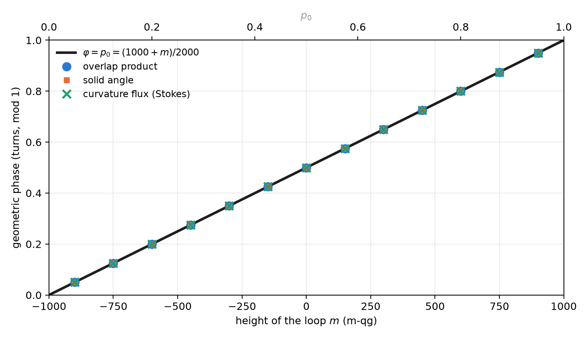
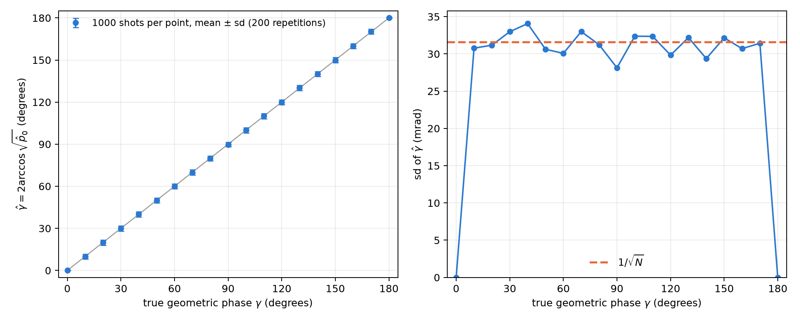

# Geometric phases and Stokes' theorem on the sphere {#sec-ch07}

A phase is not a probability. Chapter 2 showed that the phases of a gate do not appear in its transition matrix: a
$Z$ measurement does not see them. This chapter deals with a phase that does carry physical meaning, the **geometric
phase** a qubit picks up when carried around a closed loop, and shows that the base of Chapter 1 reaches it twice.
First, its value: for a loop at constant height, the phase in turns *is* the probability $p_0$. Then, its measurement:
an interferometer turns it into a probability, and the qang angle of that probability is the phase (§84).

## The Berry connection and curvature {#sec-berry}

If a state $|\psi(\mathbf R)\rangle$ depends on parameters $\mathbf R$ and is carried slowly around a closed path, besides the
dynamical phase it picks up a phase that depends only on the geometry of the path. Its density is the **Berry
connection**, $\mathbf A=i\langle\psi|\nabla\psi\rangle$, and its curl is the **curvature**. For a qubit, with the state described
by its qg vector on the sphere, the curvature is a monopole of strength $\tfrac12$ at the centre: on the unit sphere its
normal component is $\tfrac12$ everywhere.

## Stokes on the sphere {#sec-stokes-sphere}

Stokes' theorem turns the line integral of the connection around the loop $C$ into the flux of the curvature
through the surface it encloses. Since the curvature is uniform, the flux is $\tfrac12$ times the area, that is, the
solid angle $\Omega(C)$:

$$
\gamma(C)=-\frac{\Omega(C)}{2}\pmod{2\pi}.
$$

The phase is gauge invariant (it does not depend on the phase chosen for each state along the path) and changes sign
when the loop is run backwards.

## Loops at constant height: the phase is the probability {#sec-cone}

A loop around the $Z$ axis at constant polar bias $qg_Z$ encloses the cap above it, of solid angle
$\Omega=2\pi(1-qg_Z)$. In turns, the library's $qg_\Phi$ unit,

$$
\varphi=\frac{\gamma}{2\pi}=\frac{qg_Z-1}{2}=-p_1\equiv p_0\pmod 1 ,
\qquad \varphi=\frac{1000+m}{2000}\ \text{turns}.
$$

**The geometric phase of a loop at constant height, measured in turns, is the probability $p_0$ of its height**, and
with the milli-qang it is a linear function of the reading. The reason is the same that made the Haar distribution
uniform in Chapter 4 (@sec-haar): by Archimedes' theorem, the fraction of the sphere in the cap above the height
$qg_Z$ is $(1-qg_Z)/2=p_1$. The solid angle is $4\pi p_1$ and the phase $-2\pi p_1$.

Some values: a loop at $+500$ m-qg ($p_0=0.75$) picks up $0.75$ turns, that is, $-\tfrac14$ of a turn; one on the
equator picks up half a turn, $\pi$; one hugging the pole $|0\rangle$, nothing. @fig-cone shows the line together with
the three independent computations of the next section.

{#fig-cone width=90%}

The equator deserves a note. There the phase is $\pi$, and $+\pi$ and $-\pi$ are the same angle. A numerical computation
can return either one depending on rounding, and a comparison that ignores this fails although the result is right.
That is exactly what happened to one of the library's tests, now fixed to compare on the circle.

## Three independent computations {#sec-three-computations}

The library computes the phase in three ways that share no code and checks that they agree (14 tests):

1. **Overlap product** (Pancharatnam): $\gamma=-\arg\prod_k\langle\psi_k|\psi_{k+1}\rangle$ over the discretized loop, gauge
   invariant.
2. **Solid angle**, as a fan of spherical triangles (Van Oosterom and Strackee's formula). It agrees with the overlap
   product to $10^{-10}$.
3. **Curvature flux** through the cap, integrated numerically. It agrees with the line integral to $10^{-5}$: Stokes'
   theorem checked in numbers.

## Measuring the phase: the interferometer and the probability equation {#sec-interferometer}

A $Z$ measurement does not see the phase. Measuring it takes an **interferometer**: a control qubit in $|+\rangle$
decides whether the system runs the loop, and at the end the control is measured in the $X$ basis (Hadamard test).
With the dynamical phase cancelled, for instance by an echo, the probability of reading 0 on the control is

$$
p_0=\frac{1+\cos\gamma}{2}=\cos^2\frac{\gamma}{2}:
$$

Born's rule of Chapter 1 with $\gamma$ in place of $\theta$. Therefore **the qang angle of the measured probability is
the geometric phase**, $\hat\gamma=2\arccos\sqrt{\hat p_0}$, and its milli-qang reading is $m=1000\cos\gamma$.

Everything the base says about that angle applies to the phase. In particular, being the arcsine transformation
(@sec-arcsine), its uncertainty is $1/\sqrt N$ **for any value of the phase**. @fig-interferometer checks it with a
simulation from this chapter: with 1000 shots per point, the standard deviation of $\hat\gamma$ stays around 32 mrad
(about $1.8^\circ$) from $10^\circ$ to $170^\circ$. At $0$ and $\pi$ it is zero because the outcome is deterministic, always 0 or
always 1, and there the exact intervals of Chapter 4 are needed.

{#fig-interferometer width=100%}

There is a limit, the same as in Chapter 1. Since $\cos\gamma$ is even, a single probability gives $|\gamma|$ in
$[0,\pi]$, not its sign. The remedy is the branch sign (@sec-inversion): measure the other quadrature too, shifting the
reference phase by a quarter turn, which gives $\sin\gamma$. The two probabilities together fix the phase on the whole
circle.

## Pancharatnam's phase and the octant {#sec-octant}

For polarized light the same phase is Pancharatnam's on the Poincaré sphere, and Chapter 6 already set up the
coordinates (@sec-malus). The circuit H → D → R → H runs around an octant of the sphere: three quarter arcs of great
circles enclosing one eighth of its area, $\Omega=4\pi/8=\pi/2$. The phase is $\gamma=-\pi/4$, one eighth of a turn
backwards ($0.875$ turns mod 1), and the library reproduces it from the three qg vectors.

## In code {#sec-code07}

```python
import math
import numpy as np
from qang import geometric

geometric.cone_phase_turns(0.5)       # 0.75 turns = p0 at +500 m-qg
geometric.cone_phase_turns(0.0)       # 0.5: the equator, half a turn

# discretized loop at qg_Z = 0.8: the phase from overlaps, in turns
r = math.sqrt(1 - 0.8 ** 2)
loop = [np.array([r * math.cos(a), r * math.sin(a), 0.8]) for a in np.linspace(0, 2 * math.pi, 400, endpoint=False)]
geometric.geometric_phase_qg(loop).phi         # 0.9 (= p0 = 0.9)

octant = [np.array([0, 0, 1.0]), np.array([1.0, 0, 0]), np.array([0, 1.0, 0])]   # H, D, R
geometric.geometric_phase_qg(octant).phi        # 0.875: -1/8 of a turn
```

The figures are generated by `tools/make_cap07_figures.py`.

## Summary {#sec-summary07}

- The geometric phase of a closed loop is minus half the solid angle it encloses: Stokes' theorem with the Berry
  curvature, a monopole of strength $\tfrac12$.
- For a loop at constant height, the phase in turns is $p_0$ (mod 1), that is, $(1000+m)/2000$: the same Archimedean
  reason that makes the Haar measure uniform in m-qg.
- Three independent computations (overlaps, solid angle, curvature flux) agree to $10^{-10}$ and $10^{-5}$.
- An interferometer turns the phase into the probability $\cos^2(\gamma/2)$; its qang angle is the phase, with
  uncertainty $1/\sqrt N$ for any value, and the sign needs a second quadrature.
- The polarization circuit H → D → R → H encloses an octant and picks up $-\pi/4$.
