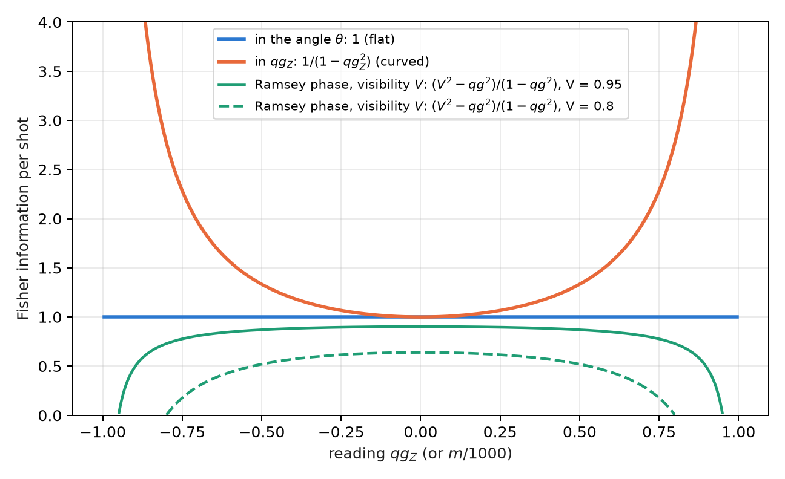
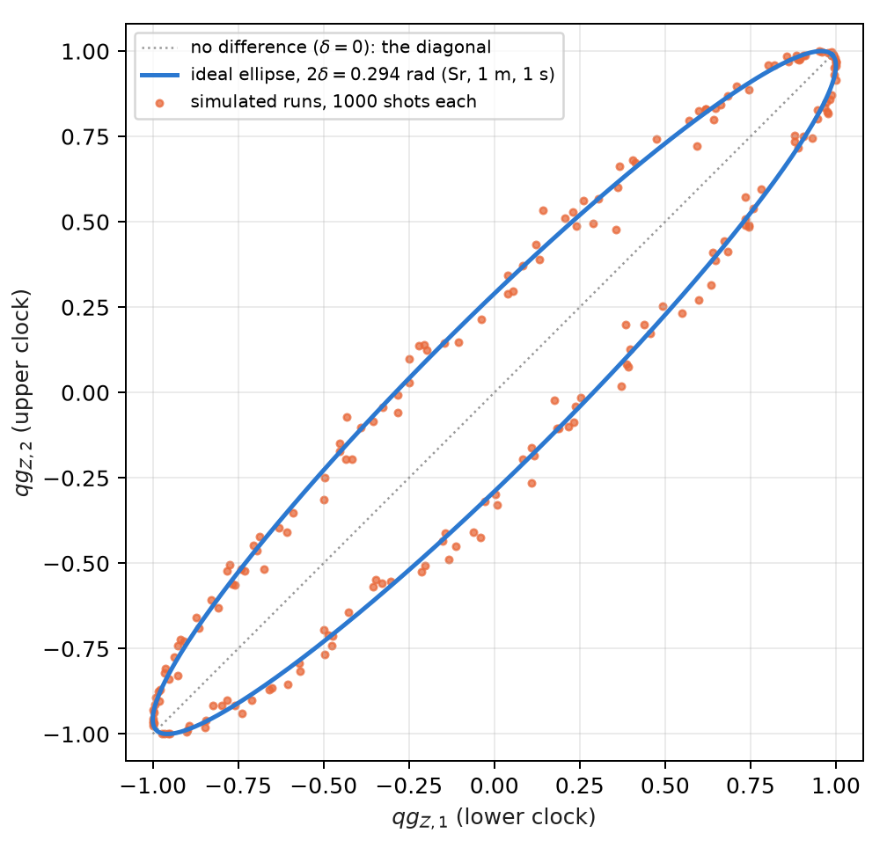
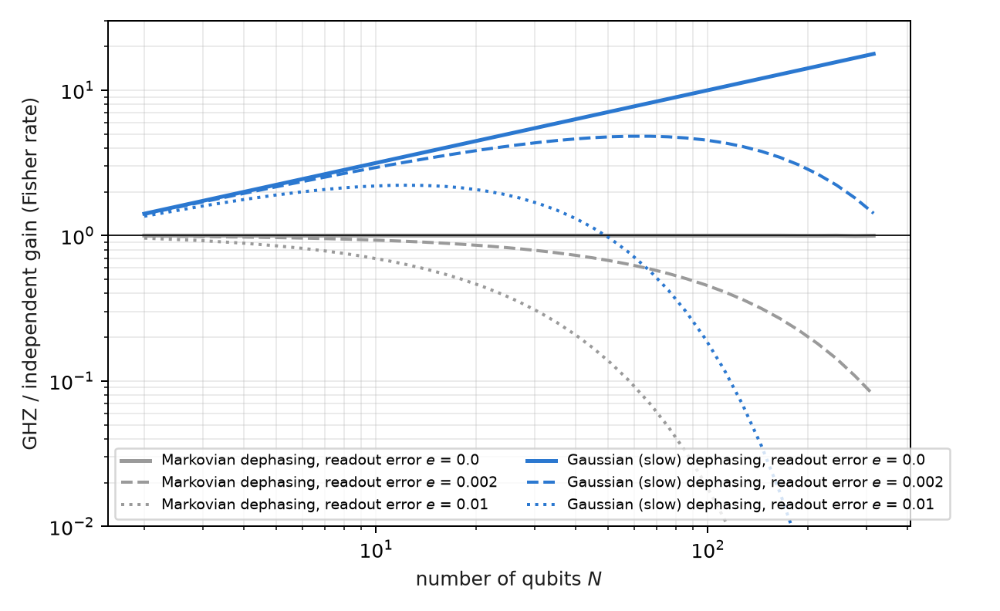

# Fisher information, clocks, gravity and metrology {#sec-ch08}

Metrology is the discipline of measuring a parameter with the smallest possible uncertainty, and its central tool is
the Fisher information: how much each shot teaches about the parameter. This chapter writes it on the base of
Chapter 1. The probability equation $p_0=\cos^2(\theta/2)$ fixes how much information each reading carries, and from it
follow the resolution in milli-qang, the operating point of an interferometer, the comparison of two atomic clocks one
metre apart in height, the advantage (and the limits) of entanglement, and the thermometry of a qubit.

## From the base: the information in one shot {#sec-fisher-base}

A shot in the $Z$ basis is a coin with probability $p_0$. Its Fisher information about the angle is

$$
F_\theta=\frac{(dp_0/d\theta)^2}{p_0(1-p_0)}=\frac{\sin^2\theta/4}{\sin^2\theta/4}=1 ,
$$

constant over the whole sphere; about the reading $qg_Z=\cos\theta$, by contrast, it is $F_{qg}=1/(1-qg_Z^2)$, growing
towards the poles. **The qang angle is the flat coordinate of the information and $qg_Z$ the curved one** (@fig-fisher).
The two descriptions are the same physics: the $1/N$ variance of the angle in Chapter 1 is the Cramér–Rao bound in the
flat coordinate (§167).

{#fig-fisher width=90%}

Expressed in milli-qang, the bound gives the resolution of a reading:

$$
\sigma_m=\frac{1000\,|\sin\theta|}{\sqrt N}\ \text{m-qg},\qquad N=\left(\frac{1000\sin\theta}{\delta}\right)^2
\ \text{shots to resolve } \delta\ \text{m-qg}.
$$

On the equator, resolving 10 m-qg takes $10^4$ shots and resolving 1 m-qg, $10^6$; at 60° from the pole, 5 m-qg cost
30 000. Near a pole the reading is more precise in m-qg, but one m-qg there corresponds to a larger angle: a state
$\delta$ m-qg from the pole is $\arccos(1-\delta/1000)\approx\sqrt{2\delta/1000}$ radians away, 2.56° for 1 m-qg.

## Information geometry and the natural gradient {#sec-fubini}

The many-parameter version of the Fisher information is the Fubini–Study metric, and it governs the **natural
gradient**: descent that measures its steps in distance between states, not between parameters. In a real ansatz of
$R_Y$ rotations and CZ gates, every state of the circuit is real, $\langle Y_k\rangle=0$ before each rotation and every
diagonal entry of the metric is exactly $\tfrac14$: the angles are flat one by one, and all the curvature sits in the
off-diagonal terms, which within a layer are correlators $\langle Y_iY_j\rangle/4$, measurable with one circuit per layer
(§159).

Two practical consequences, checked on a 4-qubit Ising chain with 20 seeds: descent in qg coordinates **never
converges** (0 of 20), because the curved coordinate distorts the steps; and the natural gradient with the qg$_{YY}$
block metric is 1.3 times faster than descent in the angle, and 4.6 times with the full metric. The gain comes from the
metric, not from changing coordinates: the natural gradient in qg is Euclidean descent in $\theta$. The rule is to
optimize in the angle and read out in qg.

## Two clocks and gravity {#sec-clocks}

An atomic clock measures a phase, and two clocks at different heights tick at different rates: the gravitational
redshift. Read with the same laser, they give $qg_{Z,1}=\cos(\varphi+\delta)$ and $qg_{Z,2}=\cos(\varphi-\delta)$, where $\varphi$
is a random common phase (the laser noise) and $2\delta$ the difference sought. Even with $\varphi$ unknown, the pairs of
readings lie on the ellipse

$$
x^2+y^2-2xy\,c=1-c^2,\qquad c=\cos2\delta ,
$$

so the difference is read from the *shape* of the cloud, without controlling the common phase (@fig-clocks). For two
strontium clocks 1 m apart, $2\delta=2\pi\nu\,gh\,t/c^2=0.294$ rad in one second.

{#fig-clocks width=70%}

Fitting the ellipse needs the squares of the readings, and there the unbiased estimator of $qg^2$ from Chapter 4
comes in: without the correction, the shot-noise bias flattens the ellipse. All four recorded predictions passed
(§126):

| check | result |
|---|---|
| relative bias, 1000 shots, 200 runs, four values of $\delta$ | +0.09%, +0.12%, +0.05%, −0.07% |
| spread of the ellipse fit against the moment estimator ($\delta=0.15$) | 0.0022 against 0.0075 |
| bias with 100 shots, without and with the correction | +11.8% and +0.9% |
| strontium, 1 m, 1 s | $\delta=0.1471$; estimate $0.1472\pm0.0022$ (68σ) |

: Clock comparison by ellipse fitting, simulated. {#tbl-clocks}

In this idealized model the spread corresponds to about 1.5 cm of height per 200 runs. The limits are stated: no
laser decoherence during the Ramsey time, contrast 1 and binomial projection noise.

## Ramsey sensing: where to operate {#sec-ramsey}

A Ramsey interferometer turns a phase into a probability: $qg=a+bV\cos(\varphi-\alpha)$, with visibility $V$, operating
point $\alpha$ and the read-out map $(a,b)$ of Chapter 27. With ideal read-out, the information per shot about the phase
is

$$
F=\frac{V^2-qg^2}{1-qg^2}.
$$

With $V=1$ it is flat, $F=1$ everywhere: the $1/(1-qg^2)$ gain at the poles is exactly cancelled by the Jacobian. With
$V<1$ the optimum is the middle of the fringe, $qg=0$, and the information vanishes at the bright fringe
(@fig-fisher). This is the known practice of operating at quadrature, written in qg (§36). Three measured nuances:

- **Read-out asymmetry moves the optimum, but it does not matter:** moving to the new optimum gains 0.17% with the
  calibrated read-out, and 1.6% even with a 10% read-out error.
- **With few shots a prior helps:** with 10 shots, the Bayesian posterior mean is about 2 times better than direct
  inversion, because the prior range of the phase carries information.
- **With visibility 0.9, operating at the pole gets worse with more shots** (the scaled error goes from 1.09 to 2.50
  between 10 and 1000 shots): small phases become invisible there. The middle of the fringe tracks its bound
  (1.11–1.24, with bound 1.12).

## GHZ metrology: when entanglement wins {#sec-ghz}

With $N$ qubits a frequency $\omega$ can be measured in two ways: $N$ independent Ramsey clocks, or a GHZ state, whose
parity $X_1\cdots X_N$ is a single qg value of the whole register, $qg_P=V_N\cos(N\omega t)$, oscillating $N$ times faster.
The advantage is paid for in visibility, which falls as the $N$-th power of that of one qubit. At mid-fringe the
information per shot is $V^2$, and per unit time (§58):

$$
\text{independent: } N\,t\,e^{-2t/T_2}(1-2e)^2,\qquad \text{GHZ: } N^2\,t\,e^{-2Nt/T_2}(1-2e)^{2N},
$$

with $e$ the read-out error per qubit. Optimizing the interrogation time:

| $N$ | Markovian, $e=0$ | $e=0.002$ | $e=0.01$ | Gaussian, $e=0$ | $e=0.002$ | $e=0.01$ |
|---|---|---|---|---|---|---|
| 2 | 1.000 | 0.992 | 0.960 | 1.414 | 1.403 | 1.358 |
| 10 | 1.000 | 0.930 | 0.695 | 3.162 | 2.942 | 2.198 |
| 30 | 1.000 | 0.793 | 0.310 | 5.477 | 4.341 | 1.697 |
| 100 | 1.000 | 0.452 | 0.018 | 10.00 | 4.522 | 0.183 |

: Gain in the Fisher-information rate, GHZ over independent qubits. {#tbl-ghz}

{#fig-ghz width=90%}

The table sums up three known results, here in a single qg reading. With Markovian dephasing there is no gain for any
$N$ (Huelga and co-workers, 1997), and with read-out error independent qubits are strictly better. With Gaussian, slow
dephasing the gain grows as $\sqrt N$, the Zeno-type limit (Matsuzaki and co-workers, 2011; Chin, Huelga and Plenio,
2012). And the read-out caps it: the parity carries $(1-2e)^N$, so there is an optimal size of the GHZ state, beyond
which adding qubits makes the measurement worse (@fig-ghz).

## Thermal states: $qg_Z=\tanh(\beta h)$ {#sec-thermal}

A qubit with $H=-hZ$ in equilibrium at temperature $T$ (with $k_B=1$) is in the Gibbs state, and its polar bias is

$$
qg_Z=\tanh(\beta h),\qquad \beta=1/T .
$$

The whole thermodynamics of the qubit is then a function of a single reading (§25):

| quantity | in qg |
|---|---|
| energy | $U=-h\,qg$ |
| entropy (bits) | $S=qg_S(qg)$, exact because $\rho$ is diagonal in $Z$ |
| free energy | $F=-T\ln\!\big(2/\sqrt{1-qg^2}\big)$ |
| heat capacity | $C/k_B=\operatorname{artanh}(qg)^2\,(1-qg^2)$ |
| preparation angle | $\theta=\arccos(qg)=\pi/2-\operatorname{gd}(\beta h)$ (Gudermannian) |

: Thermodynamics of a qubit in qg units. {#tbl-thermal}

**Thermometry.** A $Z$ measurement is an energy measurement, and therefore the optimal one on a Gibbs state; its Fisher
information about $T$ is $C/T^2$. The best relative precision is at the maximum of the heat capacity:

$$
qg\cdot\operatorname{artanh}(qg)=1\quad\Rightarrow\quad qg^\ast=0.8336,\qquad \beta h=1.1997 ,
$$

the peak of the Schottky anomaly, the known optimal operating point of a two-level thermometer (Correa and co-workers,
2015), here as a one-line condition on the reading. The section is an exact rewriting of textbook thermodynamics,
checked against $e^{-\beta H}$ to $5\cdot10^{-12}$; no advantage was expected or found.

## Without qang and with qang {#sec-comparison08}

| action | without qang | with qang | difference |
|---|---|---|---|
| resolution of a reading | variance of $\langle Z\rangle$, $(1-\langle Z\rangle^2)/N$, different at each point | information 1 per shot in the angle; $\sigma_m=1000\lvert\sin\theta\rvert/\sqrt N$ | it is the usual **Cramér–Rao bound**; the angle makes it uniform |
| optimize a variational circuit | descent in the gate angles | descent in qg coordinates: **does not converge** (0 of 20); natural gradient with $qg_{YY}$ correlators: 1.3× to 4.6× | **against** using $qg_Z$ as a coordinate; the gain is the **metric**'s, not qang's |
| compare two clocks | ellipse fit with naive squares: bias +11.8% at 100 shots | with unbiased $qg^2$: +0.9% | **in favour** of the estimator; it is the standard correction, applied on the qg scale |
| optimal thermometry point | maximum of the heat capacity (Schottky) | $qg\cdot\operatorname{artanh}(qg)=1$, $qg^\ast=0.8336$ | **same point**; qang gives it as a one-line condition on the reading |
| GHZ gain | Fisher rates | the same rates, with a qg parity | **none**: the three results are known |

: The chapter's actions without the qang scale and with it. {#tbl-comparison08}

**Balance.** In metrology qang organizes: it puts the Cramér–Rao bound in a flat coordinate and gives one-line
conditions. The single result against the qg coordinate is explicit: for optimization, the angle and the metric, not
$qg_Z$.

## In code {#sec-code08}

```python
from qang import probability

r = probability.analyze(750, 1000)   # 750 zeros in 1000 shots, in every qang unit
# p0, qg_Z, m = 500.0 [444.5, 551.7] m-qg, theta = 60.0° [56.5°, 63.6°], qg_S, with intervals
```

## Summary {#sec-summary08}

- Per shot, the information is 1 in the angle and $1/(1-qg_Z^2)$ in $qg_Z$; the resolution in m-qg is
  $1000|\sin\theta|/\sqrt N$, the Cramér–Rao bound.
- The natural-gradient metric in a real ansatz has diagonal $\tfrac14$ and $qg_{YY}$ correlators; optimizing in qg
  coordinates does not converge, and the gain comes from the metric.
- Two clocks with a random common phase trace an ellipse; its shape gives the gravitational redshift at 1 m with 68σ in
  the model, if the bias of the squares is corrected.
- A Ramsey interferometer with visibility $V<1$ is operated at mid-fringe; its information is $(V^2-qg^2)/(1-qg^2)$.
- The GHZ state gains nothing with Markovian dephasing, gains $\sqrt N$ with slow dephasing and loses it to the read-out
  error raised to the $N$.
- A thermal qubit has $qg_Z=\tanh(\beta h)$; its best thermometry point is $qg^\ast=0.8336$, the Schottky peak.
