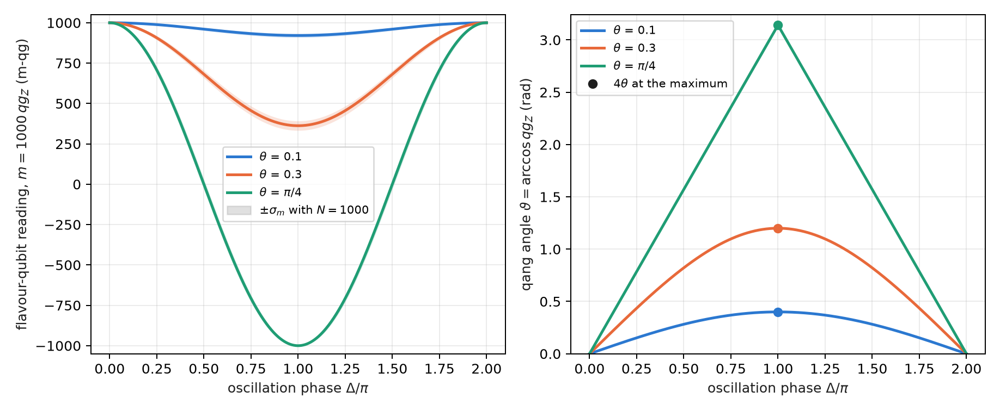
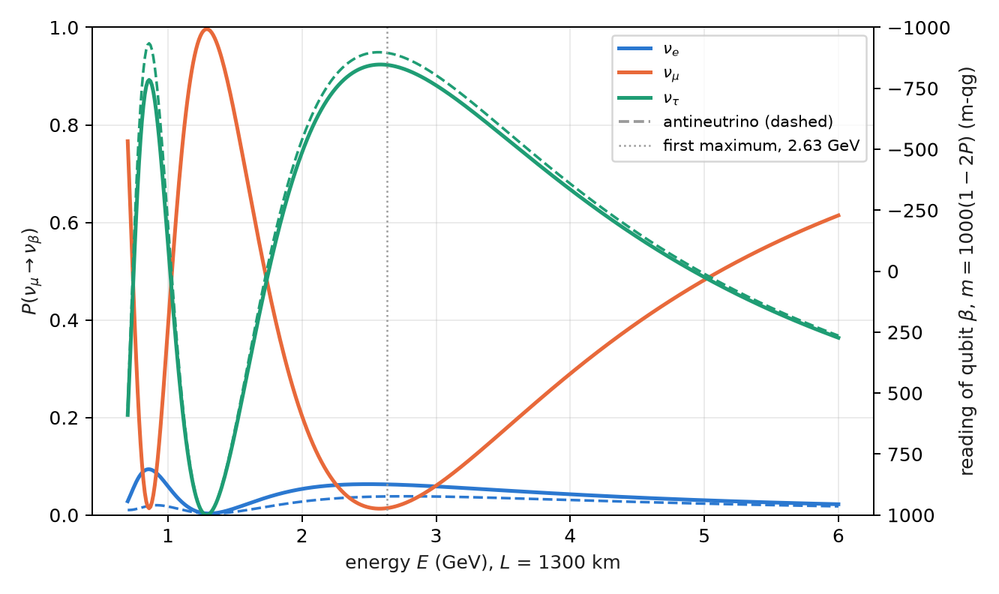
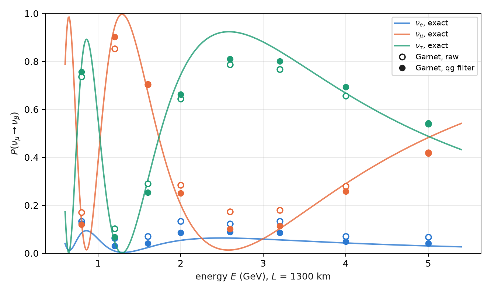

# Quantum kinematics of flavour oscillation in vacuum {#sec-ch09}

A neutrino is born and detected in a flavour state ($\nu_e$, $\nu_\mu$ or $\nu_\tau$), but it travels in mass states. Since
the mass states pick up different phases, the flavour changes on the way: this is flavour oscillation, and in vacuum
it is exactly a two- or three-level rotation. This chapter writes it on the base of Chapter 1. An oscillation
probability is a qang probability like any other, with its angle, its milli-qang reading and its error bar;
two-flavour oscillation is a precession on a cone of the sphere; and three flavours fit on three qubits with a
circuit that conserves the weight, so the qg filter applies. The chapter ends with the project's first real-hardware
data point, taken on IQM Garnet.

Everything in this chapter is in vacuum. A 1300 km baseline crosses the Earth and has sizeable matter effects; those
are the subject of Chapter 10.

## From the base: the oscillation probability in m-qg {#sec-osc-base}

With two flavours on one qubit, $|0\rangle=\nu_e$ and $|1\rangle=\nu_\mu$, the survival probability is $p_0=1-P$, with
$P=P(\nu_e\to\nu_\mu)$. The probability equation of Chapter 1 gives all its readings:

$$
qg_Z=1-2P,\qquad m=1000\,(1-2P)\ \text{m-qg},\qquad \vartheta=\arccos qg_Z=2\arcsin\sqrt P ,
$$

and its shot resolution, $\sigma_m=1000\,|\sin\vartheta|/\sqrt N=2000\sqrt{P(1-P)}/\sqrt N$ m-qg. A 1% appearance
probability is 20 m-qg; a probability difference of 0.025 is 50 m-qg. With three flavours on three qubits (below)
each qubit carries the probability of one flavour and is read the same way: $m_\beta=1000\,(1-2P_\beta)$.

The scale adds no physics: it is the same probability. What it adds is a common ruler for comparing the signal with
shot noise and, as shown next, a coordinate in which the mixing angle is read directly.

## Oscillation as a rotation on a cone {#sec-cone-osc}

In the flavour basis, going to the mass basis is a rotation $R_Y(-2\theta)$, with $\theta$ the mixing angle; in the mass
basis the two states acquire the relative phase

$$
\Delta=\frac{\Delta m^2L}{2E}=2\times1.267\,\frac{\Delta m^2[\mathrm{eV}^2]\,L[\mathrm{km}]}{E[\mathrm{GeV}]},
$$

which is an $R_Z(\Delta)$; and returning to flavour is $R_Y(2\theta)$. The one-qubit circuit is then
$R_Y(2\theta)\,R_Z(\Delta)\,R_Y(-2\theta)$, and its reading is (§151)

$$
qg_Z=\cos^2 2\theta+\sin^2 2\theta\,\cos\Delta,\qquad P(\nu_e\to\nu_\mu)=\sin^2 2\theta\,\sin^2\frac{\Delta}{2}.
$$

The first formula is the **spherical law of cosines**. The mass axis is $2\theta$ from the pole; the Bloch vector, which
starts at the pole, precesses about that axis on a cone of half-angle $2\theta$, and after turning by $\Delta$ it is an arc
distance $\vartheta=\arccos qg_Z$ from the pole. It is the spherical triangle with two sides $2\theta$ and included angle
$\Delta$. The qang angle of the reading is the distance travelled on the sphere (@fig-cone-osc).

{#fig-cone-osc width=100%}

## The mixing angle is a quarter of the qang angle {#sec-quarter}

At the oscillation maximum, $\Delta=\pi$, the law of cosines reduces to $qg_Z=\cos^2 2\theta-\sin^2 2\theta=\cos4\theta$, and
therefore

$$
\theta_{\text{mix}}=\frac{\vartheta}{4}=\frac{\arccos qg_Z}{4}\qquad(\theta\le\pi/4).
$$

The mixing angle is read as a quarter of a qang angle, without inverting any $\sin^2$. It must be said precisely what
this is and what it is not. It is exact only at the maximum: at any other phase the relation between $\vartheta$ and
$\theta$ is not linear, and the trigonometry is still there. And it is not new physics: it is the arcsine
transformation of a proportion from Chapter 4 (§125), which at the maximum coincides with the geometry of the cone.

The condition $\theta\le\pi/4$ is not a detail either. For $\theta>\pi/4$ the angle $4\theta$ exceeds $\pi$ and $\arccos$ returns
$2\pi-4\theta$, that is, $\pi/2-\theta$. Since $\sin^22\theta$ is symmetric under $\theta\to\pi/2-\theta$, no two-flavour measurement
can tell the two values apart: this is the **octant degeneracy**, the same one the atmospheric angle $\theta_{23}$ has
(49° in the values used here; the reading at the maximum would give 41°). The qg scale makes it visible; it does not
resolve it.

## Error bars that do not depend on the angle {#sec-bars}

The qang angle inherits the stabilized variance of the arcsine transformation: its shot-noise standard deviation is
$1/\sqrt{N+\frac12}$, the same over the whole sphere (Chapter 4, §125). Divided by four:

$$
\sigma_\theta=\frac{1}{4\sqrt{N+\frac12}} ,
$$

which does not depend on $\theta$. With 1000 shots it is 0.0079 rad (0.45°). Read in milli-qang, the same measurement
does depend on the point: for $\theta=0.1$ the maximum is at $m=1000\cos0.4=921$ m-qg with $\sigma_m=12$ m-qg. The
pre-registered prediction (N1) held over 2000 binomial repetitions:

| $\theta$ (rad) | 0.1 | 0.3 | 0.5 | 0.7 |
|---|---|---|---|---|
| mean of $\hat\theta$ | 0.0999 | 0.2999 | 0.5000 | 0.7006 |
| std of $\hat\theta$ (theory 0.0079) | 0.0079 | 0.0077 | 0.0078 | 0.0081 |

: The mixing angle read as $\arccos(qg_Z)/4$ at the maximum, 1000 shots, 2000 repetitions. {#tbl-bars}

## Three flavours on three qubits {#sec-three}

With three flavours, flavour state $k$ is the weight-1 state with only qubit $k$ excited: $\nu_e=|100\rangle$,
$\nu_\mu=|010\rangle$, $\nu_\tau=|001\rangle$ (in qubit order 0, 1, 2). The PMNS matrix in its standard form,

$$
U=R_{23}\,U_\delta\,R_{13}\,U_\delta^\dagger\,R_{12},\qquad U_\delta=\operatorname{diag}(1,1,e^{i\delta_{CP}}),
$$

is three real rotations and two phases. Each rotation $R_{ij}$ is an RBS gate (an $XX+YY$) between qubits $i$ and $j$;
each phase is a phase gate on one qubit; and propagation, in the mass basis, is one phase gate per qubit. **Every gate
conserves the Hamming weight**, so a shot with weight other than 1 is an error and can be discarded: this is the qg
symmetry filter of Chapter 21 (§77). For antineutrinos, $\delta_{CP}\to-\delta_{CP}$ is enough. The circuit reproduces the
analytic vacuum probabilities to $10^{-15}$.

@fig-spectrum shows the case of the prediction: an initial $\nu_\mu$, $L=1300$ km (a DUNE-like baseline),
$\delta_{CP}=-\pi/2$ and NuFIT-like mixing values in normal ordering. The first oscillation maximum is at 2.63 GeV, where
survival drops to $P(\nu_\mu\to\nu_\mu)=0.013$, that is, $m_\mu=974$ m-qg.

{#fig-spectrum width=90%}

## Noise suppression with the qg filter {#sec-filter}

The compiled three-flavour circuit has 18 two-qubit gates on IBM. It was run on **simulated noise models** of three
devices (FakeBrisbane with ECR gates, FakeTorino and FakeFez with CZ), at 8 energies between 0.8 and 5 GeV with 4000
shots. The error is the mean of $|\hat P-P|$ over the three flavours and eight energies (§151):

| simulated device | raw | readout correction | qg filter | filter + readout | kept | raw / filter + readout |
|---|---|---|---|---|---|---|
| FakeBrisbane | 0.048 | 0.038 | 0.014 | 0.013 | 85–87% | 3.8× |
| FakeTorino | 0.034 | 0.028 | 0.010 | 0.010 | 90–92% | 3.4× |
| FakeFez | 0.025 | 0.024 | 0.009 | 0.009 | 93–94% | 3.0× |

: Mean error of the three-flavour probabilities, simulated noise models. {#tbl-filter}

The error falls between 3.0 and 3.8 times, and almost all of the gain is the filter, not the readout correction. All
four pre-registered predictions held, including the position of the minimum of $P(\nu_\mu\to\nu_\mu)$ at 2.6 GeV on all
three devices.

**On real hardware** (§165). The same circuit was run on IQM Garnet, a 20-qubit superconducting processor, compiled to
its native gates with 12 CZ; 8 energies, 300 shots each, with predictions recorded before the job. All four held, and
@fig-garnet shows the data:

| check | result |
|---|---|
| filtered error below raw | 0.039 < 0.062 |
| ratio raw / filtered $\ge 1.5$ | 1.59 (narrowly) |
| filtered minimum of $P(\nu_\mu\to\nu_\mu)$ at 2.6 GeV | yes; **raw puts it at 0.8 GeV** |
| kept fraction $\ge 0.5$ | 0.88 |

: The three-flavour circuit on IQM Garnet, 8 × 300 shots, no readout correction. {#tbl-garnet}

{#fig-garnet width=90%}

Three readings of this data point. On real hardware **the filter puts the oscillation maximum back where it is**. The
chip did better than its simulated model (0.062 raw against 0.126) and so the filter gained less (1.6× against 2.2× in
the rehearsal): fewer shots leave the sector, so there is less to remove. And what remains is **inside the sector**,
where the filter cannot see: at the maximum, $P(\nu_\mu\to\nu_\mu)$ reads 0.10 against an exact 0.013 (about 175 m-qg
apart), and the $\nu_\tau$ error barely moves (0.062 → 0.052). It is one run on one day, with 300 shots per circuit.

## The CP asymmetry in vacuum {#sec-cp}

CP violation shows up as a difference between neutrinos and antineutrinos:

$$
A_{CP}=P(\nu_\mu\to\nu_e)-P(\bar\nu_\mu\to\bar\nu_e) .
$$

At 2.6 GeV with $\delta_{CP}=-\pi/2$ it is 0.0250 (0.0630 against 0.0380), that is, **50 m-qg** on the $\nu_e$ qubit. With
20 000 shots per circuit, the shot noise of the difference is about 4.4 m-qg: the signal is about 11σ. Survival, on
the other hand, cannot tell them apart: in vacuum CPT imposes $P(\nu_\mu\to\nu_\mu)=P(\bar\nu_\mu\to\bar\nu_\mu)$ (the orange
curves of @fig-spectrum coincide).

| simulated device | raw | filter + readout |
|---|---|---|
| FakeBrisbane | 0.024 (48 m-qg) | 0.026 (51 m-qg) |
| FakeTorino | 0.017 (35 m-qg) | 0.022 (44 m-qg) |
| FakeFez | 0.020 (41 m-qg) | 0.022 (44 m-qg) |

: CP asymmetry at 2.6 GeV, exact 0.0250 (50 m-qg), 20 000 shots, simulated noise models. {#tbl-cp}

**The asymmetry survives even without the filter.** It is the difference of two nearly identical circuits (only the
sign of two phases changes), so the shift that noise produces in common cancels in the subtraction, as in the fidelity
classifier of §149. What does not cancel is the contraction, which shrinks both probabilities and the difference with
them: that is why FakeTorino's raw value reads 35 m-qg and not 50. The filter halves the error on the CZ devices.

## What the link between neutrinos and qang is, and is not {#sec-scope09}

It is modelling: the oscillation is a rotation, and the qang angle reads the mixing angle directly at the maximum,
with a known error bar. It does not remove the trigonometry in general, and it does not speed up variational methods
for dense neutrino gases: those are many-body problems (Chapter 10). The limits are stated: vacuum only, fixed
parameters, simulated device noise except for the single IQM Garnet run.

## Without qang and with qang {#sec-comparison09}

| action | without qang | with qang | difference |
|---|---|---|---|
| read the mixing angle at the maximum | $\theta=\tfrac12\arcsin\sqrt{P}$ and the delta method | $\theta=\arccos(qg_Z)/4$, $\sigma_\theta=1/(4\sqrt{N+\frac12})$ | **same leading order**: the delta method also gives $1/(4\sqrt N)$; qang gets it without a derivative, with the $+\frac12$ correction for few shots; at exactly $P=0$ or $1$ both need the intervals of Chapter 4 |
| see the octant degeneracy | symmetry of $\sin^22\theta$ | the reading at the maximum returns $\pi/2-\theta$ | **none**: the scale makes it visible, it does not resolve it |
| compare the CP signal with noise | $\Delta P=0.025$ against $\sigma_P$ | 50 m-qg against 4.4 m-qg | **unit**: the ratio (11σ) is the same |
| reduce the error of the three-flavour circuit | readout correction: little effect | weight filter: 3.0–3.8× (simulated), 1.6× on Garnet | the gain is the **symmetry filter**'s, not the qang scale's |

: The chapter's actions without the qang scale and with it. {#tbl-comparison09}

**Balance.** The geometry of the cone and the reading of the mixing angle are qang's own contribution, with an error
bar that need not be derived. The improvement against noise, the chapter's largest number, belongs to the filter.

## In code {#sec-code09}

```python
import math
from qang import neutrino as nu

# two flavours: the reading and the mixing angle at the maximum
q = nu.two_flavour_qg_z(theta=0.1, delta=math.pi)   # cos(0.4) = 0.921 -> 921 m-qg
nu.mixing_angle_from_maximum(q)                      # 0.1
nu.mixing_angle_std(1000)                            # 0.0079 rad

# three flavours: exact probabilities, weight-1 circuit and CP asymmetry
P = nu.three_flavour_probabilities(L=1300, E=2.6, delta_cp=-math.pi / 2)   # P[mu] = [0.063, 0.013, 0.924]
qc = nu.three_flavour_circuit("mu", L=1300, E=2.6, delta_cp=-math.pi / 2)
nu.cp_asymmetry(L=1300, E=2.6, delta_cp=-math.pi / 2)                    # 0.0250
```

## Summary {#sec-summary09}

- An oscillation probability $P$ is read as $m=1000(1-2P)$ m-qg, with angle $2\arcsin\sqrt P$ and resolution
  $2000\sqrt{P(1-P)/N}$ m-qg.
- With two flavours, $qg_Z=\cos^22\theta+\sin^22\theta\cos\Delta$ is the spherical law of cosines of the precession on a cone
  of half-angle $2\theta$.
- At the maximum, $\theta=\arccos(qg_Z)/4$ with standard deviation $1/(4\sqrt{N+\frac12})$, independent of $\theta$; for
  $\theta>\pi/4$ the reading returns $\pi/2-\theta$ (octant degeneracy).
- Three flavours are three qubits in the weight-1 sector; PMNS is three RBS gates and two phases, and the qg filter
  lowers the error 3.0–3.8 times on simulated models.
- On IQM Garnet the filter gains 1.6× and puts the oscillation maximum back at 2.6 GeV; the error that remains is
  inside the sector.
- The CP asymmetry at 2.6 GeV is 50 m-qg and survives without the filter, because the common shift cancels in the
  subtraction.

## Bibliographic notes {.unnumbered}

The lepton mixing matrix comes from @pontecorvo1968 and @maki1962; the oscillation parameters used are of the type of
the NuFIT global fit [@esteban2020] and the *Review of Particle Physics* [@pdg2024]. The RBS gate is that of the
orthogonal networks of @landman2022. The numbered research notes (§) cited in this chapter and the scripts that check it
are in the repository [@qangrepo]; the definition of the qang unit is in @monteverde2026.
