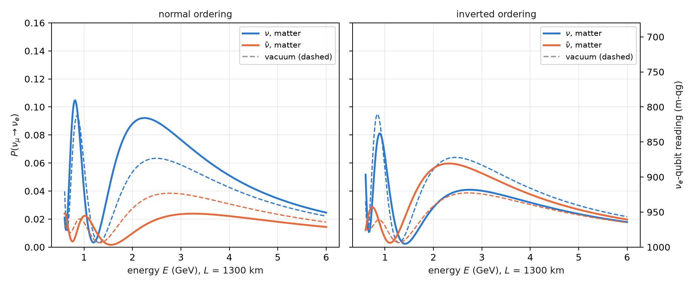

# Matter effects, solar neutrinos and collective oscillations {#sec-ch10}

Chapter 9 left the neutrino in vacuum. But a 1300 km beam crosses the Earth, solar neutrinos are born at the centre
of the Sun, and in a supernova neutrinos are so dense that they interact with each other. In all three cases the
medium adds a term to the flavour Hamiltonian, and the chapter's question is the same in all three: **which number is
still conserved**, because that decides whether the qg filter applies, and in which basis. On the base of Chapter 1,
each effect of the medium is read as a shift in milli-qang, on the same scale as shot noise.

## From the base: the medium as a shift in m-qg {#sec-matter-base}

Each flavour (or mass) qubit is read as in Chapter 9, $m=1000\,(1-2P)$ m-qg, so an effect of the medium that changes
a probability by $\delta P$ is a shift of $2000\,\delta P$ m-qg, directly comparable with the resolution
$\sigma_m=2000\sqrt{P(1-P)/N}$. Three examples from this chapter, on that scale:

| effect | $\delta P$ | in m-qg |
|---|---|---|
| matter on $P(\nu_\mu\to\nu_e)$, 1300 km, 2.6 GeV, normal ordering | 0.063 → 0.087 | 48 |
| fake asymmetry from matter at $\delta_{CP}=0$ | 0.042 | 84 |
| solar MSW drop of $P_{ee}$, 0.5 → 10 MeV, read on the $\nu_2$ qubit | $p_2$: 0.35 → 0.93 | 1173 |

: Effects of the medium as shifts in milli-qang. {#tbl-matter-mqg}

With 1000 shots and $P\approx0.07$ the resolution is about 16 m-qg: the Earth's effect shows at 3σ in a single circuit,
and the solar drop spans most of the scale.

## The MSW effect in the Earth {#sec-msw-earth}

Electrons in the Earth forward-scatter $\nu_e$ and add to the flavour Hamiltonian a potential $A=2\sqrt2\,G_FN_eE$,
which in oscillation units is

$$
A=1.52\times10^{-4}\,Y_e\,\rho[\mathrm{g/cm^3}]\,E[\mathrm{GeV}]\ \mathrm{eV}^2 ,
$$

with the opposite sign for antineutrinos (Mikheyev–Smirnov–Wolfenstein). In the crust ($\rho=2.85$ g/cm³, $Y_e=0.5$)
and at 2.6 GeV, $A=5.6\times10^{-4}$ eV², 22% of $\Delta m^2_{31}$: not a small correction.

The potential acts on $\nu_e$ only, that is, it is a phase on qubit 0. The circuit alternates the exact vacuum step of
Chapter 9 with that phase (second-order, or Strang, Trotter), and **every gate still conserves the weight**: the qg
filter applies just as in vacuum (§152). With $L=1300$ km and between 0.8 and 5 GeV:

| check | result |
|---|---|
| M1 noiseless Trotter error, $r=2$ / $4$ (needed $<0.005$ / $<0.001$) | 0.0052 / 0.0011 — **failed** narrowly |
| M2 matter-only asymmetry at $\delta_{CP}=0$, 2.6 GeV | 0.042 (the vacuum CP signal was 0.025) |
| M3 best error raw / filter + readout | Brisbane 0.046 / 0.017, Torino 0.027 / 0.009, Fez 0.023 / 0.014 (median 2.8×) |
| M4 optimal steps with filter $\ge$ without | $r^\ast=1$ everywhere (holds vacuously) |
| M5 $A_{CP}(\delta_{CP}=0)$, filter + readout, $r=2$ | 0.035, 0.035, 0.029 (exact 0.042; Trotter $r=2$: 0.033) |

: The MSW effect as a Trotter circuit, simulated noise models. {#tbl-msw}

Three lessons. **Matter fakes CP violation**: at $\delta_{CP}=0$, where vacuum gives no asymmetry at all, the Earth
produces 84 m-qg of difference between $\nu$ and $\bar\nu$, more than the 50 m-qg of Chapter 9's CP signal; that is why
long-baseline experiments must model matter, and the filtered circuit sees it. **There is no depth trade-off**: a
single Trotter step already has less error (0.012) than the noise, so $r^\ast=1$ with or without the filter, and M4
holds only because both are 1. And **M5's gap to the exact value is Trotter error, not noise**: the filtered values
sit within 0.004 of the $r=2$ Trotter value.

## The mass ordering read through matter {#sec-ordering}

Vacuum cannot tell the sign of $\Delta m^2_{31}$; matter can, because what matters is the sign of the product
$A\,\Delta m^2_{31}$. In normal ordering ($\Delta m^2_{31}>0$) matter enhances $\nu_\mu\to\nu_e$ and suppresses the
antineutrino channel; in inverted ordering, the reverse (@fig-matter). With the exact values at 2.6 GeV:

| | $\nu$, vacuum | $\nu$, matter | $\bar\nu$, vacuum | $\bar\nu$, matter |
|---|---|---|---|---|
| normal | 0.063 | 0.087 | 0.038 | 0.021 |
| inverted | 0.063 | 0.041 | 0.039 | 0.058 |

: $P(\nu_\mu\to\nu_e)$ at 1300 km and 2.6 GeV, $\delta_{CP}=-\pi/2$. {#tbl-ordering}

{#fig-matter width=100%}

On the simulated noise models, with the $r=2$ Trotter circuit and the filter, **the ordering is read correctly on all
three devices**, with the right sign of the $\nu/\bar\nu$ asymmetry (§163). The filtered values sit 0.010–0.033 above
the noiseless-circuit reference (prediction O3 failed): noise inside the sector moves probability toward the other
flavours. But the bias is common, and the difference between orderings survives: 0.034–0.036 against 0.037 in the
reference.

## Solar neutrinos: the whole Sun is one rotation {#sec-sun}

A $\nu_e$ is born at the solar core, where $(\rho Y_e)\approx100$ g/cm³, and travels out to vacuum. At low energy matter
barely matters and it reaches the Earth with the averaged vacuum probability; above the resonance (about 2 MeV at the
core), the central density turns the matter mixing angle $\theta_m$ almost to 90°, the neutrino adiabatically follows
the heavy eigenstate and leaves the Sun as $\nu_2$. The phases are lost on the way to the Earth, so what arrives is a
population in the mass basis, and the survival probability (§156)

$$
P_{ee}=c_{13}^4\left(\cos^2\theta_{12}\,p_1+\sin^2\theta_{12}\,p_2\right)+s_{13}^4
$$

is **linear in $qg_Z$ of the $\nu_2$ qubit**. It falls from 0.54 to 0.30 between 0.5 and 15 MeV (@fig-sun); on the $\nu_2$
qubit that is going from $+304$ to $-868$ m-qg, more than half of the scale.

{#fig-sun width=90%}

The circuit uses two effective flavours ($\nu_3$ decoupled; it agrees with three flavours to 0.001) and a scaled Sun:
an exponential profile with a 100 km scale height, cut into $r$ slabs uniform in $\theta_m$. Each slab is one exact
$2\times2$ propagator, $R_Z\cdot\mathrm{RBS}\cdot R_Z$ on two qubits in the weight-1 sector, and the filter applies. All
six pre-registered predictions held:

| read-out (mean $P_{ee}$ error against the noiseless circuit) | Brisbane | Torino | Fez |
|---|---|---|---|
| slabs $r=8$, raw / filter + readout | 0.025 / 0.011 | 0.018 / 0.008 | 0.027 / 0.015 |
| compiled (a single RBS), raw / filter + readout | 0.008 / 0.002 | 0.005 / 0.002 | 0.006 / 0.003 |
| one qubit, raw / readout | 0.004 / 0.002 | 0.031 / 0.003 | 0.004 / 0.002 |
| MSW drop $P_{ee}(0.5)-P_{ee}(10\ \text{MeV})$, $r=8$ filtered (exact 0.231) | 0.218 | 0.218 | 0.202 |

: Solar neutrinos on simulated noise models. {#tbl-sun}

The filter gains 1.9–2.3× on the slab circuit, as in the Earth. But the important result is another one: **the physics
makes the circuit unnecessary**. Because the phases are lost before detection, the observable is a single population,
and the compiled circuit (the whole Sun in the one RBS that loads $p_2$) beats every slab circuit even without the
filter; with two flavours, one qubit with readout correction is as good as anything. The adiabatic answer is
classical, $\sin^2\theta_m$ at the core. A quantum computer could add something only where coherence survives: day–night
regeneration in the Earth, or the collective effects of the next section.

**Open: the real Sun.** The profile is scaled (the real one has a scale height of about $6\times10^4$ km and is far more
adiabatic, with the same adiabatic answer), and the slab discretization error (0.009 at $r=8$) is of the size of the
filtered noise. The comparison with a Standard Solar Model density profile has not been done: it stays a proposal,
not a result.

## Collective oscillations: what is conserved is the mass number {#sec-collective}

In a supernova the neutrino density is so high that neutrinos scatter off each other. With $N$ two-flavour neutrinos,
one qubit each, in the single-angle approximation, the Hamiltonian in the mass basis is

$$
H_m=-\sum_i\frac{\omega_i}{2}Z_i+\frac{\mu}{2N}\sum_{i<j}\boldsymbol\sigma_i\cdot\boldsymbol\sigma_j ,
$$

with $\omega_i=\Delta m^2/2E_i$ and $\mu$ the neutrino–neutrino coupling. Section §151 had named these gases a
natural target for the filter because "the total flavour number is conserved". **That holds only for the
neutrino–neutrino term.** The product $\boldsymbol\sigma_i\cdot\boldsymbol\sigma_j$ is the same in every basis, but the vacuum term is
diagonal only in the mass basis: what is conserved is **the number of $\nu_2$**, not the flavour number (§154).
@fig-collective shows it with the exact evolution of four neutrinos: the number of $\nu_2$ is constant and the number of
$\nu_x$ moves, a little at the experiment's angle and more at a large angle.

{#fig-collective width=100%}

A flavour initial state is a superposition of mass sectors with known, conserved probabilities (for
$\nu_e\nu_e\nu_x\nu_x$ at $\theta=0.195$: 0.863 in the two-$\nu_2$ sector and 0.067 in each neighbour). The function
`reweight_sectors` rescales each sector to its probability; when the distribution is a delta, it is the filter.

**All seven pre-registered predictions failed, for one reason**: the noiseless Trotter error (0.095) was larger than
the whole noisy error against the exact evolution (0.074–0.088), so every read-out was scored mostly on Trotter
error. A post hoc analysis, not pre-registered, scored against the noiseless circuit, gives what the predictions meant
to measure:

| simulated device | mass basis, raw / filter | flavour start in mass basis, raw / reweighted | flavour basis, raw / readout |
|---|---|---|---|
| FakeBrisbane | 0.054 / 0.025 | 0.054 / 0.034 | 0.057 / 0.055 |
| FakeTorino | 0.032 / 0.011 | 0.031 / 0.019 | 0.035 / 0.031 |
| FakeFez | 0.028 / 0.012 | 0.027 / 0.016 | 0.027 / 0.026 |

: Collective oscillations, $N=4$, post hoc analysis against the noiseless circuit. {#tbl-collective}

The filter on the conserved mass number gains 2.2–2.8×; the known distribution over sectors, 1.6–1.7×; and in the
flavour basis, where nothing is conserved, there is no gain beyond readout correction. The lesson for the next
pre-registration is on record: score against the noiseless circuit when the Trotter error is not known to be small,
or measure that error before fixing the predictions.

## Without qang and with qang {#sec-comparison10}

| action | without qang | with qang | difference |
|---|---|---|---|
| quantify an effect of the medium | probability change $\delta P$ | shift of $2000\,\delta P$ m-qg | **unit**: lets the Earth, the fake asymmetry and the Sun be tabulated on one scale with the noise |
| read solar survival | $P_{ee}$ linear in the population $p_2$ | linear in $qg_Z$ of the $\nu_2$ qubit | **equivalent** |
| simulate the Earth with noise | unfiltered Trotter circuit | with the weight filter: 2.8× in the median | the **filter**'s, not qang's |
| collective oscillations | flavour-basis reading: no gain | filter in the mass basis: 2.2–2.8× (post hoc) | the **conserved number**'s; qang does not decide which number is conserved |

: The chapter's actions without the qang scale and with it. {#tbl-comparison10}

**Balance.** In this chapter qang is the presentation scale. Everything that improves the simulation comes from
identifying the conserved number and filtering on it, and the table says so.

## In code {#sec-code10}

```python
import math
from qang import neutrino as nu
from qang.sectors import reweight_sectors

# the Earth: exact matter probabilities and the weight-preserving Trotter circuit
P = nu.matter_probabilities(L=1300, E=2.6, delta_cp=-math.pi / 2, rho=2.85)        # P[mu, e] = 0.087
qc = nu.matter_trotter_circuit("mu", L=1300, E=2.6, delta_cp=-math.pi / 2, rho=2.85, steps=2)
nu.cp_asymmetry(L=1300, E=2.6, delta_cp=0.0, rho=2.85)                              # 0.042: matter, not CP
Pio = nu.matter_probabilities(1300, 2.6, -math.pi / 2, 2.85, params=nu.NUFIT_IO)    # P[mu, e] = 0.041

# the Sun: the adiabatic answer and the compiled circuit (a single RBS)
nu.solar_pee_adiabatic(0.010)                                                      # 0.315 at 10 MeV
qc_sun = nu.solar_circuit(0.010, h=100.0, X=800.0, r=8, compiled=True)

# collective oscillations: the conserved mass sectors of a flavour state
nu.mass_sector_probabilities("eexx", theta=0.195)              # [0.001, 0.067, 0.863, 0.067, 0.001]
```

## Summary {#sec-summary10}

- An effect of the medium that changes a probability by $\delta P$ is a shift of $2000\,\delta P$ m-qg, comparable with
  shot noise on the same scale.
- The Earth adds a phase on the $\nu_e$ qubit; the Trotter circuit conserves the weight, the filter gains 2.8× in the
  median, and a single step is enough.
- Matter fakes CP violation (84 m-qg at $\delta_{CP}=0$) and reveals the mass ordering: the sign of the shift flips
  between normal and inverted.
- In the Sun, $P_{ee}$ is linear in $qg_Z$ of the $\nu_2$ qubit and falls by 1173 m-qg; since the phases are lost, the
  whole Sun is one rotation, and the answer is classical.
- In collective oscillations the number of $\nu_2$ is conserved, not the flavour number: the filter works in the mass
  basis (2.2–2.8×, post hoc) and not in the flavour basis; all seven pre-registered predictions failed on Trotter
  error.
- The comparison with a realistic solar density profile is still open.
