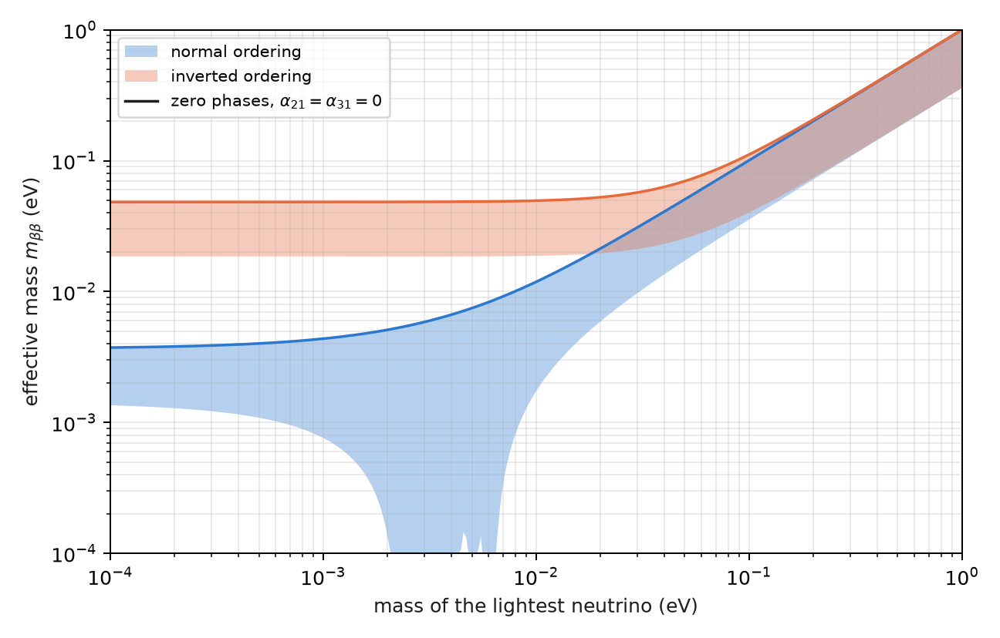
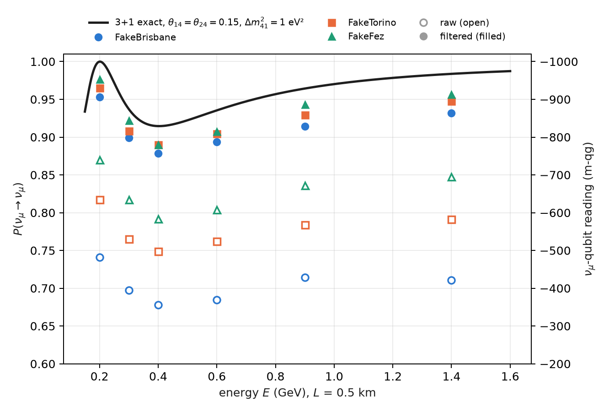

# Majorana phases, neutrinoless double beta decay and sterile neutrinos {#sec-ch11}

Chapters 9 and 10 read what an oscillation circuit sees: mixing angles, the CP phase, the mass ordering through
matter. This chapter takes two open questions of neutrino physics that have a clear answer in qg terms, one negative
and one positive. Majorana phases change no oscillation probability, and therefore no qang reading: the compiler
deletes them. A sterile neutrino, on the other hand, is one more qubit in the weight-1 sector, and the filter treats it
like any other flavour. At the end, closing Part III, the four quantum numbers of the atom written with the same rule.

## From the base: what changes no probability changes no reading {#sec-majorana-base}

All the readings of Chapter 1 are functions of probabilities: $qg_Z=2p_0-1$, $m=1000\,qg_Z$, the angle $\arccos qg_Z$ and
the entropy $qg_S$. So a physical parameter that changes no measurement probability is invisible to all of them at
once, without exception and with any number of shots. The question "does a circuit see it?" reduces to "does it change
any probability?", and is answered before running anything.

Conversely, a parameter that does change a probability by $\delta P$ shows up as $2000\,\delta P$ m-qg on the qubit of the
corresponding flavour, as in Chapters 9 and 10. The sterile neutrino of this chapter is of that kind: with the
hypothetical parameters used below, it lowers $\nu_\mu$ survival by 0.085, that is, 171 m-qg.

## Majorana phases are invisible to oscillations {#sec-majorana-invisible}

If the neutrino is its own antiparticle (a Majorana particle), the mixing matrix has two more phases,

$$
U_M=U\,\operatorname{diag}\!\left(1,\ e^{i\alpha_{21}/2},\ e^{i\alpha_{31}/2}\right).
$$

The added matrix is diagonal in the mass basis, and so is propagation. The two commute, and in the evolution operator
$U_M\,D\,U_M^\dagger$ the phase cancels against its inverse: $U_M D U_M^\dagger=U D U^\dagger$. No oscillation probability depends
on $\alpha_{21}$ or $\alpha_{31}$, in vacuum or in matter (in matter the Hamiltonian is
$U_M\,\mathrm{diag}(0,\Delta m^2_{21},\Delta m^2_{31})\,U_M^\dagger+V$, and the cancellation already happens in the first term,
before the potential is added). Numerically the largest difference among the nine probabilities with and without the
phases is $4\times10^{-16}$, machine rounding (§163).

In the three-flavour circuit of Chapter 9 the phases are phase gates in the mass basis, inserted on either side of
propagation (`majorana_circuit`). What is instructive is what the transpiler does: on all three simulated devices,
**the circuit compiled with phases $(\alpha_{21},\alpha_{31})=(\pi/2,\,3\pi/4)$ is identical to the one compiled without them**
(on FakeFez, 18 CZ, 48 $R_Z$ and 47 $\sqrt X$ in both). The optimizer merges each phase gate with its inverse and deletes
them. It is not an "analytic elimination" designed by anyone, but the direct consequence of the operator not
changing: a compiler that simplifies consecutive phases finds the identity on its own.

## Majorana phases in neutrinoless double beta decay {#sec-doublebeta}

Where the phases do show is in a process that violates lepton number: neutrinoless double beta decay,
$(A,Z)\to(A,Z+2)+2e^-$, possible only if the neutrino is Majorana. Its rate is proportional to the square of the
effective mass

$$
m_{\beta\beta}=\left|\sum_i U_{ei}^2\,m_i\right| ,
$$

and since $U_{ei}^2$ enters and not $|U_{ei}|^2$, the phases do not cancel: they can add the three contributions or make
them interfere destructively. With a massless lightest neutrino, scanning the two phases gives (§163)

| ordering | masses (meV) | $m_{\beta\beta}$ (meV) |
|---|---|---|
| normal | 0; 8.6; 50.1 | 1.4 to 3.7 |
| inverted | 49.2; 49.9; 0 | 18.7 to 48.3 |

: Effective mass of neutrinoless double beta decay with a massless lightest neutrino, scanning the Majorana phases. {#tbl-mbb}

@fig-mbb shows both bands as a function of the lightest mass. In inverted ordering the band has a floor of about
19 meV, which is the target of the next generation of experiments. In normal ordering, for a lightest mass between
about 2 and 7 meV, the phases can make $m_{\beta\beta}$ vanish completely: a cancellation that no double beta experiment
could tell apart from a Dirac neutrino.

{#fig-mbb width=85%}

The qg reading of this section is just the previous section said the other way round: an oscillation circuit cannot
measure what this figure plots. What the scale does do is separate the two questions cleanly, the oscillation one
(probabilities, qang readings) and the mass one (an amplitude with phases, outside any reading of a flavour qubit).

## The sterile neutrino: a fourth qubit in the weight-1 sector {#sec-sterile}

A sterile neutrino $\nu_s$ is a fourth flavour that does not interact through the weak force, but mixes with the other
three. In the 3+1 model there is a fourth mass state with $\Delta m^2_{41}\sim1$ eV², much larger than the other two, and
the real mixing is a sequence of six rotations,

$$
U=R_{34}\,R_{24}\,R_{14}\,R_{23}\,R_{13}\,R_{12}
$$

(without CP phases, to keep it simple). In the circuit each flavour is a qubit with a single 1: the sterile one is
simply **one more qubit in the weight-1 sector** (`sterile_circuit`). Each rotation is an RBS and propagation is one
phase gate per qubit; everything conserves the weight and the filter applies unchanged.

At short distances, where the three-flavour oscillations have not started yet, survival is effectively two-level,

$$
P(\nu_\mu\to\nu_\mu)\approx1-4|U_{\mu4}|^2\left(1-|U_{\mu4}|^2\right)\sin^2\frac{\Delta_{41}}{2} .
$$

With the hypothetical values $\theta_{14}=\theta_{24}=0.15$ and $\Delta m^2_{41}=1$ eV², $|U_{\mu4}|^2=0.022$ and the amplitude
is 0.085; at $L=0.5$ km the first minimum falls at 0.40 GeV (@fig-sterile). It is the same case as Chapter 9, with the
same geometry: a precession cone with an effective mixing angle, now between $\nu_\mu$ and $\nu_s$.

On the simulated noise models, all three pre-registered predictions for the sterile neutrino held:

| check | result |
|---|---|
| S1 filtered error below raw at all 18 (energy, device) combinations | yes |
| S2 median raw / filtered ratio $\ge 2$ | 5.5 |
| S3 filtered minimum of $P(\nu_\mu\to\nu_\mu)$ at 0.4 GeV on all three devices | yes |

: The 3+1 sterile neutrino on simulated noise models, 4 qubits, 8000 shots. {#tbl-sterile}

At the minimum (exact 0.915), FakeBrisbane reads 0.678 raw and 0.879 filtered; FakeTorino, 0.749 and 0.890; FakeFez,
0.792 and 0.890. **The gain is larger than with three flavours** (5.5× against 3.0–3.8×) because the circuit has four
qubits: there are more ways for a shot to leave the weight-1 sector, and the filter discards them all.

{#fig-sterile width=90%}

What remains is, again, inside the sector: the filtered values still sit 0.025 to 0.036 below the exact value at the
minimum, because noise that moves a 1 from one qubit to another conserves the weight and the filter cannot see it.

**Open: the data.** The mixing angles in this section are hypothetical, chosen so that the signal is visible; they are
not a fit. Phenomenological limits and the comparison of 3+1 models with short-baseline experiments have not been
done: they stay a proposal.

## The four quantum numbers in qg terms {#sec-numbers}

Chapter 10 ended on the question of which number is conserved. The same question, applied to the atom, gives a qg
reading of the four quantum numbers (§155). It is a translation, not new physics.

- **The magnetic number.** A register of $n$ qubits in its symmetric subspace is a spin $j=n/2$, and in each shot the
  magnetic number is read from the **Hamming weight**: $m=n/2-w$. The weight filter is the projection onto one value of
  $m$, and $qg_Z=\langle J_z\rangle/j$ for any angular momentum.
- **$m_s$** is one qubit, with $qg_Z=2m_s$. **$m_l$** of an $l$ orbital is the weight of a symmetric register of $2l$
  qubits: the three complex $p$ orbitals are $|00\rangle$, $(|01\rangle+|10\rangle)/\sqrt2$ and $|11\rangle$. The real $p_x$ and $p_y$
  mix $m_l=\pm1$, which is why they have $qg_Z=0$ like $p_z$, but with entropy 0.63 instead of zero.
- **$l$** is the permutation symmetry, and is read with qg values of SWAP: for two qubits,
  $\langle J^2\rangle=1+qg_{\text{SWAP}}$.
- **$n$**: by hydrogen's hidden SO(4) symmetry, shell $n$ is two spins $(n-1)/2$, that is, two symmetric registers of
  $n-1$ qubits; $m_l$ is $(n-1)$ minus the total weight of the $2(n-1)$ qubits, and the weight filter fixes it.

The qang angle of an eigenstate $|l,m\rangle$ is $\arccos(m/l)$. The textbook vector-model angle is
$\arccos\!\big(m/\sqrt{l(l+1)}\big)$, and always lies closer to the equator (@fig-angles-lm), because $|l,m\rangle$ has a transverse
spread $\langle J_x^2+J_y^2\rangle=l(l+1)-m^2>0$:

| $l$, $m$ | qang angle | vector model | $\langle J_x^2+J_y^2\rangle$ |
|---|---|---|---|
| 1, +1 | 0° | 45.0° | 1 |
| 2, +2 | 0° | 35.3° | 2 |
| 2, +1 | 60.0° | 65.9° | 5 |
| 3, +3 | 0° | 30.0° | 3 |
| 3, +1 | 70.5° | 73.2° | 11 |

: The qang angle of $|l,m\rangle$ against the vector-model angle. {#tbl-numbers}

{#fig-angles-lm width=85%}

$qg_Z$ measures where $\langle\mathbf J\rangle$ points; the vector model draws a vector of length $\sqrt{l(l+1)}$. The two agree
only at $m=0$. In a demonstration (not pre-registered) on the FakeTorino noise model, $p_z$ ($m_l=0$) leaks to $m_l=\pm1$
in 19% of shots on the default qubit layout and in 2.2% on the chain chosen by `ibm.best_chain`; in both cases the
weight filter returns $P(m_l=0)=1$.

## Without qang and with qang {#sec-comparison11}

| action | without qang | with qang | difference |
|---|---|---|---|
| decide whether a parameter is observable | check whether any probability depends on it | "what changes no probability changes no reading" | **equivalent**; the qang rule says it for all readings at once |
| compute $m_{\beta\beta}$ | $\lvert\sum U_{ei}^2m_i\rvert$ | — | **qang does not apply**: it is an amplitude with phases, not a probability |
| quantify the sterile signal | $\delta P=0.085$ | 171 m-qg | **unit** |
| reduce the error with four flavours | raw reading | weight filter: 5.5× | the **filter**'s |
| compare the qang angle with the vector model | $\arccos(m/\sqrt{l(l+1)})$ | $\arccos(m/l)$ | **in favour** of qang as a reading: it is the direction of $\langle\mathbf J\rangle$, which is what a $qg_Z$ measures; the vector model draws something else |

: The chapter's actions without the qang scale and with it. {#tbl-comparison11}

**Balance.** The chapter has one case where qang has nothing to say ($m_{\beta\beta}$), and it is worth having it written.
Its own contribution is interpretive: what a reading sees and does not see, and which angle a $qg_Z$ really measures.

## In code {#sec-code11}

```python
import math
from qang import neutrino as nu
from qang import angular

# Majorana: no probability changes, in vacuum or in matter
nu.majorana_invisible(1300, 2.6, -math.pi / 2, math.pi / 2, 3 * math.pi / 4, rho=2.85)   # 4e-16
nu.m_bb(0.0, a21=0.0, a31=0.0, ordering="IO")                                           # 0.048 eV

# the sterile neutrino: a fourth qubit in the weight-1 sector
P = nu.sterile_probabilities(L=0.5, E=0.4, dm41=1.0, theta14=0.15, theta24=0.15)        # P[mu, mu] = 0.915
qc = nu.sterile_circuit("mu", L=0.5, E=0.4, dm41=1.0, theta14=0.15, theta24=0.15)

# the quantum numbers: the qang angle and the vector-model angle
math.degrees(angular.qang_angle_of_eigenstate(2, 1)), math.degrees(angular.vector_model_angle(2, 1))   # 60.0, 65.9
```

## Summary {#sec-summary11}

- Every qang reading is a function of probabilities: a parameter that changes no probability is invisible to all of
  them at once.
- Majorana phases cancel in $U_MDU_M^\dagger$ (difference $4\times10^{-16}$); the transpiler outputs the same circuit with
  and without them.
- Neutrinoless double beta decay does see them: $m_{\beta\beta}$ ranges from 1.4 to 3.7 meV (normal) and from 18.7 to
  48.3 meV (inverted) with a massless lightest neutrino, and can vanish in normal ordering.
- A sterile neutrino is a fourth qubit in the weight-1 sector; with hypothetical mixing, the filter gains 5.5× and
  places the minimum at 0.4 GeV. Limits from real data are still open.
- The four quantum numbers are read in qg: $m$ from the Hamming weight, $l$ from SWAP, $n$ from the register size; the
  qang angle $\arccos(m/l)$ is not the vector-model one.

## Bibliographic notes {.unnumbered}

The Majorana neutrino is @majorana1937; the Majorana phases and their invisibility in oscillations, @schechter1980 and
@bilenky1980. For neutrinoless double beta decay, see @dolinski2019; the signal that motivated the sterile neutrino is
@aguilar2001. The numbered research notes (§) cited in this chapter and the scripts that check it are in the repository
[@qangrepo]; the definition of the qang unit is in @monteverde2026.
