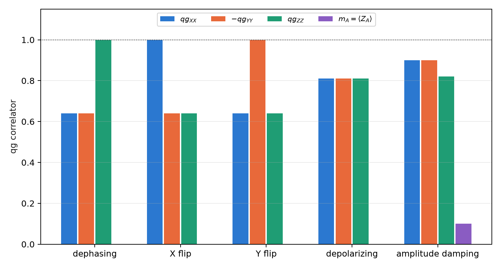

# Optical teleportation and the Bell-pair limit {#sec-ch12}

Part IV takes the qang scale to quantum communication networks. This chapter deals with teleporting a qubit through a
passive optical network: a central office shares an entangled state with a user through a fibre and a passive $1{:}N$
splitter, and the photon arrives with low probability. The question is which state to share. The usual answer, a
Bell pair, stops being optimal as soon as the channel loses photons, and the optimal state is fixed by a single
number: the $qg_Z$ reading of one of its qubits. The chapter closes with the qg reading of Bell pairs in a network,
which is what Chapter 13 uses as a predictor of the fidelity.

## From the base: the fidelity is a probability {#sec-tele-base}

The fidelity of teleporting an input state is the probability that Bob, after undoing the preparation, measures 0: it
is a $p_0$ of Chapter 1, with its reading $m=1000(2p_0-1)$ m-qg and its error bar. The average fidelity over the Bloch
sphere is obtained exactly with six inputs, the cardinal states $|0\rangle$, $|1\rangle$, $|\pm\rangle$, $|\pm i\rangle$, because they
form a spherical 3-design.

The shared state is $\cos\alpha|00\rangle+\sin\alpha|11\rangle$, and each of its qubits has

$$
qg_Z=\cos^2\alpha-\sin^2\alpha=\cos2\alpha,\qquad \alpha=\frac{\arccos qg_Z}{2}.
$$

The resource angle is half the qang angle of either of its qubits. The Bell pair, $\alpha=\pi/4$, is the equator:
$qg_Z=0$, $m=0$. A less entangled resource leans toward $|00\rangle$ ($m>0$); a "more than maximally entangled" one, in
the sense of this section, leans toward $|11\rangle$ ($m<0$). The whole design rule of this chapter is an m-qg reading of a
single qubit.

## Teleportation with a Bell pair {#sec-bennett}

In the protocol of Bennett and co-workers (1993), Alice measures her input qubit and her half of the resource in the
Bell basis, sends Bob two classical bits, and Bob applies one of four Pauli corrections. With a perfect Bell pair the
fidelity is 1. With an imperfect resource, the average fidelity depends only on its singlet fraction
$f=\langle\Phi^+|\rho|\Phi^+\rangle$:

$$
F=\frac{2f+1}{3},
$$

and teleportation beats every classical strategy (measure and resend) only if $F>2/3$, that is, $f>1/2$. In the circuit
the Bell measurement is in deferred form (CX, H, CX, CZ), with no mid-circuit measurements.

## A channel that loses photons {#sec-lossy-channel}

In a downlink passive optical network (§157) the resource's second qubit is a photon present or absent (single rail)
that travels through a fibre of transmission $T=10^{-0.02L}$ ($L$ in km, 0.2 dB/km) and reaches a $1{:}N$ splitter. For
Bob's mode both are beam splitters, that is, RBS gates that conserve the photon number, and the photon arrives with
probability

$$
\eta=\frac{T}{N}.
$$

A lost photon leaves Bob in $|0\rangle$: the channel is amplitude damping, which does not treat the two branches of the
resource alike. The $|00\rangle$ branch has nothing to lose; the $|11\rangle$ branch loses its photon with probability $1-\eta$. So
it pays to put less weight on the fragile branch, and the optimum moves away from $\alpha=\pi/4$.

## The design rule {#sec-rule}

The singlet fraction of the resource after the channel is

$$
f=\frac{(\cos\alpha+\sqrt\eta\,\sin\alpha)^2}{2\,(\cos^2\alpha+\kappa\sin^2\alpha)} ,
$$

with $\kappa=1$ in the non-assisted protocol, in which only Alice and Bob act. In the **assisted** protocol the other
$N-1$ users report whether the photon reached them, and those shots are discarded: it is a **sector filter** on the
other users' register, and the only loss left unheralded is the fibre loss, with $\kappa=\eta+1-T$. Maximizing $f$
gives

$$
\tan\alpha^\ast=\frac{\sqrt\eta}{\kappa},\qquad F^\ast=\frac{2+\eta/\kappa}{3},\qquad
qg_Z^\ast=\cos2\alpha^\ast=\frac{\kappa^2-\eta}{\kappa^2+\eta} .
$$

The original master index wrote the rule as $\sqrt{\eta/\kappa}$; the correct form is $\sqrt\eta/\kappa$, which is what the
code verifies. The whole rule is the third formula: **one resource qubit measured in $Z$ fixes $\alpha$**. On the four
links of the experiment:

| link | protocol | $\eta$ | $\alpha^\ast$ (rad) | $F^\ast$ | $m^\ast$ (m-qg) | Bell pair | kept at $\alpha^\ast$ |
|---|---|---|---|---|---|---|---|
| 0 km, 1:4 | non-assisted | 0.250 | 0.464 | 0.750 | +600 | 0.708 | 1 |
| 0 km, 1:4 | assisted | 0.250 | 1.107 | 1.000 | −600 | 0.933 | 0.40 |
| 0 km, 1:8 | non-assisted | 0.125 | 0.340 | 0.708 | +778 | **0.639** | 1 |
| 0 km, 1:8 | assisted | 0.125 | 1.231 | 1.000 | −778 | 0.876 | 0.22 |
| 20 km, 1:4 | non-assisted | 0.100 | 0.306 | 0.700 | +819 | **0.622** | 1 |
| 20 km, 1:4 | assisted | 0.100 | 0.423 | 0.714 | +663 | 0.672 | 0.95 |
| 20 km, 1:8 | non-assisted | 0.050 | 0.219 | 0.683 | +905 | **0.583** | 1 |
| 20 km, 1:8 | assisted | 0.050 | 0.330 | 0.692 | +790 | 0.635 | 0.96 |

: The design rule on the four links; in bold, the cases where the Bell pair does not beat the classical limit. {#tbl-rule}

Three readings of the table. **Without assistance, the Bell pair may be useless**: on a 1:8 splitter, or at 20 km, it
falls below 2/3, and only the optimal resource, leaning toward $|00\rangle$, beats the classical limit. **With assistance
and no fibre, the optimum has $F^\ast=1$** at $\tan\alpha^\ast=\sqrt N>1$: the resource leans further toward $|11\rangle$ than a
Bell pair, and the splitter's filtering brings it back to exactly a Bell pair; the price is the kept fraction. In that
case $\kappa=\eta$ and $qg_Z^\ast=-(1-\eta)/(1+\eta)$, exactly the opposite reading of the non-assisted case: $-600$ against
$+600$ m-qg at $N=4$. **With fibre**, the unheralded loss dominates again and the assisted optimum returns to the
$|00\rangle$ side (@fig-design-qpon).

{#fig-design-qpon width=100%}

It is the discrete-variable version of a continuous-variable result: in a passive optical network, non-assisted
teleportation has a finite optimal squeezing, and assisted teleportation one that goes to infinity at short distance
(Yaghoobianzadeh and Salehi, 2026). The non-maximally entangled resource is the analogue of finite squeezing.

## The rule on simulated devices {#sec-rule-noise}

The circuit has five qubits (input, Alice, Bob, the fibre's environment and the other users), with the fibre and the
splitter as RBS gates. It was run with 14 resource angles plus $\pi/4$, six inputs and 4000 shots, on three
**simulated noise models** (§157). Five of the six pre-registered predictions held:

| check | result |
|---|---|
| Q1 best non-assisted angle within 0.1 rad of $\alpha^\ast$ | 12 of 12 |
| Q2 0 km, 1:8: Bell pair below 2/3, best angle above | 0.624–0.627 and 0.690–0.701 on all 3 |
| Q3 assisted beats non-assisted | 12 of 12 |
| Q4 assisted optimum above $\pi/4$ at 0 km | 1.0–1.2 rad on all 3 |
| Q5 $\lvert F_{\text{best}}-F^\ast\rvert<0.05$ | **failed**: 19 of 24; the 5 misses are assisted at 0 km ($F^\ast=1$, measured 0.897–0.957) |
| Q6 kept fraction within 0.03 of $\cos^2\alpha+\kappa\sin^2\alpha$ | 12 of 12 (largest gap 0.028) |

: The design rule on three simulated noise models. {#tbl-qpon-noise}

{#fig-alpha-qpon width=90%}

**The design rule survives device noise** (@fig-alpha-qpon): on a 1:8 splitter only the optimal resource beats the
classical 2/3. And the qang scale, here, **adds nothing against the noise**: the teleportation circuit (H, CX) does not
conserve the weight, so the only filter is the other users' heralding. That is why the Q5 misses are where $F^\ast$ is
near 1: gate noise weighs more the higher the fidelity one is after. Chapter 13 asks what changes when every gate
conserves the photon number.

The limits are stated: downlink only, single rail, simulated device noise, and no detector inefficiency or dark
counts beyond the readout errors of the models.

## Bell pairs in a network, read in qg {#sec-bell-network}

Before teleporting it pays to know how good the shared pair is. A pair meant to be $|\Phi^+\rangle$ is described by five
qg readings: three two-qubit correlators, $qg_{XX}$, $qg_{YY}$, $qg_{ZZ}$, and the polar biases of each side,
$m_A=\langle Z_A\rangle$ and $m_B=\langle Z_B\rangle$. Three measurement settings are enough (§57). The fidelity with $|\Phi^+\rangle$ is
exact for any state,

$$
F_{\Phi^+}=\frac{1+qg_{XX}-qg_{YY}+qg_{ZZ}}{4},
$$

and with it the teleportation fidelity the pair will give, $F=(2F_{\Phi^+}+1)/3=(3+qg_{XX}-qg_{YY}+qg_{ZZ})/6$, without running
the teleportation (Chapter 13 puts it to the test). The weights of the four Bell states say which error dominates:
$\Phi^-$ is a phase flip, $\Psi^+$ a bit flip, $\Psi^-$ both. With noise $p=0.1$ on each half:

| noise | $qg_{XX}$ | $qg_{YY}$ | $qg_{ZZ}$ | $m_A=m_B$ | $F_{\Phi^+}$ | dominant error |
|---|---|---|---|---|---|---|
| dephasing | +0.64 | −0.64 | **+1.00** | 0 | 0.820 | $\Phi^-$ |
| X flip | **+1.00** | −0.64 | +0.64 | 0 | 0.820 | $\Psi^+$ |
| Y flip | +0.64 | **−1.00** | +0.64 | 0 | 0.820 | $\Psi^-$ |
| depolarizing | +0.81 | −0.81 | +0.81 | 0 | 0.858 | all equal |
| amplitude damping | +0.90 | −0.90 | +0.82 | **+0.10** | 0.905 | $\Psi^+$ |

: qg signatures of noise on a Bell pair, $p=0.1$ on each half. {#tbl-bell-signatures}

{#fig-bell-signatures width=90%}

Each Pauli noise leaves one correlator untouched, and only damping (the T1 relaxation of a memory) moves the local
biases (@fig-bell-signatures). That reading decides how to **distil**. The DEJMPS protocol combines the $\Phi^+$ weight
with the error sitting in a fixed slot, and local rotations choose which error goes there. The textbook order can make
things worse: with Y-flip noise, one round lowers the fidelity from 0.820 to 0.705, and with damping it gains almost
nothing (0.828). The rule "smallest estimated error in that slot", read from the three correlators with 200 shots per
setting, reaches the best output in all three cases: 0.954, 0.954 and 0.915 (against an optimum of 0.920).

## In code {#sec-code12}

```python
import math
from qang import qpon

eta, kappa = qpon.link(length_km=0, n_users=8, assisted=False)   # (0.125, 1.0)
qpon.optimal_angle(eta, kappa)                                   # 0.340 rad
qpon.optimal_fidelity(eta, kappa)                                # 0.708
qpon.average_fidelity(math.pi / 4, eta, kappa)                   # 0.639: the Bell pair, below 2/3
qpon.optimal_qg_z(eta, kappa)                                    # 0.778 -> +778 m-qg
qpon.resource_angle_from_qg_z(0.778)                             # 0.340: the resource, from one reading

qc = qpon.teleport_circuit(alpha=0.340, transmission=1.0, n_users=8, input_index=2)   # input |+>
qpon.fidelity_from_correlators(xx=0.81, yy=-0.81, zz=0.81)       # 0.905 = (2 F_Phi+ + 1)/3, F_Phi+ = 0.858
```

## Summary {#sec-summary12}

- The teleportation fidelity is a probability; the resource $\cos\alpha|00\rangle+\sin\alpha|11\rangle$ has $qg_Z=\cos2\alpha$ on each
  qubit, and the Bell pair is $m=0$.
- On a channel that loses photons ($\eta=T/N$) the optimum is not the Bell pair: $\tan\alpha^\ast=\sqrt\eta/\kappa$,
  $F^\ast=(2+\eta/\kappa)/3$, $qg_Z^\ast=(\kappa^2-\eta)/(\kappa^2+\eta)$.
- Without assistance, on a 1:8 splitter or at 20 km the Bell pair falls below 2/3 and the optimal resource stays above;
  with assistance and no fibre, $F^\ast=1$ with a resource on the $|11\rangle$ side.
- The rule survives simulated noise (five of six predictions); the qg filter does not help here because teleportation
  does not conserve the weight.
- A Bell pair is read with three correlators and two biases; each Pauli noise leaves one untouched, and that signature
  picks the right distillation round.
