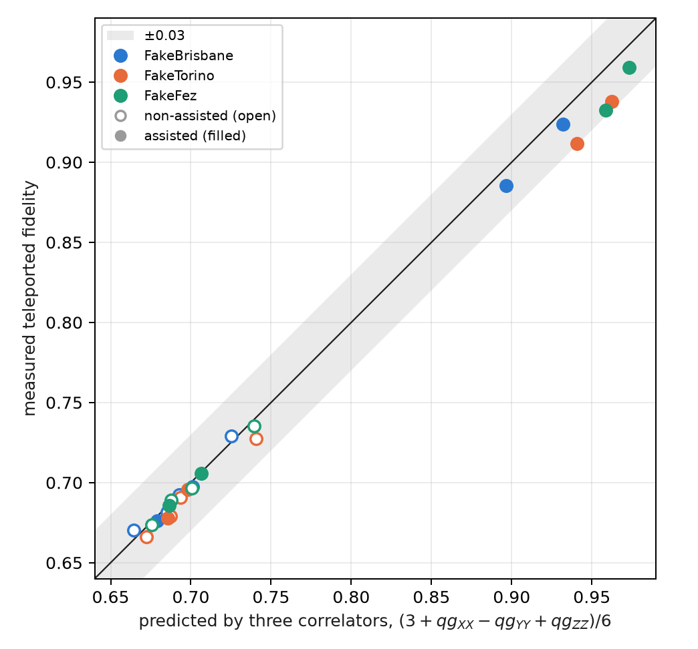
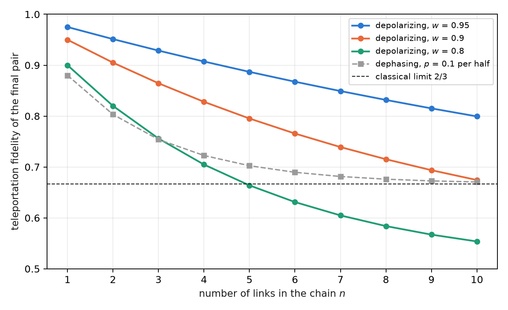

# Dual rail, the sector filter and long-distance fidelity {#sec-ch13}

Chapter 12 ended on a limitation: the qg filter did not help against device noise, because the teleportation circuit
does not conserve the weight. This chapter asks the two questions that follow. The first is whether the fidelity a
resource will give can be read before teleporting, with few measurements; the answer is yes, with three qg
correlators. The second is what happens if every gate conserves the photon number; the answer is dual rail, in which
the filter heralds every loss, and which at 20 km beats the noiseless single-rail optimum until false heralds set a
floor. The chapter closes Part IV with entanglement swapping along a chain, read with the same correlators.

## From the base: three qg readings predict a fidelity {#sec-correlators-base}

Each two-qubit correlator is a qg reading like those of Chapter 1: the parity of two bits measured in a basis,
$qg_{PP}=1-2P(\text{odd parity})$, with its m-qg reading and its error bar $\sqrt{(1-qg^2)/N}$. Chapter 12 showed that the
fidelity with $|\Phi^+\rangle$ is linear in three of them; so is the average teleportation fidelity (§158):

$$
F=\frac{3+qg_{XX}-qg_{YY}+qg_{ZZ}}{6}.
$$

It is a **linear read-out of the resource alone**, without the Bell measurement: three circuits with 4–5 two-qubit
gates, against 10–11 for the teleportation. Being linear, its error bar combines the three: with $N$ shots per
correlator, $\sigma_F=\sqrt{\sum(1-qg^2)/N}/6$, about 0.0025 with $N=10\,000$ near $F\approx0.7$.

## The fidelity from three correlators {#sec-prediction}

On the four links of Chapter 12, with both protocols and on three **simulated noise models**, the fidelity predicted
by the correlators was compared with the teleported one. In all 24 combinations the difference is at most 0.029
(@fig-correlators): **three short circuits predict the teleported fidelity**.

{#fig-correlators width=70%}

The pre-registered predictions wanted more: that the difference would isolate the noise of the Bell measurement. That
failed. The prediction fell below the noiseless optimum in 5 of 24 cases (A1), was not always above the teleported one
(A2, 3 of 24, all within two shot errors), and the difference was not always larger with assistance (A3, 2 of 12). The
reason is that the three correlator circuits read two data qubits and the herald, so they carry almost all the noise
the teleportation sees. **They work as a predictor, not as a decomposition.**

## Dual rail: every loss is heralded {#sec-dual-rail}

In single rail a qubit is a photon present or absent, and losing the photon turns a $|1\rangle$ into a valid $|0\rangle$: the loss
is invisible. In **dual rail** each qubit is one photon in two modes, $|0_L\rangle=|10\rangle$ and $|1_L\rangle=|01\rangle$. The logical
gates are built to conserve the photon number: the logical CNOT is a controlled SWAP of the target's modes, the logical
CZ a CZ between modes, and one-qubit gates act on the subspace $\{|10\rangle,|01\rangle\}$. Every loss leaves Bob's pair with
weight 0, and the qg filter (weight 1 on each pair) **heralds every loss, fibre included, without help from the other
users**.

Without gate noise, the result is clean:

$$
F_{\text{filtered}}=1\ \text{at any distance},\qquad \text{kept}=\eta,\qquad
F_{\text{raw}}=\frac{1+\eta}{2},
$$

where the raw value assumes Bob guesses when no photon arrives, and falls below the single-rail optimum $(2+\eta)/3$.
The filter turns loss into rate: the fidelity does not fall with distance; the number of useful pairs does. The price
is the circuit: 65–66 two-qubit gates, six times those of single rail.

## What dual rail measures on simulated devices {#sec-dual-noise}

With the Bell pair ($\alpha=\pi/4$), six inputs and 10 000 shots (§158), only one of the five dual-rail predictions held
(B4: the raw value is below single rail in all 12 combinations, 0.516–0.595). The other four failed, mostly for the same
reason:

| simulated device | filtered, (0 km, 1:4) → (20 km, 1:8) | kept / $\eta$ | 20 km: filtered vs noiseless single-rail $F^\ast$ |
|---|---|---|---|
| FakeBrisbane | 0.786; 0.720; 0.709; 0.650 | 0.91 → 1.98 | 0.709 / 0.714 (1:4); 0.650 / 0.692 (1:8) |
| FakeTorino | 0.847; 0.790; 0.783; 0.727 | 0.97 → 2.14 | 0.783 / 0.714; 0.727 / 0.692 |
| FakeFez | 0.869; 0.814; 0.791; 0.710 | 0.98 → 1.74 | 0.791 / 0.714; 0.710 / 0.692 |

: Dual rail with the qg filter on three simulated noise models; links in the order (0, 4), (0, 8), (20, 4), (20, 8). {#tbl-dual}

**False heralds set a floor** (B1, B2 and B5 failed). When the photon is lost, a gate or readout error can still leave
Bob's pair with weight 1: at 20 km, $(\text{kept}-\eta)/(1-\eta)$ is 3 to 6%. Those shots carry a fidelity of about 1/2, and
as $\eta$ falls they weigh more among the kept ones. With a false-herald probability $p_f$, the filtered fidelity is

$$
F_{\text{filtered}}=\frac{\eta\,F_0+(1-\eta)\,p_f/2}{\eta+(1-\eta)\,p_f},
$$

which falls with distance even though the channel adds no error (@fig-dual-rail). It is the dark-count floor of a real
heralded link, produced here by gate and readout errors.

{#fig-dual-rail width=90%}

**Heralding still wins at 20 km.** In a post hoc analysis, not pre-registered, on FakeTorino and FakeFez the filtered dual
rail beats the **noiseless** single-rail optimum on both splitters: 0.783 and 0.791 against 0.714 at 1:4; 0.727 and 0.710
against 0.692 at 1:8. It does so with six times the two-qubit gates. The raw value loses everywhere (B4), so the gain is
the filter's. B3, the pre-registered version of that comparison (against the noisy teleported fidelity), failed only on
FakeBrisbane at (20 km, 1:8).

The comparison with the continuous-variable work is qualitative: there the fidelity is deterministic and falls with
distance and with $N$; here the filter keeps the fidelity high and pays in rate (kept $\approx\eta$), until false heralds,
not loss, set the limit.

## Entanglement swapping along a chain {#sec-swapping}

To go further than one link, a network chains pairs: an intermediate node makes a Bell measurement between its two
halves, and the ends become entangled (entanglement swapping). This section is new in the book: it is exact
density-matrix algebra, verified in the figure script, with no device run.

For pairs diagonal in the Bell basis, which are what the Pauli noises of Chapter 12 leave, the result in qg is a
one-line rule: **the correlators multiply**. After swapping two pairs, with the Pauli correction that belongs to each
outcome,

$$
qg_{PP}^{(1\to3)}=qg_{PP}^{(1\to2)}\cdot qg_{PP}^{(2\to3)},\qquad P\in\{X,Y,Z\},
$$

and along a chain of $n$ equal links each correlator is raised to the $n$-th power. With depolarized pairs of parameter
$w$ ($qg_{XX}=qg_{ZZ}=w$, $qg_{YY}=-w$), the teleportation fidelity of the final pair is $F=(1+w^n)/2$, and it beats the
classical limit while $w^n>1/3$, that is, up to $n\le\ln3/\ln(1/w)$: 21 links at $w=0.95$, 10 at $w=0.9$ and 4 at $w=0.8$
(@fig-swapping).

{#fig-swapping width=85%}

The correlator reading also says which error accumulates. With dephasing, $qg_{ZZ}=1$ on every link and therefore along
the whole chain, while $qg_{XX}$ and $qg_{YY}$ decay as $0.64^n$: the final pair keeps its $Z$ correlations and loses its
phase ones, and its fidelity tends to 2/3 from above. It is the same signature as in the noise table of Chapter 12,
propagated along the chain, and it is what decides where to distil.

The link with dual rail is direct: in a chain of dual-rail pairs, every intermediate Bell measurement also conserves the
photon number, and the filter heralds the losses of all links at once. That experiment has not been done.

## What remains open {#sec-open13}

Three topics of the index have no support in the repository yet, and stay proposals, not results:

- routing and passive quantum switching in multi-carrier metropolitan topologies;
- a dual-rail repeater chain with the filter on simulated devices, which would test this section's multiplication rule
  against real gate noise;
- gate teleportation and its reading in qg correlators.

## Without qang and with qang {#sec-comparison13}

| action | without qang | with qang | difference |
|---|---|---|---|
| predict the teleportation fidelity | teleport and measure (10–11 two-qubit gates) | three correlators of the resource (4–5 gates): largest error 0.029 over 24 cases | **in favour** in circuit cost; the formula is known, qang makes it a linear reading with an error bar |
| herald losses | single rail: the loss is invisible | dual rail with the weight filter: every loss is heralded | the **filter and the encoding**'s, not the scale's |
| propagate noise along a chain of swaps | compose channels | the qg correlators multiply; $F=(1+w^n)/2$ | **in favour** in clarity: a one-line rule and the signature of which error accumulates |

: The chapter's actions without the qang scale and with it. {#tbl-comparison13}

**Balance.** The qg correlators are the part of qang that pays most in networks: they predict and propagate with
linear rules. The chapter's large gain, dual rail, belongs to the encoding and the filter.

## In code {#sec-code13}

```python
from qang import qpon

# the teleportation fidelity, from three correlators of the resource
qpon.fidelity_from_correlators(xx=0.84, yy=-0.81, zz=0.73)       # 0.897
qc = qpon.resource_circuit(alpha=1.231, transmission=1.0, n_users=8, basis="X")

# dual rail: noiseless closed forms and the 8-qubit circuit
qpon.dual_rail_fidelities(alpha=0.7854, eta=0.05)                # filtered 1.0, raw 0.525, kept 0.05
qc_dual = qpon.dual_rail_teleport_circuit(alpha=0.7854, eta=0.05, input_index=2)
```

## Summary {#sec-summary13}

- The teleportation fidelity is linear in three qg correlators of the resource, $F=(3+qg_{XX}-qg_{YY}+qg_{ZZ})/6$; in 24
  simulated cases it predicts the teleported one to 0.029, although it does not isolate the noise of the Bell
  measurement.
- In dual rail every gate conserves the photon number and the filter heralds every loss: without noise, $F=1$ at any
  distance with rate $\eta$.
- With noise, false heralds (3–6% at 20 km) set a floor and the filtered fidelity falls with distance; even so, on two
  of three models it beats the noiseless single-rail optimum at 20 km (post hoc analysis).
- Along a chain of swaps, the correlators of Bell-diagonal pairs multiply; with depolarization $F=(1+w^n)/2$, and with
  dephasing $qg_{ZZ}$ survives whole.
- Routing, repeaters on devices and gate teleportation remain open.
