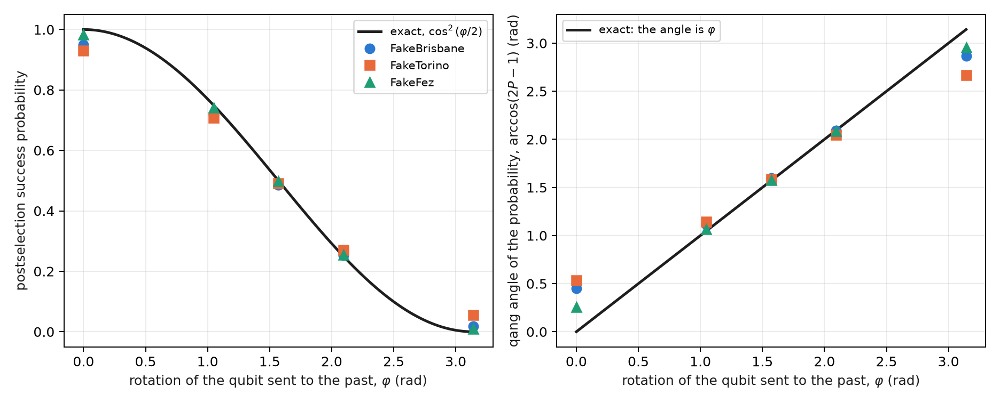
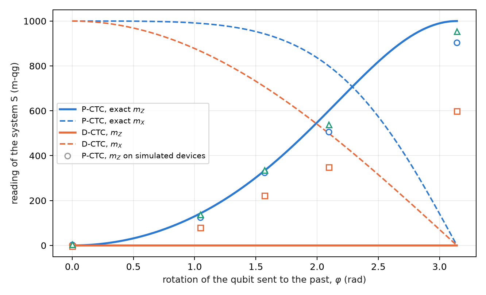
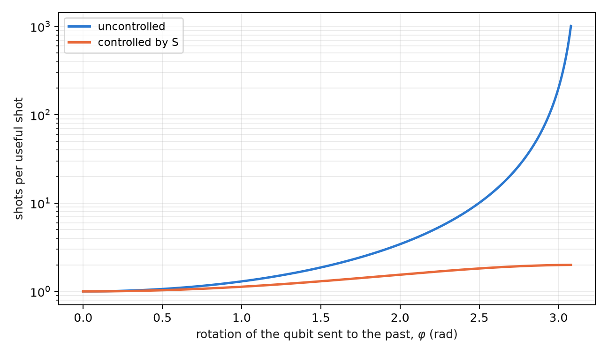

# Postselected closed timelike curves (P-CTC) and the resolution of paradoxes {#sec-ch14}

Part V deals with two information-theory models that use the vocabulary of relativity: time loops and black-hole
evaporation. It is worth saying from the start: **they are models of information theory, not statements about
spacetime** (§164). Both are teleportation with postselection on a Bell outcome, that is, a filter on the Bell sector,
and that is why they belong in this book. This chapter treats the time loop in its two known formulations, the
postselected one (P-CTC) and Deutsch's (D-CTC), and what a qg reading tells apart between them.

## From the base: the success probability has qang angle $\varphi$ {#sec-pctc-base}

In the simplest model the qubit that "travels to the past" undergoes a rotation $R_X(\varphi)$, and the postselection
succeeds with probability

$$
P_{\text{success}}=\cos^2\frac{\varphi}{2}.
$$

It is the probability equation of Chapter 1 with $p_0=P_{\text{success}}$, so its qang angle is exactly the rotation,
$\arccos(2P-1)=\varphi$, its reading is $m=1000\cos\varphi$, and the success rate measured over $N$ attempts gives $\varphi$ with
uncertainty $1/\sqrt N$. The grandfather paradox, $\varphi=\pi$, sits at the south pole: $P=0$, $m=-1000$.

## Two ways to close a time loop {#sec-dctc-pctc}

**Deutsch (D-CTC, 1991).** The system in the loop must be self-consistent: its state $\rho_C$ is a fixed point of the
evolution, $\rho_C=\operatorname{Tr}_S[U(\rho_S\otimes\rho_C)U^\dagger]$. At least one fixed point always exists, so there is never a
paradox, but there may be several, and an extra rule is needed to choose; the usual one takes the maximum-entropy
fixed point.

**Postselection (P-CTC; Bennett and Svetlichny, Lloyd and co-workers, 2011).** The qubit sent to the past, $C$, is half
of a Bell pair $(C,A)$. After $C$ interacts with the system $S$, $(C,A)$ is projected back onto the Bell state: it is a
teleportation of $C$ to its own past, with the Bell measurement forced to its trivial outcome. The effective evolution
of $S$ is

$$
\rho_S\mapsto\frac{\operatorname{Tr}_C(U)\,\rho_S\,\operatorname{Tr}_C(U)^\dagger}{\operatorname{Tr}[\ldots]},
$$

which is not linear because of the normalization. In the circuit the projection is a Bell measurement keeping the
shots that read 00: a filter on the Bell sector.

## The success law and the grandfather paradox {#sec-grandfather}

With $R_X(\varphi)$ on $C$ alone, $\operatorname{Tr}_C(U)=\operatorname{Tr}R_X(\varphi)/2=\cos(\varphi/2)$, and the success is $\cos^2(\varphi/2)$. At
$\varphi=\pi$ the qubit flips its own past: it is the grandfather paradox, and in P-CTC **it has probability zero**. It is
not resolved: it does not happen. In D-CTC the same case has the maximally mixed state as its fixed point, and it
happens with probability 1, like a coin.

On three **simulated noise models**, with 8000 shots (§164), the success law holds within 0.05 except at $\varphi=0$ on two
devices (C1 failed: 0.950 and 0.931 against 1), and the paradox is suppressed to the noise floor on two of three (C2
failed on FakeTorino):

| simulated device | success at $\varphi=0$ (exact 1) | success at $\varphi=\pi$, the paradox (exact 0) |
|---|---|---|
| FakeBrisbane | 0.950 | 0.019 |
| FakeTorino | 0.931 | 0.056 |
| FakeFez | 0.983 | 0.009 |

: The P-CTC success law at the extremes, simulated noise models. {#tbl-pctc-extremes}

{#fig-pctc-success width=100%}

@fig-pctc-success shows something specific to the angle reading. In the interior, the qang angle of the measured rate
reproduces $\varphi$ to a few hundredths of a radian; at the poles it deviates by up to half a radian. It is the
non-linearity of the milli-qang in angle from Chapter 1: next to the pole, 1 m-qg is 2.56°, and the devices' 34–138 m-qg
of error at $\varphi=0$ become 0.26–0.53 rad.

## The rotation controlled by the system {#sec-controlled}

If it is the system $S$ that controls the rotation of $C$, the partial trace is an operator on $S$:

$$
\operatorname{Tr}_C(U)=\operatorname{diag}\!\left(1,\ \cos\tfrac{\varphi}{2}\right),
$$

and the branch of $S$ that would produce the paradox is damped by $c=\cos(\varphi/2)$. From $|+\rangle$, the postselected
state of $S$ has

$$
qg_Z(S)=\frac{1-c^2}{1+c^2},\qquad qg_X(S)=\frac{2c}{1+c^2},
$$

with success $(1+c^2)/2$. At $\varphi=\pi$, $qg_Z(S)=1$: the system is forced into the branch that does not flip the past.
On the simulated models FakeFez follows the curve within 0.061 over the whole range, FakeBrisbane reads 0.903 at
$\varphi=\pi$, and FakeTorino loses most of the suppression (0.600): prediction C3 failed.

## What a qg reading tells apart between D-CTC and P-CTC {#sec-dctc-numeric}

This section is new in the book: it is exact density-matrix algebra, computed in the figure script, with no device
run. The same controlled circuit is taken, with $S$ in $|+\rangle$, and the output of $S$ is computed in both formulations.

In D-CTC the channel on $C$ is $\rho_C\mapsto\tfrac12\rho_C+\tfrac12R_X\rho_CR_X^\dagger$, and every state that commutes with $R_X(\varphi)$ is a
fixed point. With the maximum-entropy rule, $\rho_C=I/2$, and the output of $S$ is

$$
qg_Z(S)=0,\qquad qg_X(S)=\cos\frac{\varphi}{2},\qquad r=\cos\frac{\varphi}{2}.
$$

The two formulations separate in different readings (@fig-dctc):

| $\varphi$ | P-CTC: $m_Z$, $m_X$ (m-qg) | D-CTC: $m_Z$, $m_X$ (m-qg) | P-CTC success |
|---|---|---|---|
| 0 | 0, 1000 | 0, 1000 | 1 |
| $\pi/3$ | 143, 990 | 0, 866 | 0.875 |
| $\pi/2$ | 333, 943 | 0, 707 | 0.750 |
| $2\pi/3$ | 600, 800 | 0, 500 | 0.625 |
| $\pi$ | 1000, 0 | 0, 0 | 0.500 |

: The system S after the controlled loop, in both formulations. {#tbl-dctc}

{#fig-dctc width=90%}

The difference is qualitative. **P-CTC changes the populations** of $S$ (the paradoxical branch loses weight) and leaves
a pure state; **D-CTC does not touch the populations** and only removes coherence. A $Z$ reading of $S$ already decides
between the two models, and the simulated devices, with all their noise, sit on the P-CTC side, as they must, because
the circuit is the P-CTC one.

Deutsch's ambiguity can be read too. At $\varphi=\pi/2$ the state $|+\rangle$ is also a fixed point, and it gives the same
$qg_Z(S)=0$ and the same $qg_X(S)=0.707$, but $qg_Y(S)=-0.707$ and radius 1, against $qg_Y=0$ and radius 0.707 with $I/2$. The two
D-CTC solutions differ in the local radius of Chapter 5: the maximum-entropy rule picks the fixed point that leaves $S$
most mixed.

## The cost of postselection {#sec-cost-pctc}

"Time travel" in this model costs shots. Each useful shot needs, on average, $1/P_{\text{success}}$ shots: 2 at $\varphi=\pi/2$,
4 at $2\pi/3$, 400 at a tenth of a radian from the paradox (@fig-cost-pctc). With the controlled rotation the cost never
exceeds 2, because half of the superposition of $S$ pays nothing. It is the same accounting as the sector filter of the
previous chapters, with one difference: here the discarded fraction is not noise but the model's physics, and it cannot
be reduced.

{#fig-cost-pctc width=80%}

## What remains open {#sec-open14}

Two topics of the index have no support yet and stay proposals: the non-linearity of P-CTCs applied to discriminating
non-orthogonal states (the circuit and the prediction are missing), and a device run of the D-CTC against P-CTC
comparison, which would require preparing Deutsch's fixed point and not only postselecting.

## Without qang and with qang {#sec-comparison14}

| action | without qang | with qang | difference |
|---|---|---|---|
| read the loop's rotation | invert $\cos^2(\varphi/2)$ | the qang angle of the success rate is $\varphi$, with $\sigma=1/\sqrt N$ | **equivalent** in the interior; at the poles the angle reading **amplifies** the error (34–138 m-qg become 0.26–0.53 rad), which counts **against** |
| verify the suppression of the paradox | success probability and the state of S by tomography | $m_Z(S)$: 903, 600 and 955 m-qg against 1000 | **unit**; the suppression is the postselection's |
| tell D-CTC from P-CTC | compare density matrices | P-CTC moves $m_Z$; D-CTC does not and lowers $m_X$ | **in favour**: a single $Z$ reading decides the model |
| tell apart the D-CTC fixed points | entropy of each solution | the local radius of Chapter 5: 0.707 against 1 | **in favour**: the ambiguity becomes a reading |
| reduce noise | — | the postselection is the filter; the qang scale adds nothing | **none** |

: The chapter's actions without the qang scale and with it. {#tbl-comparison14}

**Balance.** In this chapter qang pays as a diagnostic tool: with one or two readings it says which loop model is
operating and which of Deutsch's solutions was chosen. The success law is the probability equation of Chapter 1, and
with it come its limits next to the poles.

## In code {#sec-code14}

```python
import math
from qang import postselection as ps

ps.pctc_success(2 * math.pi / 3)                 # 0.25: postselection success
math.acos(2 * ps.pctc_success(2.0) - 1)          # 2.0: the qang angle is the rotation
ps.pctc_controlled_qg_z(math.pi)                 # 1.0: the paradoxical branch, suppressed
qc = ps.pctc_circuit(math.pi, controlled=True)   # S, C, A; success = C and A read 0
```

## Summary {#sec-summary14}

- The time loops of this chapter are information models: teleportation with postselection on a Bell outcome.
- In P-CTC the success probability is $\cos^2(\varphi/2)$ and its qang angle is $\varphi$; the grandfather paradox has
  probability zero and, on two of three simulated models, sits at the noise floor.
- With the controlled rotation, $qg_Z(S)=(1-c^2)/(1+c^2)$: the paradoxical branch is suppressed; FakeTorino loses most of
  the suppression.
- D-CTC does not change the populations of S and only removes coherence; a $Z$ reading separates the two models, and the
  local radius separates Deutsch's fixed points.
- Postselection costs $1/P$ shots per useful shot; it is the model's physics, not noise, and it cannot be reduced.
