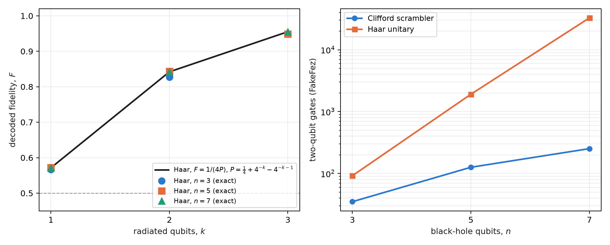
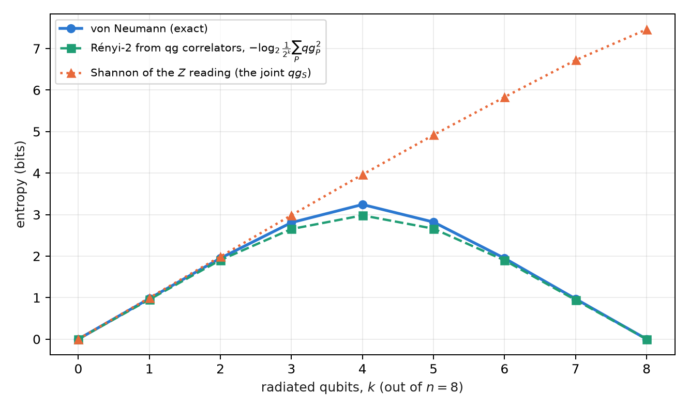

# Black-hole thermodynamics, quantum chaos and the Yoshida–Kitaev decoder {#sec-ch15}

This is the second model of Part V, and the warning of chapter 14 holds again: **it is an information-theoretic model,
not a statement about real black holes** (§164). A black hole of a few qubits, a unitary that scrambles information, and
a teleportation postselected on a Bell outcome: the same filter on the Bell sector as in the previous chapter, now set to
recover a message that fell into the horizon.

## From the base: success 1/4 and the equator of the fidelity {#sec-yk-base}

The protocol produces two numbers, and both are probabilities, so the probability equation of chapter 1 reads them
directly. The postselection succeeds with probability $P=1/4$: its reading is $m_P=1000(2P-1)=-500$ and its qang angle
$\arccos(-1/2)=2\pi/3$. The fidelity $F$ of the recovered pair with a Bell pair is the probability that the Bell
measurement gives its trivial outcome, and it reads the same way, $m_F=1000(2F-1)$.

The scale has a concrete virtue here: **the threshold that matters falls on the equator**. A Bell fidelity above $1/2$
certifies entanglement, and $F=1/2$ is $m_F=0$. Without scrambling the pair comes out maximally mixed, $F=1/4$, and reads
$-500$; with scrambling, $F=1$, and it reads $1000$. Decoding is crossing the equator.

## The information paradox and complementarity {#sec-hawking}

Hawking (1976) showed that a black hole radiates with a thermal spectrum, and that the radiation does not seem to depend
on what fell in. If the hole evaporates completely, a pure state would end as a mixed one: evolution would not be
unitary. Complementarity (Susskind, Thorlacius and Uglum, 1993) and, above all, Page's argument (1993) led to the opposite
position, the majority one today: the information comes out in the radiation, encoded in fine correlations.

Hayden and Preskill (2007) asked when it comes out. Their answer, for a black hole past the middle of its life whose
dynamics scrambles information fast, is "almost at once": a message of a few qubits thrown into the hole can be
rebuilt from just a few more qubits of radiation, given the early radiation. Yoshida and Kitaev (2017) gave an explicit
decoder, and it is the one run in this chapter.

## Scrambling: a 3-qubit micro black hole {#sec-scrambling}

The toy black hole has 3 qubits: the message $A$ and two qubits $B_1,B_2$ that were already inside. Its dynamics is a
unitary $U$ on the three, and "$U$ scrambles information" has an operational definition: **every single-qubit Pauli
operator ends up, after $U$, acting on all three qubits**. For a Clifford this is checked with no approximation, by
evolving the 9 Paulis $X,Y,Z$ of each qubit. `find_scrambler` takes the first random Clifford (seed 164) that meets the
condition, and its 9 Paulis have weight 3.

Scrambling is the quantum version of chaos: a local error (a Pauli) becomes, after the dynamics, an error of the whole
system, and no measurement of one qubit detects it. So it is no surprise that a black hole "hides" the message, and it
is a surprise that the message can be recovered.

## The Hayden–Preskill protocol and the decoder {#sec-yk}

The circuit has 8 qubits. The message $A$ is entangled with a reference $R$, the one who throws it; the black hole $B$ is
entangled with the early radiation $B'$, held by the outside observer. After $U$ on $(A,B_1,B_2)$, one qubit $D$ (the
output of $B_2$) is radiated. The observer holds $D$ and $B'$, and prepares a copy of the experiment: a pair $(A',R')$
and the conjugate unitary $U^*$ on $(A',B'_1,B'_2)$. Then **$(D,D')$ is postselected on the Bell state**. On success,
the entanglement of $A$ with $R$ has moved to $R'$: the message was teleported out of the interior.

For a scrambler, the postselection succeeds with probability $1/d_A^2=1/4$ and the fidelity of the pair $(R,R')$ is 1.
Without scrambling ($U=I$), the postselection almost always succeeds, because $D$ carries nothing of $A$, and the
fidelity is that of a random pair, $1/4$. The postselection is, as in chapter 14, a filter on the Bell sector of
$(D,D')$.

## The exact law $P\cdot F=1/4$ {#sec-pf-law}

This section is new in the book. In Yoshida and Kitaev's probabilistic decoder, the success and the fidelity are not
independent:

$$
P\,F=\frac{1}{d_A^{2}}=\frac14 .
$$

The figure script checks it on exact states over 60 random Cliffords and 25 Haar unitaries of 3 qubits, and at every
size of the next section: on 3 qubits the largest deviation is $3\times10^{-16}$. On the chapter 1 scale the law is a hyperbola,

$$
(1000+m_P)(1000+m_F)=10^{6},\qquad\text{or}\qquad \cos\frac{\theta_P}{2}\,\cos\frac{\theta_F}{2}=\frac12 ,
$$

with a practical consequence: **without noise, the success already tells the fidelity**. A success of $1/4$ ($m_P=-500$)
forces $F=1$; a success of 1 ($m_P=1000$) forces $F=1/4$. Among random 3-qubit Cliffords, 27 of 60 decode
perfectly.

With noise the law breaks, and the direction in which it breaks is what makes it useful. Full noise takes $(D,D')$ to
the mixed state, whose success is *also* $1/4$, with $F=1/4$: the success alone does not tell a perfect decoder from
one destroyed by noise. The product does: $4PF$ is 1 for the first and $1/4$ for the second.

## On simulated noise models {#sec-yk-noise}

With 8000 shots on three **simulated noise models** (§164), the circuit with the scrambler, 90 two-qubit gates after
transpilation, gives:

| simulated device | success $P$ ($m_P$) | fidelity $F$ ($m_F$) | $4PF$ | no scrambling: $F$ ($m_F$) |
|---|---|---|---|---|
| exact | 0.250 (−500) | 1 (1000) | 1 | 0.250 (−500) |
| FakeBrisbane | 0.260 (−481) | 0.547 (93) | 0.568 | 0.248 (−504) |
| FakeTorino | 0.248 (−504) | 0.578 (156) | 0.573 | 0.250 (−501) |
| FakeFez | 0.246 (−508) | 0.742 (484) | 0.731 | 0.250 (−500) |

: The Yoshida–Kitaev decoder on three simulated noise models. {#tbl-yk}

{#fig-yk width=100%}

The three runs with the scrambler cross the equator (H3), and the success stays within 0.05 of $1/4$ (H2). But
@fig-yk shows why H2 is no evidence of decoding: the success of the three devices is the one full noise would give.
What sets FakeFez apart from the other two is the fidelity, and $4PF$ sums it up in one number: 0.73 against 0.57.
Prediction H1 (a fidelity advantage above 0.3 over the unscrambled case on all three) missed by 0.001 on FakeBrisbane.

## Larger black holes {#sec-yk-large}

This section is new as well: exact states, gate counts and a simulation with the FakeFez noise model, no device run.
The circuit is generalised to an $n$-qubit black hole with $k$ radiated qubits: $2n+2$ qubits in all, 16 for $n=7$.

Two results organise the topic. The first: **with a single radiated qubit, a generic black hole is not enough**. For a
Haar unitary the average success is $P\approx\tfrac14+4^{-k}-4^{-k-1}$, and by the law $F=1/(4P)$: with $k=1$, $F\approx4/7=0.57$,
barely above the equator, whether $n=3$, 5 or 7. One has to radiate a little more than the message: with $k=2$,
$F\approx0.84$; with $k=3$, $F\approx0.95$ (@fig-size, left). It is the quantitative version of Hayden and Preskill's "a
few more qubits". The 3-qubit Clifford scrambler, with $F=1$ at $k=1$, is a special case, not the typical one.

The second: **the gate cost separates the two kinds of scrambler**. A Clifford scrambler is transpiled as a Clifford circuit: 35, 126
and 252 two-qubit gates for $n=3$, 5 and 7. A Haar unitary is synthesised as a generic unitary, and its cost grows as $4^n$:
92, 1908 and 32 680 (@fig-size, right). There is also a lesson for the §164 run: the same 3-qubit scrambler, handed to the
transpiler as a matrix, was synthesised with 90 gates; handed over as a Clifford, with 35, and on the FakeFez model the
fidelity rises from 0.742 to 0.887 (a new simulation with another seed, not the saved run).

| black hole | radiated qubits | two-qubit gates (FakeFez) | success on FakeFez (exact 0.25) | $F$ on FakeFez ($m_F$; exact 1) | $4PF$ on FakeFez |
|---|---|---|---|---|---|
| 3 qubits | 1 | 35 | 0.253 | 0.887 (773) | 0.899 |
| 5 qubits | 2 | 126 | 0.191 | 0.802 (605) | 0.613 |
| 7 qubits | 3 | 252 | 0.105 | 0.882 (764) | 0.370 |

: The decoder with perfect Clifford scramblers of 3, 5 and 7 qubits, exact and on the FakeFez noise model. {#tbl-yk-large}

{#fig-size width=100%}

@tbl-yk-large shows how far the filter reaches. The fidelity stays between 0.80 and 0.89 even with 252 gates,
and not because noise does not act: the postselection on $k$ Bell pairs discards the shots in which noise touched
$(D,D')$, and with more pairs it discards more. The success falls from 0.253 to 0.105 against the exact $1/4$ (with full
noise it would be $4^{-k}$, $1/64$ for $k=3$). The fidelity alone would say the 7-qubit decoder is as good as the
3-qubit one; $4PF$ says it delivers 0.37 of what it should, because it pays in shots what the fidelity does not show. It
is the rule of the sector filters of earlier chapters: the filter improves what is kept at the cost of the rate, and
$4PF$ puts both in one number. With noise the law now breaks on the other side: on 3 qubits the fidelity drops, on 7 the
success does.

## A toy Page curve {#sec-page}

Page (1993) predicted how the entanglement of the radiation of a unitarily evaporating black hole grows: it rises while
the radiation is the smaller part, peaks when half has been radiated, and falls to zero at the end, because the total
state is pure. An exact toy: a Haar state of 8 qubits, with the first $k$ as the radiation.

The index proposed reading this curve with $qg_S$. **It does not work**, and it is worth saying why. $qg_S$ is the
Shannon entropy of a $Z$ reading, and a random state looks random in any basis: the joint reading of the $k$ radiated
qubits has entropy close to $k$ through the whole evaporation, including when the radiation is already nearly pure
(@fig-page, triangles). It is the limit `qang.circuits` already documents with graph states as the counterexample:
$qg_S$ depends on the basis and does not measure entanglement.

What does work uses the same qg readings, squared. The purity of the radiation is the sum of the squares of its Pauli
correlators,

$$
\operatorname{Tr}\rho^{2}=\frac{1}{2^{k}}\sum_{P\in\{I,X,Y,Z\}^{k}}qg_P^{\,2},
$$

and $S_2=-\log_2\operatorname{Tr}\rho^2$, the Rényi entropy of order 2, is a lower bound on the von Neumann entropy that
follows the Page curve: at $k=4$, the half, $S_2=2.98$ bits against $S=3.24$, and both return to zero at $k=8$, while the Shannon entropy of the $Z$ reading reaches 7.46. The cost is the unfavourable side: $4^k-1$ correlators, 255 for $k=4$. (The script
computes it from the correlators up to $k=4$; beyond that it uses $\operatorname{Tr}\rho^2$ directly, the same quantity.)

{#fig-page width=85%}

## Traversable wormholes {#sec-wormhole}

The Yoshida–Kitaev decoder is, as a circuit, the same protocol that the holographic literature calls teleportation
through a traversable wormhole (Gao, Jafferis and Wall, 2017; Maldacena, Stanford and Yang, 2017): two entangled systems,
a scrambling dynamics on each (one side conjugated) and a coupling between them that lets a qubit through. The ER = EPR
conjecture (Maldacena and Susskind, 2013) proposes that such entangled pairs are, in a dual gravitational theory, an
Einstein–Rosen bridge. The circuit decides none of that; it does let the result be read with the tools of this book.

The fidelity of the recovered pair is linear in three qg correlators, as in chapter 13:

$$
F=\frac{1+qg_{XX}-qg_{YY}+qg_{ZZ}}{4}.
$$

On the exact state, with the scrambler, $(qg_{XX},qg_{YY},qg_{ZZ})=(1,-1,1)$ and $F=1$; without scrambling, $(0,0,0)$ and
$F=1/4$. The experiment of Jafferis and collaborators (2022) on a Google processor used a learned 7-qubit model to mimic
this physics, and its reading as a wormhole was disputed (Kobrin and collaborators, 2023). This book does not run that
experiment; the correlator reading stays a tool, not evidence.

## What remains open {#sec-open15}

None of the new results of this chapter (the law $PF=1/4$ as a diagnostic, the 5- and 7-qubit black holes, the Page
curve from correlators) has a device run. A real-hardware run of the 3-qubit decoder, with 90 two-qubit gates, would be
the next step and costs credits; it stays outside this book for now.

## Without qang and with qang {#sec-comparison15}

| action | without qang | with qang | difference |
|---|---|---|---|
| decide whether the message was recovered | compare $F$ with 1/2 | the sign of $m_F$: decoding is crossing the equator | **unit**: the threshold sits at zero, but it is the same threshold |
| judge the quality of the decoder | $P$ and $F$ separately | the law $(1000+m_P)(1000+m_F)=10^6$ and its summary $4PF$ | **in favour**, with a caveat: the law is Yoshida and Kitaev's, not qang's; the scale turns it into a readable hyperbola and shows that $m_P=-500$ proves nothing |
| predict how much radiation is needed | the Haar formula | the same formula, $F=1/(4P)$ | **none** |
| the Page curve | von Neumann entropy by tomography | $qg_S$ in $Z$ | **against**: $qg_S$ does not see the curve |
| the Page curve, again | tomography | Rényi-2 from the sum of $qg_P^2$ | **equivalent**: it is Pauli tomography written in qg, with its $4^k-1$ cost |
| the wormhole fidelity | Bell measurement of the pair (one setting) | three qg correlators | **none** in cost, since the Bell measurement already gives $F$; **in favour** as a diagnostic: the three correlators tell which component fails |
| reduce noise | — | the postselection is the filter; the scale adds nothing | **none** |

: The actions of the chapter without the qang scale and with it. {#tbl-comparison15}

**Balance.** The clearest contribution of qang in this chapter is one of reading: the decoder's exact law becomes a
curve in the plane of the two readings, and in that plane one sees at once that the right success is no evidence of
decoding. Where the index promised more, the Page curve with $qg_S$, the result is negative, and what replaces it is
Pauli tomography, not a property of the scale.

## In code {#sec-code15}

```python
from qiskit.quantum_info import Statevector
from qang import postselection as ps

scr = ps.find_scrambler()                        # 3-qubit Clifford, seed 164
qc = ps.yk_decoder_circuit(scr, measure=False)   # 8 qubits: R, A, B1, B2, B1', B2', A', R'
probs = Statevector(qc).probabilities_dict()
ps.yk_from_counts({k: round(1e6 * v) for k, v in probs.items()})
# {'success': 0.25, 'fidelity': 1.0}: P F = 1/4
```

## Summary {#sec-summary15}

- The Yoshida–Kitaev decoder is teleportation postselected on the Bell sector of a radiated qubit and its copy: a model
  of information, not of gravity.
- On the chapter 1 scale, the success $1/4$ is $m_P=-500$ and the fidelity that certifies recovery, $F>1/2$, is
  $m_F>0$: decoding is crossing the equator.
- The exact law $PF=1/4$ is a hyperbola in m-qg; with noise, the success stays at $1/4$ but the fidelity drops, and
  $4PF$ (0.57–0.73 on three simulated models) measures the quality of the decoder.
- With a single radiated qubit, a generic black hole gives $F\approx0.57$; 2 or 3 radiated qubits are needed for
  $F\approx0.84$–$0.95$.
- A Clifford scrambler costs 35, 126 and 252 two-qubit gates on 3, 5 and 7 qubits; with 7, the fidelity on FakeFez
  stays at 0.88 but the success falls to 0.105 and $4PF$ to 0.37: the filter keeps the quality and charges in rate.
- $qg_S$ does not see the Page curve; the Rényi-2 entropy from the qg correlators does, at the cost of $4^k-1$ readings.
