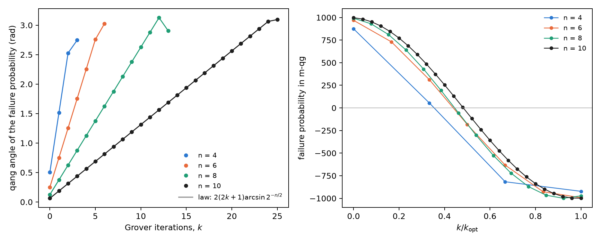
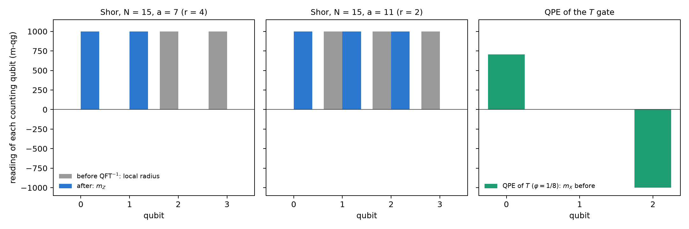

# Demarcation: quantum cryptography against post-quantum cryptography (PQC) {#sec-ch16}

Part VI is about security. Before reading quantum key distribution (Chapter 17) and certified random numbers
(Chapter 18) in qg, it is worth drawing the border. There are two answers to the quantum computer that share the word
"quantum" and little else. **Quantum cryptography** (QKD, QRNG) uses qubits: its security rests on a physical
measurement, and so it enters the probability equation of Chapter 1. **Post-quantum cryptography** (PQC) is classical
software that runs on ordinary computers: its security rests on the hardness of a mathematical problem, and there is no
qubit to read. This chapter says where the line runs, with numbers, and what qang reads on each side.

## From the base: which probabilities exist on each side {#sec-pqc-base}

Any probability $p_0$ enters the equation of Chapter 1: it has qang angle $\theta=2\arccos\sqrt{p_0}$ and reading
$m=1000(1-2p_1)$ m-qg. The question is not whether it can be written down, but whether the reading says anything.

- **In QKD**, the probability that decides security is the quantum bit error rate (QBER) of a measurement in one basis.
  It is the probability of a qubit, and its reading is the one of Chapter 17: $Q=(1-|qg|)/2$, that is,
  $m=1000\,|qg|=1000(1-2Q)$.
- **In PQC**, the only probability in the scheme is that decryption fails, $\delta$. For ML-KEM, the FIPS 203 standard
  bounds it by $2^{-138.8}$, $2^{-164.8}$ and $2^{-174.8}$ for the three levels. Written in m-qg it is
  $m=1000-3.3\times10^{-39}$ at best: it sits against the pole, and there is no Hermitian operator, measurement basis or
  Bloch sphere behind that number.

The security of PQC, moreover, is not that probability: it is the hardness of a lattice problem (module learning with
errors, MLWE), which is not the frequency of anything. That is the demarcation in one line: **qang reads probabilities of
measurements; PQC has no measurements**.

## The nature of PQC {#sec-pqc-nature}

NIST's standards of August 2024 are three: ML-KEM (FIPS 203, formerly Kyber), a lattice key-encapsulation mechanism;
ML-DSA (FIPS 204, formerly Dilithium), lattice signatures; and SLH-DSA (FIPS 205, formerly SPHINCS+), signatures built
only on hash functions. In 2025 HQC, based on error-correcting codes, was also chosen as a second key mechanism. All of
them are integer arithmetic: polynomials modulo $q=3329$ in ML-KEM, hash trees in SLH-DSA. None of them prepares a state,
applies a gate or measures.

In ML-KEM, decrypting is subtracting and rounding: the message survives if an accumulated noise (the sum of many products
of small coefficients) stays within $\pm q/4$. If not, decryption fails. That is the $\delta$ above.

## Decryption failure is counted, not measured on a qubit {#sec-pqc-failure}

To see what qang would do with $\delta$, the figure script builds a toy scheme with the same mechanism: noise
$e=\sum_{i<2n}a_ib_i+c$ with $a_i,b_i,c$ from ML-KEM's centred binomial distribution, $n=256$, $q=3329$, without the
standard's compression (which in ML-KEM accounts for most of the failure), and with the width $\eta$ as the knob. The
failure probability is computed exactly (a convolution modulo $q$) and counted over 200,000 simulated encryptions.

| $\eta$ | $\sigma/q$ | exact failure | counted | reading (m-qg, 95% CI) |
|---|---|---|---|---|
| 16 | 0.054 | $5.1\times10^{-6}$ | 1 of 200,000 | 1000.0 [999.9, 1000.0] |
| 20 | 0.068 | $2.5\times10^{-4}$ | 60 | 999.4 [999.2, 999.5] |
| 24 | 0.082 | $2.2\times10^{-3}$ | 437 | 995.6 [995.2, 996.0] |
| 32 | 0.109 | $2.2\times10^{-2}$ | 4360 | 956.4 [955.1, 957.7] |
| 40 | 0.136 | $6.6\times10^{-2}$ | 13,072 | 869.3 [867.1, 871.4] |

: Decryption failure of the toy scheme, exact and counted. {#tbl-pqc-failure}

The count agrees with the exact sum, and `qang.probability.analyze` reads it in m-qg with its interval. But that reading
is the Wilson proportion in another unit: there is no angle of a state behind it. And no count reaches where real PQC
lives (@fig-frontier16, right). Seeing a single ML-KEM-512 failure takes on the order of $1/\delta\approx6\times10^{41}$
decryptions; with $10^{12}$ trials, about the most one can count, the floor sits 30 orders of magnitude above. The shot
rule of Chapter 1 says the same in m-qg: next to the pole, $\sigma_m\approx2000\sqrt{\delta/N}$, and to bring it below the
offset $2000\,\delta$ one needs $N>1/\delta$. **PQC's $\delta$ is proved, not measured.**

{#fig-frontier16 width=100%}

On the other side of the line (@fig-frontier16, left), the quantity that decides BB84's security sits in the middle of
the scale. The Shor–Preskill asymptotic rate, $1-2h(Q)$, vanishes at $Q=11.0\%$, which is $m=780$ m-qg; intercept-resend
gives $Q=25\%$, $m=500$. With 2000 shots, $\sigma_m$ is 11.8, 9.7 and 7.0 m-qg at 850, 900 and 950 m-qg: the margin to
the threshold is resolved comfortably. It is the probability of a qubit, readable and with an error bar; Chapter 17 uses
it to separate the eavesdropper from the noise.

## The quantum attack vector: Grover {#sec-pqc-grover}

The quantum computer is quantum, and its attacks do enter the base. Grover's attack on an $n$-bit key has, after $k$
iterations, failure probability

$$
p_{\text{fail}}=\cos^2\!\big((2k+1)\,\beta\big),\qquad \beta=\arcsin 2^{-n/2},
$$

which is the probability equation with qang angle $2(2k+1)\beta$: **each iteration advances the qang angle by $4\beta$, in a
straight line**. This was checked with the circuits of `qang.algorithms` for $n=4$, 6, 8 and 10: the angle of the exact
probability matches the law to $10^{-10}$ rad (@fig-grover16). In m-qg, the failure goes from +1000 to −1000 along a
cosine and crosses the equator (success 1/2) halfway.

{#fig-grover16 width=100%}

For AES-128 the step is $4\arcsin2^{-64}=2.2\times10^{-19}$ rad per iteration, and reaching the pole takes $1.4\times10^{19}$
serial iterations, each a full AES circuit; for AES-256, $2.7\times10^{38}$. PQC's answer to this attack is to double the
symmetric key length, and the geometry explains it: the angle advances as $2^{-n/2}$, so Grover halves the security bits
and nothing more.

## The quantum attack vector: Shor and phase estimation {#sec-pqc-shor}

The attack that breaks RSA and elliptic curves, and that PQC sidesteps, is Shor's algorithm: phase estimation (QPE) on
modular multiplication. The notes (§13) show that QPE recovers exact phases, and the book's index said that "the
eigenstate register projects onto $qg_Z=-1$ without resolving the phase". That holds for the QPE of an eigenstate, and the
exact computation of this chapter says how far a qg reading goes in Shor's case (@fig-shor16).

**QPE of an eigenstate.** With the $T$ gate on $|1\rangle$ ($\varphi=1/8$), the target register stays at $m_Z=-1000$ and carries
no information: the phase lives in the counting register. There, before the inverse QFT, qubit $k$ has
$m_X=1000\cos(2\pi2^k\varphi)$: 707, 0 and −1000 m-qg. Each qubit carries one bit of the phase in its qang angle, which is
Kitaev's iterative phase estimation.

**Shor for $N=15$.** The work register is not in an eigenstate but in a superposition of the $r$ eigenstates, and the
counting qubits end up entangled with it. With four counting qubits:

| case | local radius of each counting qubit, before (m-qg) | $m_Z$ of each qubit, after | outcomes |
|---|---|---|---|
| $a=7$ ($r=4$) | 0, 0, 1000, 1000 | 1000, 1000, 0, 0 | 0, 4, 8, 12 |
| $a=11$ ($r=2$) | 0, 1000, 1000, 1000 | 1000, 1000, 1000, 0 | 0, 8 |
| $N=21$, $a=2$ ($r=6$), six qubits | 0, 0, 0, 0, 0, 0 | 0, 250, 312, 328, 332, 0 | peaks at 0, 11, 21, 32, 43, 53 |

: Single-qubit readings of the counting register in Shor's algorithm (exact state). {#tbl-shor16}

For $N=15$ the order can be read qubit by qubit: the number of qubits with zero radius before the QFT, or with $m_Z=0$
after it, is $\log_2 r$. But that is an accident of $N=15$, where $r$ is a power of 2. With $N=21$ and $r=6$, every local
radius is zero and the $m_Z$ after do not say 6: the order is in the joint distribution, and is extracted with continued
fractions. The work register does not help either: for $a=7$ its qubits read $m_Z=\pm500$, the mixture of 1, 7, 4 and 13.

{#fig-shor16 width=100%}

The conclusion holds for the whole chapter: single-qubit readings see the phase when there is an eigenstate, and lose it
when the information is in the correlations. It is limitation 3 of the notes (§14) in another form.

## The demarcation {#sec-pqc-demarcation}

| | quantum cryptography (QKD, QRNG) | post-quantum cryptography (PQC) | quantum attack (Grover, Shor) |
|---|---|---|---|
| substrate | qubits, photons | integers, polynomials, hashes | qubits |
| security rests on | a physical measurement | the hardness of MLWE, of codes or of the hash | — |
| the key probability | QBER, in the middle of the scale (780 m-qg) | $\delta\le2^{-138.8}$, against the pole | Grover's failure, Shor's success |
| does qang read it? | **yes**: Chapters 17 and 18 | **no**: there is no qubit; $\delta$ can only be counted, and cannot be | **partly**: Grover yes; Shor per qubit only with an eigenstate |

: Where the line runs. {#tbl-demarcation16}

qang is a physical-layer tool: it reads what comes out of a measurement on a qubit. It says nothing about the hardness of
a lattice, and a module claiming to "measure in qg" the security of ML-KEM would be a category error.

## What remains open {#sec-open16}

There is no `qang.crypto` module, and this chapter does not propose one. The project's cryptography lives in `examples/`
(`bb84_qg_eve_vs_noise.py`, `bb84_finite_key_qg.py`, `bb84_attacks_beyond_ir_qg.py`, `qrng_qg_certified.py`,
`ionq_sim_bb84.py`, `ionq_sim_qrng.py`) and in `manuscript/crypto`. Two questions remain open: whether the per-qubit reading
of iterative QPE (one recycled counting qubit) saves shots against QPE with a QFT when there is noise, and a run of Shor for
$N=15$ on a device, read per qubit; neither has a circuit or a written prediction yet.

## Without qang and with qang {#sec-comparison16}

| action | without qang | with qang | difference |
|---|---|---|---|
| read BB84's security | QBER and $1-2h(Q)$ | threshold at 780 m-qg, $\sigma_m$ 7–12 m-qg with 2000 shots | **unit**; the detail is in Chapter 17 |
| estimate PQC's decryption failure | counting with a Wilson interval | the same proportion in m-qg | **none**: it is the same statistic, and there is no state behind it |
| ML-KEM's failure | mathematical proof ($\le2^{-138.8}$) | $1000-3\times10^{-39}$ m-qg, with no possible resolution | **none**; qang does not apply |
| describe Grover's attack | $\sin^2((2k+1)\beta)$ | the qang angle advances $4\beta$ per iteration, in a straight line | **equivalent**: it is the standard Grover geometry under another name, though it reads at a glance |
| read the phase in the QPE of an eigenstate | histogram of the register after the QFT | $m_X$ of each counting qubit: one bit per qubit | **in favour**, modestly: iterative QPE read on the Chapter 1 scale |
| read the order in Shor | continued fractions on the histogram | local radii and $m_Z$ per qubit | **against** except for $r$ a power of 2: with $N=21$ everything reads zero |

: The chapter's actions without the qang scale and with it. {#tbl-comparison16}

**Balance.** This is the chapter where qang contributes least, and its value lies in saying so. On the PQC side there is
nothing to read; on the attack side, Grover is a probability equation and reads cleanly, and Shor shows the known limit of
single-qubit readings. On the quantum side, the QBER is a qang reading, and the next two chapters use it.

## In code {#sec-code16}

```python
import math
from qang import algorithms as al
from qang import probability as pb

pb.milliqang_from_p0(1 - 0.11)                   # 780: the BB84 threshold in m-qg
pb.analyze(200_000 - 437, 200_000).milliqang     # (995.6, 995.2, 996.0): a counted failure, in m-qg
p = 1 - al.grover_success_probability(8, 1, 5)
math.acos(2 * p - 1)                             # 2(2*5+1) asin(2**-4) = 1.376: Grover's angle
```

## Summary {#sec-summary16}

- Quantum cryptography has measurements and enters the probability equation; PQC is classical arithmetic and does not.
- BB84's security is a line in m-qg: the key rate vanishes at 780 m-qg, in the middle of the scale.
- ML-KEM's only probability, the decryption failure, is $3\times10^{-39}$ m-qg from the pole: it is proved, not measured;
  counting it is impossible, and reading it in m-qg is the same proportion in another unit.
- Grover's attack advances the qang angle by $4\arcsin2^{-n/2}$ per iteration, in a straight line; hence doubling the key
  is enough.
- In the QPE of an eigenstate each counting qubit carries one bit of the phase in $m_X$; in Shor the information is in the
  correlations, and single-qubit readings see the order only when it is a power of 2.

## Bibliographic notes {.unnumbered}

The post-quantum standards are FIPS 203, 204 and 205 [@fips203; @fips204; @fips205], and the selection of HQC is in
@nistir8545. The quantum attack vectors are Grover [@grover1996] and Shor [@shor1997], the latter built on the phase
estimation of @kitaev1995. BB84 is @bennett2014 (reprint of the 1984 original). The numbered research notes (§) cited in
this chapter and the scripts that check it are in the repository [@qangrepo]; the definition of the qang unit is in
@monteverde2026.
