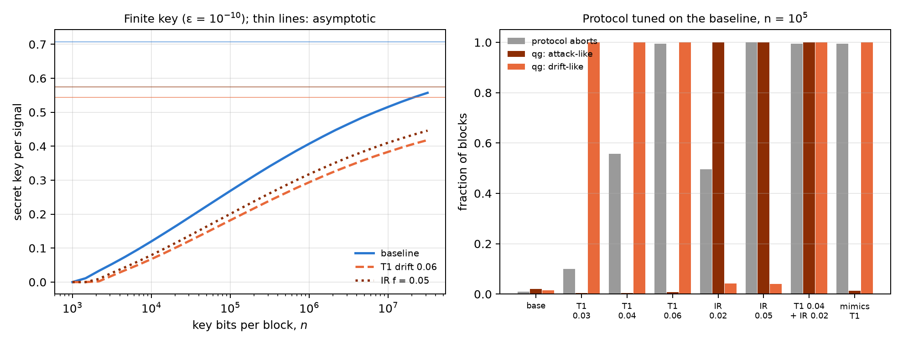

# Quantum key distribution (QKD) and BB84 in qg space {#sec-ch17}

Chapter 16 left BB84's QBER on the side of what qang reads: it is the probability of a qubit, and the security threshold
sits in the middle of the scale, at 780 m-qg. This chapter opens it up. The QBER is a single number, and a real link has
four: each state Alice sends reaches Bob with its own error probability. On the scale of Chapter 1 those four readings
say where the image of the Bloch sphere ended up after the channel, and the shape of that image tells apart two causes
the QBER confuses: a memory that degrades and an eavesdropper who intercepts. The chapter says how far that distinction
goes, with finite key blocks, with subtler attacks and with trapped-ion noise, and where it does not go.

## From the base: four readings and the image of the sphere {#sec-bb84-base}

In BB84 Alice sends $|0\rangle$ or $|1\rangle$ (Z basis) or $|+\rangle$ or $|-\rangle$ (X basis); the qubit waits in a
memory or travels through a channel, and Bob measures. After sifting only the rounds in which Bob measured in Alice's
basis remain. For each sent state, Bob's reading in its own basis is a reading of Chapter 1:

$$
m(0)=1000\,(1-2e_{0\to1}),\qquad m(1)=-1000\,(1-2e_{1\to0}),
$$

and likewise for $|\pm\rangle$ in X. An ideal channel gives $\pm1000$. A real channel maps the sphere to an ellipsoid,
and in each basis the two readings give its **centre** and its **semi-axis**:

$$
c_Z=\frac{m(0)+m(1)}{2},\qquad r_Z=\frac{m(0)-m(1)}{2},\qquad Q_Z=\frac{1}{2}\Big(1-\frac{r_Z}{1000}\Big).
$$

The QBER is exactly the semi-axis, with no approximation. The index's formula, $Q=(1-|qg|)/2$, is the symmetric case,
in which the two readings of a basis have the same modulus; in general $|m(0)|\neq|m(1)|$, and the difference is the
centre. The asymmetry $A_Z=qg(0)+qg(1)$ of the notes (§40) is $2c_Z$: the T1 witness of §24.

The two causes move the image in different directions. T1 relaxation of the memory is affine, $z\mapsto(1-\gamma)z+\gamma$:
it leaves $|0\rangle$ at the pole and lifts $|1\rangle$, so that $c_Z$ goes up and $r_Z$ goes down **by the same
amount**. An eavesdropper who intercepts and resends a fraction $f$ of the qubits, measuring in a random basis, shrinks
the sphere before the memory: $r_Z$ goes down and **$c_Z$ does not move**, exactly, because the affine memory puts the
centre at a place that depends only on $\gamma$. In the $(c_Z,r_Z)$ plane the drift is a line of slope $-1$ and the
eavesdropper a vertical (@fig-ellipse17, left).

The channel of the notes: a memory with $\gamma_0=0.02$ (T1), dephasing $p_0=0.01$ and an asymmetric detector
($e_{01}=0.005$, $e_{10}=0.01$, calibrated as in §31).

| scenario | $m(0)$ | $m(1)$ | $c_Z$ | $r_Z$ | $r_X$ | $Q_Z$ | $Q_X$ | secret fraction |
|---|---|---|---|---|---|---|---|---|
| baseline | 990.0 | −940.6 | 24.7 | 965.3 | 955.6 | 1.74% | 2.22% | 0.720 |
| T1 drift, $\gamma=0.04$ | 990.0 | −901.2 | 44.4 | 945.6 | 945.8 | 2.72% | 2.71% | 0.640 |
| T1 drift, $\gamma=0.06$ | 990.0 | −861.8 | 64.1 | 925.9 | 935.9 | 3.70% | 3.21% | 0.567 |
| intercept-resend, $f=0.05$ | 965.9 | −916.5 | 24.7 | 941.2 | 931.7 | 2.94% | 3.41% | 0.594 |
| intercept-resend, $f=0.10$ | 941.7 | −892.3 | 24.7 | 917.0 | 907.8 | 4.15% | 4.61% | 0.481 |

: The four BB84 readings in m-qg (the centre in X is $c_X=5.0$ in every case, from the detector). The secret fraction is
Shor–Preskill's asymptotic one, $1-h(Q_Z)-h(Q_X)$. {#tbl-readings17}

In a window of $N$ compared bits, $N/4$ per state, the shot noise of $c_Z$ and of $r_Z$ is 16.4, 8.2 and 3.7 m-qg for
$N=500$, 2000 and 10,000. The memory going from $\gamma=0.02$ to $0.04$ moves the centre by 19.7 m-qg: with 2000 bits,
2.4 standard deviations.

{#fig-ellipse17 width=100%}

## The monitor: drift or eavesdropper {#sec-bb84-monitor}

The notes (§40) compare two monitors on windows of $N$ sifted and compared bits, both tuned to 1% false alarms on the
baseline:

- **QBER monitor**: a one-sided test on the total error count;
- **qg monitor**: a generalized likelihood ratio on the four error counts, where "attack" ($f>0$) must beat both
  "baseline" and "T1 drift" ($\gamma$ free).

| scenario | QBER, $N=500$ | qg, $N=500$ | QBER, $N=2000$ | qg, $N=2000$ | QBER, $N=10^4$ | qg, $N=10^4$ |
|---|---|---|---|---|---|---|
| baseline | 0.007 | 0.004 | 0.007 | 0.006 | 0.010 | 0.007 |
| T1 drift, 0.04 | 0.147 | 0.009 | 0.478 | **0.009** | 0.992 | 0.000 |
| T1 drift, 0.06 | 0.463 | 0.009 | 0.962 | **0.006** | 1.000 | 0.000 |
| intercept, $f=0.02$ | 0.072 | 0.065 | 0.218 | 0.271 | 0.847 | 0.848 |
| intercept, $f=0.05$ | 0.337 | 0.338 | 0.861 | 0.823 | 1.000 | 1.000 |
| intercept, $f=0.10$ | 0.821 | 0.730 | 1.000 | 0.994 | 1.000 | 1.000 |
| T1-mimicking attack | 0.463 | 0.009 | **0.962** | 0.006 | 1.000 | 0.000 |

: Fraction of windows with an alarm (1000 windows per scenario). {#tbl-monitor17}

Three things can be read from the table.

- **Detection is the same; false alarms are not.** The qg monitor catches the naive eavesdropper as well as the QBER
  monitor, at every $N$ and $f$, within the sampling spread. When the memory degrades, the QBER monitor fires in 48% and
  96% of windows ($N=2000$) and the qg monitor stays at 0.9% and 0.6%, at the baseline level. The reduction in false
  alarms holds for T1 drift, which is in the qg monitor's model, and not for any degradation whatsoever.
- **The price, by design.** An eavesdropper who couples the qubit to her ancilla through an amplitude-damping interaction
  produces exactly the counts of a T1 drift, because in the $(c_Z,r_Z)$ plane she runs along the same line. The qg
  monitor misses her (0.6%, the same figure as the drift, because the counts are identical), and the QBER monitor does
  not (96%). The two are complementary: QBER says "something changed"; qg says "symmetric (attack-like)" or "T1-like
  (drift, or an eavesdropper hiding as one)".
- **No security gain.** The secret fraction falls the same way in both cases (0.720 → 0.567 with drift to 0.06;
  0.720 → 0.594 with $f=0.05$). A security proof must charge every error to Eve, and the qg reading does not change that.

The setting is a link with matter qubits, or an on-chip demonstration, where the qubit waits with T1 and T2 before Bob
measures. In a photon-polarization link the noise is nearly unital, the centre does not move, and the distinction does
not exist.

## Finite blocks {#sec-bb84-finite}

A real link cuts the key into blocks. The notes (§43) use the finite-key bound of Tomamichel, Lim, Gisin and Renner
(Nat. Commun. 3, 634, 2012) on the same channel:

$$
\ell=n\big[1-h(Q_{\text{tol}}+\mu)\big]-1.1\,n\,h(Q_Z)-\log_2\frac{2}{\varepsilon_{\text{sec}}^2\varepsilon_{\text{cor}}},\qquad
\mu=\sqrt{\frac{n+k}{nk}\,\frac{k+1}{k}\,\ln\frac{2}{\varepsilon_{\text{sec}}}},
$$

with $\varepsilon=10^{-10}$, $n$ key bits in Z and $k$ test bits in X. The protocol aborts if the test error exceeds
$Q_{\text{tol}}$; $k$ and $Q_{\text{tol}}$ are optimised for each $n$.

| scenario | minimum $n$ | $n=10^4$ | $10^5$ | $10^6$ | $10^7$ | asymptotic |
|---|---|---|---|---|---|---|
| baseline | $1.2\cdot10^3$ | 0.120 | 0.268 | 0.407 | 0.516 | 0.707 |
| T1 drift, 0.04 | $1.6\cdot10^3$ | 0.091 | 0.223 | 0.348 | 0.446 | 0.622 |
| T1 drift, 0.06 | $2.0\cdot10^3$ | 0.068 | 0.182 | 0.294 | 0.383 | 0.544 |
| intercept, $f=0.05$ | $1.7\cdot10^3$ | 0.079 | 0.201 | 0.318 | 0.410 | 0.575 |

: Secret bits per signal with a finite key. {#tbl-finite17}

A block of $10^4$ bits keeps 17% of the asymptotic rate; $10^5$, 38%; $10^6$, 58%; $10^7$, 73%. Below about $10^3$ bits
there is no key. Drift and attack cost key alike.

**Where qg enters, at no key cost.** After error correction and its check, Bob knows Alice's bits: he has the four error
counts, that is the four readings, over the $n$ key bits, without disclosing anything. Announcing an alarm bit costs at
most one key bit, and the bits of an aborted block are discarded anyway. Two nested likelihood ratios on the joint model
($\gamma$ and $f$ free) give an "attack-like" flag (symmetric error beyond any T1) and a "drift-like" flag (T1 beyond the
baseline, attack or not), each with 1% false alarms.

With the protocol tuned on the baseline for $n=10^5$ ($k=7609$, $Q_{\text{tol}}=2.67$%, that is, abort if the semi-axis
in X falls below 946.6 m-qg), 400 blocks per scenario:

| scenario | protocol aborts | qg: attack-like | qg: drift-like |
|---|---|---|---|
| baseline | 0.010 | 0.020 | 0.015 |
| T1 drift, 0.03 | 0.100 | 0.005 | **1.000** |
| T1 drift, 0.04 | 0.557 | 0.005 | **1.000** |
| T1 drift, 0.06 | 0.995 | 0.007 | **1.000** |
| intercept, $f=0.02$ | 0.495 | **1.000** | 0.043 |
| intercept, $f=0.05$ | 1.000 | **1.000** | 0.040 |
| drift 0.04 + intercept 0.02 | 0.995 | **1.000** | **1.000** |
| T1-mimicking attack | 0.995 | 0.013 | 1.000 |

: Protocol aborts and the qg diagnosis of the same blocks ($n=10^5$). {#tbl-diagnosis17}

- **An abort does not say why; qg does.** With $10^5$ key bits the attribution is nearly exact: every drifting block,
  aborted or not, comes out as drift and not as an attack, and every intercepted block comes out as an attack, including
  the half that did not abort. With $n=10^4$ the flags are already at 0.97–1.00 (0.81 for drift 0.03).
- **An attack hidden under drift is caught.** Intercepting with $f=0.02$ on a memory with $\gamma=0.04$ raises both flags
  in every block. The one-parameter test of the previous section misses it: it gives 0.5% attack flags and calls 99%
  "drift". The joint model fixes a real weakness of §40.
- **Early warning.** At $\gamma=0.03$ only 10% of blocks abort, but the drift flag is up in all of them: the memory can be
  serviced before the link stops. A $Q_Z$ trend would also warn; what qg adds is the attribution.

{#fig-finite17 width=100%}

## Beyond intercept-resend {#sec-bb84-attacks}

The flags know two error families. Seen from Bob, every individual attack is a Pauli channel $(p_x,p_y,p_z)$, and on the
image of the sphere a Pauli channel **shrinks the axes without moving the centre**: the semi-axis in Z is multiplied by
$1-2(p_x+p_y)$ and the one in X by $1-2(p_z+p_y)$. That explains the table of the notes (§49):

| attack | $(p_x,p_y,p_z)$ | what it shrinks | same counts as |
|---|---|---|---|
| intercept in both bases, fraction $f$ | $(f/4,0,f/4)$ | Z and X | — |
| optimal phase-covariant cloner, disturbance $D$ | $(0,D,0)$ | Z and X | intercept with $f=4D$ |
| Z-only intercept, fraction $f$ | $(0,0,f/2)$ | X only | **T2 drift**, $(1-2p')=(1-2p_0)(1-f)$ |
| X-only intercept, fraction $f$ | $(f/2,0,0)$ | Z only | no natural noise |

: Individual attacks as Pauli channels. The identities hold to $10^{-16}$. {#tbl-pauli17}

T2 dephasing also shrinks only the X axis. Hence the third family: with $n=10^5$, $k=7609$ and 400 blocks, the model adds
a dephasing family and three one-sided nested flags: attack-like, T1-like ($\gamma>\gamma_0$) and T2-like ($p>p_0$).

| scenario | attack-like | T1-like | T2-like | two-family model: attack |
|---|---|---|---|---|
| baseline | 0.020 | 0.005 | 0.033 | 0.020 |
| T1 drift, 0.04 | 0.018 | **1.00** | 0.033 | 0.015 |
| T2 drift, $p=0.02$ / $0.03$ | 0.007 / 0.020 | 0.01 | **1.00** | **0.075 / 0.268** |
| intercept, $f=0.05$ | **1.00** | 0.055 | 0.028 | 1.00 |
| cloner, $D=0.0125$ / $0.025$ | **1.00** | 0.055 | 0.02–0.04 | 1.00 |
| Z-only, $f=0.02$ / $0.04$ | 0.013 | 0.02–0.03 | **1.00** | 0.06 / 0.27 |
| X-only, $f=0.04$ | **1.00** | 0.048 | 0.000 | 1.00 |
| T2 drift + cloner | **1.00** | 0.043 | **0.995** | 1.00 |

: Flags with three error families ($n=10^5$, 400 blocks). {#tbl-threefamilies17}

- **Partial cloning is caught.** The optimal cloner comes out as an attack in every block, like intercepting with $f=4D$,
  because Bob sees the same counts. What no error statistic shows is that the cloner gives Eve more information per
  error; the key rate, which charges every error to Eve, already accounts for it.
- **The two-family model had a false alarm.** Without the dephasing family, T2 drift raised the attack flag in 7.5% and
  27% of blocks. With the family, the false alarm drops to 0.7–2% and the verdict is T2 in every block.
- **A second blind spot, by construction.** A Z-only intercept shrinks only the X axis, like T2: it comes out as T2 drift
  and not as an attack. It is the twin of the T1-mimicking attack: an eavesdropper hiding in the error type the hardware
  makes by itself. An X-only intercept has no natural twin, and is always caught.
- **Mixtures are resolved:** T2 drift plus a cloner raises both flags.

{#fig-attacks17 width=100%}

## On IonQ's noisy simulator {#sec-bb84-ionq}

So far the channel was analytic. In the notes (§44) every part of BB84 is a circuit run on the aria-1 and forte-1 noise
models of IonQ's simulator (free; nothing was sent to a QPU), and the model behind the flags is fitted, not given.

- **The memory** is amplitude damping built with an ancilla, CRY$(2\arcsin\sqrt\gamma)$ followed by CX, with a healthy
  $\gamma_0=0.02$ and drifts from 0.03 to 0.06.
- **Eve** measures and resends (CX to her ancilla in Z, H·CX·H in X), never reading the ancilla; a fraction $f$ of the
  rounds is taken from those circuits.
- **The runs:** 32 circuits in native gates, 4 copies of each (12 qubits), 2000 shots, 4 repetitions per noise model.
  Each copy is a block of $n=k=4000$ bits.
- **The flag model** is the joint one ($\gamma$, $f$) plus two symmetric device flip rates, $\varepsilon_Z$ and
  $\varepsilon_X$, fitted leaving out each repetition, with thresholds from a parametric bootstrap at 1%.

The device adds a nearly symmetric error of 2.3–2.4% per bit (aria-1) and 2.8–3.1% (forte-1), mostly from the two MS
gates of the memory circuit. On the image of the sphere that is a shrinking, not a shift. The designed healthy memory
gives $c_Z=20$, $r_Z=980$ and $r_X=990$ m-qg; the simulator gives $c_Z=18.5$ and $20.6$ m-qg (aria-1, forte-1), with the
semi-axes 46–62 m-qg lower; with $\gamma=0.06$ the centre rises to 60.5 and 56.5 m-qg, where the design says 60. The
device noise leaves the centre in place, which is what the T1 witness needs to keep working. The fit recovers the
designed $\gamma_0$ (0.020–0.0225) in every fold.

| scenario | aria-1 QBER | aria-1 attack | aria-1 drift | forte-1 QBER | forte-1 attack | forte-1 drift |
|---|---|---|---|---|---|---|
| baseline | 0.00/0.01 | 0.00/0.00 | 0.00/0.02 | 0.00/0.01 | 0.06/0.00 | 0.06/0.00 |
| drift 0.03 | 0.56/0.36 | 0.00/0.00 | 0.31/0.12 | 0.06/0.20 | 0.06/0.01 | 0.00/0.06 |
| drift 0.04 | 0.94/0.93 | 0.00/0.01 | 0.81/0.73 | 0.38/0.75 | 0.00/0.01 | 0.38/0.46 |
| drift 0.06 | 1.00/1.00 | 0.00/0.00 | **1.00**/1.00 | 1.00/1.00 | 0.00/0.00 | **1.00**/0.99 |
| intercept, $f=0.02$ | 0.62/0.58 | 0.38/0.21 | 0.00/0.02 | 0.31/0.38 | 0.25/0.15 | 0.00/0.01 |
| intercept, $f=0.05$ | 1.00/1.00 | **0.88**/0.96 | 0.00/0.01 | 1.00/0.99 | **0.81**/0.88 | 0.06/0.01 |
| intercept, $f=0.10$ | 1.00/1.00 | **1.00**/1.00 | 0.00/0.01 | 1.00/1.00 | **1.00**/1.00 | 0.06/0.01 |
| drift 0.04 + $f=0.05$ | 1.00/1.00 | 0.81/0.94 | 0.81/0.58 | 1.00/1.00 | 0.75/0.84 | 0.31/0.42 |

: Flags on IonQ's simulator, observed / predicted by the fitted model (16 blocks per scenario). {#tbl-ionq17}

- **The attribution transfers.** A drifting memory is never taken for an attack on aria-1 (0 of 48 blocks), and once in
  48 on forte-1. An attack is taken for drift in at most 1 of 16 blocks. Large changes (drift 0.06, $f=0.10$) are
  attributed in every block.
- **Small blocks, noisy device.** With 4000 bits and 2–3% of its own noise, small changes are seen only in part: 31–81%
  for drift 0.03–0.04 and 81–88% for $f=0.05$. The QBER monitor sees changes as often or more often, but cannot say
  which kind.
- **The model predicts which flag rises.** Almost every observed rate falls within the ±0.12 spread of 16 blocks; the
  largest misses are near threshold. Extrapolated with the fitted noise to $n=10^5$, the regime of the finite-block
  section, every scenario is attributed correctly in 99–100% of blocks.

These are vendor noise models on a simulator, not hardware; the memory and the attack are designed circuits.

## What remains open {#sec-open17}

There is no hardware run: the Forte-1 plan (notes, §46) was rejected by the provider before the job was accepted, and
the IQM credits at hand do not stretch to blocks of $10^5$ bits. Collective attacks, detector attacks and photon links,
where the noise does not move the centre, are not modelled. Nor is there a `qang.crypto` module (Chapter 16): everything
lives in `examples/bb84_*.py` and `examples/ionq_sim_bb84.py`.

## Without qang and with qang {#sec-comparison17}

| action | without qang | with qang | difference |
|---|---|---|---|
| decide whether there is a key | QBER and $1-h(Q_Z)-h(Q_X)$, or the finite-key bound | the semi-axis $r$ in m-qg; abort if $r_X<946.6$ | **unit**: it is the same computation |
| describe the channel | four error rates | centre and semi-axis of the image of the sphere in each basis | **in favour**, modest: T1 shifts the centre, the eavesdropper shrinks, T2 shrinks X only; the geometry says which model is needed |
| tell drift from eavesdropper | total QBER: cannot | likelihood ratio on the four counts | **in favour**, but the gain belongs to the likelihood model on per-state counts; a standard asymmetric analysis would do the same without the word qg |
| false alarms from T1 drift ($N=2000$) | 48% and 96% | 0.9% and 0.6% | **in favour**, at a price: the T1-mimicking attack gets through (0.6% against 96%) |
| security | every error is charged to Eve | the same | **none**: the key does not grow |
| attack hidden under drift | only an abort | both flags, 100% of blocks ($n=10^5$) | **in favour** of the joint model |
| noise of a real device (simulated) | QBER jumps with everything | attribution with 0–1 errors in 48 blocks | **in favour**, still partial with 4000-bit blocks |

: The chapter's actions without the qang scale and with it. {#tbl-comparison17}

**Balance.** The contribution that belongs to the Chapter 1 base is the geometry: reading the four probabilities as the
centre and semi-axes of the image of the sphere says at once which error families can be told apart (those that move
different things) and which cannot (those that shrink the same axis). The detection power comes from the statistics on
per-state counts, which does not need qang. And security does not change: this is an operational diagnostic, not a
proof.

## In code {#sec-code17}

```python
import sys
sys.path.insert(0, "examples")
import bb84_qg_eve_vs_noise as B

e = B.error_probabilities(gamma=0.04)        # error rates of 0, 1, +, -
m = 1000 * B.qg_per_state(e)                 # [990.0, -901.2, 950.8, -940.8] m-qg
c_z, r_z = (m[0] + m[1]) / 2, (m[0] - m[1]) / 2
c_z, r_z, (1 - r_z / 1000) / 2               # 44.4, 945.6 and Q_Z = 0.0272
```

## Summary {#sec-summary17}

- In BB84 each sent state has its reading; in each basis, the two readings give the centre and the semi-axis of the image
  of the sphere, and the QBER is exactly the semi-axis: $Q=(1-r/1000)/2$.
- T1 drift shifts the centre and shrinks by the same amount; an intercepting eavesdropper shrinks without moving the
  centre. Hence the qg monitor stays quiet under drift (0.6–0.9% against 48–96%) and sees the eavesdropper as well as
  the QBER does.
- By construction, an eavesdropper who mimics T1, or who intercepts only in Z (and looks like T2), comes out as drift.
- With finite blocks of $10^5$ bits the attribution is nearly exact, at no key cost, and an attack hidden under drift
  raises both flags; IonQ's simulator confirms it with 4000-bit blocks, in part.
- The secret key does not grow: the qg reading is a diagnostic, not security.
