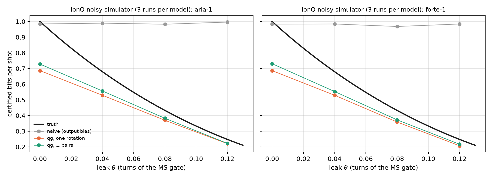

# Certified quantum random numbers (QRNG) and channel auditing {#sec-ch18}

A one-qubit quantum random number generator (QRNG) is the simplest experiment in the book: prepare $|+\rangle$, measure
in Z, write down the bit. The result is a fair coin, and that is what the usual analysis measures. But a fair coin is not
the same as a private coin. If the qubit lost coherence, the output still comes out 50/50, and yet someone holding the
environment can know every bit in advance. This chapter reads that difference on the scale of Chapter 1. The output
lives in one reading and privacy in the other two, and what the adversary knows is one more reading: the one the state
lacks to reach the sphere. The chapter adds the readout calibration needed to avoid overestimating, and the same
certifier against a designed leak on IonQ's simulator.

## From the base: output and privacy are different readings {#sec-qrng-base}

The source qubit has three readings, $m_X$, $m_Y$ and $m_Z$. The QRNG output is the measurement in Z, and the usual
analysis looks only at its bias: with $p_0=(1000+m_Z)/2000$ it certifies

$$
H_{\text{naive}}=-\log_2\max(p_0,p_1)=-\log_2\frac{1000+|m_Z|}{2000}
$$

bits per shot, 1 bit when $m_Z=0$. But $m_Z=0$ is given by $|+\rangle$ and by the completely mixed state alike, and in
the second case nothing is private: the environment holds the other half of the purification and knows what came out.

With a trusted measurement and an adversary (Eve) holding the purification, Eve's two conditional states are pure, and
their overlap depends only on the transverse radius $r_\perp=\sqrt{qg_X^2+qg_Y^2}$. By Helstrom, her guessing probability
is (notes, §41)

$$
P_{\text{guess}}=\frac{1+\sqrt{1-r_\perp^2}}{2},\qquad H_{\min}(Z|E)=-\log_2 P_{\text{guess}}.
$$

On the scale of Chapter 1, that probability is one more reading. Its value in m-qg is

$$
m_E=1000\sqrt{1-r_\perp^2}=\sqrt{1000^2-m_X^2-m_Y^2},
$$

**what the transverse radius lacks to reach the sphere**, and its qang angle is $\arcsin r_\perp$. The formula does not
depend on $m_Z$. A pure state on the equator has $m_\perp=1000$ and leaves Eve at $m_E=0$: she guesses with probability
1/2, and the bit is private. A state that lost coherence has $m_\perp<1000$, and the length it lost is what Eve knows
(@fig-private18, left).

| $m_\perp$ (m-qg) | 1000 | 990 | 950 | 900 | 800 | 500 | 200 |
|---|---|---|---|---|---|---|---|
| what Eve knows, $m_E$ (m-qg) | 0 | 141 | 312 | 436 | 600 | 866 | 980 |
| private bits per shot | 1.000 | 0.810 | 0.608 | 0.478 | 0.322 | 0.100 | 0.015 |

: The private randomness of a qubit measured in Z, as a function of its transverse radius. {#tbl-private18}

The shape of the formula has a practical consequence. Ten m-qg less of transverse radius, from 1000 to 990, give Eve
141 m-qg and take 0.19 bits per shot from the source. It is the pole of Chapter 1 seen from the other side: near
$m_\perp=1000$, the square root has infinite slope.

## The output-bias analysis fails; the qg reading does not {#sec-qrng-failure}

The qg certifier estimates $m_X$ and $m_Y$ with test rounds (rotations that bring X and Y to the measurement basis) and
uses a 3σ lower bound on $r_\perp$. The notes (§41) compare four estimators with $10^4$ test rounds per setting, 300 runs
per scenario and the asymmetric readout of §31 ($e_{01}=0.015$, $e_{10}=0.04$):

- **naive**: the bias of the output;
- **qg, one rotation**: $m_X$ and $m_Y$ measured with one rotation each;
- **qg, ± pairs**: each axis with both rotations, so that the readout offset cancels;
- **qg calibrated**: the ± pairs, divided by the readout scale factor $b$ measured with the protocol of §31.

| scenario | $m_\perp$ | truth | naive | qg, one rotation | qg, ± pairs | **qg calibrated** |
|---|---|---|---|---|---|---|
| ideal $\lvert+\rangle$ | 1000 | 1.000 | 0.965 (0) | 0.578 (0) | 0.512 (0) | 0.681 (0) |
| T2: $V=0.8$ | 800 | 0.322 | 0.964 (**1.00**) | 0.269 (0) | 0.245 (0) | **0.286 (0)** |
| T2: $V=0.5$ | 500 | 0.100 | 0.965 (**1.00**) | 0.087 (0) | 0.077 (0) | **0.087 (0)** |
| T2: $V=0.2$ | 200 | 0.015 | 0.965 (**1.00**) | 0.013 (**0.07**) | 0.009 (0) | **0.010 (0)** |
| thermal $p=0.05$, $V=0.9$ | 810 | 0.334 | 0.965 (**1.00**) | 0.279 (0) | 0.254 (0) | **0.297 (0)** |
| strongly asymmetric readout, $e_{10}=0.10$, $V=0.95$ | 950 | 0.608 | 0.876 (**1.00**) | 0.498 (0) | 0.341 (0) | **0.513 (0)** |

: Certified bits per shot: mean estimate and, in parentheses, the fraction of runs above the truth (unsafe). {#tbl-qrng18}

- **The usual estimator is unsafe whenever the state is not pure.** At $V=0.2$ it certifies 0.97 bits per shot where only
  0.015 are private, in 100% of runs. Dephasing and thermal mixing leave the output unbiased.
- **The qg estimator with ± pairs is safe in every run**, because the readout offset $a$ cancels. With one rotation, the
  offset inflates $r_\perp$ and overestimates in 7% of runs at $V=0.2$. So the "100% against 0%" safety holds for the
  paired estimator, not for any qg reading whatsoever.
- **Calibrating $b$ with §31 recovers 10 to 50% more certified bits** (0.286 against 0.245 at $V=0.8$; 0.513 against
  0.341 with the strongly asymmetric readout), without losing safety.

{#fig-private18 width=100%}

## Near the pole certification is shot-hungry {#sec-qrng-pole}

A 3σ bound with $n$ rounds per setting lowers the radius by $3000/\sqrt n$ m-qg, and near the pole that is expensive. For
a perfect source, without readout error:

| test rounds | $10^3$ | $10^4$ | $10^5$ | $10^6$ | $10^7$ |
|---|---|---|---|---|---|
| bound on $m_\perp$ (m-qg) | 905 | 970 | 991 | 997 | 999 |
| what is conceded to Eve, $m_E$ (m-qg) | 425 | 243 | 137 | 77 | 44 |
| certified bits (truth: 1) | 0.489 | 0.686 | 0.814 | 0.892 | 0.939 |
| with $m_\perp=950$ (truth: 0.608) | 0.397 | 0.523 | 0.578 | 0.598 | 0.605 |

: Certified bits with a 3σ bound, closed form. {#tbl-pole18}

With the §31 readout and the calibrated certifier, the simulation gives 0.68, 0.81 and 0.89 bits with $10^4$, $10^5$ and
$10^6$ rounds, the same. Away from the pole the bound converges fast: with $m_\perp=950$, $10^5$ rounds already give 95%
of the truth (@fig-readout18, left). A nearly perfect source is the most expensive to certify.

## Readout calibration: temperature or detector error {#sec-qrng-readout}

The calibrated certifier divides by the readout scale factor $b$, and the question is where $b$ comes from. On the
scale of Chapter 1 the readout is affine (notes, §31):

$$
m_{\text{measured}}=1000\,a+b\,m,\qquad a=e_{10}-e_{01},\quad b=1-e_{01}-e_{10}.
$$

A real qubit starts with thermal population $p$, that is with $m_{\text{eq}}=1000(1-2p)=1000\tanh(hf/2k_BT_{\text{eff}})$.
The standard calibration measures "$|0\rangle$" and "$|1\rangle$", which are really the thermal state and X on it: **two
readings for three unknowns** ($a$, $b$, $m_{\text{eq}}$). It assumes $m_{\text{eq}}=1000$ and charges the thermal
population to the readout: it reports $e_{01}+p\,b$ and $e_{10}+p\,b$, exactly.

| $p$ | $T_{\text{eff}}$ (5 GHz) | $m_{\text{eq}}$ (m-qg) | standard $e_{01}$ | qg protocol $e_{01}$ (§31) |
|---|---|---|---|---|
| 0 | 0 mK | 1000 | 0.0150 | 0.0149 |
| 0.01 | 52 mK | 980 | 0.0245 | **0.0151** |
| 0.03 | 69 mK | 940 | 0.0434 | **0.0148** |
| 0.08 | 98 mK | 840 | 0.0906 | **0.0152** |

: The standard calibration against the qg protocol of §31 ($e_{01}=0.015$, $e_{10}=0.04$). The standard column is exact;
the qg column is the median of 100 repetitions from §31. {#tbl-readout18}

The qg protocol adds the third equation. It measures, reads again and uses the covariance of the two readings,
$V=b^2(1-qg_{\text{eq}}^2)$, which separates $b$ from $m_{\text{eq}}$ in closed form. According to the notes, it recovers
the temperature to ±1 mK from 52 mK up. Chapter 27 develops it. What matters here is its consequence for the QRNG:
**calibrating with the standard suite makes the certifier unsafe**. With a thermal source ($V=0.9$), dividing by the
standard $b$, which is $b(1-2p)$, returns $r_\perp$ without the thermal contraction and certifies too much.

| $p$ | truth | calibrated with the standard $b$ | calibrated with the true $b$ |
|---|---|---|---|
| 0.01 | 0.443 | 0.418 (0.01 unsafe) | 0.390 (0) |
| 0.03 | 0.383 | 0.414 (**1.00** unsafe) | 0.339 (0) |
| 0.05 | 0.334 | 0.413 (**1.00** unsafe) | 0.297 (0) |

: Thermal source with $V=0.9$, $10^4$ test rounds, 300 runs: the certifier with each calibration. {#tbl-thermal18}

{#fig-readout18 width=100%}

## On IonQ's noisy simulator, with a leak {#sec-qrng-ionq}

In the notes (§42) the leak is real: an ion $q$ is the source and a second ion $e$ plays the environment. An
MS$(0,0,\theta)$ interaction lets $e$ learn the X value of $q$, and the output is read in X. It is still a fair coin,
but the private randomness falls to the formula above with $r=|\cos2\pi\theta|$ (X and Z exchanged). Test rounds
measure ±Z and ±Y, and two circuits calibrate the readout. Everything is in native gates (GPI, GPI2, MS), with 5 pairs
per circuit, $10^4$ samples per setting and three repetitions per noise model, on the free simulator. Nothing was sent
to a QPU.

| $\theta$ (turns) | truth | naive | qg, one rotation | **qg, ± pairs** | measured / ideal $m_\perp$ |
|---|---|---|---|---|---|
| 0 (no leak) | 1.000 | 0.98 | 0.69 | 0.73 | 1000 / 1000 |
| 0.04 | 0.680 | 0.99 / 0.98 | 0.53 | **0.56 / 0.55** | 954 / 969 |
| 0.08 | 0.433 | 0.98 / 0.97 | 0.37 / 0.36 | **0.38 / 0.37** | 866 / 876 |
| 0.12 | 0.248 | 1.00 / 0.98 | 0.22 / 0.21 | **0.22** | 721 / 729 |

: Certified bits per shot, mean of 3 runs (aria-1 / forte-1 where they differ; $m_\perp$ from aria-1). {#tbl-ionq18}

- **The naive estimator does not see the leak:** 0.97–1.00 bits per shot in every run, above the truth in 100% of runs
  with $\theta>0$. At $\theta=0.12$ it certifies four times the private randomness.
- **The qg estimator is safe in all 24 cells** (run × $\theta$) and captures 81–90% of the truth when there is a leak,
  and 73% without one, because of the pole of the previous section.
- **Calibration adds nothing here.** The simulator's readout is almost perfect ($b=0.9998$–$1.0000$,
  $|a|\le2\cdot10^{-4}$). The 10–50% gain needs hardware-like readout errors, and this is a limit of the noise model
  that only a QPU can check.
- **Gate noise is counted as lost privacy:** the measured $m_\perp$ sits 1–2% below the ideal, which is the MS error.
  That is as it should be, because the certifier cannot know who took that length.

{#fig-ionq18 width=100%}

## What remains open {#sec-open18}

There is no hardware run. The missing test is a QRNG on a device with real readout errors, where the §31 calibration
should show its 10–50% gain. It is a device-dependent QRNG (trusted measurement, independent and identical rounds), not
device-independent randomness. And the leak of §42 is a designed interaction, not an adversary's best strategy.

## Without qang and with qang {#sec-comparison18}

| action | without qang | with qang | difference |
|---|---|---|---|
| certify bits from the output bias | $-\log_2\max(p_0,p_1)$ | the same in $m_Z$ | **none**: both fail alike, 100% unsafe under dephasing |
| certify private bits | Helstrom's $H_{\min}(Z\mid E)$ with the purification | $m_E=\sqrt{1000^2-m_\perp^2}$: what Eve knows is the missing length | **equivalent** in the computation (the formula is standard); **in favour** in the reading: privacy is in the transverse plane and is measured with two rotations |
| how many test rounds are needed | error propagation on $H_{\min}$ | the pole of Chapter 1: 10 m-qg of radius give Eve 141 m-qg | **in favour**, modest: it shows at a glance why the perfect source is the most expensive |
| calibrate the readout | two circuits; temperature is read as error | affine readout and a third equation (§31) | **in favour**: it avoids an unsafe certifier (100% of runs with $p\ge0.03$) and recovers 10–50% of bits |
| detect a leak (simulated IonQ) | the bias does not see it | safe in 24 of 24 cells, 81–90% of the truth | **in favour** of the transverse estimator, which is standard in device-dependent QRNGs |

: The chapter's actions without the qang scale and with it. {#tbl-comparison18}

**Balance.** The entropy bound is the usual one, and a QRNG expert already measures transverse coherence. What the
Chapter 1 base adds is the reading: what the adversary knows is a reading in m-qg, $m_E$, the length the state lacks to
reach the sphere. Two things follow that can be seen at a glance: the drop of certification near the pole and the
danger of calibrating the readout with two circuits. The second is the chapter's most concrete gain, and it is owed to
the §31 protocol, not to the unit.

## In code {#sec-code18}

```python
import math
import sys
sys.path.insert(0, "examples")
import qrng_qg_certified as Q

m_x, m_y = 800.0, 0.0                       # transverse readings (m-qg)
m_perp = math.hypot(m_x, m_y)
m_e = math.sqrt(1000**2 - m_perp**2)        # 600: what Eve knows
-math.log2((1000 + m_e) / 2000)             # 0.322 private bits per shot
Q.h_min_certified(m_perp / 1000)            # 0.322, the same computation
```

## Summary {#sec-summary18}

- The output of a one-qubit QRNG is the reading $m_Z$; its privacy is the transverse radius $m_\perp$. What an adversary
  holding the purification knows is one more reading, $m_E=\sqrt{1000^2-m_\perp^2}$.
- The output-bias analysis certifies almost 1 bit per shot even when the state is almost mixed: unsafe in 100% of runs
  with dephasing or thermal mixing. The qg estimator with ± pairs is safe in all of them.
- Near the pole certification is expensive: 10 m-qg of radius are worth 0.19 bits, and a perfect source gives 0.69
  certified bits with $10^4$ rounds and 0.89 with $10^6$.
- The standard calibration reads temperature as readout error, and using it makes the certifier unsafe. The §31
  protocol separates them and recovers 10–50% of bits.
- On IonQ's simulator, with a designed leak, the naive estimator does not see it and the qg one is safe in every cell.

## Bibliographic notes {.unnumbered}

Optimal state discrimination is @helstrom1976, and the operational meaning of the min-entropy, @konig2009. For quantum
random number generators, see the reviews @herrero2017 and @ma2016. The numbered research notes (§) cited in this
chapter and the scripts that check it are in the repository [@qangrepo]; the definition of the qang unit is in
@monteverde2026.
