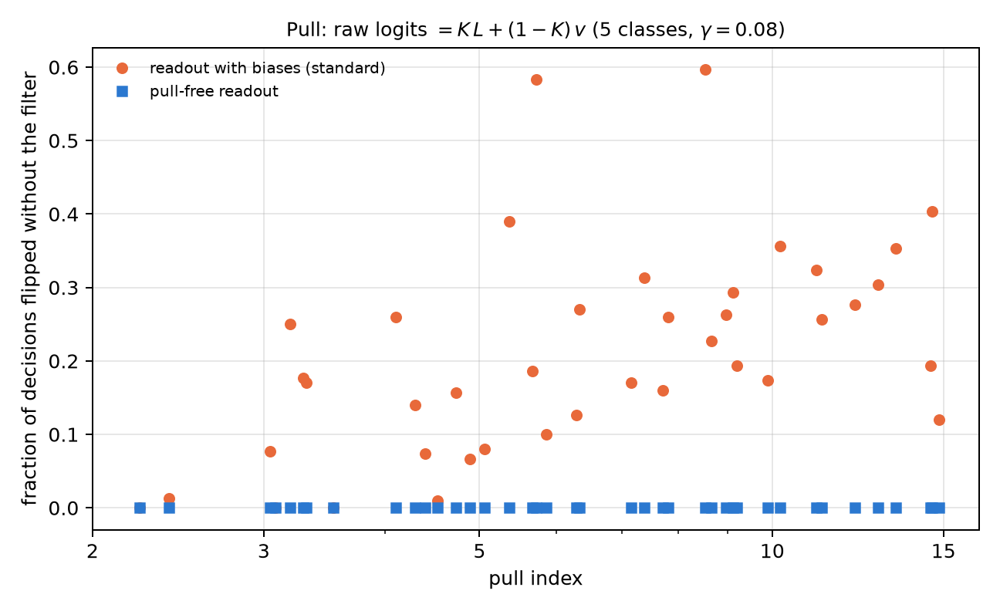

# Echo calibration and the noise bias (pull effect) {#sec-ch22}

The qg filter of Chapter 21 makes the readout exact under equal T1, but it does not correct everything. Two things
remain, and this chapter deals with them. The first are errors that conserve the weight and move the excitation from one
qubit to another: they pass the filter, and must be measured separately, with echo circuits. The second is what decayed
shots do to a classifier without the filter: they do not add random noise, they **pull** every decision towards the same
class. Both are read on the scale of Chapter 1, and for both the chapter checks the mechanism with code and quotes the
notes' results on device noise models, with predictions committed before running.

## From the base: two errors the filter treats differently {#sec-echo-base}

In the weight-1 sector, each qubit reads $m_Z(q)=1000(1-2p_q)$, with $p_q$ the probability that the excitation is on it.
There are two ways to go wrong:

- **A T1 jump** takes the shot out of the sector: the excitation disappears and every qubit reads $+1000$, the north
  pole. The filter discards those shots. Without the filter, the raw readout is a mixture: with probability $K$ the
  noiseless readout, and with probability $1-K$ the north pole on every qubit.
- **An in-sector error** moves the excitation from one qubit to another: the shot still has weight 1, passes the filter
  and changes the readings of two qubits at once. On the probabilities $p_q$ it acts as a stochastic matrix $M$.

The first is corrected by discarding; the second, by inverting $M$, as a readout confusion matrix is inverted.

## In-sector errors and the echo {#sec-echo-matrix}

An echo circuit prepares a basis state of the sector, $|e_j\rangle$, applies the network's gates and then their inverses.
Without errors it returns to $|e_j\rangle$; with errors, its filtered distribution over the sector states is column $j$ of a
transfer matrix $M$ (notes, §105). Since the real circuit has half the echo's gates, the correction uses $M^{1/2}$: the
filtered distribution $f$ is unmixed by solving $M^{1/2}x=f$ with $x\ge0$ (`qang.sectors.unmix_sector`).

The chapter's script tests it with a controlled in-sector error: after every sublayer, each pair of qubits of an RBS is
swapped with probability $p$ (it keeps the weight and moves the excitation). Five qubits, weight 1, 9 sublayers, 60 random
inputs:

| $p$ | echo diagonal | error with the filter | + echo with $M^{1/2}$ | + echo with $M$ |
|---|---|---|---|---|
| 0.005 | 0.93–0.94 | 15.0 | 5.7 (−62%) | 13.4 (−11%) |
| 0.01 | 0.87–0.89 | 29.4 | 11.3 (−61%) | 25.5 (−13%) |
| 0.02 | 0.76–0.80 | 56.4 | 22.4 (−60%) | 47.4 (−16%) |
| 0.04 | 0.58–0.65 | 104.2 | 43.7 (−58%) | 87.4 (−16%) |
| 0.08 | 0.38–0.45 | 178.8 | 84.5 (−53%) | 164.3 (−8%) |

: Mean error of the $m_Z$ readings (m-qg) with exact probabilities. {#tbl-echo22}

$M^{1/2}$ removes a bit more than half of the error the filter leaves; the full $M$ over-corrects and removes little. On the
notes' device noise models, the echo removes 38–47% of the filtered error at weight 1 with 5 qubits (§105, five simulated
devices), 37–43% at weight 2 with a 10×10 matrix (§107) and 27–38% at weight 2 with 8 qubits, a 28×28 matrix (§115). The
larger the sector, the dirtier and harder to recover: the echo diagonal drops from 0.77–0.92 to 0.50–0.80. Filter plus
echo ends 3.4 to 7 times below the raw readout.

## Does it reach the classifier? {#sec-echo-classifier}

With the weight-1 network on 189 test inputs and 1000 shots (§106), on three simulated IBM devices and the IonQ
simulator:

| device | accuracy (raw / qang / qang + echo) | decisions differing from noiseless | decision-value error |
|---|---|---|---|
| fake brisbane | 0.968 / 0.974 / 0.979 | 2 / 1 / 0 | 1.53 / 0.76 / 0.33 |
| fake sherbrooke | 0.963 / 0.974 / 0.979 | 3 / 1 / 0 | 1.26 / 0.61 / 0.29 |
| fake torino | 0.963 / 0.979 / 0.979 | 3 / 0 / 0 | 1.08 / 0.47 / 0.27 |
| IonQ aria-1 | 0.958 / 0.963 / 0.968 | 4 / 3 / 2 | 1.67 / 0.87 / 0.44 |
| IonQ forte-1 | 0.963 / 0.968 / 0.974 | 3 / 2 / 1 | 1.60 / 0.80 / 0.43 |

: Echo calibration in the classifier (notes §106; noiseless accuracy 0.979). {#tbl-classifier22}

The echo cuts the decision-value error left by the filter by 43 to 56%, and filter plus echo ends 3.7 to 4.6 times below
the raw readout. Decisions move only towards the noiseless network: 15 differ without qang, 7 with the filter and 3 with
filter plus echo, over 945 readings.

**When it does not help** (§108). With narrow-margin inputs, the echo added nothing (19 flipped decisions against 17 with
the filter alone). The filtered decision-value error was 0.26 to 0.35, barely above its shot noise (0.22): little bias was
left, and inverting the matrix adds variance. The notes' rule is to use the echo when the filtered error is well above its
shot-noise level. In this chapter's model, with 1000 shots and 4000 per echo, the echo kept helping even at $p=0.005$
(22 → 17 m-qg); at $p=0$ it changes nothing (15 m-qg, pure shot noise).

{#fig-echo22 width=100%}

## The pull: why the loss without qang varies between seeds {#sec-echo-pull}

In the multiclass network of Chapter 20, the loss without the filter varied a lot from one seed to another (from −0.7 to
41.7 points). The notes explained it with an exact property (§121 F7). At weight 1 under equal T1, every decayed shot lands
in $|0\dots0\rangle$, where each qubit reads $+1000$. Since the logits are linear in the readings, the raw logits are

$$
\text{logits}_{\text{raw}}=K\,L+(1-K)\,v,
$$

with $L$ the noiseless logits and $v$ the logits of the north pole, a constant vector fixed by training (for the linear
head, $v=W^\top\mathbf 1+b$). Without the filter, every input is pulled towards the class with the largest $v_c$, and how
much that weighs is measured by a pull index: $(1-K)/K$ times the range of $v$, over the median training margin.

The script checks it on 40 five-class models with random parameters ($K=0.472$, 300 inputs each):

- the formula for the raw logits holds to $7\cdot10^{-15}$;
- without the filter, 0 to 60% of the decisions flip depending on the model, and the flips grow with the pull index
  (Spearman 0.60; in the notes, 0.65 with the head and 0.98 with the qubit readout);
- with the filter, none flips.

The spread between seeds is not bad luck: it is the $v$ that training left, and it can be read before running anything.

{#fig-pull22 width=80%}

## The pull-free readout {#sec-echo-pullfree}

If the pull comes from $v$, it can be removed by design: logits linear in the excitation probabilities with no constant
term (for the head, $W^\top(qg_Z-1)$; for the qubit readout, $a\,p_c$). Then the north pole contributes zero, decayed shots
only rescale the logits by $K$, and the raw decision is the noiseless one. The script checks it on the 40 models: no
decision flips, and the raw logits are $K$ times the noiseless ones to $6\cdot10^{-15}$. The notes (§123, 10 seeds, 5-class
digits) confirm it in accuracy:

| readout | model | noiseless | T1 (qang / raw) | unequal T1 (qang / raw) | 1000 shots (qang / raw) |
|---|---|---|---|---|---|
| qubit | standard | 0.860 | 0.860 / 0.725 | 0.849 / 0.688 | 0.861 / 0.724 |
| qubit | pull-free | 0.862 | 0.862 / 0.862 | 0.851 / 0.851 | 0.863 / 0.863 |
| head | standard | 0.932 | 0.932 / 0.653 | 0.932 / 0.624 | 0.927 / 0.651 |
| head | pull-free | 0.938 | 0.938 / 0.938 | 0.928 / 0.928 | 0.932 / 0.932 |

: The pull-free readout (notes §123). {#tbl-pullfree22}

Dropping the biases costs no accuracy, and the pull-free readout is immune to decay without filtering: it carries the
filter inside it. Without the filter, the pull-free head is 28.5 points above the standard one. It is the picture of
Chapter 1 carried into design: if the north pole is worth zero, falling into it does not pull.

## Calibrating with the device itself {#sec-echo-device}

The notes tried two more ways of using calibration on IBM noise models (§119, §120): training with qang under the published
T1 and T2, and measuring the device itself (with the echo matrix inside the model, or refitting the readout on 40 inputs
run on the device). None beat the simple recipe: train noiseless and run with the filter (0.972 mean accuracy against
0.979 noiseless), plus the echo for the decision values. The reason is that gate errors dominate on those models, and a
T1/T2 calibration does not describe them (the per-sublayer $\gamma$ are only 0.002–0.017).

## What remains open {#sec-open22}

The echo mechanism and property F7 are checked with code, and the results on simulated devices are those of the notes. A
package is ready to run the multiclass network with the echo on an IonQ QPU (§116: 55 circuits, 60,000 shots, with
predictions committed before sending anything); its rehearsal on the simulator gave 4 flipped decisions with the filter
and 1 with the echo, against 8 raw. The hardware run is pending credits and an explicit approval of the cost.

## Without qang and with qang {#sec-comparison22}

| action | without qang | with qang | difference |
|---|---|---|---|
| in-sector errors | invisible: they pass any weight filter | echo matrix and unmixing with $M^{1/2}$: −27 to −62% of the filtered error | **in favour**, at a cost: $\binom nk$ extra echo circuits |
| decision-value error | — | −43 to −56% with the echo over the filter (§106) | **in favour** when the filtered error exceeds its shot noise; **none** with narrow margins (§108) |
| understand the spread between seeds | bad luck | raw logits $=KL+(1-K)v$, exact; the pull index predicts it | **in favour**: the pull is read before running |
| correct the pull | train under the noise | the filter removes it exactly | **in favour** |
| design an immune readout | — | no biases: the north pole is worth zero, identical decisions with or without the filter | **in favour**, at no accuracy cost |
| calibrate with the device | train with the calibration | equal to or worse than noiseless training + filter | **none** on those models: gate errors dominate |

: The chapter's actions without the qang scale and with it. {#tbl-comparison22}

**Balance.** Echo calibration is known mitigation, of the kind that inverts readout confusion matrices, applied inside a
sector. What the notes add is its measured reach (how much it removes depending on the sector size) and the rule for when
it does not help. The cleanest contribution of the chapter is the pull: an exact property that explains the spread
between seeds, and a bias-free readout that avoids it without filtering. Both come from reading decay as Chapter 1 reads
it: every qubit at the north pole.

## In code {#sec-code22}

```python
import numpy as np
from qang import qml as QML

m = QML.MultiClassQNN(n_qubits=5, n_classes=5, readout="head")
rng = np.random.default_rng(0)
psi = m.encode(rng.uniform(-1, 1, size=(4, 4)))
th = rng.uniform(-np.pi, np.pi, size=m.n_theta)
head = rng.normal(size=m.n_head)
K = QML.kept_fraction(0.08, 1, m.depth)
L = m._logits(m.qg_z(m.probs(th, psi), qang=False), head)
raw = m._logits(m.qg_z(m.probs(th, psi, gamma=0.08), qang=False), head)
v = m._logits(np.ones((1, 5)), head)       # the north pole: +1000 m-qg on every qubit
np.abs(raw - (K * L + (1 - K) * v)).max()  # ~1e-15: F7
```

## Summary {#sec-summary22}

- A T1 jump takes every qubit to the north pole and the shot out of the sector; an in-sector error moves the excitation
  and passes the filter. The first is discarded; the second is measured with echoes and inverted.
- The echo with $M^{1/2}$ removes more than half of the filtered error in the chapter's model and 27–47% on the notes'
  simulated devices; the full $M$ over-corrects. It helps when the filtered error exceeds its shot noise.
- Without the filter, the raw logits are exactly $K\,L+(1-K)\,v$: decay pulls every decision towards one class, and the
  pull index predicts how much.
- A bias-free readout makes the north pole worth zero: the raw decisions are the noiseless ones, without filtering and
  without losing accuracy.
- On IBM noise models, training noiseless and running with the filter (and the echo) was the best recipe; calibrating with
  the device did not improve it.

## Bibliographic notes {.unnumbered}

The echo is that of @hahn1950; read-out error mitigation, @bravyi2021. The sector filter is the symmetry verification of
@bonetmonroig2018. The numbered research notes (§) cited in this chapter and the scripts that check it are in the
repository [@qangrepo]; the definition of the qang unit is in @monteverde2026.
