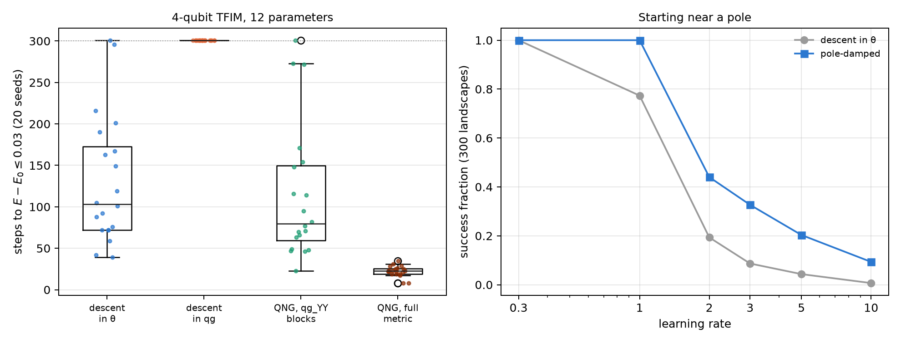
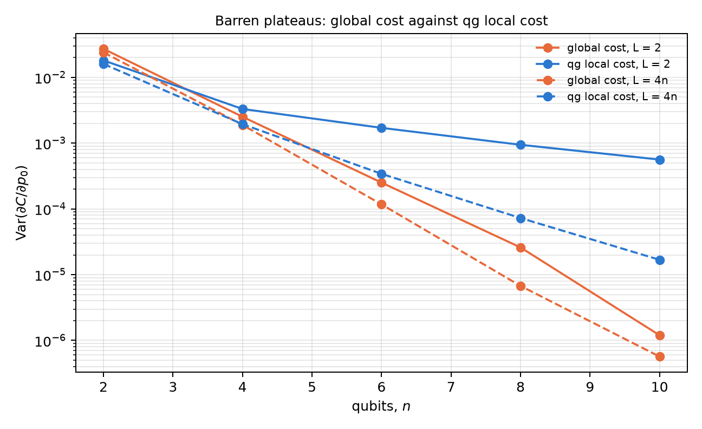

# Information geometry, the natural gradient (QNG) and kernels {#sec-ch23}

Chapters 20 to 22 read in qg what comes out of a circuit. This chapter asks about what goes in: the parameters an optimizer
moves. An attractive idea circulates: if qg is the natural readout, writing the circuit in qg coordinates should speed up
the gradient and flatten the landscape. The chapter shows with code that it is the other way round, and why. The coordinate
to optimize in is the qang angle $\theta$, and qg is the coordinate to read out in. Four honest uses of qang follow from
that distinction: regularizing the pole singularity, reading the natural-gradient metric from qg correlators, damping the
step near the poles, and writing a local cost that flattens more slowly. The structural results are checked with code; the
kernel results on device noise models are the notes', with predictions committed before running.

## From the base: the angle and the readout {#sec-geo-base}

In Chapter 1, a qubit prepared with $R_y(\theta)|0\rangle$ reads $m_Z=1000\cos\theta$ m-qg, and $\theta$ is the qang angle.
Both coordinates describe the same state, but they are not equivalent for optimizing, because the change between them is
not linear:

$$
\frac{d\,qg_Z}{d\theta}=-\sin\theta ,\qquad \frac{dE}{d\,qg_Z}=-\frac{1}{\sin\theta}\,\frac{dE}{d\theta}.
$$

At the poles ($m_Z=\pm1000$) the readout barely moves when $\theta$ changes, and so the gradient in qg diverges. The whole
chapter follows from that line.

## The singularity and its regularizations {#sec-geo-singularity}

The factor $-1/\sin\theta$ is $-10$ at $\theta=0.1$, $-100$ at $0.01$ and $-1000$ at $0.001$. The notes (§1) propose two
bounded versions, in `qang.gradients`:

- **clipping:** $-1/(\operatorname{sign}(\sin\theta)\max(|\sin\theta|,\varepsilon))$, never larger than $1/\varepsilon$;
- **Tikhonov:** $-\sin\theta/(\sin^2\theta+\varepsilon^2)$, smooth everywhere and zero at the pole itself.

With $\varepsilon=0.05$, at $\theta=0.001$ the raw factor is 1000, the clipped one 20 and the Tikhonov one 0.40. The
chapter's script repeats the notes' experiment: minimize $E=-\sin\theta$ (minimum at $\pi/2$, away from the edges) starting
at the pole, $\theta_0=0.01$, for 150 iterations.

| space | rate | final $\theta$ | final $E$ | largest step | behaviour |
|---|---|---|---|---|---|
| in $\theta$ | 0.05 | 1.5698 | −1.0000 | 0.05 | converges to $\pi/2$ |
| in qg, raw | 0.05 | 3.1416 | 0.0000 | 3.14 | jumps from one pole to the other and never stops |
| in qg, clipped | 0.01 | 1.4184 | −0.9884 | 0.63 | converges, more slowly |
| in qg, Tikhonov | 0.01 | 1.4043 | −0.9862 | 0.27 | converges, more slowly, smaller steps |

: Descent from a pole (notes §1; the script's figures match the notes'). {#tbl-singularity23}

With the same rate as in $\theta$, raw descent in qg never recovers: each huge step crosses to the opposite pole, where the
gradient is huge again. Both regularizations fix it, but they need a rate about five times smaller (the notes' rule of thumb
is rate $\le\varepsilon$) and still end worse than descent in $\theta$. Regularizing removes the divergence; it does not
make qg a good coordinate to optimize in.

## The angle is the Fisher-flat coordinate {#sec-geo-fisher}

The underlying reason is statistical. Measuring in Z, the Fisher information per shot is (notes §15.1, §159)

$$
F_\theta=1, \qquad F_{qg}=\frac{1}{1-qg_Z^2}=\frac{1}{\sin^2\theta}.
$$

In the angle it is 1 everywhere; in qg it depends on where one is and diverges at the poles. It is the same $1/\sin\theta$
as in the previous section, now as the Fubini-Study metric written in qg coordinates. In Chapter 1 units, the standard
deviation of the readout with $N$ shots is $\sigma_m=1000\sin\theta/\sqrt N$ m-qg (the sample mean attains the Cramér-Rao
bound), and that of the estimated angle is $1/\sqrt N$ radians, the same all around the circle.

The script checks it with 4000 repetitions of 1000 shots at 12 angles: $\sigma_{qg}\sqrt N$ reproduces $\sin\theta$ to the
third digit (0.149 against 0.149 at $\theta=0.15$; 0.995 against 0.992 at $1.70$), and $\sigma_\theta\sqrt N$ stays between
0.98 and 1.05 at every point (@fig-fisher23, left). The angle is the flat coordinate: in it, each optimizer step is worth the
same anywhere.

**A coordinate does not save evaluations.** For a gate $e^{-i\theta G}$ with $G^2=I/4$, the energy is
$E(\theta)=a+b\cos\theta+c\sin\theta$. A single shifted evaluation is not enough for the derivative: the script builds two
functions of that form that agree at $\theta+\pi/2$ (both $-0.644218$) and have different derivatives at $\theta$ ($-0.644$
and $+0.765$). Two evaluations suffice, so two per parameter is the minimum in any coordinate. In qg the same two numbers are
used and the pole is added.

{#fig-fisher23 width=100%}

## The natural gradient and the qg_YY metric {#sec-geo-qng}

The natural gradient (QNG) [@stokes2020] corrects the step with the metric: $\Delta\theta=-\eta\,g^{-1}\nabla E$. For
one qubit, the natural step in qg is exactly plain descent in $\theta$ (notes §15.1): invariance under the change of
coordinates means that writing it in qg adds nothing.

With several qubits there is something qang does contribute (§159). In a real ansatz of $R_y$ and CZ, every state along the
circuit is real, so $\langle Y_k\rangle=0$ before every $R_y$ and **every diagonal entry of the metric is exactly 1/4**. The
angles are flat one by one, and all the curvature sits off the diagonal. Within a layer those terms are
$g_{ij}=\langle Y_iY_j\rangle/4$: qg_YY correlators read from one Y-basis circuit per layer. It is the block-diagonal metric
of Stokes et al. written as qg readouts. The script checks it on the 4-qubit TFIM with 3 layers: the diagonal is 1/4 to
$1.7\cdot10^{-16}$, the qg_YY blocks match the full metric within each layer to $1.7\cdot10^{-16}$, and off the diagonal
there are entries up to 0.248, which is where the metric acts.

The notes' experiment, with predictions committed before running: 4-qubit TFIM ($h=1$), 12 parameters, success if
$E-E_0\le0.03$ within 300 steps (the ansatz floor is 0.0245), rate chosen on 6 seeds and 20 test seeds. The script re-runs
the 20 test seeds with the stored rates and gets the same figures:

| method | steps (median) | successes | rate |
|---|---|---|---|
| descent in $\theta$ | 103 | 19/20 | 0.2 |
| descent in qg (clipped Jacobian) | never | 0/20 | 0.005 |
| QNG, qg_YY blocks | 79.5 | 19/20 | 0.05 |
| QNG, full metric | 22.5 | 20/20 | 0.1 |

: Natural gradient on the 4-qubit TFIM (notes §159, reproduced by the script). {#tbl-qng23}

- **Descent in qg fails** at every rate of the grid. One optimizes in the angle and reads out in qg.
- **The qg_YY metric helps a little**: 1.3 times fewer steps than descent in $\theta$. The committed prediction asked for 1.5
  and failed. The full metric is 4.6 times faster.
- Counting circuits (24 per gradient, 3 more for the block metric and about 78 more for the full one on hardware), the three
  methods end within 15% of each other. This count was made after the run.
- With 1000 shots, each entry of the qg_YY metric comes out with an error of 0.013 to 0.022.

## Pole-damped descent {#sec-geo-damped}

If the problem is at the poles, one can brake there without leaving the angle (notes §9):

$$
\theta\leftarrow\theta-\eta\,\max(|\sin\theta|,\varepsilon)\,\frac{dE}{d\theta}.
$$

The factor is $|d\,qg_Z/d\theta|$, the same geometry as in the first section, and it needs no tuning. It is the natural step
multiplied by $|\sin\theta|$, which for these real states is also the coherence $2|\rho_{01}|$: the optimizer slows down the
less coherence the qubit has left. **It is not a new class of optimizer**: it is a position-dependent step, of the
trust-region kind.

The script repeats the robustness test: 300 random landscapes $E=h_z\cos\theta+h_x\sin\theta$ per rate, starting near a pole.

| rate | descent in $\theta$ | damped | damped, trapped |
|---|---|---|---|
| 0.3 | 1.000 | 1.000 | 0.000 |
| 1 | 0.773 | 1.000 | 0.000 |
| 2 | 0.193 | 0.440 | 0.013 |
| 3 | 0.087 | 0.327 | 0.017 |
| 5 | 0.043 | 0.203 | 0.030 |
| 10 | 0.007 | 0.093 | 0.077 |

: Success fraction starting near a pole (300 landscapes per rate, seed 0). {#tbl-damped23}

At safe rates nothing changes; at rate 1 it always succeeds against 77%; from rate 2 on it wins by 2.3 to 13 times, although
at large rates both fail almost always. The fraction trapped oscillating at its pole grows with the rate, up to 7.7% at rate
10. The figures differ somewhat from the notes' (§9.2): there, at rate 0.3, the damped version lost a few points (0.963
against 0.997), and the gains from rate 2 were 2.5 to 5 times. The pattern is the same; the exact figures depend on the
landscapes drawn.

{#fig-qng23 width=100%}

## Quantum kernels and the qg filter {#sec-geo-kernels}

A fidelity kernel $K_{ij}=|\langle\psi(x_i)|\psi(x_j)\rangle|^2$ estimated on a noisy device comes out shrunk ($K_{ii}<1$)
and pulled towards the noise value. The usual repair, $K_{ij}/\sqrt{K_{ii}K_{jj}}$, costs the diagonal circuits. If the
kernel circuit conserves the Hamming weight, the qg filter of Chapter 21 is another repair (notes §161). With the weight-1
encoding (one qubit per component of the normalized vector), the kernel is $K=(x\cdot y)^2$, and in qg it is a qang angle:
$\arccos(2K-1)=2\varphi$, with $\varphi$ the angle between the two vectors. The script checks it to $1.3\cdot10^{-15}$.

The notes' experiment: breast-cancer data reduced to 4 components plus a constant (5 qubits), 40 + 40 points, SVM with a
precomputed kernel, 2000 shots and three IBM device noise models.

| backend | Gram-matrix error (raw / normalized / filtered / both) | correct (exact 35/40) | diagonal (raw / filtered) |
|---|---|---|---|
| FakeBrisbane | 0.097 / 0.016 / 0.016 / 0.015 | 32 / 34 / 34 / 35 | 0.674 / 0.944 |
| FakeTorino | 0.101 / 0.021 / 0.017 / 0.014 | 34 / 35 / 34 / 34 | 0.717 / 0.971 |
| FakeFez | 0.039 / 0.027 / 0.011 / 0.011 | 34 / 34 / 35 / 35 | 0.953 / 1.000 |

: The weight-1 kernel with the qg filter (notes §161). {#tbl-kernels23}

- **The filter repairs the Gram matrix best**: 2.4 to 6 times below raw, and 1.0 to 2.5 times below the normalization,
  without the 80 diagonal circuits. Normalizing after the filter adds almost nothing.
- **Accuracy barely notices**: an SVM compares kernel values, and a common shrink cancels. The committed prediction on
  accuracy failed on one raw kernel, by three points.
- Kernel-target alignment does not see the shrink, because it divides by $\|K\|$.
- This kernel is a degree-2 polynomial, easy to compute classically: it is a test of repair, not of advantage.

## Barren plateaus: global cost against the qg local cost {#sec-geo-plateaus}

With many qubits, the gradient of a random circuit becomes exponentially small [@mcclean2018]. The notes looked at
it in qg twice. In §12, converting the gradient to qg changes nothing: the plateau stays exponential, regularization only
rescales it, and at the poles the singularity is added on top. **The two are independent and compound.**

In §23 the coordinate does matter, by another route: the cost. An ansatz is trained to reach a product state, and two costs
that vanish only at the target are compared: the global one, $C_G=1-P(0\dots0)$, and the local one of
@cerezo2021, which on the Chapter 1 scale is the register's mean readout, $C_L=(1-\overline{qg_Z})/2$. The script recomputes the
variance of the derivative with respect to the first parameter over 200 random initialisations:

| | $n=2$ | $n=4$ | $n=6$ | $n=8$ | $n=10$ |
|---|---|---|---|---|---|
| global, $L=2$ | $2.7\cdot10^{-2}$ | $2.5\cdot10^{-3}$ | $2.5\cdot10^{-4}$ | $2.6\cdot10^{-5}$ | $1.2\cdot10^{-6}$ |
| qg local, $L=2$ | $1.8\cdot10^{-2}$ | $3.3\cdot10^{-3}$ | $1.7\cdot10^{-3}$ | $9.4\cdot10^{-4}$ | $5.6\cdot10^{-4}$ |
| global, $L=4n$ | $2.4\cdot10^{-2}$ | $1.9\cdot10^{-3}$ | $1.2\cdot10^{-4}$ | $6.7\cdot10^{-6}$ | $5.7\cdot10^{-7}$ |
| qg local, $L=4n$ | $1.6\cdot10^{-2}$ | $1.9\cdot10^{-3}$ | $3.4\cdot10^{-4}$ | $7.3\cdot10^{-5}$ | $1.7\cdot10^{-5}$ |

: Variance of $\partial C/\partial p_0$ (200 initialisations). {#tbl-plateaus23}

- With short circuits ($L=2$), the qg local cost decays like a polynomial and the global one like an exponential: at $n=10$
  the local one has 470 times more variance (in the notes, 5600 times at $n=12$), that is, about 470 times fewer shots for
  the same signal-to-noise ratio.
- With deep circuits ($L=4n$) **the local cost does not cure the plateau**: both decay exponentially.
- With finite shots (notes §23, 100 shots per circuit), the global gradient comes out exactly zero in 22% of the
  initialisations at $n=10$ and 35% at $n=12$; the local one, never. Training at $n=10$, the local cost reaches fidelity 0.5
  in a median of 11 steps against 20 for the global one.
- **The classical control.** With depth $L$, each $\langle Z_i\rangle$ depends only on the $2L+1$ qubits in its light cone,
  so the local cost and its gradient are computed classically in time $O(n\,2^{2L+1})$. The notes train 50 and 100 qubits
  that way, without shots. Where the qg local cost escapes the plateau it is also simulable: the advantage is in training,
  not quantum.

{#fig-plateaus23 width=80%}

## What remains open {#sec-open23}

Everything in this chapter is noiseless or on noise models. The §159 natural gradient was tested with exact gradients on one
small model; measuring the qg_YY metric with shots on hardware, and seeing whether the 1.3× gain survives the metric's shot
noise, is still to do. The filtered kernel was tested on one small, easy kernel, without the exponential concentration that
appears with more qubits.

## Without qang and with qang {#sec-comparison23}

| action | without qang | with qang | difference |
|---|---|---|---|
| optimize the parameters | descent in the angle | descent in qg: diverges at the poles and fails (0/20) | **against**: optimize in $\theta$, read out in qg |
| regularize near the poles | — | clipping or Tikhonov on $1/\sin\theta$ | **none** against not using qg: it only repairs the problem qg creates |
| understand why | Fubini-Study metric | $F_{qg}=1/(1-qg_Z^2)$: the qg singularity is the metric; $\sigma_m=1000\sin\theta/\sqrt N$ | **in favour** as a reading: it explains the failure and gives each readout's error |
| count gradient evaluations | 2 per parameter | 2 per parameter | **none**: no coordinate goes below two |
| natural-gradient metric | block-diagonal metric (Stokes et al.) | the same, read as qg_YY correlators; diagonal exactly 1/4 | **none** in the method; **in favour** in the reading: one circuit per layer |
| step near the poles | fixed rate | damped by $|\sin\theta|$, no tuning | **in favour** at aggressive rates (2.3 to 13 times more successes from rate 2); costs little or nothing at safe rates |
| repair a noisy kernel | normalize by the diagonal | qg filter on fixed-weight circuits | **in favour**: Gram 1.0 to 2.5 times better without the diagonal circuits; **none** in accuracy |
| training cost | global fidelity | local cost $(1-\overline{qg_Z})/2$ | **in favour** with short circuits (470 times more variance at $n=10$); **none** with deep circuits |

: The chapter's actions without the qang scale and with it. {#tbl-comparison23}

**Balance.** The chapter is largely a correction: qg is not a coordinate to optimize in, and Fisher geometry says exactly
why. What remains in qang's favour is not a coordinate but a reading: the natural-gradient metric as qg_YY correlators,
damping as $|d\,qg_Z/d\theta|$, the kernel as a qang angle repaired by the filter, and the local cost as the register's mean
readout. They are known results (Stokes et al., Cerezo et al.) written on the Chapter 1 scale, plus two measured gains: the
kernel repair with the filter and the robustness of pole damping.

## In code {#sec-code23}

```python
import math
import numpy as np
from qang import fisher as F
from qang import gradients as GR

F.fisher_theta(1.0), F.fisher_qg(math.cos(1.0))       # 1 in the angle; 1/sin^2(1) = 1.41 in qg
GR.inverse_jacobian_raw(0.001)                        # -1000: the singularity
GR.inverse_jacobian_tikhonov(0.001)                   # -0.40: regularized
th = np.random.default_rng(0).uniform(0, 2 * np.pi, 12)
B = F.block_metric(th, 4, 3)                          # qg_YY blocks / 4
G = F.full_metric(th, 4, 3)                           # full Fubini-Study
np.diag(G)                                            # all 0.25
np.abs(B[:4, :4] - G[:4, :4]).max()                   # ~1e-16 within the layer
```

## Summary {#sec-summary23}

- On the Chapter 1 scale, $dE/d\,qg_Z=-(1/\sin\theta)\,dE/d\theta$ diverges at the poles. Raw descent in qg jumps from pole
  to pole; clipping and Tikhonov fix it, but converge more slowly than descent in $\theta$.
- The Fisher information is 1 in the angle and $1/(1-qg_Z^2)$ in qg: the qang angle is the flat coordinate. Optimize in
  $\theta$ and read out in qg, with $\sigma_m=1000\sin\theta/\sqrt N$ m-qg.
- No change of coordinate goes below two evaluations per parameter.
- In a real ansatz the metric's diagonal is exactly 1/4 and the blocks are qg_YY correlators. The block metric helps a little
  (1.3 times); the full one, 4.6 times; counting circuits, the three methods end within 15%.
- Damping by $|\sin\theta|$ is not a new optimizer, but it withstands aggressive rates when starting near a pole.
- The qg filter repairs the Gram matrix of a fixed-weight kernel better than the normalization and without its circuits;
  accuracy barely changes.
- The qg local cost escapes the plateau only with short circuits, and there it is also classically simulable.

## Bibliographic notes {.unnumbered}

Fisher geometry is @braunstein1994, and the natural gradient, @amari1998 and, for quantum circuits, @stokes2020. Damped
descent is that of @levenberg1944 and @marquardt1963. Quantum kernels are @havlicek2019 and @schuld2019; barren
plateaus, @mcclean2018 and @cerezo2021. The numbered research notes (§) cited in this chapter and the scripts that check
it are in the repository [@qangrepo]; the definition of the qang unit is in @monteverde2026.
