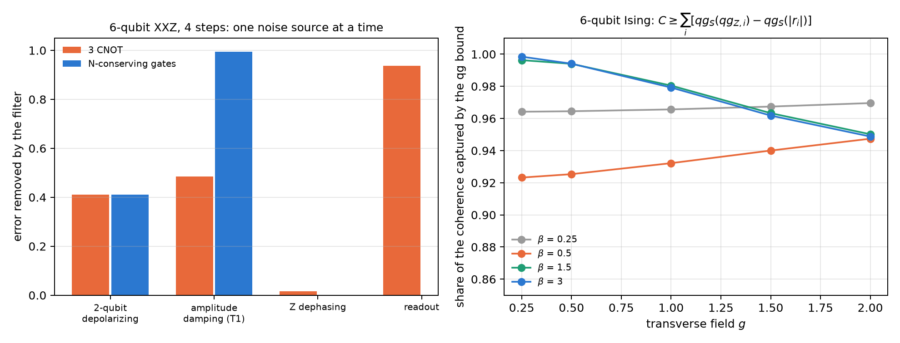

# Hamiltonian simulation, quantum walks and VarQTE {#sec-ch24}

Simulating the time evolution of a quantum system is the most natural application of a quantum computer, and it is also
where the qg filter of Chapter 21 reaches furthest: many Hamiltonians of physics conserve the number of excitations, and so
do their Trotter circuits. Then the Hamming weight of each shot is a free witness, and the filter applies to every
observable read in Z. This chapter goes through time evolution on the Chapter 1 scale: XY and XXZ chains, a quantum walk,
noise channels as maps of the readouts, variational evolution at fixed depth and, more briefly, differential equations,
Hubbard, a gauge theory, coherence in Ising and Boltzmann machines. The structural results are checked with code; the
results on device noise models are those of the notes' committed runs, read from their stored files.

## From the base: conserving N means having a filter {#sec-sim-base}

On the Chapter 1 scale, each qubit reads $m_Z=1000(1-2p)$, with $p$ the probability that it is excited. The number of
excitations of a shot is its Hamming weight, and the register's mean readout counts it: $N=\sum_i(1-qg_{Z,i})/2$. If the
Hamiltonian conserves $N$ and so does every gate of the circuit, every shot with the wrong weight had an error, and the
filter discards it (Chapter 21).

With a single excitation, the state lives in $n$ amplitudes, one per qubit: the excitation hops between neighbouring
qubits. It is a **continuous-time quantum walk**, and each qubit's readout says where the walker is.

## Trotter and the quantum walk on the XY chain {#sec-sim-xy}

The XY chain with fields, $H=J\sum_k(X_kX_{k+1}+Y_kY_{k+1})/2+\sum_kh_kZ_k/2$, conserves $N$, and its first-order Trotter
circuit uses only $R_Z$ and XX+YY gates, which conserve it too (notes, §147).

**How many steps.** More Trotter steps lower the Trotter error and add noise, so on a device the error has a minimum at a
number of steps $r^*$. Noiselessly, with $n=5$, random fields and $T=3$, the script recomputes the Trotter error: 0.381,
0.363, 0.221, 0.140, 0.078, 0.054 and 0.033 with 1, 2, 3, 4, 6, 8 and 12 steps. On the notes' 21 IBM device noise models,
the filter (plus readout correction) halved the best error (median 0.147 → 0.067; 1.6 to 2.8 times depending on the
device) and moved $r^*$ from 8 to 12 steps in the median: **the filter lets the simulation use deeper circuits**. On 11
devices the optimum was 12, the deepest tested.

**The walk.** With $n=7$ and the walker in the middle, the variance of its position $\sigma^2(t)$ grows like $t^2$ in a
quantum (ballistic) walk and like $t$ in a classical (diffusive) one. The script computes it with the exact evolution in the
weight-1 sector:

| $t$ | 0.4 | 0.8 | 1.2 | 1.6 | exponent |
|---|---|---|---|---|---|
| exact quantum walk | 0.320 | 1.278 | 2.832 | 4.759 | 1.96 |
| with the Trotter steps | 0.327 | 1.291 | 2.832 | 4.737 | 1.94 |
| classical walk, same rate | 0.791 | 1.513 | 2.113 | 2.585 | 0.86 |

: $\sigma^2(t)$ of the walk on 7 qubits; the exponent is the slope of $\log\sigma^2$ against $\log t$. {#tbl-walk24}

On the simulated devices, **raw data look like a classical walk**: median exponent 0.87, because noise spreads the walker
from the start. **With the filter it is ballistic again**: median exponent 1.84, and $\sigma^2$ stays within 20% of the
exact value at all four times on 15 of 21 devices (raw: none). The committed prediction asked for an exponent of at least
1.5 on 18 devices and it held on 16: it failed. The four noisiest ended between 1.26 and 1.38, and FakeKyoto at zero.

{#fig-walk24 width=100%}

## Several excitations: the XXZ chain {#sec-sim-xxz}

The XXZ chain adds an interaction $V\,Z_kZ_{k+1}/4$: the excitations interact and everything still conserves $N$. Here the
compilation matters (notes §60). The script measures, with exact density matrices ($n=6$, 4 steps), what share of the
imbalance error the filter removes with one noise source at a time:

| noise | 3 CNOT per bond | N-conserving gates |
|---|---|---|
| 2-qubit depolarizing, 0.01 | 41.1% | 41.1% |
| amplitude damping (T1), 0.01 | 48.5% | 99.5% |
| Z dephasing, 0.01 | 1.6% | 0.0% |
| readout, 0.02 | 93.8% | — |

: Share of the error the filter removes on the XXZ chain (notes §60, recomputed by the script). {#tbl-xxz24}

- **T1 leaks through the CNOTs.** Each decay lowers $N$, and the filter catches it if the state is in the sector when it
  happens. Inside a three-CNOT bond the intermediate states are not in the sector, and a decay mid-gate can be rotated back
  to $N=n/2$ and pass. With gates that conserve $N$ at every point, the filter removes 99.5%.
- Z dephasing does not change $N$, and the filter does not see it.
- With mixed noise, filter plus ZNE sits 2.6 to 8 times below the best single method up to 4 steps (§60).

On the 21 simulated IBM devices with $n=6$ (§148), the filter's gain falls from 5.6 times with one excitation to 2.6 with
two and with three: sectors with more excitations keep more shots, but more of the noise lands inside them. The prediction
that the filter never makes things worse failed in one of 63 cases (FakeKyoto at half filling). On IonQ's forte-1 noise
model (§61), the filter removed about half of the error in both XY compilations, with a ratio of 0.82 between them, inside
the committed band: on trapped ions, without dominant T1, the CNOT leak does not appear.

## Channels as affine maps of the readouts {#sec-sim-channels}

A qubit is $\rho=(I+r\cdot\sigma)/2$ with $r=(qg_X,qg_Y,qg_Z)$. Every channel with Kraus operators acts as $r'=Mr+c$ (notes
§162, `qang.channels.bloch_affine`): **the readouts after any noise are affine in those before it**. The script checks it on
800 random states to $2.8\cdot10^{-16}$. On the Chapter 1 scale:

- amplitude damping $\gamma$: $m_Z\to(1-\gamma)m_Z+1000\gamma$, and $m_X,m_Y$ are multiplied by $\sqrt{1-\gamma}$ (with
  $\gamma=0.3$: 0.7 and 0.837);
- dephasing: leaves $m_Z$ alone; depolarizing: multiplies the three readouts by the same number and keeps the qang angle;
- T1/T2 relaxation for a time $t$: $m_Z\to e^{-t/T_1}m_Z+(1-e^{-t/T_1})(1-2p_1)\cdot1000$ and $m_{X,Y}\to e^{-t/T_2}m_{X,Y}$
  (with $t=0.5$, $T_1=1$, $T_2=0.8$: 0.6065 and 0.5353, which are $e^{-0.5}$ and $e^{-0.625}$).

It is the Chapter 1 picture carried over to noise: every channel moves the readout point inside the sphere by a linear rule.

## Variational evolution at fixed depth {#sec-sim-varqte}

Trotter grows with time: more time, more steps, more gates. Variational evolution (VarQTE, McLachlan's principle) fixes the
circuit and changes only its angles (notes §162). With a weight-preserving ansatz (6 layers of RBS and $R_Z$, 54
parameters, 48 two-qubit gates), the filter still applies. The integration is classical; the device prepares and reads the
state. The script recomputes the noiseless fidelity of the angles stored by the notes' run (XXZ chain, $n=5$, $V=2$, two
excitations): 0.9999, 0.9956, 0.967 and 0.934 at $t=0.5$, 1, 1.5 and 2, equal to the stored ones.

| backend | filtered error at $t=2$: variational / best Trotter (72 gates) | variational error, $t=0.5\to2$ |
|---|---|---|
| FakeBrisbane | 0.036 / 0.076 | 0.052, 0.030, 0.030, 0.036 |
| FakeTorino | 0.030 / 0.042 | 0.034, 0.022, 0.012, 0.030 |
| FakeFez | 0.022 / 0.032 | 0.017, 0.008, 0.005, 0.022 |

: VarQTE against Trotter on three noise models (notes §162). {#tbl-varqte24}

At late times fixed depth wins, on all three devices, even though its noiseless fidelity is only 0.934 (the prediction that
it would exceed 0.95 failed). The variational error stays flat and the best Trotter error grows 2.6 to 11 times. Before
$t\approx1$ a short Trotter circuit wins. Limit: at $n=5$ everything is classically trivial, and on hardware the integration
would need metric and gradient circuits at every step.

## Differential equations {#sec-sim-ode}

A one-qubit re-uploading circuit can solve a differential equation: $u(x)=u_0+s(f(x)-f(0))$ with $f=\langle Z\rangle$,
trained on the residual (notes §22). The qang question is how to encode $x$: in the angle, or with $\arccos$, so that $x$ is
a qg readout. The notes' result: **qg wins clearly on exponential decay** (2.3, 17 and 6.6 times better than the best angle
scale with 2, 3 and 4 layers) and **does not win in general**: on the logistic equation the angle is about 2 times better,
and on the sine 25 times. qg has no scale to tune; the angle does (with scale $\pi$ it fails everywhere). The classical
control, Chebyshev collocation with as many coefficients as parameters, solves everything to $10^{-7}$ or better. The result
says which encoding to use, not that the circuit beats a classical method.

## Hubbard and a gauge theory: symmetry filters on every observable {#sec-sim-hubbard}

**1D Hubbard** (notes §29): 4 sites on 8 qubits, one register per spin. The Hamiltonian conserves $N_\uparrow$ and
$N_\downarrow$, so each register has zero mean readout at all times, and every observable (charge imbalance, double
occupancy) is in Z. The script checks it noiselessly: mean readout 0 in both registers and kept fraction 1 at 1, 2, 4 and 8
steps. In the notes, the filters roughly halve the error on a device without routing, and ZNE plus spin filters gives the
best double occupancy (6 to 9 times below raw). On the heavy-hex lattice, routing creates spin leak (8 to 47% of the
right-$N$ shots land in the wrong spin sector), and there the second filter pays. From 4 steps on everything sits on the
noise floor.

**$\mathbb Z_2$ lattice gauge theory** (§66): 4 matter sites and 3 links. The Gauss law $G_j$ is a product of Z's, so it is
the qg readout of a parity: the same Z shots give the local Gauss witnesses and three filters ($N$, Gauss and both). The
script checks that noiselessly each $\langle G_j\rangle$ is exactly $\pm1$ and no shot is lost. In the notes, with 2 steps,
the Gauss filter removes more than the $N$ filter (80 against 64% under depolarizing noise) and both together 90%. Under T1,
58–65%: the same CNOT leak. The local witnesses do not locate errors in this homogeneous model. Gauss-law post-selection is
known; what qang adds is reading it as qg of parities from the same shots.

## Coherence in the transverse-field Ising model {#sec-sim-ising}

The difference between the Z-basis entropy and the entropy of the state is a known measure: the relative entropy of
coherence $C(\rho)$ [@baumgratz2014]. It needs the entropy of the state, which counts do not give. The
notes (§34) propose a bound from two readouts per qubit:

$$
C\geq\sum_i\left[qg_S(qg_{Z,i})-qg_S(|r_i|)\right],\qquad |r_i|=\sqrt{qg_{X,i}^2+qg_{Y,i}^2+qg_{Z,i}^2}.
$$

The script evaluates it on thermal states of the 6-qubit Ising ring at 20 points ($\beta$ from 0.25 to 3, field $g$ from
0.25 to 2): **it captures 92.3 to 99.8% of the coherence** (@fig-filters24, right). The single-qubit bound captures 15–17%
(1/6 of the sum, by symmetry), and the basis-entropy bound is useless: it goes down to −5.9 bits. With 1000 shots the bound
reads to ±0.04 bits. Where it fails: on a graph state every reduced qubit is $I/2$ and the bound gives 0 with $C=6$ bits. The
tightness is a property of these thermal states, not a law.

{#fig-filters24 width=100%}

## Boltzmann machines: the I–η plane {#sec-sim-rbm}

A recent review [@singh2026] looks at each visible–hidden pair of an RBM through two numbers: the covariance $\eta$
and the mutual information $I$, which lie between two bounds $LB(\eta)$ and $UB(\eta)$, and observes that trained RBMs sit
on $LB$. In qg (notes §47), a pair of spins is fixed by three numbers, $qg_v$, $qg_h$ and $\eta$, and the script checks:
$LB$ is exactly the case of zero marginals ($2.2\cdot10^{-16}$) and the minimum of $I$ at fixed $\eta$; $UB$ is the locked
pair with $|qg_v|=|qg_h|=\sqrt{1-\eta}$ ($2.9\cdot10^{-15}$). In between, to leading order,
$I-LB\approx\eta^2(qg_v^2+qg_h^2)/(2\ln2)$; with $\eta=0.2$–$0.4$ the formula sits 10–14% above the exact value, because it
is leading order in $\eta$ too.

The explanation: the Ising driver has $\mathbb Z_2$ symmetry, a symmetric RBM has zero marginals, and so it sits on $LB$ by
symmetry, not by a learning principle. The prediction, which could have failed, held: a longitudinal field moves the same
learner off $LB$ by the amount the marginals set.

## What remains open {#sec-open24}

No result in this chapter ran on hardware. The three clearest things to test on a QPU are the filtered walk (§147, the
change of exponent from 0.87 to 1.84), the T1 leak through CNOTs (§60, which does not show up on an ion simulator) and
fixed-depth VarQTE against Trotter at late times (§162).

## Without qang and with qang {#sec-comparison24}

| action | without qang | with qang | difference |
|---|---|---|---|
| simulate N-conserving dynamics | raw readout or ZNE | weight filter on every Z observable | **in favour**: best error 1.6–2.8 times lower and deeper circuits (§147) |
| tell a quantum walk from a classical one | raw $\sigma^2$: exponent 0.87, looks classical | filtered: 1.84 (exact 1.96) | **in favour**: the filter recovers the physics |
| choose the compilation | CNOTs | N-conserving gates: the filter removes 99.5% of T1 against 48.5% | **in favour** on platforms with T1; **none** on ions (§61) |
| several excitations | — | gain 5.6 times with one, 2.6 with two or three | **in favour**, decreasing with $N$ |
| describe a channel | Kraus matrices | $r'=Mr+c$ on the readouts | **none** in content (it is the Bloch representation); **in favour** as a reading |
| late-time evolution | growing Trotter | fixed-depth VarQTE with the filter | **in favour** after $t\approx1$; **against** before |
| encode an ODE | angle with a scale | $\arccos$, no scale | **in favour** on exponential decay; **against** on others; a classical method beats all |
| Hubbard and gauge | known post-selection | witnesses and filters as qg of parities, from the same shots | **in favour** in cost (no extra circuits); the idea is known |
| bound the coherence | basis entropies: useless (−5.9 bits) | qg bound from two readouts per qubit: 92–100% | **in favour** on these states; **none** on graph states |
| I–η plane of an RBM | a learning principle | the bounds are the qg marginals; saturation is symmetry | **in favour**: explains and predicts |

: The chapter's actions without the qang scale and with it. {#tbl-comparison24}

**Balance.** Most of what this chapter gains belongs to the weight filter, not to the scale: conserving $N$ turns every shot
into a witness, which recovers a ballistic walk, allows deeper circuits and makes the compilation matter. What belongs to
qang is the reading: channels as affine maps of $m_X,m_Y,m_Z$, Gauss witnesses as qg of parities, a coherence bound from
two readouts per qubit and the RBM bounds as marginals. The gains that depend on the scale itself (the ODE) are partial,
and the chapter says so.

## In code {#sec-code24}

```python
import numpy as np
from qang import channels as CH

M, c = CH.bloch_affine(CH.amplitude_damping(0.3))
np.diag(M), c                     # (0.837, 0.837, 0.7) and (0, 0, 0.3): m_Z -> 0.7 m_Z + 300
r = np.array([0.2, -0.1, 0.5])    # (qg_X, qg_Y, qg_Z)
CH.qg_after(CH.amplitude_damping(0.3), r)   # = M @ r + c
```

## Summary {#sec-summary24}

- If the Hamiltonian and the gates conserve $N$, each shot's weight is a witness and the filter reaches every Z observable.
- On the XY chain, the filter halves the best error and moves the Trotter optimum to deeper circuits; the raw walk looks
  classical (exponent 0.87) and the filtered one is ballistic (1.84; exact 1.96).
- Under T1, CNOTs let half the error through and N-conserving gates almost none (99.5% removed).
- Every channel is an affine map of the readouts; fixed-depth VarQTE wins at late times.
- Differential equations, Hubbard, gauge, coherence in Ising and RBMs: the filter and the qg readouts help where the chapter
  measures it, and where they do not, it says so.

## Bibliographic notes {.unnumbered}

The product formula is @trotter1959 and @suzuki1991, and universal quantum simulation, @lloyd1996. The quantum walk is
@aharonov1993; variational evolution, @mclachlan1964 and @yuan2019. The generators of Markovian channels are
@lindblad1976 and @gorini1976, and the Hubbard model, @hubbard1963. The coherence measure is @baumgratz2014, and the I–η
plane of RBMs, @singh2026. The numbered research notes (§) cited in this chapter and the scripts that check it are in
the repository [@qangrepo]; the definition of the qang unit is in @monteverde2026.
