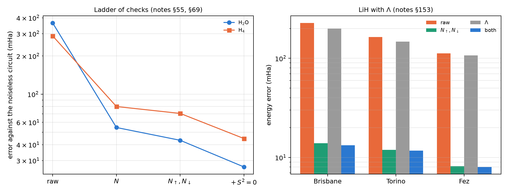

# Quantum spectroscopy, PCA and molecular chemistry {#sec-ch25}

Chapter 24 used the conservation of the number of excitations to filter dynamics. This one does the same with spectra and
molecules, where the conserved number is the number of electrons. The register's mean readout, on the Chapter 1 scale,
counts the electrons of each shot; if the circuit conserves them, that number is both a reference-free error witness and a
filter. The chapter follows that idea from a data PCA to 12-qubit molecules, and also shows where it stops reaching: when
the error lives in terms that are not measured in Z. The structural results are checked with code; the noise-model results
are those of the notes' committed runs.

## From the base: counting electrons with the register readout {#sec-chem-base}

In the Jordan-Wigner encoding each qubit is a spin-orbital, and its occupation is $(1-qg_Z)/2$, that is $(1000-m_Z)/2000$
in m-qg. Summing over the register,

$$
N_e=\sum_i\frac{1-qg_{Z,i}}{2},\qquad \overline{qg_Z}=1-\frac{2N_e}{n}.
$$

For any circuit that conserves the number of electrons, the ideal mean readout is known before running (0 for H$_2$: 2
electrons on 4 qubits). A departure from it is a witness that the hardware added or removed electrons (T1 pushes it towards
$+1$), and shot by shot it is a filter. **The filter is the known symmetry verification** [@bonetmonroig2018;
@mcardle2019]; what qang adds is the witness and its reading.

## PCA in the weight-1 sector {#sec-chem-pca}

Quantum PCA diagonalizes $\rho=C/\mathrm{tr}\,C$. In the unary encoding, a mixture of the loaded data vectors (with weights
$|x_j|^2$) is exactly that $\rho$, and an RBS circuit applying the PCA rotation leaves eigenvalue $\lambda_k$ on qubit $k$
(notes §146). The script checks it with exact states: for 5 components and 16 data points, each qubit's excitation
probability is the normalized eigenvalue (0.640, 0.203, 0.122, 0.023, 0.011) to $2.2\cdot10^{-16}$, with 10 RBS in the
rotation. Every gate conserves the weight, so the filter applies. It is not the quantum-PCA speed-up (5 components use 5
qubits and the rotation is computed classically): it tests how well a device reads a known spectrum.

On the notes' 21 IBM device noise models, with all four committed predictions passing, the raw estimate is biased upwards:
shots leaving the sector add excitations on every qubit (median L1 error 0.266). Filter plus readout correction brings it
to 0.048 (4.6 times lower; 1.6 to 7.7 depending on the device) and orders all five eigenvalues correctly on 18 of 21 devices
(raw: 13). What is left is a flattening of the spectrum that grows when few shots are kept (FakeKyoto keeps 15% and fails).

## H$_2$: the witness and the filter {#sec-chem-h2}

The script checks the structure on the notes' H$_2$ Hamiltonian (STO-3G, 0.735 Å, 4 qubits): it commutes exactly with $N$,
$N_\uparrow$ and $N_\downarrow$; the $N$-conserving ansatz reaches the exact (FCI) energy to $5\cdot10^{-11}$ mHa, and the
register's ideal mean readout is 0. Hartree-Fock sits 20.3 mHa above. The notes (§21) ran fake brisbane's noise model with
20,000 shots and an idle delay before measurement that amplifies T1:

| method | 0 µs | 20 µs | 50 µs |
|---|---|---|---|
| classical Hartree-Fock | 20.3 | 20.3 | 20.3 |
| quantum, raw | 74 | 140 | 231 |
| + readout correction | 18 | 90 | 188 |
| **+ readout + qg filter** | **5.5** | **20** | **30** |
| witness: mean readout (ideal 0) | +0.011 | +0.057 | +0.122 |
| shots kept | 91% | 83% | 72% |

: H$_2$ energy error against FCI, in mHa (notes §21). {#tbl-h2-25}

The witness rises as electrons are lost. With the filter the energy is 3.2 times better than with readout correction alone
without delay (6 times at 50 µs) and 3.7 times better than Hartree-Fock, but still 3.4 times above chemical accuracy: the
rest sits in the 4 XXYY-type terms, which a Z filter cannot reach, and in errors that conserve $N$. FCI is exact and cheap
at this size: the table measures what the correction buys a noisy quantum computation, not an advantage.

**Spin filters** (§28). The Hamiltonian conserves $N_\uparrow$ and $N_\downarrow$ separately, and each spin register has its
own mean readout. A second free filter, from the same shots: under depolarizing noise it removes a further 34–37% of the
error the total filter leaves, but on fake brisbane the gain is within the seed spread (6.5 → 5.9 mHa), because the spin
leak is below 1%. The leak witness says when it pays.

## Why the filter helps H$_2$ and not LiH {#sec-chem-reach}

With LiH (6 qubits) the §21 filter did nothing. The notes (§50) separated the causes: reach (the filter acts only on Z
shots), routing and depth.

| case | 2q gates | Z group raw → filtered | X/Y groups raw | total raw → filtered |
|---|---|---|---|---|
| H$_2$, all-to-all | 3 | 13.0 → 4.9 | 0.9 | 13.9 → 5.9 |
| H$_2$, brisbane | 6 | 20.6 → 2.8 | 2.4 | 23.0 → 5.2 |
| LiH, all-to-all, 1 layer | 20 | −2.2 → −1.9 | 26.2 | 24.0 → 24.3 |
| LiH, brisbane, 3 layers | 60 | −30.5 → −18.0 | 165.8 | 135.3 → 147.9 |

: Where the error sits, in mHa against the noiseless circuit (notes §50). {#tbl-reach25}

**Reach is the main reason.** In H$_2$ the error is in the Z group, where the filter acts; in LiH it is in the 16 X/Y groups,
where a Z filter does not look, and not even a perfect filter would go below that column. Routing is not the cause: the LiH
ansatz is nearest-neighbour and needs the same gates on an all-to-all device. The qang attempt to rescale the X/Y groups by
the kept fraction failed: it over-corrects 2–3 times, because local gate noise is not a global depolarization.

## Checks that reach every group {#sec-chem-checks}

If the problem is reach, the remedy is a check that commutes with every term (§52): the parity of the electron number on an
ancilla (6 CNOTs), and $N$ modulo 4 on a second ancilla, which also catches the errors that change $N$ by 2. With 3-layer
LiH and all-to-all noise, parity plus mod 4 take the error from 83.9 to 13.4 mHa (§50's best was 76.6), discarding 28% of
the shots: for the first time in the repository, LiH ends (on that model) below Hartree-Fock. On IonQ's forte-1 model (§53)
the mod-4 check survives (3.8 times less error, parity alone 1.25 times), but the result stays above Hartree-Fock.

Larger molecules (§54, §55, §69), with ideal projections:

| molecule | qubits | raw | $N$ | $N_\uparrow$, $N_\downarrow$ | $+\,S^2=0$ |
|---|---|---|---|---|---|
| H$_2$O | 8 | 363.9 | 54.6 | 43.3 | 26.7 |
| H$_4$ | 8 | 287.5 | 79.9 | 70.5 | 44.7 |

: The ladder of checks, error in mHa against the noiseless circuit (notes §69). {#tbl-ladder25}

- Number checks keep working up to 12 qubits, but **they reach a shrinking share** of the error: the part that changes $N$
  falls from 92% (LiH, 60 CX) to 67% (H$_6$, 132 CX). The rest conserves $N$ and no number check sees it.
- Splitting by spin recovers part of it (from 75.7 to 66.8 mHa on H$_4$).
- **The projection onto the singlet $S^2=0$ removes a further 37–38%**, the largest gain since §52, but $S^2$ is not diagonal
  in Z: it needs 640 Pauli strings for the projector and 2064–3456 for the projector times $H$, against 105–185 for $H$.

**Λ as a third filter** (§153). A linear molecule conserves $\Lambda$, the projection of the orbital angular momentum on its
axis. With the π orbitals written as π± ($m_l=\pm1$), $\Lambda$ is diagonal and is checked shot by shot with only the four π
qubits, so it reaches 29 of LiH's 317 measurement groups (10 qubits), against 1 for the number filter. The committed
prediction half held: **where $N_\uparrow,N_\downarrow$ already applies, $\Lambda$ adds almost nothing** (13.9 → 13.3 mHa on
FakeBrisbane), because changing $\Lambda$ without changing $N$ takes two errors. **The extra reach is real and does not pay**:
in the 28 groups where only $\Lambda$ acts, it discards 4–10% of the shots and their error barely moves, because the error
that matters there is on the σ qubits measured in X/Y.

{#fig-checks25 width=100%}

## Overlaps: inversion test against swap test {#sec-chem-overlaps}

The fidelity $F=|\langle x|y\rangle|^2$ of two unary states can be estimated two ways (§149). The **inversion test** loads
$x$, undoes the loader of $y$ and reads the probability of one basis state: 5 qubits, everything conserves the weight. The
**swap test** uses 11 qubits and an ancilla, and reads $P(\text{ancilla}=0)=(1+F)/2$. The script checks both formulas with
exact states ($3\cdot10^{-16}$ and $6\cdot10^{-16}$). On six IBM noise models:

- with the filter, the inversion test cuts its error 3.8 to 11.2 times, down to 0.010–0.036;
- in the swap test the answer is on the ancilla, outside the symmetry, and the filter gains only 1.4–1.8 times (error
  0.089–0.239);
- a fidelity classifier (40 flowers) keeps its noiseless accuracy with both methods, because comparing two fidelities
  cancels the common shrink;
- but the test "are they equal?" needs the absolute value: for identical states the filtered inversion test reads
  0.92–1.00 and the raw swap test 0.20–0.65.

{#fig-pca25 width=100%}

## Constrained optimization: QAOA with "exactly K" {#sec-chem-qaoa}

Choosing exactly $K$ of $n$ vertices is the same identity as the number of electrons: $\overline{qg_Z}=1-2K/n$, 0.25 for
$K=3$ of $n=8$ (notes §30). The script checks that with the XY mixer (which conserves the weight, from a Dicke state) the
ideal distribution is 100% feasible at random angles, while penalty QAOA leaves 10 to 45% feasible mass. On an all-to-all
device the filter doubles the XY mixer's probability of finding the optimum (0.150 → 0.278 at $p=1$; 0.177 → 0.366 at
$p=2$), and on the IonQ models too (1.8–2.6 times, §38). On fake brisbane, with routing, everything falls to the level of
picking a random feasible set, and the kept fraction warns of it (0.24–0.33, close to 0.22 for a mixed register).
**Classical wins**: a greedy algorithm reaches 98.5% of the optimum. The qg ingredients improve QAOA against QAOA, not
against classical optimization.

## What remains open {#sec-open25}

No result in this chapter ran on hardware. The notes committed a criterion for LiH with the mod-4 check on an IonQ QPU
(§53: it holds if parity plus mod 4 cut the error at least 2.5 times in every run and parity alone less than 1.5), at an
estimated cost of about 1,100–2,200 dollars, which did not fit in the budget.

## Without qang and with qang {#sec-comparison25}

| action | without qang | with qang | difference |
|---|---|---|---|
| read a PCA spectrum | raw: biased upwards (L1 0.266) | weight filter: L1 0.048 | **in favour**: 4.6 times less error; it belongs to the filter |
| detect electron loss | compare with a reference | register mean readout, known ideal | **in favour**: reference-free witness |
| H$_2$ energy | readout correction: 18 mHa | + filter: 5.5 mHa | **in favour**: 3.2 to 6 times; symmetry verification is known |
| LiH energy with a Z filter | — | no gain: the error is in X/Y | **none**: the witness diagnoses, the filter does not reach |
| rescale X/Y by the kept fraction | — | over-corrects 2–3 times | **against** |
| ancilla checks | parity: a third | + $N$ mod 4: 6–8 times less error | **in favour**, with 1–2 ancillas; an extension of known methods |
| larger molecules | — | the reachable share falls from 92 to 67% | **in favour**, decreasing |
| $\Lambda$ filter | — | reaches 29 more groups and does not pay | **none** where a spin filter already applies |
| absolute fidelity | raw swap test: 0.20–0.65 for equal states | filtered inversion: 0.92–1.00 | **in favour** of the filtered inversion test |
| constrained QAOA | penalty: chance level | XY mixer + filter: doubles success | **in favour** against QAOA; **against** against classical greedy |

: The chapter's actions without the qang scale and with it. {#tbl-comparison25}

**Balance.** As in Chapter 24, almost everything gained belongs to symmetry verification, which is known. What belongs to
qang is the witness: the register's mean readout says how many electrons there are, and its kept fraction says how much is
left to filter. That witness is what led from the §21 failure on LiH to the §50 reach diagnosis and the §52 checks. The
chapter also leaves the measured limits: the error that conserves every symmetry grows with size, and one more symmetry
($\Lambda$) can reach more groups without lowering the error.

## In code {#sec-code25}

```python
import numpy as np
from qiskit.quantum_info import Statevector
from qang import ibm

x = np.array([0.3, -0.5, 0.2, 0.7, 0.4])
y = np.array([0.1, 0.6, -0.3, 0.5, 0.5])
x, y = x / np.linalg.norm(x), y / np.linalg.norm(y)
sv = Statevector(ibm.unary_overlap_circuit(x, y, measure=False)).data
abs(sv[1]) ** 2, (x @ y) ** 2      # inversion test: P(only qubit 0 excited) = F
```

## Summary {#sec-summary25}

- In Jordan-Wigner, the register's mean readout counts the electrons: $\overline{qg_Z}=1-2N_e/n$. Its ideal value is known
  before running, so it is a reference-free witness and, shot by shot, a filter.
- In the unary PCA, the filter cuts the error of the read spectrum 4.6 times; on H$_2$, the energy error 3.2 to 6 times.
- On LiH the Z filter does not reach the error, which sits in the X/Y groups; ancilla checks (parity and $N$ mod 4) do, and
  cut the error 6–8 times.
- With larger molecules each symmetry reaches a smaller share of the error; $S^2$ removes a further 37–38% at the cost of
  many more measurements, and $\Lambda$ adds reach without lowering the error.
- The filtered inversion test gives the absolute fidelity; the raw swap test does not. In constrained QAOA the filter
  doubles the XY mixer's success, and a classical algorithm still wins.

## Bibliographic notes {.unnumbered}

Quantum PCA is @lloyd2014. The Jordan–Wigner transformation is @jordan1928; the VQE, @peruzzo2014, @omalley2016 and
@kandala2017, with integrals from PySCF [@sun2018]. Symmetry verification is @bonetmonroig2018 and @mcardle2019. The
swap test comes from @buhrman2001, and QAOA and its mixers, from @farhi2014 and @hadfield2019. The numbered research
notes (§) cited in this chapter and the scripts that check it are in the repository [@qangrepo]; the definition of the
qang unit is in @monteverde2026.
