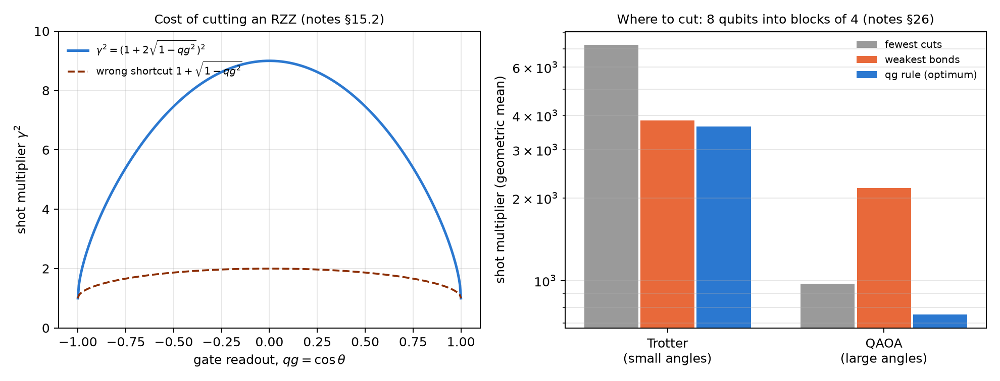

# Error correction and continuous syndromes {#sec-ch26}

Error correction protects a logical qubit by spreading it over several physical ones and measuring syndromes: parities that
say which error happened without touching the information. On the Chapter 1 scale, each syndrome is the qg readout of a
parity, a number between $-1000$ and $1000$ m-qg that can be averaged and tracked in time. This chapter uses that readout for
four things: choosing the code according to how much T1 and how much dephasing the device has, tracking noise drift with the
syndromes themselves, decoding the surface code knowing that T1 leaves zeros, and deciding where to cut a circuit. The
code-capacity results (perfect syndromes, one round) are checked with code; the circuit-level, qutrit, erasure-qubit and
device-model results are those of the notes' committed runs.

## From the base: the syndrome is a qg readout {#sec-qec-base}

A stabilizer such as $Z_0Z_1$ is $+1$ or $-1$ on each shot; its average is the $qg$ of the parity, and the rate of
non-trivial syndromes is $(1-qg)/2$, the same probability equation as Chapter 1. The two noises of an idle qubit are read with
two experiments (notes §27): preparing $|1\rangle$ and measuring Z gives $qg_Z=-1+2\gamma$ (damping, T1), and preparing
$|+\rangle$ and measuring X gives $qg_X=\sqrt{1-\gamma}\,(1-2p)$ (dephasing, $T_\varphi$). Inverting them gives $\gamma$ and $p$,
and with them one decides which code to use.

## Which code to use under T1 and dephasing {#sec-qec-codes}

At code capacity, with one round of damping $\gamma$ and dephasing $p$ on every qubit, the script recomputes the exact logical
infidelity of four options: no code, the repetition code against bit flips, the phase-flip code, and the 4-qubit code of
Leung, Nielsen, Chuang and Yamamoto (1997), built for T1.

| noise | no code | bit flip | phase flip |
|---|---|---|---|
| T1 only, $\gamma=0.02$ | **0.0067** | 0.0101 | 0.0197 |
| dephasing only, $p=0.02$ | 0.0133 | 0.0384 | **0.0008** |
| $\gamma=p=0.02$ | **0.0199** | 0.0474 | 0.0204 |

: Repetition codes under T1 and dephasing (notes §27, recomputed). {#tbl-repetition26}

- **No repetition code corrects T1**, and the bit-flip code is worse than not coding in every case. The boundary between
  "phase code" and "no code" is at $p=\gamma$ (ratio 1.00, 1.02 and 1.10 at $\gamma=0.002$, 0.01 and 0.04).
- **The Leung code does correct T1**: its infidelity is $\approx0.92\,\gamma^2$, 36 times below no code at $\gamma=0.01$ and 364
  times at $\gamma=0.001$. But it is fragile to dephasing: it wins only if $p<\gamma/4$ (boundary 0.249, 0.247 and 0.237).

**The rule in device times.** With one idle round, $\gamma=t/T_1$ and $p=t/2T_\varphi$, so $p=\gamma/4$ is $T_2=T_1$ and $p=\gamma$
is $T_2=0.4\,T_1$. The best option is **Leung if $T_2>T_1$, no code if $0.4\,T_1<T_2<T_1$, and the phase code if
$T_2<0.4\,T_1$**; the script confirms it at nine $T_2/T_1$ ratios. With both qg witnesses measured with 1000 shots each, the
policy chooses right in 79% of 300 random cases, at a cost of 6.4% over the oracle, against 14.7% for the §27 policy (without
Leung) and 64–220% for always taking one option. **The $qg_Z$ readout alone does not work**: it sees T1 but not dephasing,
and always recommends not coding.

{#fig-codes26 width=100%}

## The syndrome as a continuous witness {#sec-qec-syndrome}

Once the code is chosen, its ancillas keep reading the noise. In the Leung code the stabilizer expectations are, in closed
form (notes §33),

$$
\langle Z_0Z_1\rangle=1-2\gamma(1-\gamma),\qquad \langle XXXX\rangle=qg_X^4,
$$

and the script confirms it against the Kraus computation (for instance, rates 0.0099 and 0.02161 at $\gamma=0.01$ and
$p=0.003$). So each ancilla's qg readout inverts in one line to $\gamma$ and $p$. In the notes, with $T_2/T_1$ jumping at random
between 1.6, 0.6 and 0.3, tracking the noise with the syndromes alone costs 13.1% over the oracle **without any probe shots**,
better than recalibrating every 10 windows (20.4%); a hybrid reaches 7.2% with 4 times fewer probe shots than probing every
window (6.6%). Calibrating once at the start is worse than never coding (57.7% against 25.9%).

**On device circuits.** Reading the Leung syndromes on three IBM noise models (§88), the damping came out within 1–10% of the
calibration on two of them and failed on the third; the causes were routing and a 9% error floor (§92). Reading them
destructively, without ancillas or SWAPs, on the device's best 4-qubit path (§93), all four committed predictions held: the
damping comes out within 1–4% of the calibration and the floor drops to 2–3%. The dephasing came out 1.17–1.51 times high, and
§99 found why: $\langle XXXX\rangle$ reads the **product mean** over the four qubits, which is what limits the logical coherence,
and against it the fit agrees to 0.99–1.04.

## The surface code and the T1-aware decoder {#sec-qec-surface}

In the rotated distance-3 surface code (9 data qubits), each averaged stabilizer is the qg readout of a parity. The script
recomputes at code capacity, enumerating the 512 patterns: $p_L=1.79\cdot10^{-5}$, $1.73\cdot10^{-3}$ and $1.44\cdot10^{-2}$ at
$p=0.001$, 0.01 and 0.03, and a pseudo-threshold of 0.0753 (notes §59).

**The syndromes barely see T1.** Under damping, a weight-$w$ syndrome reads exactly $(1-\gamma)^w+\gamma^w$, against
$(1-\gamma)^w$ for the equivalent Pauli model: at $\gamma=0.01$ and $w=2$, 0.98020 against 0.98010, a difference that would need
about $10^8$ shots. **The register's mean readout does see it**: it is $\gamma$ under T1 and 0 for symmetric flips, and it comes
from the same bits.

**Decoding knowing that T1 leaves zeros.** A decay only turns a 1 into a 0, so a decoder that places errors only on bits read
0 lowers the logical error:

| $\gamma$ | Pauli model | minimum weight | T1-aware | maximum likelihood | ratio |
|---|---|---|---|---|---|
| 0.01 | $4.41\cdot10^{-4}$ | $4.90\cdot10^{-4}$ | $1.99\cdot10^{-4}$ | $1.99\cdot10^{-4}$ | 2.46 |
| 0.03 | $3.82\cdot10^{-3}$ | $4.22\cdot10^{-3}$ | $1.77\cdot10^{-3}$ | $1.77\cdot10^{-3}$ | 2.39 |
| 0.1 | $3.69\cdot10^{-2}$ | $4.03\cdot10^{-2}$ | $1.89\cdot10^{-2}$ | $1.89\cdot10^{-2}$ | 2.14 |
| 0.3 | 0.217 | 0.231 | 0.144 | 0.144 | 1.60 |

: d = 3 surface code under T1, code capacity (notes §59, recomputed). {#tbl-surface26}

The T1-aware decoder equals maximum likelihood, and the Pauli model underestimates the standard decoder's error by 6–11%.
**Does it survive at circuit level?** In the notes (§64), with full syndrome extraction and $d$ rounds, the gain is 2.2 times at
$d=3$ and 3.3 at $d=5$ under pure T1, 1.6 and 2.0 when T1 dominates, and it grows with distance. **It is not free**: when
depolarizing noise dominates, the reweighting costs 15% at $d=3$. A qg witness (final mean readout over detector rate) chooses
the decoder without labels: 1.3–2.6 where the T1-aware decoder wins and 0.34–0.54 where it loses, although the threshold of 1
was chosen after seeing the cases.

## Qutrits and erasure qubits {#sec-qec-qutrits}

Before extending qang beyond the qubit, the notes asked whether a three-level readout gives it an advantage (§70–§74), with
criteria committed before each run:

- **If the leaked qubit keeps its value, the $|2\rangle$ flag is useless** (§70): all the gain was the T1 reweighting, and adding
  the flag made it worse. Recorded verdict: no qutrit advantage.
- **If the leak scrambles the qubit, it helps** (§70b): reweighting plus flag give 1.78 times over standard, more than the
  product of the two parts (1.55).
- **A rule for the flag** (§71): weighting it by where the leak came from (posterior $1/(1+a)$) is never worse than standard, and
  the qutrit-plus-qg gain grows with distance (1.48 times at $d=3$, 1.77 at $d=5$). One of the four predictions failed, so it
  stands as a partly confirmed rule.
- **A real transmon** (§72, coherent three-level CZ): leakage comes only from $|11\rangle$, the asymmetry is zero and the flag is
  nearly useless; the qg reweighting is not (1.8–2.0 times).
- **Erasure qubits** (§73, §74): if the device heralds decays with probability $h$, naively combining the herald with the
  reweighting makes things worse (0.46 times at $h=0.99$). The $(1-h)$ rule, committed before running, fixes it: qg still gives
  1.4–1.9 times at $h=0.25$–$0.5$ and fades towards 1 when heralding is nearly perfect.

## Cutting circuits: where and at what cost {#sec-qec-cutting}

Cutting a two-qubit gate to run a large circuit in pieces multiplies the shots needed by $\gamma^2$. For a Pauli rotation such
as RZZ$(\theta)$, in qg (notes §15.2):

$$
\gamma=1+2|\sin\theta|=1+2\sqrt{1-qg^2},\qquad qg=\cos\theta .
$$

Cutting is free at the poles ($qg=\pm1$) and costs 9 times at the equator. A shortcut that circulates, $\gamma^2=1+\sqrt{1-qg^2}$,
underestimates the cost by up to 4.5 times (2 instead of 9 at $qg=0$).

Where to cut? An 8-qubit circuit with 12 RZZ couplings must run in blocks of at most 4 qubits (§26). The script compares three
rules on 200 instances per regime, choosing among the 3795 partitions:

| regime | fewest cuts | weakest bonds | qg rule (optimum) |
|---|---|---|---|
| Trotter (small angles) | 7254 | 3838 | 3642 |
| QAOA (large angles) | 976 | 2174 | 753 |

: Shot multiplier, geometric mean (notes §26, recomputed). {#tbl-cutting26}

With small angles, "cut the weakest bonds" nearly matches the qg rule. With large angles it is the worst rule: RZZ$(\theta\approx\pi)$
is almost a local $Z\otimes Z$ and nearly free to cut. **The reference tool already does this**: qiskit-addon-cutting's
`find_cuts` reaches the optimum on all 400 of the notes' instances (it is not installed in this environment, so the script does
not run it). What qg adds is the closed form: scoring the 3795 partitions takes 1–2 ms per instance. In the notes' end-to-end
run, the qg choice lowers the error 2.9 times with shots proportional to the weights, and raises it with equal shots per
subexperiment: the $\gamma^2$ law assumes importance sampling.

{#fig-cutting26 width=100%}

## Randomized benchmarking, ZNE and $qg_S$ as a signal {#sec-qec-benchmarking}

- **Randomized benchmarking** (§11.1): with per-gate depolarizing noise, the survival is exactly $qg_Z(m)=(1-p)^{m+1}$, the same
  for any Clifford sequence. The script confirms it on four seeds (0.95, 0.7351 and 0.5688 at $m=0$, 5 and 10).
- **ZNE: which space to extrapolate in** (§11.2): if the noise shrinks the readout, extrapolating in qg is exact ($10^{-16}$) and
  in the angle it is not ($10^{-4}$); if the noise rotates the angle, the other way round. Rule: extrapolate where the noise is
  linear, and the $\theta\leftrightarrow qg$ change makes trying both cheap.
- **$qg_S$ as a signal** (§10): the output entropy follows the heavy-output probability without ideal simulation (correlation
  −0.926 under depolarizing noise), but under T1 it stops being monotone: on a fake brisbane model with a 200 µs idle it falls
  below the noiseless value, and would rank the most damaged point as the least noisy. With the register's mean readout
  alongside, which rises at every step, the pair is no longer fooled.

## What remains open {#sec-open26}

The code-capacity results are verified; the circuit, qutrit and erasure results are from the notes' simulations with committed
predictions. The destructive Leung-syndrome readout (§93, 24 four-qubit circuits) is ready to run on a real IBM device and has
not been run.

## Without qang and with qang {#sec-comparison26}

| action | without qang | with qang | difference |
|---|---|---|---|
| choose a code | pick one fixed: 64–220% over the oracle | $qg_Z$ and $qg_X$ witnesses and the $T_2/T_1$ rule: 6.4% | **in favour**; the $T_2/T_1$ rule is equivalent, qg makes it measurable with two readouts |
| see T1 with one witness | — | $qg_Z$ alone: always recommends no code | **against** if used alone: both components are needed |
| track drift | recalibrate every 10 windows: 20.4% | syndromes as qg readouts: 13.1% without probe shots | **in favour** |
| read dephasing from syndromes | arithmetic mean: 1.17–1.51 times high | product mean: 0.99–1.04 | **in favour**: the right number is the one that limits the code |
| see T1 in the surface code | syndromes: a $\gamma^w$ difference, invisible | register mean readout: equals $\gamma$ | **in favour** |
| decode under T1 | minimum weight | errors only on bits read 0: 2.1–2.5 times (capacity), 2.2–3.3 (circuit) | **in favour** when T1 dominates; **against** (15%) when depolarizing noise dominates |
| qutrits and erasure | flag erased blindly | flag weighted by its origin; $(1-h)$ rule | **in favour** with scrambling leaks or partial heralds; **none** with near-perfect heralds |
| choose cuts | count cuts or cut the weakest | $\gamma=1+2\sqrt{1-qg^2}$ per gate | **in favour** against angle-blind rules (up to 2.9 times); **none** against qiskit-addon-cutting, which already does it |
| extrapolate to zero noise | one fixed space | choose qg or $\theta$ by the noise | **in favour**, on idealized models |
| certify with the entropy | $qg_S$ alone: fooled under T1 | $qg_S$ plus the mean readout | **in favour** of the pair |

: The chapter's actions without the qang scale and with it. {#tbl-comparison26}

**Balance.** None of the codes or decoders is new, and the reference cutting tool already chooses the way qg does. What the
qang scale brings here is measurable and concrete: the syndrome as a readout that inverts in one line to $\gamma$ and $p$, a
code-choice rule with its cost, a reading of T1 that the syndromes lack, a decoder that uses the fact that T1 leaves zeros, and
the closed form of the cost of cutting. The gains depend on the regime, and the table says where they are lost.

## In code {#sec-code26}

```python
from qang import knitting as KN

KN.cut_sampling_overhead(0.0)    # 9: cutting an RZZ at the equator (qg = 0)
KN.cut_sampling_overhead(0.95)   # 2.64: cheap near the pole
KN.total_sampling_overhead([0.95, 0.2, -0.99])   # 38.0: product of the gamma^2
```

## Summary {#sec-summary26}

- Each syndrome is the qg readout of a parity; $qg_Z$ of $|1\rangle$ and $qg_X$ of $|+\rangle$ read T1 and dephasing.
- No repetition code corrects T1; the Leung code does. Rule: Leung if $T_2>T_1$, no code if $0.4\,T_1<T_2<T_1$, phase code if
  $T_2<0.4\,T_1$.
- The Leung syndromes track drift without probe shots, and read the product mean of the dephasing.
- In the surface code the syndromes do not see T1 and the mean readout does; placing errors only on bits read 0 lowers the
  logical error 2–3 times when T1 dominates.
- With qutrits and erasure qubits, qg adds up if the flag is weighted by its origin and the herald by $(1-h)$.
- Cutting an RZZ costs $(1+2\sqrt{1-qg^2})^2$: free at the poles, 9 times at the equator.
