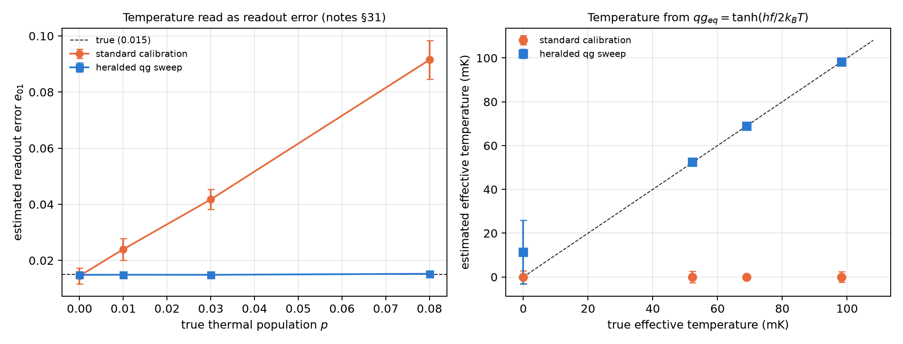
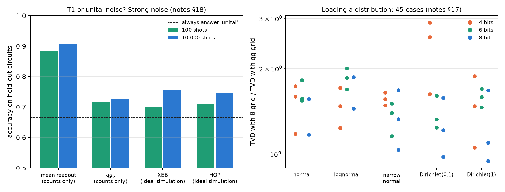

# Hardware characterization in qg {#sec-ch27}

Before running any algorithm one has to know what the device is like: how long it takes to decay (T1), how long to lose its
phase (T2), how hot it is and how often it misreads. This chapter reads those quantities on the Chapter 1 scale. Each one
shows up as a qg readout, and the scale helps in three concrete cases: separating temperature from readout error, telling
T1 from unital noise with the mean readout, and choosing the grid with which the electronics sets the angles. All three are
recomputed with code. The results on IBM device models are those of the notes' committed runs.

## From the base: an idle qubit is a readout {#sec-hw-base}

A real qubit is never completely cold: at rest it has a residual excited population $p$, and its equilibrium readout is
$qg_{eq}=1-2p$, in m-qg $m_{eq}=1000(1-2p)$. For a qubit of frequency $f$ in thermal equilibrium,

$$
qg_{eq}=\tanh\!\left(\frac{hf}{2k_BT_{\text{eff}}}\right),
$$

so the equilibrium readout **is** a thermometer. The instrument's readout is also affine in qg: if it confuses 0→1 with
probability $e_{01}$ and 1→0 with $e_{10}$, the measured readout is $a+b\,qg$, with $a=e_{10}-e_{01}$ and $b=1-e_{01}-e_{10}$
(notes §31). The problem is that in the Z basis only $a+b\,qg_{eq}$ is seen: temperature and readout error are mixed.

## T1, T2, temperature and readout in one sweep {#sec-hw-sweep}

The standard calibration measures "$|0\rangle$" and "$|1\rangle$", which are really the thermal state and X applied to it, and
counts the thermal population as readout error. The qg protocol adds a herald: measure, apply I, X or $R_y(\pi/2)$, wait and
measure again. The pairs at zero delay give, in closed form, the mean $m$, the readout covariance $V=b^2(1-qg_{eq}^2)$ and
$C_X=a^2-b^2$, from which $a$, $b$ and $qg_{eq}$ follow. The delays add T1 (after X) and T2 (the decay of $qg_X$). The script
repeats the notes' experiment with 40 repetitions of 16 circuits of 2000 shots (T1 = 100 µs, T2 = 70 µs, $e_{01}=0.015$,
$e_{10}=0.04$, 5 GHz):

| true thermal population (temperature) | $e_{01}$ standard | $e_{01}$ qg | temperature standard | temperature qg |
|---|---|---|---|---|
| 0 (0 mK) | 0.0145 | 0.0149 | 0 | $11\pm15$ mK (bound) |
| 0.01 (52 mK) | 0.0240 | **0.0149** | 0 | **$52.5\pm1.0$** |
| 0.03 (69 mK) | 0.0418 | **0.0149** | 0 | **$68.9\pm0.9$** |
| 0.08 (98 mK) | 0.0915 | **0.0153** | 0 | **$98.3\pm0.8$** |

: Standard calibration against the heralded qg sweep (notes §31, recomputed). {#tbl-sweep27}

- **The standard calibration reads temperature as readout error**: it overestimates $e_{01}$ by exactly $p\cdot b$ and sees the
  qubit perfectly cold at any temperature.
- **The qg sweep is unbiased** in $e_{01}$, $e_{10}$, $p$ and the temperature, and resolves it to 1 mK from 52 mK up (at $p=0$
  it only gives a bound).
- T1 and T2 come out unbiased in both, but the joint qg fit is more precise (T1 spread 1.5–2.1 µs against 2.8–3.1; T2,
  2.2–2.5 against 3.1–4.8), partly because of the maximum-likelihood fit itself.

**As IBM circuits** (§86). With 32 one-qubit circuits with mid-circuit measurement, on three IBM device noise models, all three
committed predictions held: T1 and T2 within 25% and readout errors within 0.01. The qg T2 sits closer to the reported value
than the standard one, which comes out 10% high on two of them. What a simulated model cannot test is precisely the thermal
population (Aer has none). The real run is pending and is the first one worth doing on hardware.

{#fig-characterization27 width=100%}

## Which noise is it? The mean readout against XEB and HOP {#sec-hw-noise}

With $N$ shots of a 4-qubit quantum-volume circuit, can one decide whether the noise is dissipative (T1) or unital (dephasing
or depolarizing)? The notes (§18) set it up with 24 circuits, three channels and 10 strengths, and each measure is turned into
a classifier with a single threshold fitted on 16 circuits and scored on 8 it has not seen. XEB and HOP need the ideal
distribution (a classical simulation); the mean readout and $qg_S$ only need counts. The script recomputes it:

| noise per gate | shots | mean readout | $qg_S$ | XEB | HOP |
|---|---|---|---|---|---|
| strong, 2–50% | 100 | **0.88** | 0.72 | 0.70 | 0.71 |
| strong, 2–50% | 1000 | **0.91** | 0.72 | 0.74 | 0.73 |
| strong, 2–50% | 10,000 | **0.91** | 0.73 | 0.76 | 0.75 |
| weak, 0.5–5% | 100,000 | 0.67 | 0.67 | 0.67 | 0.67 |

: Accuracy on held-out circuits (0.67 = always answer 'unital'). {#tbl-noise27}

- **With strong noise, the mean readout identifies T1** much better than the standard measures, from only 100 shots and
  without the ideal distribution: 0.88 with 100 shots and 0.91 with 1000 or more. Its accuracy grows with the strength (0.75
  below 10% per gate, 0.98 above 25%). XEB and HOP measure how much noise there is, not which kind.
- **At realistic strengths everything is at chance**, even with 100,000 shots. The limit is not shot noise: the ideal mean
  readout already varies from circuit to circuit (spread 0.139, from −0.325 to +0.334), more than the T1 shift.

The practical consequence: the mean readout is a T1 detector on circuits whose ideal value is known, such as an idle wait
before measurement, not a passive detector on any circuit.

## Coherent errors and the always-on ZZ {#sec-hw-zz}

A conditional-phase error (an extra ZZ) conserves the weight, so one might expect it to pass the weight filter unnoticed. The
notes tested this twice with committed predictions, and both times the prediction failed in an informative way:

- **A coherent RZZ after every native gate** (§145): the kept fraction fell by 0.009–0.020 at $\varepsilon=0.10$ rad, and the
  filtered error grew only 4% on the ECR devices but 62% on FakeTorino (CZ). The error acts inside the decomposition of the
  logical gate, where the qubits are not in the computational basis, and part of it leaves the sector.
- **Always-on ZZ between neighbours** (§150, 5 and 15 kHz): the filter removed 32–60% of the added error; the filtered error
  grew 14–38% at 15 kHz and stayed 4–5 times below raw. Short circuits suffer least.

On these devices coherent errors are filtered in proportion to the time the qubits spend outside the computational basis.

## Control quantization: an even grid in the angle or in qg {#sec-hw-control}

The electronics sets each angle from a grid of $2^b$ values. The usual choice is a grid even in $\theta$; a grid even in
$qg=\cos\theta$ is even in the Born probability and, on the Bloch sphere, is made of equal-area bands (notes §17). The script
recomputes it:

- **One qubit, random targets**: the qg grid's worst probability error is exactly $\pi/2$ times smaller (1.568, 1.570 and 1.570
  with 4, 8 and 10 bits; it saves $\log_2(\pi/2)\approx0.65$ bits). But its worst infidelity is worse, by a factor that grows
  like $2^b$ (from 2.7·10⁻³ to 1.7·10⁻² with 4 bits), because it is coarse near the poles.
- **Loading a distribution** with a tree of $R_y$ rotations (the state-preparation step of quantum Monte Carlo): in qg each
  rotation is set directly by a conditional probability, $qg=2p-1$. In the 45 cases (4, 6 and 8 qubits; 4, 6 and 8 bits; five
  distributions), the qg grid lowers the total variation distance in **43 of 45** (median 1.56 times, up to 2.9).
- For smooth distributions the infidelity is also lower with the qg grid (25 of 27, median 1.98 times); for sparse or sharply
  peaked ones the $\theta$ grid wins (15 of 18, median 3.3 times, up to 56).

**Design rule**: a grid even in qg when the task is to reproduce probabilities (sampling, Monte Carlo, smooth distributions);
a grid even in $\theta$ when state fidelity matters and the targets sit near the poles.

{#fig-noise27 width=100%}

## What remains open {#sec-open27}

The heralded sweep (§86, 32 one-qubit circuits) is ready for a real IBM device and is the first thing worth running: the
thermal population, its central point, does not exist in the simulators. T1 detection at realistic strengths needs circuits
with a known ideal value.

## Without qang and with qang {#sec-comparison27}

| action | without qang | with qang | difference |
|---|---|---|---|
| calibrate the readout | two circuits, "$|0\rangle$" and "$|1\rangle$": $e_{01}$ inflated by $p\,b$ | heralded sweep: unbiased | **in favour**; separating by repeated measurement is known practice, qg adds the closed form |
| measure the temperature | the standard calibration always sees 0 | $T_{\text{eff}}$ from $qg_{eq}$, to 1 mK | **in favour** |
| measure T1 and T2 | separate fits | joint qg fit: 1.5 times more precise | **in favour**, partly because of the joint fit |
| tell T1 from unital noise | XEB or HOP, with ideal simulation: 0.70–0.76 | mean readout, counts only: 0.88–0.91 | **in favour** with strong noise; **none** with realistic noise |
| anticipate coherent ZZ errors | "the filter does not see them" | the filter removes 32–60% of the always-on ZZ | **in favour**, although the committed prediction failed |
| quantize the control | grid even in $\theta$ | grid even in qg: probability $\pi/2$ times better, 43 of 45 loads better | **in favour** for probabilities; **against** for fidelity near the poles |

: The chapter's actions without the qang scale and with it. {#tbl-comparison27}

**Balance.** This is the chapter where the qang scale contributes most on its own, without depending on the weight filter:
the equilibrium readout is a thermometer, the instrument's readout is affine in qg and separates from the temperature in
closed form, the mean readout tells dissipation from unital noise, and a grid even in qg is the right grid for probabilities.
The limits are written down: with realistic noise the mean readout does not classify arbitrary circuits, and the qg grid
loses in fidelity near the poles.

## In code {#sec-code27}

```python
import numpy as np

f = 5e9                                  # qubit frequency (Hz)
h, kB = 6.62607015e-34, 1.380649e-23
p = 0.03                                 # residual thermal population
qg_eq = 1 - 2 * p                        # equilibrium readout: 940 m-qg
T_eff = h * f / (2 * kB * np.arctanh(qg_eq))
T_eff * 1e3                              # ~69 mK
```

## Summary {#sec-summary27}

- The equilibrium readout $qg_{eq}=\tanh(hf/2k_BT_{\text{eff}})$ is a thermometer, and the instrument's readout is affine in qg.
- The standard calibration counts temperature as readout error; the heralded sweep separates the two without bias and
  measures the temperature to 1 mK.
- The mean readout tells T1 from unital noise with 100 shots when the noise is strong (0.88 against 0.70–0.72); with realistic
  noise nothing manages it on arbitrary circuits.
- Coherent ZZ errors are not invisible to the filter: they are filtered according to the time spent outside the
  computational basis.
- A grid even in qg improves 43 of 45 distribution loads; one even in $\theta$ is better for fidelity near the poles.
