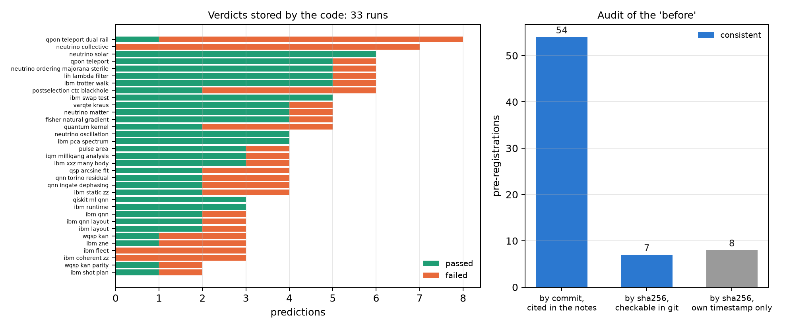

# Methodology: the pre-registered falsification protocol {#sec-ch28}

The previous chapters quoted "predictions committed before running" again and again. This chapter explains what that means,
how many held and how many failed, and something a book about a new scale owes its reader: **an audit of whether that "before"
can be checked**. There is no new physics here. The chapter's script simulates nothing: it inspects the repository itself, its
git history and the files the runs stored.

## From the base: a prediction is a readout that can be wrong {#sec-pre-base}

On the Chapter 1 scale, nearly every claim in the notes is a number in m-qg or a ratio between two errors. That the filter
"helps" says nothing; that it lowers the readout error from 104 to 23 m-qg on three devices does, and it can fail. The
discipline is to write that number and the threshold that would make it false **before** running, to pin it in a way that cannot
be changed later, and to publish the outcome whatever it is.

## Two ways of pinning a prediction {#sec-pre-ways}

The notes used two:

- **By commit**: the predictions are written and pushed to the repository before the run, and the section cites that commit
  (for instance, "committed before the run (77700bd)"). It is the method of §71 to §165.
- **By sha256**: the script that does the run is frozen, the sha256 of its bytes is computed and stored in
  `examples/data/*.prereg` with a timestamp. If the script changes, the hash stops matching. It is the method of the neutrino,
  kernel, VarQTE, IQM and other sections.

## The tally of hits and misses {#sec-pre-tally}

**What the code stored.** 33 runs leave in their results file a dictionary of verdicts computed by the script itself. The
chapter's script counts them: **143 predictions, 89 passed (62%) and 54 failed**. Three runs failed all their predictions (the
IBM fleet, the coherent ZZ and collective neutrinos) and six passed all of theirs.

**The QML line.** For §75–§123, the repository's README keeps another tally: 176 predictions judged, 123 passed and 53 failed,
with 4 more waiting for the IonQ hardware run. The two counts are separate bookkeeping that partly overlap, and must not be
added.

**What cannot be recounted automatically.** The sections before §71 barely use pre-registration, and many later ones record
their verdicts only in prose ("Four passed; V1 failed"), with varied wording. A full count over §1–§168 would have to be done by
hand, section by section. This book does not do it: it gives the two counts that can be checked.

A 62% hit rate is not a weakness. A rate near 100% would signal thresholds that are too soft. Several failures were the most
informative results in the notes: the coherent ZZ that the filter does see (Chapter 27), the erasure rule that had to be fixed
with $(1-h)$ (Chapter 26), the qg_YY metric that helps less than predicted (Chapter 23).

## Audit of the "before" {#sec-pre-audit}

That a prediction was written "before" has to be checkable. The script checks it with git:

- **By commit (54 citations, §71–§165)**: every cited commit exists in the history and, at that commit, the notes do not yet
  contain the section's results. **All 54 are consistent.**
- **By sha256 (15 files)**: no script matches its hash today, as expected, because after the run the findings are added to its
  opening comment. The question is whether any stored version matches.
  - In **7 of 15**, the hash matches the script at the commit that added the `.prereg`, and that commit is earlier than the
    results'. The "before" is **checked**.
  - In **8 of 15**, the `.prereg` and the results came in the same commit, and no version of the script stored in git matches
    the hash: the script was frozen, run and edited before anything was pushed. For those eight the "before" rests **only on the
    file's own timestamp**, which the author could have written at any time.

The eight are: neutrino matter and oscillation, mass ordering and steriles, solar neutrinos, post-selection and CTCs, pulse
area, the quantum kernel and VarQTE. Their results are not false because of this; their pre-registration cannot be checked by a
third party. The fix for what comes next is simple: push the `.prereg` and the frozen script in a commit of their own before
running.

{#fig-audit28 width=100%}

## Testbeds {#sec-pre-testbeds}

Nearly all the book's results come from simulations with calibrated noise models, not from hardware:

- **IBM**: qiskit-ibm-runtime's models with real published calibrations (Brisbane, Sherbrooke, Torino, Fez and a fleet of 21),
  run locally in Aer or in IBM Runtime's local mode (§137, §144).
- **IonQ**: the cloud simulator with the Aria-1 and Forte-1 noise models, free (§20, §38). Without dominant T1: the mean readout
  does not move (+0.004 and +0.007, consistent with zero), the opposite of the IBM model.
- **IQM**: the simulated Apollo and Garnet models, used as a free rehearsal before every real run.

A calibrated noise model is not a device: it has no thermal population (Chapter 27), no drift, and none of the ways the
vendor's software batches circuits. That is why the book calls "simulated" everything that did not run on hardware.

## Real hardware {#sec-pre-hardware}

- **IonQ Forte-1** (§128): the predictions for H$_2$ with the filter were pinned by commit and the simulator rehearsal met
  them, but the vendor refused the first submission before accepting the job (the project did not have that QPU enabled).
  Nothing was charged and there is no data.
- **IQM Garnet, three-flavour neutrinos** (§165, 8 circuits of 300 shots): the script rescores the four checks from the stored
  run, and **all four hold**. The error falls from 0.0615 to 0.0386 (1.59 times) and 88% of the shots are kept. With the
  filter the survival minimum sits at 2.6 GeV (exact 2.63); without it, at 0.8 GeV.
- **IQM Garnet, the milli-qang** (§168, 26 circuits of 4000 shots on one qubit): three of four predictions held. The script
  recomputes the X-gate cost with a single slope: **1.64 m-qg per gate** ($\chi^2/\text{dof}=0.81$). Prediction M2 failed: the
  ten equator copies scatter half as much as binomial noise allows (ratio 0.50). It remains open.

The two IQM runs are the project's first real-hardware data, and Chapter 31 treats them in detail. A replication of §168 on
five qubits and two days is prepared but not pushed to the repository, because at full size it would cost about 80 credits and
12.50 are left.

**The $\mathrm{Var}_\theta(F_{\text{echo}})$ criterion.** The index announced a QPU falsification criterion based on the variance of
the inversion echo over continuous trajectories. It is not defined anywhere in the repository, so the book does not use it. It
remains an unwritten proposal.

## Without qang and with qang {#sec-comparison28}

This chapter does not compare the qang scale with something else: it compares working without pre-registration with working
with it.

| action | without pre-registration | with pre-registration | difference |
|---|---|---|---|
| decide whether a result helps | decided after seeing the data | threshold fixed beforehand, in m-qg or in ratios | **in favour**: 54 of 143 predictions failed and were published |
| report failures | omitted or reinterpreted | reported with their numbers (89/54, 123/53) | **in favour** |
| check the "before" | impossible | by commit: 54 of 54 checked; by sha256: 7 of 15 | **in favour**, with 8 cases unverified |
| rehearse before spending | — | free simulator with the same predictions before every QPU run | **in favour**: IonQ's refusal cost nothing |
| pin the script by sha256 | — | only checkable if the `.prereg` is pushed before the results | **none** in 8 cases: the procedure must be fixed |

: Working without pre-registration and with it. {#tbl-comparison28}

**Balance.** Pre-registration worked: it kept failures in view and could be checked in 61 of 69 cases. The other 8 show a
defect of the procedure, not of the result, and already have a fix. The lesson holds for the whole book: a figure without its
prior threshold is not evidence, and a prior threshold that cannot be checked is not entirely evidence either.

## In code {#sec-code28}

```python
import hashlib, subprocess

h, path = open("examples/data/iqm_neutrino_qg.prereg").read().split()[:2]
c = "a74c07c5"                                     # commit that added the .prereg
frozen = subprocess.run(["git", "show", f"{c}:{path}"], capture_output=True).stdout
hashlib.sha256(frozen.replace(b"\r\n", b"\n")).hexdigest() == h   # True: this is the frozen script
```

## Summary {#sec-summary28}

- Predictions were pinned by commit (§71–§165) or by the sha256 of the frozen script.
- The 33 runs that store verdicts add up to 143 predictions: 89 passed and 54 failed; the QML line (§75–§123) records 123 and
  53. A full count of §1–§168 would have to be done by hand.
- The "before" is checked for the 54 predictions pinned by commit and for 7 of the 15 sha256 pre-registrations; for 8 there is
  only their own timestamp.
- Nearly everything is simulated with calibrated models. Real hardware is two runs on IQM Garnet: neutrinos (4 of 4) and the
  milli-qang (3 of 4, with 1.64 m-qg per X gate).
- The $\mathrm{Var}_\theta(F_{\text{echo}})$ criterion does not exist in the repository and is not used.

## Bibliographic notes {.unnumbered}

The falsification criterion is that of @popper1959, and pre-registration as a practice, @nosek2018. The numbered
research notes (§) cited in this chapter and the scripts that check it are in the repository [@qangrepo]; the definition
of the qang unit is in @monteverde2026.
