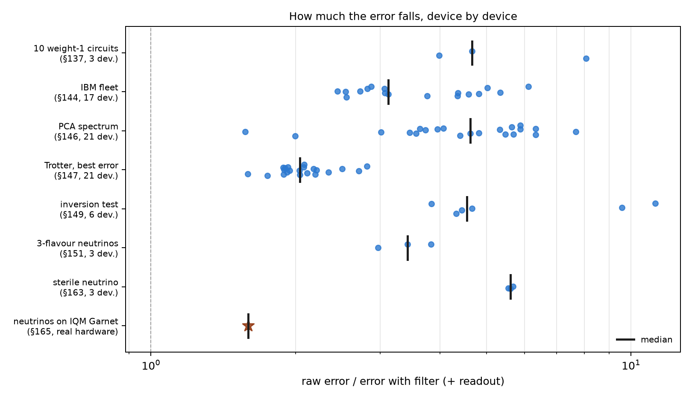
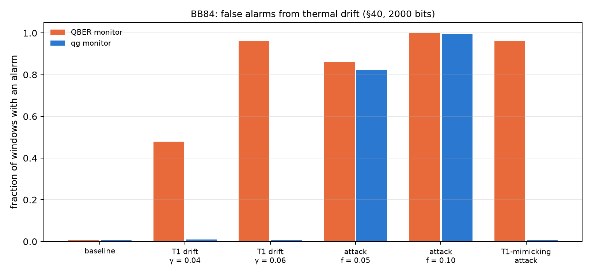

# The confirmed empirical advantages {#sec-ch29}

After twenty-eight chapters of "without qang and with qang" comparisons, this one gathers those that gave a measurable
benefit, with their size, their limits and where each figure comes from. The bar for entry is strict: a gain measured in code
or in a pre-registered run, against the same action without the scale or without the filter, with the case where it stops
holding written next to it. Every factor is recomputed here, device by device, from the runs' stored files. Nothing is
simulated again. What did not pass the bar goes to Chapter 30.

## From the base: where the advantages come from {#sec-advantages-base}

The book's advantages have two origins, and they should not be mixed:

- **The weight filter** (Chapters 20–25): if the circuit conserves the number of excitations, every shot with the wrong weight
  had an error and is discarded. It is symmetry verification, a known technique. The qang scale contributes the witness (the
  register's mean readout, whose ideal value is known before running) and the rule for when it pays (Chapter 21).
- **The scale itself** (Chapters 18, 23, 26, 27): readouts that separate things the raw readout mixes. Temperature from readout
  error, T1 from unital noise, thermal drift from an attack.

## Exact restoration under T1 {#sec-advantages-t1}

With the same T1 on every qubit, the filter returns exactly the noiseless readout in every sector (Chapter 21, checked to
$10^{-12}$ m-qg). In classification, the notes (§80) measured it over 60 paired runs (5 seeds, 3 splits, 4 datasets), with
predictions committed before running:

- with the weight-1 model, trained without noise and read under T1, qang recovers **+2.5 points** of accuracy (95% interval:
  +0.8 to +4.1), up to the exact accuracy of 0.952;
- with the weight-2 model it recovers **+16.5 points** (+11.8 to +21.2), from 0.757 to 0.922;
- with dephasing, +12.6 and +22.6 points;
- when training under the noise, the difference vanishes (+0.1 and −0.1 points): **the advantage is not having to train under
  the noise**, not an accuracy higher than achievable.

All five predictions held. The index's figures ("+2.5 and +16.5 over 60 runs") are in §80 as stated.

## Lower readout error on simulated devices {#sec-advantages-filter}

The script recomputes the error-reduction factor (raw over filter plus readout correction) on every device of every stored run:

| study | devices | min | median | max |
|---|---|---|---|---|
| 10 weight-1 circuits (§137) | 3 | 3.99 | 4.66 | 8.07 |
| IBM fleet (§144) | 17 | 2.45 | 3.12 | 6.11 |
| PCA spectrum (§146) | 21 | 1.57 | 4.63 | 7.67 |
| XY Trotter, best error (§147) | 21 | 1.59 | 2.04 | 2.82 |
| inversion test (§149) | 6 | 3.84 | 4.55 | 11.24 |
| 3-flavour neutrinos (§151) | 3 | 2.97 | 3.43 | 3.83 |
| sterile neutrino (§163) | 3 | 5.55 | 5.61 | 5.68 |
| **neutrinos on IQM Garnet (§165, real hardware)** | 1 | — | **1.59** | — |

: Raw error over error with filter plus readout, recomputed from the stored runs. {#tbl-factors29}

- **The filter never made the error worse** in any of the 74 cases (the same simulated device appears in several studies). It
  cut it 1.6 to 11 times.
- **On real hardware it gained less** (1.59 times): the chip was better than its simulated model (raw error 0.062 against 0.126),
  so fewer shots left the sector. The remaining error is inside the sector, where the filter does not see.
- The IBM fleet, taking the better of filter alone and filter plus readout, gives 2.4 to 9.0 times (the notes: 2.4–8.9). The
  "2.7–3.6×" range the index announced is not in the notes: the figures are those of this table. For the §85 classifier the notes
  give 2.9–3.6 times on the readout error, with the same accuracy (0.933) with and without qang.

{#fig-factors29 width=100%}

## In-sector errors: the echo {#sec-advantages-echo}

What the filter does not see, the echo measures (Chapter 22). With the weight-1 network on 189 inputs and 1000 shots, on five
simulated devices, the decisions that differ from the noiseless network are **15 without qang, 7 with the filter and 3 with the
filter plus the echo**, over 945 readouts (§106). The echo removes 43 to 56% of the decision-value error the filter leaves. It
does not help with narrow-margin inputs, when the filtered error is already close to its shot noise (§108).

## Characterization and control {#sec-advantages-hardware}

These advantages belong to the scale itself, without the filter (Chapter 27):

- **Temperature and readout**: the heralded sweep measures the readout error without bias and the effective temperature to 1 mK,
  where the standard calibration inflates the error by $p\cdot b$ and sees the qubit at 0 mK.
- **T1 diagnosis without classical simulation**: the mean readout tells T1 from unital noise with 88% accuracy from 100 shots
  under strong noise, against 70–76% for XEB and HOP, which also need the ideal distribution. With realistic noise nothing tells
  the two apart on arbitrary circuits.
- **Control quantization**: a grid even in qg lowers the total variation distance when loading a distribution in 43 of 45 cases
  (median 1.56 times), and the worst probability error by an exact factor $\pi/2$. It loses in fidelity near the poles.

## Neutrinos: mitigation without extra circuits {#sec-advantages-neutrinos}

Neutrino oscillations in a circuit conserve the weight, so the filter applies without adding any circuit. With three flavours
(§151), the error falls 3.4 times in the median of three simulated devices (the index said 3 times); with a sterile neutrino
(§163), 5.6 times, and the survival dip appears at the right energy on all three. **On IQM Garnet** (§165), on real hardware,
the filter cuts the error 1.59 times and puts the oscillation maximum back at 2.6 GeV (exact 2.63), where the raw readout placed
it at 0.8 GeV. It is the only one of these advantages confirmed on hardware.

## BB84: fewer false alarms under thermal drift {#sec-advantages-bb84}

In BB84, the sum $qg(0)+qg(1)$ of the states sent in Z is a T1 witness: relaxation produces only 1→0 errors, and an
intercept-resend attack produces symmetric errors (notes §40, Chapter 17). With windows of 2000 bits and 1% false alarms on the
baseline:

| scenario | QBER monitor | qg monitor |
|---|---|---|
| baseline | 0.007 | 0.006 |
| T1 drift, $\gamma$ 0.02 → 0.04 | 0.478 | **0.009** |
| T1 drift, $\gamma$ 0.02 → 0.06 | 0.962 | **0.006** |
| intercept-resend, $f=0.05$ | 0.861 | 0.823 |
| intercept-resend, $f=0.10$ | 1.000 | 0.994 |
| T1-mimicking attack | **0.962** | 0.006 |

: Fraction of windows with an alarm (notes §40, from the Chapter 17 cache). {#tbl-bb84-29}

The qg monitor detects the attack as well as the QBER monitor and **does not fire when only the memory's T1 worsens**, where the
QBER monitor fires in 48–96% of windows. The price is written down: an attacker who mimics T1 goes unnoticed by the qg monitor
and not by the QBER one. The two are complementary, and there is no security gain: the key rate falls the same way in both
cases.

{#fig-bb84-29 width=100%}

## What remains open {#sec-open29}

Of all these advantages, only the neutrino one is confirmed on real hardware, once, with 300 shots per circuit. The ones most
worth taking to a device are the heralded characterization (thermal population does not exist in simulators) and the filter on a
circuit with several excitations.

## Without qang and with qang {#sec-comparison29}

| advantage | without qang | with qang | size | where it stops holding |
|---|---|---|---|---|
| accuracy under T1 without retraining | 0.928 / 0.757 (weight 1 / 2) | 0.952 / 0.922 | +2.5 / +16.5 points | with unequal T1 it loses ≤ 1 point; training under noise, none |
| readout error (simulated) | raw | filter + readout | 1.6 to 11 times, never worse | error inside the sector |
| error on real hardware | 0.062 | 0.039 | 1.59 times | chips better than their model gain less |
| a classifier's decisions | 15 of 945 differ | 3 with filter and echo | 5 times fewer | narrow margin (§108) |
| readout and temperature | $e_{01}$ inflated, 0 mK | unbiased, to 1 mK | — | needs mid-circuit measurement |
| T1 diagnosis | 0.70–0.76 with ideal simulation | 0.88 from counts only | +12–18 points | realistic noise: chance |
| loading distributions | grid in $\theta$ | grid in qg | 43 of 45, median 1.56 times | fidelity near the poles |
| BB84 alarms | 48–96% false alarms from drift | 0.6–0.9% | — | an attack that mimics T1 |

: The confirmed advantages and their limits. {#tbl-comparison29}

**Balance.** The advantages are real and measured, but of two kinds. Those of the filter are the largest (up to 11 times in
simulation) and belong to symmetry verification, which is known; qang contributes the witness and the rule. Those of the scale
itself are smaller and more its own: separating temperature from readout, T1 from unital noise and drift from attack. Only one
advantage has been through real hardware, and there it gained less than in simulation. That is the figure to look at first.

## In code {#sec-code29}

```python
import json

d = json.load(open("examples/data/iqm_neutrino_qg_run.json"))
d["raw_error"] / d["filtered_error"]      # 1.59: the filter on IQM Garnet, real hardware
d["kept"]                                 # 0.88 of the shots kept
```

## Summary {#sec-summary29}

- Under equal T1, qang recovers the noiseless accuracy without retraining: +2.5 points with weight 1 and +16.5 with weight 2 over
  60 runs.
- The filter cuts the readout error 1.6 to 11 times in 74 simulated-device cases, never making it worse; on real hardware, 1.59
  times.
- The echo brings wrong decisions from 15 to 3 over 945 readouts.
- The scale itself separates temperature from readout error, T1 from unital noise, and thermal drift from an attack in BB84.
- Each advantage has written down where it stops holding; Chapter 30 gathers the negative results.

## Bibliographic notes {.unnumbered}

The restoration under T1 is a symmetry verification [@bonetmonroig2018; @mcardle2019]; the echo, @hahn1950. The neutrino
results use the parameters of @esteban2020, and the BB84 monitor, the protocol of @bennett2014 and the proof of
@shor2000. The numbered research notes (§) cited in this chapter and the scripts that check it are in the repository
[@qangrepo]; the definition of the qang unit is in @monteverde2026.
