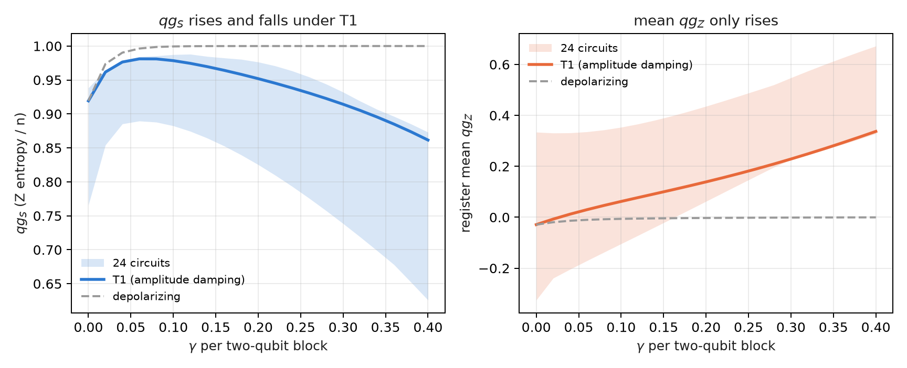
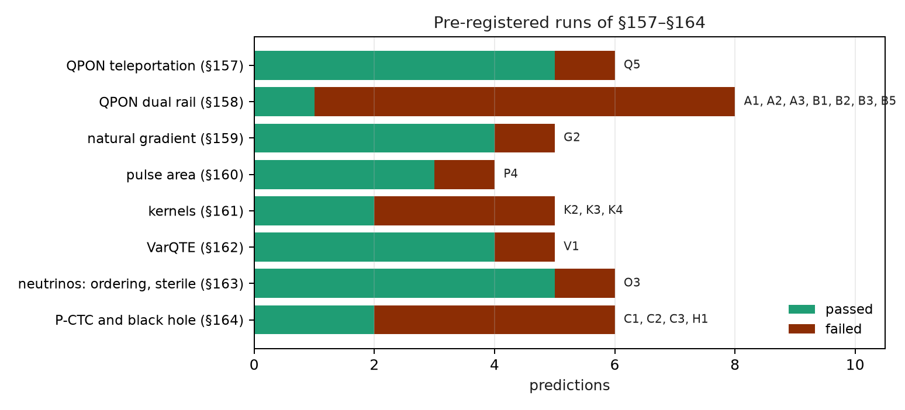

# Structural limits, equivalences and negative results {#sec-ch30}

Chapter 29 gathered what gave a measurable benefit. This one gathers what did not: the blind spots that come from the
definition of the scale itself, the equivalences that were offered as advantages, and the predictions that failed. A limit
gets in if it can be shown in code or is in a stored run, with the same action without qang next to it. The new checks are
in `tools/make_cap30_figures.py`; the rest is quoted from the notes and from the chapters where it was measured.

## From the base: what the scale cannot see {#sec-limits-base}

The equation of Chapter 1 makes qg a function of a single probability, $p_0$, measured in the Z basis. Two kinds of limits
follow:

- **What lives outside the Z populations.** Relative phases and coherences do not change $p_0$, so no Z-basis qg readout sees
  them. They only show up when measuring in another basis, and that is no longer the Z-basis qg readout.
- **What the filter cannot reach.** The filter discards shots outside the right weight sector. An error that leaves the shot in
  the sector, or a circuit that does not conserve the weight, is out of its reach.

Neither is an implementation defect: both follow from the definition.

## Graph states: entanglement invisible in Z {#sec-limits-graph}

A graph state is $H^{\otimes n}$ followed by one CZ per edge. CZ is diagonal, so it only changes phases: every Z population
stays at $2^{-n}$. The script checks it on the 6-qubit ring:

- its Z distribution matches that of $|+\rangle^{\otimes 6}$, which has no entanglement, with a difference of **exactly 0**;
- so $qg_Z = 0$ on every qubit, $qg_S = 1$ and the qg correlation is 0 for both states;
- the stabilizers $X_i Z_{i-1} Z_{i+1}$ are **1** on the graph state and **0** on the product. They tell the two states apart,
  but they are measured in the X basis.

The same happens without qang: any Z-basis statistic, raw or tomographic, is blind to this entanglement. qang inherits the
limit, it does not create it (notes §8.1). Readout dephasing is the same blind spot seen from the noise side (§10.4).

## $qg_S$ is not monotonic under T1 {#sec-limits-qgs}

Under depolarizing noise, $qg_S$ (the entropy of the Z distribution divided by $n$) rises towards 1 as the noise grows, so it
can rank devices. Under amplitude damping (T1) it cannot: it first rises, because the noise mixes, and then falls, because T1
pushes everything to $|0\ldots0\rangle$, which has entropy 0.

The script runs 24 four-qubit quantum-volume circuits with amplitude damping on every qubit after every two-qubit block, with
exact density matrices:

- **$qg_S$ rises and falls in all 24.** In circuit 0 it starts at 0.919, reaches 0.981 at $\gamma=0.06$ and comes back to 0.923
  at $\gamma=0.28$. On its own it cannot tell an almost noiseless device from one with a lot of T1.
- **The pair ($qg_S$, mean $qg_Z$) can.** At those two points the mean $qg_Z$ is −0.029 and +0.209. T1 pushes the mean $qg_Z$
  towards +1 and depolarizing noise leaves it at 0 (it goes from −0.029 to 0.000).
- **The fix is not a theorem.** In this model the mean $qg_Z$ rises monotonically in 21 of the 24 circuits. The notes, with
  their mid-circuit T1 model, found it in 23 of 24 (§10.4 D). The others have small downward steps.

{#fig-t1-30 width=100%}

## The natural-gradient equivalence {#sec-limits-qng}

Chapter 23 measured it, and here it is written down as a limit. A change of coordinate does not speed up an optimizer. The
natural gradient written in qg is plain descent in $\theta$, up to terms of order $\eta^2$ (notes §15.1). Claims that it
"converges in qg where $\theta$ does not" came from clipping $\theta$ to $[0,\pi]$. That hides the minima at $\theta<0$, and
without the clip descent in $\theta$ converges.

In the pre-registered run of §159, with 20 seeds of the 4-qubit Ising model:

- descent in $\theta$ got there in 103 steps (median);
- descent in qg never got there;
- the natural gradient with the full metric took 22.5 steps.

That gain belongs to the natural gradient, not to qang: the full metric is not read in qg. The version that is read from qg
correlators ($qg_{YY}$ blocks) took 79.5 steps. It improved 1.3 times on $\theta$, not the 1.5 that had been predicted
(G2 failed).

## The filter does not reach deep circuits {#sec-limits-deep}

In Chapter 25 the electron-number filter cut the H₂ error three times and did nothing for LiH. The notes (§50) took the causes
apart, and the main one turned out to be **reach**: the filter acts on the shots measured in Z, and in LiH the error is in the
groups measured in X and Y.

| case | two-qubit gates | Z-group error, raw → filtered | X/Y groups | total raw → with filter (mHa) |
|---|---|---|---|---|
| H₂, all-to-all | 3 | 13.0 → 4.9 | 0.9 | 13.9 → 5.9 |
| LiH, all-to-all, 1 layer | 20 | −2.2 → −1.9 | 26.2 | 24.0 → 24.3 |
| LiH, all-to-all, 3 layers | 60 | −20.8 → −12.4 | 97.4 | 76.6 → 85.0 |
| LiH, heavy-hex, 3 layers | 60 | −30.5 → −18.0 | 165.8 | 135.3 → 147.9 |

: Energy error with readout correction and 200,000 shots (notes §50). {#tbl-lih30}

- **It is not the routing.** The LiH ansatz is nearest-neighbour and needs the same 60 gates without routing.
- **The qg remedy for the X/Y groups fails.** Rescaling them by the depolarizing strength read from the kept fraction
  overcorrects, by 2 to 3 times (from +97 to −124 mHa). Local gate noise is not global depolarizing noise.
- **Hubbard hits the same wall** (§29). On fake_brisbane, from 4 Trotter steps on (188 ECR or more, 18 % of the shots kept),
  every method sits on the noise floor: the double occupancy tends to 1/4 and the charge imbalance to 0.

For larger molecules the X/Y groups grow in number and carry most of the correlation energy. A Z filter reaches a shrinking
share of the error.

## The weight-1 network is classical {#sec-limits-qnn}

The filter protects a weight-conserving quantum neural network exactly against T1 (Chapter 20). The same reason makes it
simulable. In the weight-1 sector the network is an orthogonal matrix $O$ acting on the loaded data $v$, and each readout is
$qg_Z^{(i)} = 1 - 2\,(Ov)_i^2$. It is a **quadratic form** in $v$, computable in $O(n^2)$ (notes §76, F2). The script checks it
on 5-qubit circuits with a unary loader and a random RBS network: the largest error is $7.8\cdot10^{-16}$.

- §75: the best classical model ties or beats the best quantum network on all four datasets (on digits, an RBF-kernel SVM
  0.963 against 0.933). There is no quantum advantage.
- §76: prediction Q3 said the network would not beat its quadratic twin by more than 1 point, and it failed, but because of the
  baseline. The twin used the default regularization. Rerun after the result with $C=100$, it sits 0.3 to 1.6 points from the
  network.
- With weight 2 the output is quartic and no longer trivial. Even so, the ceiling of the encoding is bounded by a quadratic form
  on the products of amplitudes (§87).

The filter gives small networks robustness on noisy hardware. It does not give supremacy.

## Where the filter does not apply: phases and classical encryption {#sec-limits-phase}

The filter needs every gate to conserve the Hamming weight. qang's analysis pass (`qang.ibm.WeightPreservationCheck`) decides
it gate by gate before running:

| circuit | conserves the weight? | gates that break it |
|---|---|---|
| 4-qubit QFT | no | 4 |
| QPE of the T gate, 3 counting qubits | no | 6 |
| 4-qubit GHZ | no | 4 |
| 4-qubit quantum volume | no | 8 |
| three-flavour neutrinos (Chapter 9) | yes | 0 |
| unary loader + RBS network | yes | 0 |

: What qang's analysis pass decides. {#tbl-reach30}

Phase estimation and everything built on it (Shor, HHL) start with Hadamards, which mix every weight. There the scale gives a
closed-form reading of the phase, $qg_\Phi = e^{i2\pi\varphi}$, invertible on its whole domain (notes §13). That is the reading
QPE computes with a circuit, but it does not lower QPE's error. Post-quantum cryptography (Chapter 16) is classical arithmetic:
there are no qubits or operators, so qang has nothing to read.

## The failed predictions of §157–§164 {#sec-limits-failures}

In the eight pre-registered runs of §157–§164, **26 of 45 predictions passed**, by the verdicts the code stored. The 19 that
failed:

- **Teleportation over a passive optical network** (§157, Q5): 5 of 24 cases far from the optimum, all where the ideal fidelity
  is 1 (measured 0.897 to 0.957). The circuit does not conserve the weight, so the only filter is the loss herald.
- **Dual rail** (§158, seven failed): the fidelity read from three correlators predicts the teleported one within 0.029, but
  does not decompose it (A1–A3). False heralds set a floor (B1, B2, B5).
- **Natural gradient** (§159, G2): 1.3 times against the 1.5 predicted.
- **Pulse area** (§160, P4): the period-$\pi$ wrap of RZZ saves 1.14 times in error against the 1.5 predicted.
- **Kernels** (§161, K2–K4): accuracy hardly changes with the repair and target alignment does not see the shrink; K4 failed
  on its thresholds, not on its direction.
- **VarQTE** (§162, V1): the ansatz is not expressive enough at late times (noiseless fidelity 0.934 at $t=2$).
- **Neutrinos** (§163, O3): the filtered values sit 0.010 to 0.033 high, because of the error inside the sector.
- **Time loops and black holes** (§164, four failed). On FakeTorino the paradox is not fully suppressed: the success at
  $\varphi=\pi$ is 0.056 where the prediction asked for close to 0 (C2), and the controlled rotation gives 0.600 where the exact
  value is 1 (C3). The decoder worked on all three devices (H2, H3); H1 missed by 0.001.

{#fig-failures30 width=100%}

## Consolidated list of limitations {#sec-limits-list}

The notes' list (§14), with what the book added:

1. **Jacobian singularity** at $\theta\in\{0,\pi\}$: regularizing it costs exactness near the poles (Chapter 23).
2. **arccos range trap**: qg-space updates cannot reach $\theta<0$; on H₂ they lose all of the correlation energy (§8.2).
3. **Z-basis blindness**: graph-state entanglement and readout dephasing are invisible to $qg_Z$, $qg_S$ and the qg
   correlation.
4. **The qg correlation is not an entanglement measure**: it is positive for classical mixtures and 0 for graph states (§7.2).
5. **$qg_S$ is not monotonic under T1**: read it together with the mean $qg_Z$, a pair that is monotone in 21 to 23 of 24
   circuits, not in all of them.
6. **Finite-shot bias of $qg_S$**: corrected with Miller–Madow (§10.2).
7. **Pole damping** costs 3 to 20 times more iterations when the optimum sits on a pole (§9).
8. **No speed or energy advantage**: qg does not change how many shots a given precision needs (§14, item 9; §15.3).
9. **Reach of the filter**: it only acts on weight-conserving circuits and on what is measured in Z; it does not see the error
   inside the sector.
10. **The networks that admit the filter are simulable** at weight 1.
11. **On real hardware the filter gained less than in simulation** (1.59 times against 2.2 on IQM's model, Chapter 31).

## Without qang and with qang {#sec-comparison30}

| limit | without qang | with qang | difference |
|---|---|---|---|
| graph states | Z readout blind | $qg_Z=0$, $qg_S=1$, same as the product | none: the limit belongs to the Z basis |
| T1 against unital noise | Z entropy, not monotonic | pair ($qg_S$, mean $qg_Z$) | separates the two in 21–23 of 24 circuits |
| optimization | descent in $\theta$, 103 steps | natural gradient in qg = descent in $\theta$ | no speed-up of its own |
| LiH, 60 gates | 76.6 mHa | 85.0 mHa with the filter | the filter makes it worse: the error is in X/Y |
| weight-1 network | classical models | exact quadratic form | no quantum advantage |
| QPE, Shor, HHL | phase estimation | closed-form $qg_\Phi$, filter not applicable | a new reading, no mitigation |
| §157–§164 | — | 26 of 45 predictions | 19 failed, published |

: The limits, with and without the scale. {#tbl-comparison30}

**Balance.** Almost every limit has the same root: qg reads a Z-basis probability, and what is not in that probability it
does not see. The negative results are not hidden: 19 of the 45 predictions of §157–§164 failed and stay written down. Several
"advantages" offered as qang's own (the natural gradient, the supremacy of the weight-1 network) turned out to be
equivalences.

## In code {#sec-code30}

```python
import math
from qiskit.transpiler import PassManager
from qang import ibm, neutrino as nu

pm = PassManager([ibm.WeightPreservationCheck()])
pm.run(nu.three_flavour_circuit("mu", 1300.0, 2.6, -math.pi / 2))
pm.property_set["qg_weight_preserving"]      # True: the filter applies
```

## Summary {#sec-summary30}

- The entanglement of a graph state is invisible in Z: its distribution matches that of $|+\rangle^{\otimes n}$ exactly.
- $qg_S$ rises and falls under T1 in all 24 circuits tested; the pair with the mean $qg_Z$ separates them, without being a
  theorem.
- The natural gradient in qg is descent in $\theta$: a change of coordinate does not speed things up.
- In LiH the error is in the X/Y groups, out of the filter's reach; Hubbard hits the same wall from 4 steps on.
- The weight-1 network the filter protects is a classical quadratic form.
- In the runs of §157–§164, 19 of 45 predictions failed.

## Bibliographic notes {.unnumbered}

Graph states are @hein2004; quantum volume, @cross2019. The natural-gradient equivalence is with @stokes2020, and the
classical simulability of plateau-free models, @cerezo2023. QFT and QPE follow @nielsen2010. The numbered research notes
(§) cited in this chapter and the scripts that check it are in the repository [@qangrepo]; the definition of the qang
unit is in @monteverde2026.
