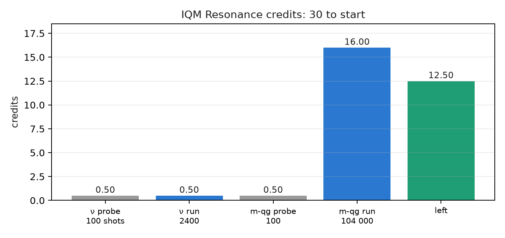
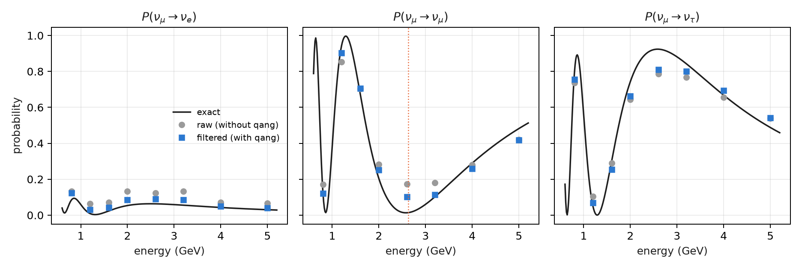

# First real-hardware experiment: IQM Resonance {#sec-ch31}

Up to here, almost the whole book was measured on simulators with device noise models. This chapter tells how qang was taken
to a real superconducting chip, IQM's Garnet (20 qubits), on trial credits: why that machine, how it was rehearsed for free,
what it cost and what came out. The figures are recomputed from the runs' stored files with `tools/make_cap31_figures.py`.
Nothing is sent to IQM, and checking them does not need `iqm-client`.

## From the base: what goes to the chip {#sec-iqm-base}

The readout of a real qubit is the same as in Chapter 1: zeros and ones are counted, and $qg_Z = 2p_0 - 1$. What changes is
everything around that count: the circuit is compiled to the chip's native gates, the readout has errors of its own and every
shot costs credits. qang brings three things, all in post-processing:

- the **weight filter**, if the circuit conserves the weight;
- the **witness** that says how much the filter removed (the kept fraction);
- the **readout in m-qg**, where a probability difference of 0.0005 is 1 m-qg.

## Why IQM, and what compiling costs {#sec-iqm-why}

Garnet's native gates are PRX (a single-qubit rotation, `r` in Qiskit) and CZ, on a square lattice. The chosen experiment
(three-flavour neutrinos) uses XX+YY gates, which conserve the weight. The script compiles on a line of three qubits to the
three native sets:

| native set | RBS | XX+YY | neutrino circuit, level 1 | level 3 |
|---|---|---|---|---|
| IQM (r, cz) | 2 | 2 | 18 | 12 |
| IBM Heron (cz, rz, sx, x) | 2 | 2 | 18 | 12 |
| IBM Eagle (ecr, rz, sx, x) | 2 | 2 | 18 | 12 |

: Two-qubit gates after compilation (`seed_transpiler` 137). {#tbl-compile31}

The notes (§165) counted 12 CZ on IQM against 18 two-qubit gates on IBM. **The difference is not the chip's**: the IQM rehearsal
was compiled at optimization level 3 and the IBM runs of §151 at level 1. At the same level the three sets give the same: the
circuit's six XX+YY gates cost two two-qubit gates each. IQM was chosen for the available credits, not for a cheaper
compilation.

## The `qang.iqm` module {#sec-iqm-module}

The index announced a module `qang/iqm.py`, the analogue of `qang/ibm.py`. The two runs of this chapter were done without it:
the scripts `examples/iqm_neutrino_qg.py` and `examples/iqm_milliqang_qg.py` read the counts with `qang.interop`
(`canonical_counts`, `qg_z_profile`, `filtered_qg_z_profile`, `weight_filter`). The module was written afterwards, with what
those runs left pending:

- **Readout correction.** §165 had none: IQM's simulated models do not publish their readout errors in the Qiskit `target`,
  where `qang.ibm` looks for them, but in an error profile of their own. `qang.iqm.readout_errors` reads them there. For a
  real device, `pole_circuits` and `readout_from_poles` measure them with two circuits, every qubit in $|0
angle$ and every
  qubit in $|1
angle$, as §168 did. On the stored counts of §168 it gives $e_0=0.0055$ and $e_1=0.029$. `iqm_qg` applies the
  inversion of `qang.ibm` and gives the four readings: raw, corrected, filtered, and filtered after correction.
- **Chain choice.** `best_chain` compares the default layout with chains of the square lattice and keeps the one with the
  highest predicted kept fraction (`predict_kept_fraction`, with IQM's gates and units).
- **The weight-preservation pass.** IQM's native single-qubit gate does not conserve the weight gate by gate, so
  `check_weight` checks the circuit before compiling.

The free rehearsal on the Garnet model (`examples/iqm_readout_chain_qg.py`, the eight circuits of §165, 4000 shots) gives a raw
error of 0.124, filtered 0.055 and **filtered after readout correction 0.047**: the correction §165 lacked removes another 15%.
The simulated kept fraction is 0.689 and the prediction brackets it between 0.640 and 0.775, less tightly than on IBM. The chain
choice barely tells chains apart (0.777 against 0.775), because the model's qubits are nearly identical. None of this has been
tried on the real chip yet.

## A free rehearsal before spending {#sec-iqm-rehearsal}

IQM publishes simulated models of its chips. The neutrino circuit was run there first, with 4000 shots and 8 energies
(docstring of `examples/iqm_neutrino_qg.py`):

| model | close to | raw error | filtered error | factor | kept |
|---|---|---|---|---|---|
| IQMFakeApollo | Garnet | 0.1263 | 0.0584 | 2.16 | 0.688 |
| IQMFakeAphrodite | Emerald | 0.1161 | 0.0515 | 2.25 | 0.708 |

: Rehearsal on IQM's simulated models (2026-10-20). {#tbl-rehearsal31}

The milli-qang rehearsal (§168) also passed its four predictions on both models before running on the chip.

## The budget: planned and spent {#sec-iqm-budget}

The account started with 30 credits. The plan was to spend 10 % on probes, 60 % on the main experiment and keep 30 % in reserve.
The token is read only from the environment variable `IQM_TOKEN`, and no script spends credits without the
`--yes-i-accept-qpu-cost` flag.

| step | shots | credits | balance |
|---|---|---|---|
| neutrino probe | 100 | 0.50 | 29.50 |
| neutrino run | 2400 | 0.50 | 29.00 |
| milli-qang probe | 100 | 0.50 | 28.50 |
| milli-qang run | 104,000 | 16.00 | 12.50 |

: IQM Resonance credits. The cost of the neutrino run is not written down: it is the difference of two balances. {#tbl-credits31}

- **Spent:** probes 3.3 %; runs 55.0 %; 12.50 credits left (41.7 %). The plan held with room to spare.
- **The cost model was corrected with data.** The first estimate, 0.50 credits per job, came from small jobs and was wrong.
  The cost grows with the shots (about 0.15 credits per 1000) and has a floor of about 0.50 per job.

{#fig-credits31 width=85%}

## The main experiment: three-flavour neutrinos {#sec-iqm-neutrinos}

It is the circuit of Chapter 9 (§151): an initial $\nu_\mu$, a 1300 km baseline, $\delta_{CP}=-\pi/2$, eight energies between
0.8 and 5 GeV, and the three flavours read at once. It has 3 qubits, 12 CZ, and every gate conserves the weight. The script was
frozen (sha256 b320f51f in `examples/data/iqm_neutrino_qg.prereg`, commit a74c07c) before any job was sent, with four
predictions:

| prediction | result |
|---|---|
| I1: the filtered error is below the raw one | 0.0386 < 0.0615 |
| I2: the raw / filtered ratio is at least 1.5 | 1.59 (narrowly) |
| I3: the filtered survival has its minimum at 2.6 GeV | yes; **the raw one at 0.8 GeV** |
| I4: at least half of the shots are kept | 0.880 |

: Job 01a15b04, Garnet, 8 circuits × 300 shots, 2026-10-20. All four passed. {#tbl-neutrinos31}

The script recomputes everything from the stored file:

- **Per flavour**, the filter lowers the $\nu_e$ error from 0.054 to 0.023 and the $\nu_\mu$ error from 0.069 to 0.041. The
  $\nu_\tau$ error barely changes (0.062 → 0.052).
- **The oscillation maximum goes back to its place.** Without the filter the lowest survival is read at 0.8 GeV. With it, at
  2.6 GeV, and the exact maximum is at 2.63.
- **What remains is inside the sector.** At 2.6 GeV the exact survival is 0.013, the raw one 0.173 and the filtered one 0.101.
  The filter does not see that error (Chapter 22).

{#fig-neutrinos31 width=100%}

## What came next, and what remains {#sec-iqm-next}

- **The milli-qang on Garnet** (§168, Chapter 28) used most of the credits. Three of four predictions passed: one X gate costs
  1.64 m-qg and the cost grows in a straight line with the number of gates. The equator copies scattered half as much as
  expected (M2 failed), and that is still open.
- **The replication on five qubits and two days** is prepared in `examples/iqm_milliqang_replication_qg.py`, not yet
  pre-registered or run. At full size (130 circuits × 4000 shots per day) it would cost about 80 credits per day, far more
  than is left: it has to be shrunk before use.
- **The index's candidates** are still pending: the one-qubit P-CTC (§164), the Yoshida–Kitaev decoder (8 qubits and 90
  two-qubit gates on the IBM models, probably too deep) and H₂ (§20, §128). The H₂ run on IonQ was refused before any job was
  accepted, and nothing was charged.

With 12.50 credits at about 0.15 per 1000 shots, some 80,000 shots are left, minus the per-job floors.

## Result: hits, misses and comparison with simulation {#sec-iqm-result}

| | IBM models (§151) | IQM model (rehearsal) | Garnet (real) |
|---|---|---|---|
| raw error | — | 0.126 | **0.062** |
| filter factor | 2.97–3.83 | 2.16 | **1.59** |
| kept shots | — | 0.688 | 0.880 |

: The same circuit in simulation and on the chip. {#tbl-result31}

**The chip did better than its model**: half the raw error, so fewer shots left the sector and the filter had less to remove.
It is the rule of Chapter 21 seen on hardware: the filter pays in proportion to the noise it takes out of the sector. One run,
one day, 300 shots per circuit: no claim about stability.

## Without qang and with qang {#sec-comparison31}

| action | without qang | with qang | difference |
|---|---|---|---|
| mean error of the probabilities | 0.0615 | 0.0386 | 1.59 times lower |
| energy of the oscillation maximum | 0.8 GeV | 2.6 GeV (exact 2.63) | the filter corrects the physics that is read |
| $\nu_\tau$ error | 0.062 | 0.052 | hardly any: it is in-sector error |
| cost | 2400 shots, 0.50 credits | the same shots | none: the filter is post-processing |
| useful shots | 2400 | 2113 (88 %) | 12 % discarded |
| compilation | 12 two-qubit gates | 12 | none: it depends on the optimization level |

: The Garnet run, with and without the scale. {#tbl-comparison31}

**Balance.** The first real-hardware data point confirms what simulation said, with a smaller effect: 1.59 times against 2.2
on IQM's model and 3 to 3.8 on IBM's. The filter costs no extra shots and puts the oscillation at the right energy. From the
original plan, IQM's compilation advantage was an artefact of the optimization level, and the `qang.iqm` module was written
after the runs, which did not use it.

## In code {#sec-code31}

```python
import json
import numpy as np

d = json.load(open("examples/data/iqm_neutrino_qg_run.json"))
raw, fil, ex = (np.array(d[k]) for k in ("raw", "filtered", "exact"))
np.abs(raw - ex).mean(), np.abs(fil - ex).mean()   # 0.0615 and 0.0386
d["energies"][int(np.argmin(fil[:, 1]))]           # 2.6 GeV: the oscillation maximum
```

## Summary {#sec-summary31}

- On Garnet, real hardware, the filter cut the error 1.59 times and moved the oscillation maximum from 0.8 to 2.6 GeV
  (exact 2.63). All four pre-registered predictions passed.
- The chip did better than its simulated model, and the filter gained less (1.59 times against 2.16).
- IQM's compilation advantage (12 against 18) came from the optimization level: at the same level IBM also gives 12.
- 17.50 of 30 credits were spent, at about 0.15 per 1000 shots with a floor of 0.50 per job.
- `qang.iqm`, written after the runs, adds readout correction and chain choice. On the Garnet model the correction removes
  another 15% of the filtered error; it has not been tried on the real chip.

## Bibliographic notes {.unnumbered}

Access was through IQM Resonance [@iqmresonance]; the Garnet processor is described in @abdurakhimov2024. Compilation
uses Qiskit [@javadiabhari2024], and the oscillation parameters are of the type of @esteban2020. The numbered research
notes (§) cited in this chapter and the scripts that check it are in the repository [@qangrepo]; the definition of the
qang unit is in @monteverde2026.
