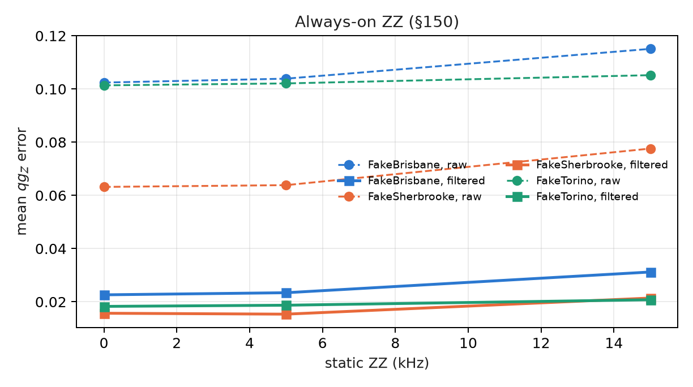
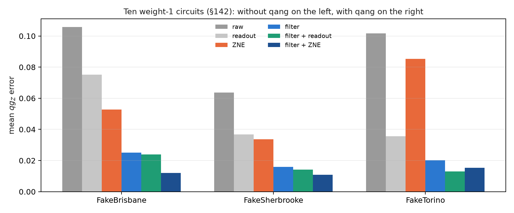

# Software architecture, the multi-SDK ecosystem and physical execution {#sec-ch32}

A qg readout is only useful if it travels intact from the device to the number that gets reported. In between there is an SDK
that orders bits its own way, primitives that return expectation values instead of counts, a compiler that picks qubits and a
chip with errors no filter sees. This chapter walks that chain as the library solved it. The new checks and the rescoring of
the stored IBM runs are in `tools/make_cap32_figures.py`.

## From the base: one count, many paths {#sec-software-base}

The equation of Chapter 1 needs one thing: how many zeros each qubit gave. Everything else is plumbing, and every pipe can break
the readout without anyone noticing:

- an SDK that writes qubit 0 on the right and another that writes it on the left **swap the qubits** without an error;
- a primitive that returns $\langle Z_i\rangle$ already gives $qg_Z$, but **not the shots** the filter needs to discard;
- a compiler that picks bad qubits **lowers the kept fraction** before anything is measured.

## One qubit order {#sec-software-order}

Qiskit writes qubit 0 at the right of the bitstring; Cirq, PennyLane, Braket and pytket write it first.
`qang.interop.canonical_counts` brings everything to $\{(b_0,\ldots,b_{n-1}):\text{count}\}$, qubit 0 first. The script checks it
with the two SDKs installed here:

- the same outcome (only qubit 0 excited), written `001` by Qiskit and `100` by PennyLane, gives **(1, 0, 0)** in both;
- a 3-qubit W state sampled 20,000 times in each SDK gives $qg_Z$ between 0.328 and 0.343 (ideal 1/3), every shot in weight 1
  and register $qg_S$ 0.528 (ideal $\log_2 3/3 = 0.528$), the same in Qiskit and in PennyLane.

Cirq, Braket and pytket are not installed on this machine. Their order is pinned by the library's tests (notes §130) and was not
run again.

## V2 primitives and filtered observables {#sec-software-primitives}

Qiskit's V2 primitives come in two forms, and qang reads both (notes §131):

- **Sampler.** `interop.sampler_qg` takes a SamplerV2 result and gives each qubit's $qg_Z$, with its error, for every parameter
  set at once. Given the weight, it also gives the filtered profile and the kept fraction.
- **Estimator.** It returns no shots, so none can be discarded. But the filtered $qg_Z$ is a ratio of two expectation values,
  $\langle P_w Z_i\rangle / \langle P_w\rangle$, where $P_w$ projects on weight $w$. Both operators are diagonal, so they are sums of
  Z strings. `interop.filtered_observables` builds those sums.

The script checks that it is exact: on 20 random 4-qubit states, the values of `filtered_observables(4, 2)` give the kept
fraction and the filtered $qg_Z$ with a largest error of $3.3\cdot10^{-16}$. It has a cost: the largest observable has $2^{n-1}$
Z strings (8 with 4 qubits, 2048 with 12). They all commute and are measured in the same basis, so the cost is classical
bookkeeping, not circuits. It still limits the method to registers of about a dozen qubits.

## Sector-aware compilation {#sec-software-compilation}

`qang.ibm` adds to Qiskit's compiler an analysis that decides, gate by gate, whether the circuit conserves the weight
(Chapter 30). It also reads the published readout errors of the physical qubits and turns an IBM Runtime result into four
readouts: raw, readout-corrected, filtered and filtered after readout correction. On the ten weight-1 circuits of §137,
recomputed from the stored file:

| device | raw | readout | filter | filter + readout |
|---|---|---|---|---|
| FakeBrisbane | 0.104 | 0.074 | 0.023 | 0.022 |
| FakeSherbrooke | 0.065 | 0.038 | 0.019 | 0.016 |
| FakeTorino | 0.101 | 0.036 | 0.018 | 0.013 |

: Mean $qg_Z$ error, 8000 shots (§137). All three predictions passed. {#tbl-runtime32}

**Choosing qubits from the calibration** (§138). `predict_kept_fraction` multiplies the survival of the weight under each
calibrated channel, and `best_chain` picks the chain with the best prediction:

- the prediction comes out too low: the mean error is 0.08 to 0.13 (L1 failed);
- but it ranks the layouts correctly (Spearman 0.94 to 0.98, L2 passed);
- and `best_chain` keeps 6 to 17 points more shots than Qiskit's default layout (L3 passed);
- after the result, adding the share of shots that return to the sector as for a fully mixed state brought the error down to
  0.023–0.041 (`kept_mixed_floor`).

For the ring-coupled neural network (§141), `best_layout` was never worse than the default layout. It gained 0.022 on
FakeBrisbane, and with filter and readout correction it got 550 of 567 inputs right. R3 asked for 551 and failed by one, which
is within the variation between runs with the identical layout.

## Static ZZ: simulated, not mitigated {#sec-software-zz}

Coupled transmons pick up a ZZ phase all the time. `ibm.add_static_zz` **adds** it to the compiled circuit, after every layer and
on every edge in use, with the layer's calibrated duration. It is there to measure how much of that error the filter sees. **It
does not correct it.** In §150, at 0, 5 and 15 kHz:

- **The filter sees part of the ZZ, not all of it.** Between logical gates ZZ is diagonal and passes the filter. Inside the
  native decomposition of the XX+YY gates it moves excitations out of the sector: the kept fraction fell by 0.019 to 0.022 on
  the two ECR devices, and by 0.001 on FakeTorino.
- **The filter removed 32 to 60 % of the added error.** The filtered error grew by 0.0025 to 0.0086 (14 to 38 %) at 15 kHz and
  stayed 3.6 to 5.1 times below raw. The notes said "4 to 5 times"; the rescoring gives 3.6–5.1.
- **Short circuits suffer least**: FakeTorino runs for 2.1 µs against 9 to 10 µs on the others.

Predictions Z2 and Z3 failed, because they assumed the filter would see none of the ZZ.

{#fig-zz32 width=80%}

## ZNE with the filter, and shot planning {#sec-software-zne}

In local mode, IBM Runtime's mitigation options do nothing. That is why `ibm.zne_qg` folds every two-qubit gate (scale 3), runs
both scales and extrapolates linearly. Folding conserves the weight, so the extrapolation (ZNE) combines with the filter (§142):

- **The filter does more than the extrapolation**, 2 to 7 times more: filter + ZNE gives 0.012, 0.011 and 0.015 against 0.053,
  0.034 and 0.085 for ZNE alone (Z2 passed).
- **ZNE does not always help.** On FakeTorino, adding it to filter + readout makes the error worse, from 0.013 to 0.014
  (Z1 failed), and the best combination there is filter + readout (Z3 failed).

`ibm.plan_shots` turns a target precision of the filtered $qg_Z$ into shots and QPU seconds, from the predicted kept fraction
(§143). For an error of 0.02 it planned 3000 to 3400 shots, and over 30 repetitions the worst qubit landed at 0.021–0.023
(P1 passed). The per-qubit prediction was 1.4 to 1.6 times too small (P2 failed). The misses are the qubits near a pole, where
the noise pulls $qg_Z$ away from ±1. That is why the plan uses the worst case.

{#fig-methods32 width=100%}

## Guidelines by hardware type {#sec-software-guidelines}

**Superconductors (IBM, IQM).**

- Compile with weight-conserving gates (XX+YY, RBS) and check it with the analysis before running.
- Compare two-qubit gate counts at the same optimization level (Chapter 31).
- Choose the chain by the predicted kept fraction, and correct the readout from the calibration, or from the two poles where the
  calibration is not available (IQM).
- Prefer short circuits: ZZ and dephasing inside the gates are filtered in proportion to the time the qubits spend outside the
  computational frame.

**Ions (IonQ, through its cloud or AWS Braket).** Connectivity is all-to-all and the native gate is Mølmer–Sørensen. The H₂
rehearsal on IonQ's simulator with the Forte-1 noise model (§128) gave:

- witness +0.0003;
- 97.9 % of the shots kept;
- the error falls from 29.9 to 15.0 mHa with the filter.

The run on the real machine was refused before any job was accepted, because the project did not have Forte-1 enabled, and
nothing was charged. Through Braket, `interop` handles the bit order.

**On any platform.**

- Rehearse for free on the simulated model.
- Measure the cost with a small probe.
- Pre-register before the main job.
- Read the token from an environment variable, and spend nothing without an explicit flag.

## Without qang and with qang {#sec-comparison32}

| action | without qang | with qang | difference |
|---|---|---|---|
| reading another SDK's counts | each SDK with its bit order | one order | no silent qubit swap |
| Estimator | unfiltered $\langle Z_i\rangle$ | ratio of two diagonal observables | the filter without shots, exact to $10^{-16}$ |
| ten weight-1 circuits | 0.065–0.104 raw | 0.013–0.022 with filter and readout | 4 to 8 times less error |
| choosing qubits | default layout | `best_chain` | 6 to 17 points more shots kept |
| static ZZ at 15 kHz | +0.004 to +0.015 raw | +0.0025 to +0.0086 filtered | 32 to 60 % of the added error removed; not mitigated |
| ZNE | 0.034–0.085 | 0.011–0.015 with the filter | 2 to 7 times; ZNE makes FakeTorino slightly worse |
| shot planning | — | 3000–3400 for an error of 0.02 | met on the worst qubit; the per-qubit prediction fails |

: The software chain, with and without the scale. {#tbl-comparison32}

**Balance.** The library fixes the plumbing that breaks readouts without warning: bit order, the filter inside an Estimator
and qubit choice. The IBM figures come from simulated models in local mode, not from hardware. Of this chapter's predictions,
L1, Z1, Z3, P2, R3 and two of the ZZ ones failed, and all stay written down. Static ZZ is the most important warning: the
library adds it in order to measure it, and the filter removes only part of it.

## In code {#sec-code32}

```python
from qiskit.quantum_info import SparsePauliOp, random_statevector
from qang import interop as IO

obs = [SparsePauliOp.from_list(list(o.items())) for o in IO.filtered_observables(4, 2)]
sv = random_statevector(16, seed=0)
kept, qg = IO.estimator_filtered_qg([sv.expectation_value(o).real for o in obs])
# kept: share in weight 2; qg: the four filtered qg_Z, exact
```

## Summary {#sec-summary32}

- `qang.interop` brings any SDK's counts to a single qubit order; Qiskit and PennyLane give the same W state.
- The filtered $qg_Z$ comes out of an Estimator as a ratio of two diagonal observables, exactly, with $2^{n-1}$ Z strings.
- On IBM's models, filter and readout cut the error from 0.065–0.104 to 0.013–0.022, and `best_chain` keeps 6 to 17 points
  more shots.
- `add_static_zz` simulates ZZ: the filter removes 32 to 60 % of what is added and does not fully mitigate it.
- The filter does 2 to 7 times more than ZNE alone; the shot plan is met by using the worst qubit.

## Bibliographic notes {.unnumbered}

The kits are Qiskit [@javadiabhari2024], PennyLane [@bergholm2018], Cirq [@cirq] and Amazon Braket [@braket]. For static
ZZ coupling, see @krantz2019; zero-noise extrapolation is @temme2017. The numbered research notes (§) cited in this
chapter and the scripts that check it are in the repository [@qangrepo]; the definition of the qang unit is in
@monteverde2026.
