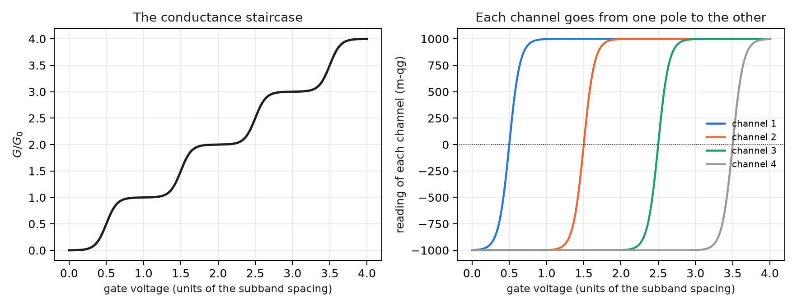
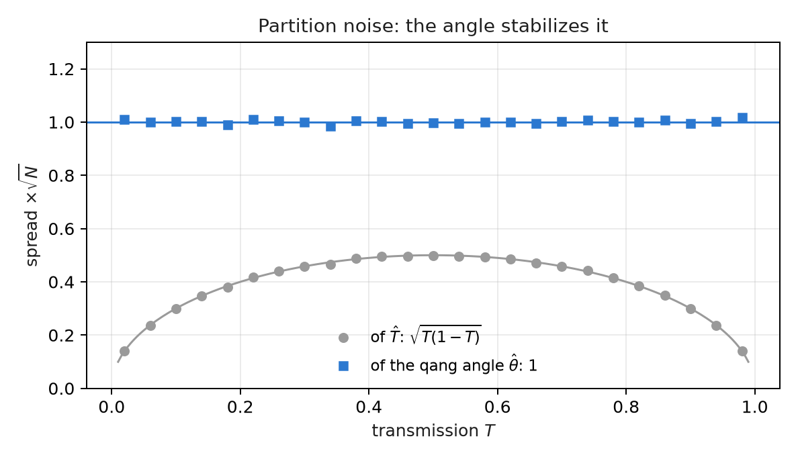
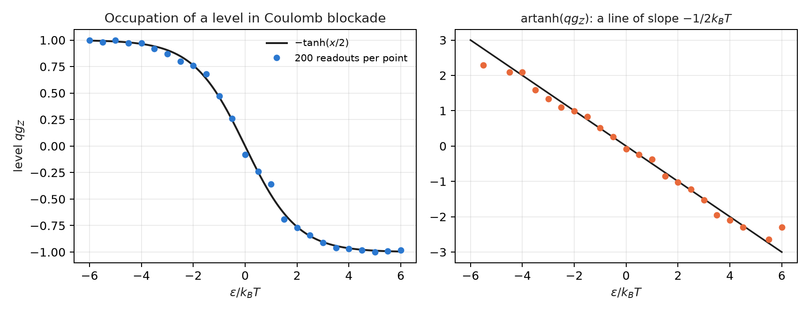

# Nanoquantum: transmission, partition noise and nanoscale qubits {#sec-ch33}

At the nanometre scale many measurable quantities are a probability: that an electron crosses a barrier, that a level is
occupied, that a spin is up. This chapter reads them with the equation of Chapter 1. There is no notes section and no qang
module for these topics, so every figure comes from a closed form or from a Monte Carlo written in
`tools/make_cap33_figures.py`. Next to each reading with qang goes the usual form, and the text says when the scale adds
something and when it only changes the notation.

## From the base: one probability per experiment {#sec-nano-base}

The equation of Chapter 1 takes a probability $p_0$ and gives four exact readings:

$$
\theta = 2\arccos\sqrt{p_0},\qquad qg_Z = 2p_0-1,\qquad qg_S = H(p_0),\qquad m = 2000\,p_0 - 1000\ \text{m-qg}.
$$

In this chapter $p_0$ is, case by case, the transmission $T$ of a channel, the occupation of a level or the population of a
spin state. Two properties from Chapter 1 do all the work:

- **the m-qg reading is linear in probability**: 1 m-qg is always $\Delta p_0 = 0.0005$;
- **the angle stabilizes binomial noise**: with $N$ counts, $\sigma_\theta = 1/\sqrt N$ for any $p_0$, while
  $\sigma_{p_0} = \sqrt{p_0(1-p_0)/N}$ changes with $p_0$.

## Tunnelling transmission as a qang probability {#sec-nano-tunnel}

An electron reaches a rectangular barrier and crosses it with probability $T$. With $p_0 = T$:

$$
\theta_T = 2\arccos\sqrt T,\qquad \cos(\theta_T/2) = \sqrt T = |t|.
$$

**The qang half-angle is the modulus of the transmission amplitude $t$.** It is not an analogy: it is the same definition, and
the script checks it to $10^{-16}$. With a 1 eV barrier, a 0.5 eV electron ($\kappa = 3.62$ nm⁻¹) and the exact rectangular
barrier formula:

| width | $T$ | reading | $\theta_T$ |
|---|---|---|---|
| 0.2 nm | 0.616 | +231.9 m-qg | 76.6° |
| 0.5 nm | 0.101 | −797.3 m-qg | 142.9° |
| 1.0 nm | 2.85·10⁻³ | −994.3 m-qg | 173.9° |
| 1.5 nm | 7.62·10⁻⁵ | −999.85 m-qg | 179.0° |

: Transmission through a 1 eV rectangular barrier for a 0.5 eV electron. {#tbl-tunnel33}

- **Without qang** one plots $\ln T$, which falls with slope $-2\kappa$.
- **With qang**, the angular distance to the pole, $\pi - \theta_T \approx 2|t|$, falls with slope $-\kappa$: the script measures
  −3.620 nm⁻¹ against −3.623. It is the amplitude instead of the probability, the same information.
- **Thick barriers live right at the pole.** One nanometre leaves the reading 5.7 m-qg from the pole, and one and a half
  nanometres, 0.15 m-qg. Reading that difference with the error of an electron count needs the exact angle near the pole
  (Chapter 1), not the linear approximation.

## The Landauer formula: one channel, one reading {#sec-nano-landauer}

The conductance of a ballistic conductor is $G = G_0\sum_n T_n$, with $G_0 = 2e^2/h$. Written in qg:

$$
\frac{G}{G_0} = \frac{N}{2} + \frac{1}{2}\sum_{n=1}^{N} qg_n .
$$

The script uses the saddle-point model of a quantum point contact, $T_n = 1/(1+e^{-2\pi(V-n-1/2)/w})$, and checks the identity to
$9\cdot10^{-16}$:

- **Each plateau is a set of channels at the poles**: open at +1000 m-qg, closed at −1000. At $V = 1, 2, 3$ the conductance is
  exactly 1, 2 and 3.
- **Each step is one channel crossing the equator.** The midpoint of the step is that channel's 0 m-qg reading.
- **Conductance alone does not separate channels that open together**: it gives $\sum T_n$ and nothing else. Shot noise (next
  section) gives $\sum T_n(1-T_n)$. With both, two partly open channels are recovered exactly: the script starts from
  $T = 0.4031$ and $0.9716$ and gets them back. It is the known technique for measuring the transmissions of an atomic
  contact. In qg, the conductance reads the channels' mean $qg$ and the noise reads their mean $qg^2$.

{#fig-qpc33 width=100%}

## Partition noise: the binomial variance, stabilized {#sec-nano-noise}

Every electron that reaches the channel either passes or bounces back: a Bernoulli trial with probability $T$. That gives the
partition noise, $S = 2eI(1-T)$, with Fano factor $F = 1-T$. In qg, $T(1-T) = (1-qg^2)/4 = \sin^2\theta/4$: it is the binomial
variance of Chapter 1. The script counts 1000 electrons per window, over 20,000 windows:

- **The Fano factor**, measured as variance over mean of the transmitted electrons, matches $1-T$ to within 0.02.
- **Without qang**, the spread of $\hat T$ times $\sqrt N$ runs from 0.14 to 0.50: it depends on what is being measured, and
  near the poles the error bar shrinks so much that it misleads.
- **With qang**, the spread of the angle $\hat\theta$ times $\sqrt N$ stays between 0.985 and 1.009 for $T$ between 0.05 and
  0.95, and is still 1.01–1.02 at 0.02 and 0.98. The error bar is the same over the whole range.

It is the arcsine transform, known in statistics for a long time. qang does not invent it. What it adds is that the
stabilized angle is the natural coordinate of the state.

{#fig-noise33 width=85%}

## Coulomb blockade: the occupation of a level {#sec-nano-coulomb}

In a quantum dot in Coulomb blockade, a level at energy $\varepsilon$ from the leads' chemical potential is occupied with the
Fermi probability $f = 1/(1+e^{x})$, with $x = \varepsilon/k_BT$. With $p_0 = f$:

$$
qg_Z = 2f - 1 = -\tanh(x/2).
$$

It is the same thermal state as $qg_Z = \tanh(\beta h)$ of Chapter 8, with the sign of the convention. The script checks it to
$2\cdot10^{-16}$. The slope at the centre, $-1/(2k_BT)$, is a thermometer: a charge sensor reads the occupation and its width
gives the electron temperature. With 25 values of $\varepsilon$, 200 readouts per point and 400 repetitions ($k_BT = 1$):

| method | estimated $k_BT$ |
|---|---|
| maximum-likelihood Fermi fit (without qang) | 0.9986 ± 0.0294 |
| straight line through $\operatorname{artanh}(qg_Z)$ (with qang) | 1.0294 ± 0.0305 |

: Thermometry from the occupation of a level. {#tbl-coulomb33}

**qang loses here.** The straight line is closed-form and needs no non-linear fit, but it is biased by +2.9 %. In the tails,
$\operatorname{artanh}$ amplifies the noise of readings close to ±1 (visible in the figure), and points where every readout
agrees have to be dropped. The Fermi fit uses the same information without bias. The qg reading is for seeing the thermometer,
not for estimating with it.

{#fig-coulomb33 width=100%}

## Charge and spin qubits in quantum dots {#sec-nano-dots}

A spin qubit in a quantum dot is read with a charge sensor: the spin is converted into charge and the sensor decides 0 or 1,
with errors $e_0 = P(1\,|\,0)$ and $e_1 = P(0\,|\,1)$. It is the same readout as a transmon's, and the rule of Chapter 28
describes it in m-qg:

$$
m_{\text{read}} = (1 - e_0 - e_1)\,m + 1000\,(e_1 - e_0).
$$

The script simulates a Rabi oscillation with $e_0 = 0.02$ and $e_1 = 0.08$ (illustrative values) and 2000 readouts per point:

- the affine identity holds to $2\cdot10^{-13}$;
- **uncorrected**, the oscillation has an amplitude of 898 m-qg instead of 1000 and is shifted by +60 m-qg. Its rms error is
  95.5 m-qg;
- **corrected from the two poles** (2000 readouts on each), the error falls to 19.4 m-qg. The price is that the noise grows
  $1/(1-e_0-e_1) = 1.11$ times;
- the usual readout fidelity, $1-(e_0+e_1)/2 = 0.95$, is in m-qg a visibility of 900 m-qg and a shift of 60.

The correction is the standard one. Writing it in m-qg makes it a linear account: each point of readout error costs 10 m-qg
of visibility.

## NV centres: contrast as an m-qg budget {#sec-nano-nv}

An NV centre in diamond is read through fluorescence: the $m_s = 0$ state is brighter than $m_s = \pm1$, with a contrast $C$.
If $p_0$ is the population of $m_s = 0$ and $N_b$ the photons the bright state would give, the count is Poisson with mean
$N_b\,[1 - C(1-p_0)]$, and the m-qg reading of $p_0$ has

$$
\sigma_m \approx \frac{2000}{C\sqrt{N_b}}\ \text{m-qg}.
$$

- With $C = 0.3$ and 444,444 photons the formula gives 10.00 m-qg. The Monte Carlo gives 9.22, the same as the formula without
  the approximation (the factor $\sqrt{1-C/2}$ at $p_0 = 1/2$).
- **Resolving 10 m-qg costs about 444,000 photons.** A contrast of 0.3 makes every m-qg cost eleven times more photons than a
  contrast of 1 would. It is the same budget as in Chapter 1 with a factor $1/C^2$.
- **ODMR magnetometry.** A 1 MHz wide line, contrast 0.2, 61 frequencies and 1.16 million photons in total. Fitting the line
  gives its centre with a spread of 8.3 kHz, equal to the Cramér–Rao bound (8.3 kHz). That is 296 nT with
  $\gamma = 28$ GHz/T.

The line fit does not change with qang. What the scale adds is the account beforehand: how many photons a given resolution
needs, in a unit that is linear in the spin population.

## Without qang and with qang {#sec-comparison33}

| topic | without qang | with qang | difference |
|---|---|---|---|
| tunnelling | $\ln T$, slope $-2\kappa$ | $\cos(\theta_T/2) = \lvert t\rvert$; $\pi-\theta_T$ with slope $-\kappa$ | the amplitude in view; the same information |
| Landauer | $G/G_0 = \sum T_n$ | $N/2 + \sum qg_n/2$; plateaus at the poles | conductance = mean $qg$, noise = mean $qg^2$ |
| partition noise | error bar of $\hat T$: 0.14 to 0.50 ($\times 1/\sqrt N$) | error bar of $\hat\theta$: 0.985 to 1.009 | constant over the whole range (arcsine transform) |
| thermometry | Fermi fit: 0.9986 ± 0.029 | line in artanh: 1.029 ± 0.031 | **qang worse**: +2.9 % bias |
| reading a spin | 95.5 m-qg error uncorrected | 19.4 corrected from the poles | the standard correction, written linearly |
| NV | contrast and photons | 444,000 photons for 10 m-qg at $C=0.3$ | a budget in population units |
| ODMR | 8.3 kHz from the fit | the same | none |

: Nanoquantum, with and without the scale. {#tbl-comparison33}

**Balance.** In nanoquantum the scale gets the language right: transmissions, occupations and populations are probabilities,
and qang reads them all the same way. It adds little beyond that:

- the constant error bar of the angle, which is the arcsine transform;
- the half-angle as the transmission amplitude;
- linear budgets in m-qg.

In the one case where it competes as an estimator, thermometry, it loses to the maximum-likelihood fit. Everything here is
calculation and simulation: no figure in this chapter comes from an experiment. There is no qang module for these topics yet
either.

## In code {#sec-code33}

```python
import numpy as np
from qang import probability as PB

T = 2.85e-3                                  # 1 nm barrier (table above)
PB.milliqang_from_p0(T)                      # -994.3 m-qg
np.cos(PB.theta_from_milliqang(PB.milliqang_from_p0(T)) / 2)   # 0.0534 = sqrt(T) = |t|
```

## Summary {#sec-summary33}

- Tunnelling transmission is a qang probability, and its half-angle is the modulus of the amplitude: $\cos(\theta_T/2) = |t|$.
- In the Landauer formula each channel is a qg reading: plateaus are channels at the poles and steps are channels crossing the
  equator. Conductance and noise together recover two channels opening at once.
- Partition noise is the binomial variance; the qang angle stabilizes it at $1/\sqrt N$ over the whole range.
- A level's occupation is $qg_Z = -\tanh(x/2)$; as a thermometer, the line in artanh has a +2.9 % bias the Fermi fit does not.
- Spin readout through a charge sensor and NV readout through fluorescence are written as linear m-qg budgets; their
  estimators do not change.

## Bibliographic notes {.unnumbered}

Conductance as transmission is @landauer1957 and @buttiker1986; for mesoscopic transport in general, see @datta1995.
Shot noise is @blanter2000, and the Fano factor, @fano1947. Coulomb blockade is @beenakker1991; spins in quantum dots,
@hanson2007, and their single-shot read-out, @elzerman2004. The NV centre is @doherty2013, and ODMR sensitivity,
@dreau2011. The numbered research notes (§) cited in this chapter and the scripts that check it are in the repository
[@qangrepo]; the definition of the qang unit is in @monteverde2026.
