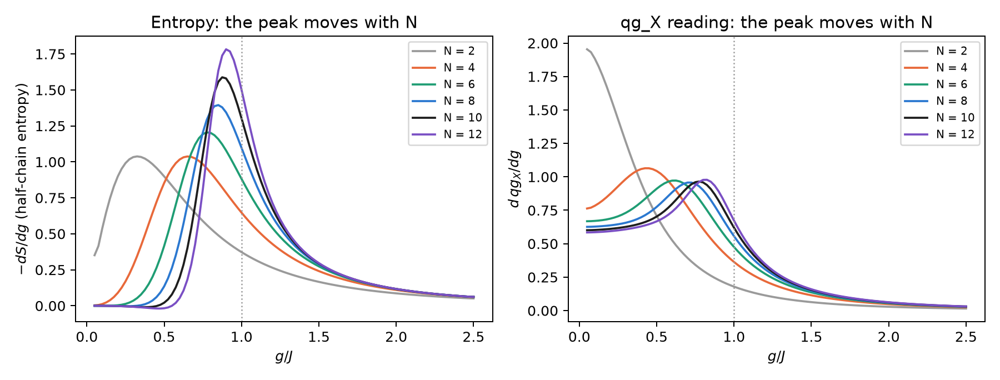
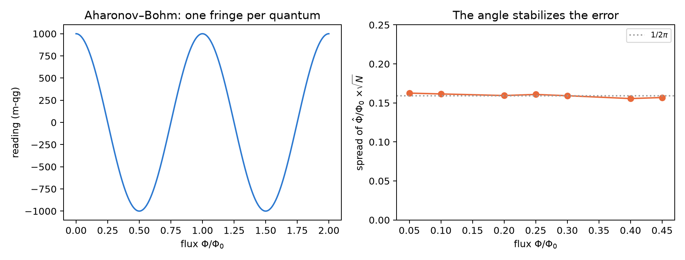
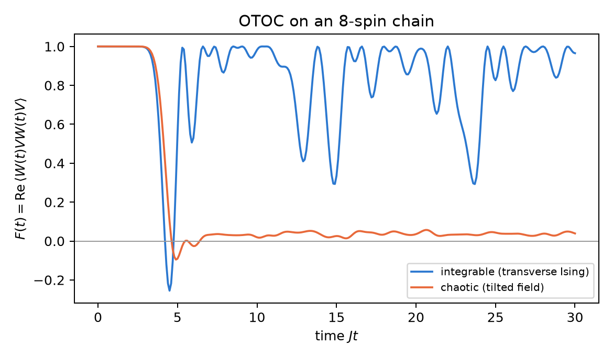

# Angular architecture: chemistry, condensed matter, relativistic optics, thermodynamics and geometry {#sec-ch34}

This chapter answers a proposal: thirteen phenomena from five fields, each with an equation, a "qg mapping" and an analytic
test with its pass criterion. The proposal uses a currency the Chapter 1 base does not have: it speaks of "qg cycles" and
"qg periods". Before anything is run, those criteria have to be translated into readings. Then each test is run in
`tools/make_cap34_figures.py`, which takes about 25 seconds. There is no notes section and no qang module for these topics,
so every figure comes from a closed form, an exact diagonalization or a Monte Carlo written there. None comes from an
experiment. The verdict on each test is in @tbl-matrix34: some hold as written, others hold only once corrected, and two
fail.

## From the base: readings, not cycles {#sec-base34}

The Chapter 1 equation starts from a probability $p_0$ and gives four exact readings:

$$
\theta = 2\arccos\sqrt{p_0},\qquad qg_Z = 2p_0-1 = \cos\theta,\qquad qg_S = H(p_0),\qquad m = 1000\,qg_Z\ \text{m-qg}.
$$

This has three consequences for the proposal:

- **qg has no period.** $qg_Z$ lives in $[-1,1]$ and the qang angle in $[0,\pi]$. A criterion such as "phase $=\pi\equiv
  0.5$ qg cycle" cannot be checked as it stands. It has to be rewritten as a reading: for instance, $qg_X=-1$, which is
  $-1000$ m-qg.
- **A phase does not change $qg_Z$.** A rotation about $Z$ (Larmor precession, Aharonov–Bohm phase, the sign of an exchange)
  leaves the populations alone. It is read with an interferometer, in $qg_X$ or $qg_Y$, like the Berry phase of Chapter 7.
- **Where there is a probability, there is a reading.** A reflectance, the weight of a determinant, the vacuum occupation or a
  transition probability is a $p_0$, so everything from Chapter 1 applies: the linear scale and the angle that stabilizes the
  noise.

## Quantum chemistry {#sec-chemistry34}

### Jordan–Wigner: the exchange sign is a reading {#sec-jw34}

The mapping is $a_j^\dagger=\big(\prod_{k<j}(-Z_k)\big)\,\sigma_j^+$. The script builds the operators of four modes and checks
the anticommutation relations $\{a_i,a_j^\dagger\}=\delta_{ij}$ and $\{a_i,a_j\}=0$ with exactly zero error. It also checks
that $a_1^\dagger a_2^\dagger|0\rangle + a_2^\dagger a_1^\dagger|0\rangle = 0$. The proposal asks for the exchange to be "a
half-period qg phase shift". On the Chapter 1 base that is not a reading. To make it one, the exchange has to act inside a
Hadamard test: an ancilla controls the exchange of the two occupied modes and is read in $X$.

- **With the fermionic exchange**, the ancilla reads $qg_X=-1$, that is $-1000$ m-qg.
- **With a qubit SWAP**, the same circuit reads $+1000$ m-qg.

The Pauli sign is the difference between the two poles of $qg_X$. The $Z$ gates of the parity string are exact, so there is
no "phase loss from accumulated gates". The error of a real circuit comes from noise, not from the mapping.

### UCC for H$_2$: the amplitude is half a qang angle {#sec-ucc34}

For H$_2$ in STO-3G at 0.735 Å, with the four-qubit Hamiltonian of Chapter 25, UCCSD reduces to a single double excitation.
The state is $|\Psi(t)\rangle=\cos t\,|\text{HF}\rangle+\sin t\,|\text{double}\rangle$, and the energy has the closed form
$E(t)=A+B\cos 2t+C\sin 2t$:

- the minimum is at $t^\ast=-0.1118$ rad, where the energy is $-1.1373060$ Ha, the FCI energy to within $5\cdot10^{-14}$ Ha;
  Hartree–Fock gives $-1.1169990$;
- **the Hartree–Fock weight is a reading**: $p_0=\cos^2 t^\ast=0.9876$, that is $+975.1$ m-qg, and its qang angle is
  $\theta=2|t^\ast|=0.2235$ rad. The UCC amplitude is half a qang angle, the same relation Chapter 33 finds for tunnelling;
- a sweep with step $\pi/200$ gets within $5.4\cdot10^{-6}$ Ha of the minimum.

The proposal asks for "sub-millihartree precision, $<1.6\cdot10^{-3}$ Ha". That threshold is chemical accuracy (1 kcal/mol),
not a sub-millihartree, and in an exact simulator it is beaten by eleven orders of magnitude: it discriminates nothing. The
dissociation curve is not redone because the environment has no PySCF; the stored runs of Chapter 25 cover it. The gradient
vanishes at the minimum in both $t$ and $m$, because $dm/dt=-2000\sin 2t\neq 0$ there. At Hartree–Fock ($t=0$, the pole) the
$m$ coordinate is singular, as Chapter 23 shows.

### Larmor and the Hahn echo {#sec-hahn34}

Free precession $\Delta\varphi=\gamma B_0t$ is a rotation about $Z$. With the proton ($\gamma/2\pi=42.577$ MHz/T) and a spin on
the equator, the script gives $qg_Z=0$ at all times and $qg_X=\cos\Delta\varphi$. The precession does not show in the $Z$
reading.

For the echo, the script takes 20,000 spins with Gaussian detuning ($\sigma=2\pi\cdot50$ kHz), $\tau=20$ µs, the sequence
$\pi/2-\tau-\pi-\tau$, and reads the magnetization in $qg_X$:

| case | $qg_X$ | theory |
|---|---|---|
| no $\pi$ pulse (free decay) | 0.004 (Monte Carlo noise) | $2.7\cdot10^{-9}$ |
| echo, static detuning | **1.000000** (+1000 m-qg) | 1 |
| echo, $\pi$ pulse 2 % too long | 0.99901 | 0.99901 |
| echo, detuning that changes by 10 % of $\sigma$ between halves | 0.820 | 0.821 |

: The Hahn echo read in $qg_X$. {#tbl-hahn34}

The proposal's criterion, "$F=1$ independent of $\Delta\omega$", holds only with static detuning and exact pulses. A pulse
with a 2 % error costs 1 m-qg, and a drifting detuning costs 180 m-qg. Calibrating the echo with the device itself is the
subject of Chapter 22.

## Condensed matter {#sec-matter34}

### Transverse-field Ising: the peak moves with size {#sec-ising34}

$H=-J\sum Z_iZ_{i+1}-g\sum X_i$ on an open chain. With $\tan\theta=g/J$, the transition is at $g=J$, that is at
$\theta=\pi/4$, **in the thermodynamic limit**. The proposal asks to find it with 2 to 4 spins, at the peak of the derivative
of the entanglement entropy. The script diagonalizes with $N=2$ to $12$ (in the even sector of the parity $\prod X$, so that
the cat state below the transition is well defined):

| $N$ | steepest drop of $S$ | peak of $d\,qg_X/dg$ | $m_X$ at $g=J$ |
|---|---|---|---|
| 2 | 0.33 | (at the edge) | 894.4 |
| 4 | 0.65 | 0.43 | 810.1 |
| 6 | 0.78 | 0.63 | 771.1 |
| 8 | 0.85 | 0.70 | 747.9 |
| 10 | 0.88 | 0.78 | 732.3 |
| 12 | 0.90 | 0.83 | 720.9 |
| $\infty$ | 1 | 1 | 636.6 ($2000/\pi$) |

: Peak position ($g/J$) and transverse reading at the critical point. {#tbl-ising34}

**The test fails with 2 to 4 spins.** The peak is at $g/J=0.33$ and $0.65$, that is at $\theta=18^\circ$ and $33^\circ$, not at
$45^\circ$. With two spins there is no transition: the curve is smooth. The peak approaches 1 as $N$ grows, and the entropy
converges faster than the $qg_X$ reading (@fig-ising34). The transverse reading at $g=J$, $m_X$, also falls towards the exact
value $1000\cdot 2/\pi=636.6$ m-qg [@pfeuty1970], but with 12 spins it is still 84 m-qg above it. What gives $\theta=\pi/4$ is
the limit, not the scale.

{#fig-ising34 width=100%}

### Kitaev chain: the protection is in the Hamiltonian, not in the angle {#sec-kitaev34}

The parity $P=\prod_j(-i\gamma_{2j-1}\gamma_{2j})$ takes the values $\pm1$, that is $\pm1000$ m-qg. The script separates two
questions:

- **Does the chain protect?** With $t=\Delta=1$ and $\mu=0.5$, the energy difference between the two parity sectors halves with
  each site: 0.207 with 2 sites and 0.0029 with 8. With $\mu=0$ and local disorder $\pm0.3$ it falls from $1.5\cdot10^{-2}$ to
  $3\cdot10^{-7}$, though not monotonically. That is topological protection: exponential in the length.
- **Does the gate protect?** The braid $B=e^{\pi\gamma_2\gamma_3/4}=(1+\gamma_2\gamma_3)/\sqrt2$ holds to $10^{-16}$, with
  exact eigenphases $\pm\pi/4$ and $B^2=\gamma_2\gamma_3$. But applied as a gate with a relative angle error $\epsilon$, the
  infidelity is $6.2\cdot10^{-5}$ at 1 %, $1.5\cdot10^{-3}$ at 5 % and $6.2\cdot10^{-3}$ at 10 %, quadratic in $\epsilon$, like
  any rotation.

**Writing the braid in "quarter qg cycles" does not protect it.** Invariance under local perturbations comes from the
Hamiltonian with separated Majorana modes [@kitaev2001; @ivanov2001]. A gate that imitates the braid has the error of any
gate.

### Aharonov–Bohm: one fringe per flux quantum {#sec-ab34}

In a two-path ring, the output has $p_0=\cos^2(\pi\Phi/\Phi_0)$, so

$$
qg_Z=\cos\!\left(2\pi\,\frac{\Phi}{\Phi_0}\right),\qquad \theta = 2\pi\,\frac{\Phi}{\Phi_0}\ \ (\text{folded into }[0,\pi]).
$$

The qang angle is the Aharonov–Bohm phase. The reading returns to its value every $\Phi_0=h/e$ (the script checks it to
$10^{-15}$). What is periodic is the flux, not qg. With 2000 electrons per measurement and 4000 repetitions, the flux estimated
from the angle has a spread times $\sqrt N$ of between 0.156 and 0.163 for $\Phi/\Phi_0$ from 0.05 to 0.45. The bound is
$1/2\pi=0.159$, the same over the whole range (@fig-ab34). It is the Chapter 1 arcsine transformation applied to an
interferometer. **What the reading does not give** is the sign: $\Phi$ and $-\Phi$ (and $\Phi_0-\Phi$) read the same. Telling
them apart needs the second quadrature, $qg_Y$, as in Chapter 7.

{#fig-ab34 width=100%}

## Relativity and optics {#sec-optics34}

### Wigner rotation {#sec-wigner34}

Two non-collinear boosts, $v_1=0.6c\,\hat x$ and $v_2=0.8c\,\hat y$, compose into a boost followed by a rotation. The script
multiplies them as $4\times4$ matrices, splits off the resulting boost and reads the angle: $\Omega_W=0.3303$ rad
($18.92^\circ$). The proposal's formula gives the same to $1.5\cdot10^{-15}$. With spinors, the same product in
$SL(2,\mathbb C)$ splits into a Hermitian part (the boost) and a unitary part (the rotation), and gives the same angle to
$2\cdot10^{-16}$. The proposal's checks pass: $\Lambda^T\eta\Lambda=\eta$ to $9\cdot10^{-16}$, the rotation is orthogonal and
the spinor part is unitary. A spin that pointed along $x$ afterwards reads $qg_X=\cos\Omega_W$, that is $+945.9$ m-qg. With
collinear boosts, $\Omega_W=0$. All of this is structure of the Lorentz group: the scale only translates the angle into a spin
reading. With Dirac spinors the result is the same, because a Dirac spinor is two $SL(2,\mathbb C)$ spinors.

### Fresnel: Brewster is a zero of probability, total reflection is a phase {#sec-fresnel34}

From air into glass with $n=1.5$:

- **Brewster**, at $56.31^\circ$: $r_p=0$ exactly. $s$ light reflects $R_s=0.148$, which as a "reflected" reading is $-704$
  m-qg. At normal incidence, $R=0.04$, that is $-920$ m-qg.
- **Total reflection**, from inside the glass and above $41.81^\circ$: $|r_s|=|r_p|=1$ to $4\cdot10^{-16}$. The reflectance
  always reads $+1000$ m-qg and says nothing. All the information is in the phases. Their difference $\delta_p-\delta_s$ reaches
  a maximum of $45.24^\circ$ at $51.67^\circ$ and passes through $45^\circ$ at $50.23^\circ$ and $53.26^\circ$: the Fresnel
  rhomb. Linear light at $45^\circ$ incident at $45^\circ$ leaves with $qg_Y=S_3/S_0=\sin(\delta_p-\delta_s)=0.600$, that is
  $+600$ m-qg, a Stokes reading like those of Chapter 6.
- **Goos–Hänchen** is not a "phase shift". It is a lateral displacement that comes from the derivative of the phase: with
  Artmann's formula, $D=-(\lambda/2\pi n)\,d\delta/d\theta_i$, it is 0.64 $\lambda$ for $s$ at $45^\circ$ [@goos1947;
  @artmann1948].

The total-reflection phase as a "single-qubit phase gate" works: it acts on the polarization and is read in $qg_Y$.

### Bogoliubov and Unruh: the half angle is the Gudermannian {#sec-unruh34}

The Minkowski vacuum seen by an accelerated observer is a two-mode squeezed state. Each reduced mode is thermal, with
$\bar n=\sinh^2r$ and Boltzmann factor $\tanh^2r=e^{-2\pi\omega c/a}$ [@unruh1976; @crispino2008]. The script checks the
closed-form entropy, $S=\cosh^2r\ln\cosh^2r-\sinh^2r\ln\sinh^2r$, against the sum over occupation numbers: they agree to
$10^{-16}$ up to $r=1$, and to $2\cdot10^{-6}$ at $r=1.5$ because of the 80-level cutoff. The hyperbolic matrix preserves the
form $\mathrm{diag}(1,-1)$ to $2\cdot10^{-16}$. The proposal calls it a "pseudo-unitary rotation parametrized in qg". An
$SU(1,1)$ transformation is not a rotation, but the vacuum weight is a probability, $p_0=1/\cosh^2r$, and it gives an exact
identity:

$$
\frac{\theta}{2}=\operatorname{gd}(r)=\arctan(\sinh r).
$$

**The qang half-angle of the vacuum weight is the Gudermannian function of the squeezing parameter.** It maps the hyperbolic
line onto a circle angle, and the script checks it to $10^{-16}$. The vacuum readings are $+880.0$, $+572.9$, $-160.1$ and
$-638.6$ m-qg for $r=0.25$, $0.5$, $1$ and $1.5$. As $r\to\infty$ (huge acceleration or zero frequency), $\theta\to\pi$.

## Thermodynamics and metrology {#sec-thermo34}

### Jarzynski with two measurements {#sec-jarzynski34}

A qubit with $H=-\tfrac h2(\cos\varphi\,Z+\sin\varphi\,X)$ is driven from $h=1$, $\varphi=0$ to $h=2$, $\varphi=1$ rad in a time
$1.5$ (400 steps), with $\beta=1$. Work is measured with two projective measurements [@talkner2007]. The transition
probabilities $|\langle n_f|U|m_i\rangle|^2$ are readings: the two "stay" probabilities are $qg=0.707$, that is $707.4$ m-qg.

- **Exact**: $\langle e^{-\beta W}\rangle=1.3684330=Z_f/Z_i$, with error $3.8\cdot10^{-15}$. $\Delta F=-0.3137$ and
  $\langle W\rangle=-0.0958\ge\Delta F$.
- **With sampled trajectories** (2000 repetitions), the estimator $-\ln\overline{e^{-\beta W}}/\beta$ has a bias of $+0.021$ with
  10 trajectories, $+0.0016$ with 100 and $+1.5\cdot10^{-4}$ with 1000. With 10,000 trajectories the bias is within the noise.

The equality holds [@jarzynski1997], and the scale changes nothing in the thermodynamics. What it adds is that each transition
probability is a reading with the Chapter 1 error bar.

### Fisher information of a GHZ state {#sec-ghz34}

For $N=1$ to $8$ qubits and the phase generated by $\sum Z/2$, the script gives a quantum Fisher information of $N^2$ for the
GHZ state and $N$ for the product state, with $10^{-15}$ error. The step that connects to Chapter 1 is the parity reading. Its
mean is $qg=\cos N\varphi$, and the single-shot Fisher information of a $\pm1$ reading is $(dqg/d\varphi)^2/(1-qg^2)$. That
gives exactly $N^2$ at any $\varphi$: **the parity reading reaches the quantum bound** [@bollinger1996; @giovannetti2006]. The
proposal asks to use "qg as a continuous differentiable parameter". If the parameter were the reading itself, the information
would be divided by $(dqg/d\varphi)^2$ and diverge at the poles. The scale reads, and the parameter is still the phase. The
cost of read-out noise, $(1-2e)^N$, is in Chapter 8.

## Geometry and chaos {#sec-geometry34}

### Fubini–Study: pole to pole, half the qang angle {#sec-fs34}

The script sums, in 20,000 steps, the distances $\arccos|\langle\psi_k|\psi_{k+1}\rangle|$ along a meridian and gets
$1.5707963=\pi/2$. With $\sqrt{1-|\langle\cdot|\cdot\rangle|^2}$ it gets the same, and also with the qg coordinate,
$ds=dqg/\big(2\sqrt{1-qg^2}\big)$, although that integrand is singular at the poles. The Gaussian curvature of
$ds^2=\tfrac14(d\theta^2+\sin^2\theta\,d\phi^2)$ comes out as $4.000$: a sphere of radius 1/2 [@provost1980]. The proposal
speaks of "half a qg metric period". Translated to the base, **the Fubini–Study distance is half the qang angle**,
$d_{FS}=\theta/2$, the Wootters distance of Chapter 1.

### OTOC: integrable against chaotic {#sec-otoc34}

On an 8-spin chain, with $W=Z_1$, $V=Z_8$ and infinite temperature, the script compares the transverse Ising model ($g=1.05$,
integrable) with the same model plus a longitudinal field of 0.5 (chaotic):

- **The front arrives at the same time**: $F(t)=\mathrm{Re}\langle W(t)VW(t)V\rangle$ drops below 0.5 at $t=4.0$ and $4.2$.
- **What separates them is what comes after**: the chaotic one stays at $0.036$ on average ($+36$ m-qg) for $t$ between 10 and
  30, and the integrable one revives, with mean $0.839$ (@fig-otoc34).
- **The usual diagnostic agrees**: the mean level-spacing ratio (10 spins, reflection-even sector) is $0.532$ for the chaotic
  chain (GOE: 0.531) and $0.387$ for the integrable one (Poisson: 0.386) [@oganesyan2007; @atas2013].

**The proposal's test cannot be done here.** With 8 spins there is no exponential window separate from the front, and the bound
$\lambda_L\le2\pi k_BT/\hbar$ [@maldacena2016] is empty at infinite temperature. That bound has content in large-$N$ models at
low temperature, such as SYK [@sachdev1993; @maldacena2016syk], not in an 8-spin chain. For Paulis, $F(t)$ is the $qg_X$
reading of an ancilla in an interferometric protocol [@swingle2016], the same kind of reading as the decoder of Chapter 15.

{#fig-otoc34 width=80%}

## The test matrix, revised {#sec-matrix34}

| phenomenon | proposal's criterion | result |
|---|---|---|
| Jordan–Wigner | accumulated phase $=\pi\equiv0.5$ qg cycle | **corrected**: Hadamard test, $-1000$ m-qg (qubit SWAP: $+1000$) |
| UCCSD (H$_2$) | $E\approx-1.137$ Ha, zero gradient in qg | **holds**: FCI to $5\cdot10^{-14}$; HF at $+975.1$ m-qg; the curve is not redone |
| Hahn echo | $F=1$ independent of $\Delta\omega$ | **holds only static**: 2 % pulse error, $-1$ m-qg; drift, $-180$ |
| transverse Ising | transition at $\theta=\pi/4$ with 2–4 spins | **fails**: the peak is at $g/J=0.33$–$0.65$; it approaches 1 with $N$ |
| Kitaev | braid invariant under $\epsilon(\theta)$ | **fails as a gate** ($6\cdot10^{-5}$ at 1 %); the protection is the Hamiltonian's |
| Aharonov–Bohm | periodicity every quantum | **holds** to $10^{-15}$; the flux is periodic, qg is not; the sign needs $qg_Y$ |
| Wigner | orthogonality and Lorentz metric | **holds** to $10^{-15}$; $\Omega_W=18.92^\circ$ |
| Brewster | exact zero at $\theta_B$ | **holds**: $r_p=0$ at $56.31^\circ$ |
| Goos–Hänchen | phase shift | **corrected**: it is a displacement, 0.64 $\lambda$ |
| Bogoliubov | entropy of the thermal state | **holds**, and $\theta/2=\operatorname{gd}(r)$ appears |
| Jarzynski | identity with theoretical $\Delta F$ | **holds** to $4\cdot10^{-15}$; sampling is biased |
| GHZ QFI | $N^2$ against $N$ | **holds**; parity reaches $N^2$ |
| Fubini–Study | curvature $K=4$ | **holds**: $K=4.000$; pole to pole $\pi/2=\theta/2$ |
| OTOC | polynomial against exponential, MSS bound | **not applicable** with 8 spins; the late-time mean does separate |

: The proposal's thirteen criteria, run. {#tbl-matrix34}

## Without qang and with qang {#sec-comparison34}

| topic | without qang | with qang | difference |
|---|---|---|---|
| UCC | amplitude $t$ | HF weight $+975.1$ m-qg, $\theta=2\lvert t\rvert$ | the amplitude is half an angle; same energy |
| Aharonov–Bohm | fringes in $P$ | $\theta=2\pi\Phi/\Phi_0$, spread $1/2\pi\sqrt N$ constant | even error bar (arcsine); the sign needs another reading |
| Bogoliubov | $\tanh^2r$, $\bar n$, $S$ | $\theta/2=\operatorname{gd}(r)$ | a new, exact identity |
| GHZ | QFI $=N^2$ | parity Fisher $(dqg)^2/(1-qg^2)=N^2$ | Chapter 1's single-shot formula reaches the bound |
| Fubini–Study | $d_{FS}=\arccos\lvert\langle\psi\vert\phi\rangle\rvert$ | $d_{FS}=\theta/2$ | the same distance (Wootters) |
| echo, Jarzynski | $\langle X\rangle$, probabilities | readings in m-qg | unit only |
| Ising | entropy, $\langle X\rangle$ | $m_X\to636.6$ | none: the scale does not bring the limit closer |
| Wigner, Kitaev, OTOC | Lorentz group, Hamiltonian, spectrum | angle translated into a reading | **none**; "qg cycles" neither protect nor measure chaos |

: The thirteen tests, with and without the scale. {#tbl-comparison34}

**Verdict.** The proposal is right in its intuition: almost everything it looks at has an angle or a probability inside. It
goes wrong in the currency, because "qg cycle" and "qg period" do not exist in the base. Translated into readings, the scale
contributes four concrete things: the UCC amplitude as half an angle, the constant error bar of the flux, the Gudermannian of
the squeezed vacuum, and the GHZ parity at the quantum bound from the single-shot formula. For the echo and Jarzynski it
changes only the unit. For Wigner, Kitaev and the OTOC it contributes nothing: the physics is in the group, the Hamiltonian or
the spectrum. Two criteria fail as written: Ising with 2 to 4 spins and the braid as a protected gate. Everything is exact
computation or simulation, and there is no qang module for these topics yet.

## In code {#sec-code34}

```python
import math
from qang import probability as PB

# UCC for H2: Hartree-Fock weight at the minimum
t = -0.11176849913374033
PB.milliqang_from_p0(math.cos(t) ** 2)          # +975.1 m-qg; qang angle 2|t| = 0.2235 rad

# Bogoliubov: the qang half-angle of the vacuum is the Gudermannian
r = 1.0
theta = PB.theta_from_milliqang(PB.milliqang_from_p0(1 / math.cosh(r) ** 2))
theta / 2, math.atan(math.sinh(r))              # 0.8658 and 0.8658
```

## Summary {#sec-summary34}

- The base has no "qg cycles": qg is a reading in $[-1,1]$. Phases are read in $qg_X$ or $qg_Y$ with an interferometer, and
  probabilities directly.
- The sign of a fermionic exchange is $-1000$ m-qg in a Hadamard test; the UCC amplitude of H$_2$ is half a qang angle
  ($+975.1$ m-qg at the FCI minimum).
- The Hahn echo recovers $+1000$ m-qg only with static detuning; Ising with 2 to 4 spins does not show the transition at
  $\theta=\pi/4$, and the Majorana braid written as a gate is not protected.
- The qang angle of an Aharonov–Bohm ring is the phase, with a constant $1/2\pi\sqrt N$ error bar; the half-angle of the
  squeezed vacuum is $\operatorname{gd}(r)$.
- GHZ parity reaches the quantum information $N^2$ with Chapter 1's single-shot formula, and the Fubini–Study distance is half
  the qang angle.
- Wigner, Jarzynski and the OTOC hold or are diagnosed with the usual tools; the scale only translates them.

## Bibliographic notes {.unnumbered}

The Jordan–Wigner mapping is @jordan1928, and UCC for VQE, @romero2018; the H$_2$ energy follows @omalley2016. The echo is
@hahn1950, and precession, @bloch1946. The solved transverse Ising model is @pfeuty1970, and entanglement entropy at
criticality, @calabrese2004. The Kitaev chain is @kitaev2001, and Majorana braiding, @ivanov2001. The Aharonov–Bohm effect is
@aharonov1959. Thomas precession is @thomas1926; Wigner's representations, @wigner1939, and the composition of boosts,
@odonnell2011. Fresnel and Brewster follow @bornwolf1999; the lateral shift is @goos1947 and @artmann1948. The Unruh effect is
@unruh1976 (review: @crispino2008). The Jarzynski equality is @jarzynski1997, and work from two measurements, @talkner2007.
Spectroscopy with GHZ states is @bollinger1996, and quantum metrology, @giovannetti2006 and @braunstein1994. The Fubini–Study
metric as a Riemannian structure is @provost1980. The chaos bound is @maldacena2016; SYK, @sachdev1993 and @maldacena2016syk;
measuring scrambling, @swingle2016, and spacing ratios, @oganesyan2007 and @atas2013. The scripts that check this chapter are
in the repository [@qangrepo]; the definition of the qang unit is in @monteverde2026.
