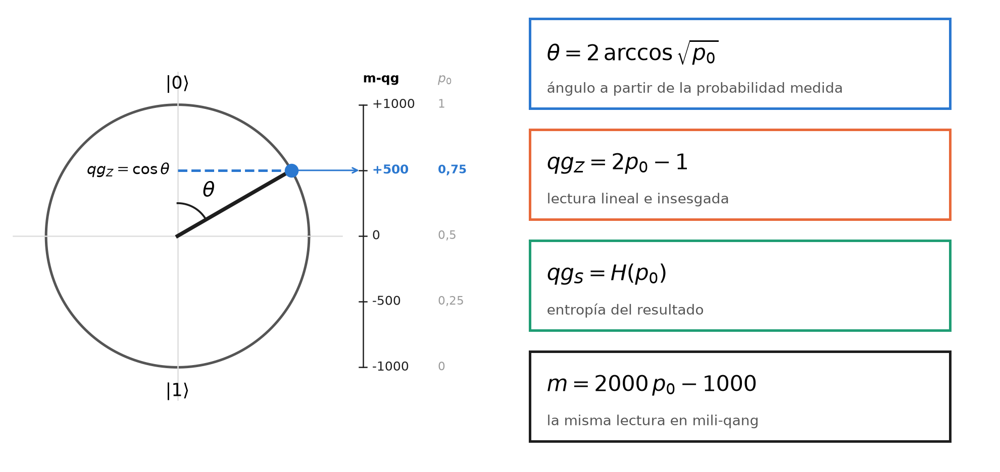
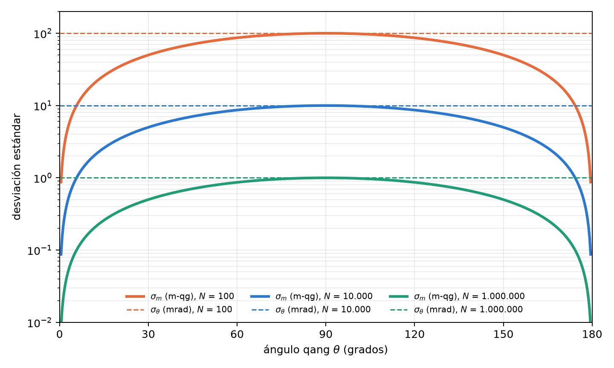
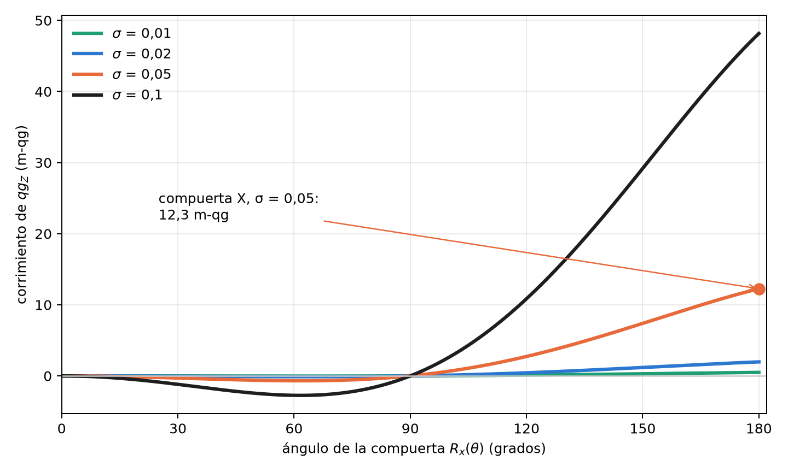
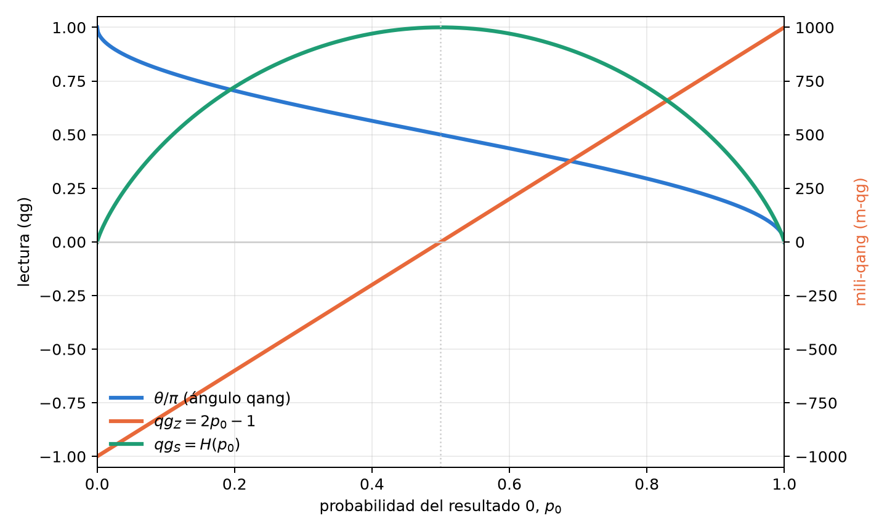

# La unidad qang: definición, mili-qang y la ecuación de probabilidad {#sec-cap01}

Un qubit se diseña con ángulos y se observa con frecuencias. Quien escribe un circuito elige rotaciones
$R_y(\theta)$; quien lo ejecuta recibe cuentas de ceros y unos. Entre ambas descripciones media una función
trigonométrica que casi nunca se nombra, y que es la fuente de varias dificultades prácticas: gradientes que
divergen, barras de error que se encogen o se inflan según el estado, y parámetros que no se pueden leer
directamente del experimento. Este capítulo construye la base del libro en tres pasos: la **definición** de la
unidad qang (qg), la **teoría del mili-qang** (su submúltiplo) y la **ecuación de probabilidad** que une ambas con
lo que se mide. Cada resultado se respalda con un gráfico calculado con el propio paquete (`qang.probability`,
§167), de modo que las figuras y el texto citan los mismos números.

## Definición del qang {#sec-definicion}

Todo estado puro de un qubit se escribe, salvo una fase global, como

$$
|\psi\rangle = \cos\frac{\theta}{2}\,|0\rangle + e^{i\varphi}\sin\frac{\theta}{2}\,|1\rangle ,
\qquad \theta\in[0,\pi],\ \varphi\in[0,2\pi).
$$

La pareja $(\theta,\varphi)$ es un punto de la esfera de Bloch y es la forma natural de *preparar* el estado: una
rotación $R_y(\theta)$ seguida de una fase $R_z(\varphi)$. Una medición en la base computacional no devuelve
$\theta$: devuelve, en cada disparo, el resultado 0 con probabilidad

$$
p_0 = \cos^2\frac{\theta}{2}\qquad\text{(regla de Born).}
$$

**Definición.** La unidad qang toma como coordenada primaria el valor esperado de $\sigma_z$, llamado *sesgo
polar*:

$$
\boxed{\;qg_Z = \langle\sigma_z\rangle = p_0 - p_1 = 2p_0 - 1 = \cos\theta\;}\qquad qg_Z\in[-1,1].
$$

De la misma probabilidad salen las otras dos lecturas de la unidad: el **ángulo qang**
$\theta=\arccos(qg_Z)\in[0,\pi]$ y la **dispersión de superposición** $qg_S=H(p_0)\in[0,1]$, la entropía de Shannon
del resultado (se estudia más abajo). La @fig-circulo resume la definición: el punto del círculo es el estado, su
proyección sobre el eje vertical es $qg_Z$, y la escala de la derecha da la misma lectura en mili-qang y en
probabilidad.

{#fig-circulo width=100%}

Tres propiedades hacen de $qg_Z$ una buena coordenada de trabajo:

1. **Es una biyección.** En $\theta\in[0,\pi]$, la función $\cos\theta$ es estrictamente decreciente y recorre
   $[-1,1]$: cada valor de $qg_Z$ corresponde a una única latitud de la esfera.
2. **Es directamente medible.** $\widehat{qg}_Z = (n_0-n_1)/N$ es el promedio de los resultados $\pm1$ de los
   disparos; no requiere inversión ni ajuste.
3. **Vale para cualquier estado.** Para un estado mixto, $qg_Z = \operatorname{Tr}(\rho\,\sigma_z)$, y se reduce a
   $\cos\theta$ cuando $\rho=|\psi\rangle\langle\psi|$ (§3).

El signo y el rango tienen una lectura física inmediata: $qg_Z=+1$ es el polo $|0\rangle$, $qg_Z=-1$ el polo
$|1\rangle$, y $qg_Z=0$ cualquier punto del ecuador, donde el resultado de la medición es máximamente incierto.

**Una unidad de ingeniería.** Una unidad útil no necesita ser una magnitud física nueva; necesita volver legible lo
que se mide. El decibelio no agrega física a la potencia: la expresa en una escala que vuelve sumables las
ganancias de una cadena de amplificadores. El qang cumple un papel análogo para el qubit: expresa su estado en la
escala en la que el experimento lo entrega, de modo que preparación, ruido y lectura se comparan en las mismas
unidades. Es una convención operativa, y como toda convención vale por lo que simplifica.

## Teoría del mili-qang {#sec-miliqang}

### Definición y escala

Las desviaciones que importan en un qubit real son pequeñas: errores de calibración, deriva, ruido de lectura.
Para expresarlas conviene un submúltiplo, el **mili-qang** (m-qg):

$$
1\ \text{qg} = 1000\ \text{m-qg},\qquad m = 1000\,qg_Z\ \in[-1000,\,+1000]\ \text{m-qg}.
$$

La escala va de $-1000$ m-qg en el polo $|1\rangle$ a $+1000$ m-qg en el polo $|0\rangle$, con el cero en el
ecuador. Un estado con $qg_Z=0{,}5018$ está a $501{,}8$ m-qg; su diferencia con el ideal $0{,}5$ es de $1{,}8$ m-qg.
La misma definición vale para los otros ejes, $qg_X$ y $qg_Y$, con lo que todo el vector de Bloch se expresa en
m-qg.

### Lineal en la probabilidad, no lineal en el ángulo

Como $qg_Z=2p_0-1$, el mili-qang es **lineal en la probabilidad**: un m-qg equivale siempre a $\Delta p_0=0{,}0005$,
es decir, 0,05 puntos porcentuales, en cualquier lugar de la escala. En cambio **no es lineal en el ángulo**:

$$
\frac{dm}{d\theta} = -1000\,\sin\theta
\qquad\Longrightarrow\qquad
\Delta\theta \approx \frac{1}{1000\,\sin\theta}\ \text{rad por m-qg}.
$$

En el ecuador ($\theta=90^\circ$) un m-qg es exactamente un miliradián; a $\theta=30^\circ$ son dos. Cerca de un
polo la relación lineal deja de valer y hay que usar la exacta: un estado que está $\delta$ m-qg por debajo del polo
$|0\rangle$ forma con él el ángulo

$$
\theta_\delta = \arccos\!\left(1-\frac{\delta}{1000}\right)\approx\sqrt{\frac{2\delta}{1000}} .
$$

Un m-qg del polo son $0{,}0447$ rad ($2{,}56^\circ$); diez m-qg, $8{,}1^\circ$. La @fig-regla muestra la
consecuencia: sobre la regla del mili-qang, las marcas de probabilidad están equiespaciadas y las de ángulo se
amontonan en los polos. Por eso la unidad se define sobre la probabilidad y no sobre el ángulo: es la escala en la
que el instrumento entrega los datos.

{#fig-regla width=100%}

### Resolución por disparos

Con $N$ disparos, $\widehat{qg}_Z$ tiene varianza $\sin^2\theta/N$ (lo derivamos en la sección del arcoseno), de
modo que la desviación estándar de la lectura en mili-qang es

$$
\sigma_m = \frac{1000\,\sin\theta}{\sqrt N}\ \text{m-qg},
\qquad
N_\delta = \left(\frac{1000\,\sin\theta}{\delta}\right)^{2}
$$

donde $N_\delta$ es el número de disparos necesario para resolver $\delta$ m-qg con un sigma. En el ecuador, resolver
10 m-qg requiere $10^4$ disparos y resolver 1 m-qg, $10^6$. A $60^\circ$ y con 1000 disparos, $\sigma_m=27{,}4$ m-qg;
para bajar a 5 m-qg en ese mismo punto hacen falta 30 000 disparos. La @fig-ruido compara $\sigma_m$ con la
incertidumbre del ángulo, $\sigma_\theta=1/\sqrt N$: la lectura en m-qg es más precisa cerca de los polos, y la del
ángulo vale lo mismo en todo el círculo. Las dos curvas se tocan en el ecuador, donde un m-qg es un miliradián.

{#fig-ruido width=90%}

### Presupuesto de error de compuerta

La escala permite expresar un error de compuerta en las mismas unidades que la lectura. Si la amplitud de un pulso
tiene un error aleatorio relativo de desviación $\sigma$, el sesgo polar esperado tras $R_x(\theta)$ es

$$
\mathbb E[qg_Z] = \cos\theta\; e^{-\theta^2\sigma^2/2}
\qquad\Longrightarrow\qquad
\varepsilon_m = 1000\cos\theta\left(e^{-\theta^2\sigma^2/2}-1\right)\ \text{m-qg}
$$

(§160). El error acerca la lectura al ecuador: con $\sigma=0{,}05$, una compuerta $X$ ($\theta=\pi$) entrega
$qg_Z=-0{,}988$ en lugar de $-1$, un corrimiento de $12{,}3$ m-qg. En los múltiplos de $\pi$ el corrimiento crece con el cuadrado del ángulo, y
siempre hacia el ecuador; en general va como $\theta^2\cos\theta$ (@fig-pulso). Una rotación de $\pi/2$ no se corre en absoluto, porque ya está en el ecuador. El capítulo 2 usa esta
fórmula para elegir, entre representaciones equivalentes de una misma compuerta, la de menor área de pulso.

{#fig-pulso width=90%}

Los capítulos 2 y 3 usan dos derivadas de la lectura respecto del ángulo, que conviene nombrar aquí. El **gradiente
polar** y la **curvatura** (o *impedancia de pulso*) son

$$
\nabla_{qg} = \frac{dm}{d\theta} = -1000\,\sin\theta\ \ \text{m-qg/rad},
\qquad
\kappa_{qg} = \left|\frac{d^2m}{d\theta^2}\right| = 1000\,\lvert\cos\theta\rvert\ \ \text{m-qg/rad}^2 .
$$

No son lecturas nuevas: son derivadas de $m=1000\cos\theta$. La curvatura explica el presupuesto anterior, porque a
segundo orden en el error, $\lvert\varepsilon_m\rvert\approx\tfrac12\,\theta^2\sigma^2\,\kappa_{qg}$: el error aleatorio
de amplitud corre la lectura en proporción a $\kappa_{qg}$, que vale 1000 en los polos y 0 en el ecuador.

## La ecuación de probabilidad del qang y del mili-qang {#sec-ecuacion}

Las secciones anteriores llevan a un único enunciado, que es la base de todo el libro: **todas las lecturas qang
de un qubit son funciones exactas de una sola probabilidad**, $p_0$:

$$
\boxed{\;
\theta = 2\arccos\sqrt{p_0},\qquad
qg_Z = 2p_0-1,\qquad
qg_S = H(p_0),\qquad
m = 2000\,p_0-1000\ \text{m-qg}
\;}
$$

y, en sentido inverso, la ecuación de probabilidad del mili-qang:

$$
p_0 = \frac{1000+m}{2000},\qquad \theta = \arccos\frac{m}{1000}.
$$

No hay aproximaciones: son cuatro lecturas de un mismo número. La @fig-lecturas las muestra juntas. $qg_Z$ y el
mili-qang son la misma recta, en dos escalas; el ángulo es monótono pero se empina en los polos; la entropía sube
hasta el ecuador y vuelve a bajar, por eso necesita una rama para invertirse. La @tbl-anclajes da los valores de
referencia.

{#fig-lecturas width=90%}

| $\theta$ | $p_0$ | $qg_Z$ | m-qg | estado |
|---|---|---|---|---|
| $0$ | $1$ | $+1$ | $+1000$ | polo $\vert{}0\rangle$ |
| $\pi/4$ | $0{,}854$ | $+0{,}707$ | $+707$ | |
| $\pi/3$ | $0{,}75$ | $+0{,}5$ | $+500$ | |
| $\pi/2$ | $0{,}5$ | $0$ | $0$ | ecuador ($\vert{}+\rangle$, $\vert{}{+i}\rangle$, …) |
| $2\pi/3$ | $0{,}25$ | $-0{,}5$ | $-500$ | |
| $\pi$ | $0$ | $-1$ | $-1000$ | polo $\vert{}1\rangle$ |

: Anclajes de la ecuación de probabilidad. {#tbl-anclajes}

### Más de dos resultados: la distancia estadística

La ecuación se generaliza a una medición con varios resultados. Para dos distribuciones $p=(p_k)$ y $q=(q_k)$, la
**distancia estadística de Wootters** [-@wootters1981], o ángulo de Bhattacharyya [@bhattacharyya1943], es

$$
d(p,q) = \arccos\sum_k\sqrt{p_k\,q_k}.
$$

Para dos resultados, la distancia entre $(p_0,1-p_0)$ y el polo $(1,0)$ es $\arccos\sqrt{p_0}=\theta/2$: el ángulo
qang es, salvo el factor 2, la distancia estadística entre lo que se mide y el estado de referencia. Con tres
resultados, por ejemplo, $p=(0{,}5;\,0{,}3;\,0{,}2)$ y $q=(0{,}4;\,0{,}4;\,0{,}2)$ están a $0{,}113$ rad. Esta es la
puerta por la que la unidad sale del qubit: la Parte II la usa para la información de Fisher y la métrica de
Fubini–Study, y la misma geometría vale para cualquier proporción medida, cuántica o no.

## La escala angular: el qang angular (qga) {#sec-qga}

La *Fundamentación geométrica y dimensional del sistema qang* [@monteverde2026fund] propone medir los ángulos en una
base milesimal: una vuelta completa son 1000 unidades. El libro adopta esa escala, pero con otro nombre, porque en
todo el libro, en la librería y en los capítulos que siguen, **m-qg designa la lectura** $m=1000\,qg_Z$, que es
lineal en la probabilidad y no es un ángulo (sección anterior). La escala angular se escribe **qga** (qang angular)
y su milésima, **m-qga**:

$$
1\ \text{vuelta} = 2\pi\ \text{rad} = 1000\ \text{qga} = 10^6\ \text{m-qga},
\qquad
\theta[\text{rad}] = \frac{2\pi}{1000}\,\theta_{qga},
\qquad 1\ \text{m-qga}\approx 6{,}283\cdot10^{-6}\ \text{rad}.
$$

Con el ángulo polar de Bloch en qga, la regla de Born y la lectura quedan

$$
p_0 = \cos^2\!\frac{\pi\,\theta_{qga}}{1000} = \frac{1+\cos(2\pi\theta_{qga}/1000)}{2},
\qquad
m = 1000\cos\frac{2\pi\,\theta_{qga}}{1000}\ \text{m-qg}.
$$

El polo $\vert0\rangle$ está en 0 qga, el ecuador en 250 qga y el polo $\vert1\rangle$ en 500 qga; la fase
$\varphi$ recorre $[0,1000)$ qga. Las dos escalas se complementan: el qga es uniforme en el ángulo y el m-qg es
uniforme en la probabilidad. El estado de la @fig-circulo, por ejemplo, está a $166{,}667$ qga y lee $+500$ m-qg; en
el ecuador, un m-qg de lectura equivale a un miliradián, es decir, a $0{,}159$ qga ($159$ m-qga).

En código, desde la versión 0.14.0, `qang.qga` hace estas conversiones: `p0_from_qga(250)` da 0,5,
`milliqang_from_qga(1000/6)` da +500 m-qg y `qga_from_milliqang(-1000)` da 500 qga.

**La coordenada azimutal.** La fase se lee con dos mediciones transversales,
$\varphi=\operatorname{atan2}(qg_Y,\,qg_X)$, porque $qg_X=\sin\theta\cos\varphi$ y $qg_Y=\sin\theta\sin\varphi$ y el
cociente elimina $\sin\theta$. Expresada como fracción de vuelta, $qg_\varphi=(\varphi\bmod 2\pi)/2\pi\in[0,1)$, es
exactamente el ángulo azimutal en qga dividido por 1000. No está definida en los polos, donde $qg_X=qg_Y=0$.

**Geometría.** La métrica de Fubini–Study de un qubit y la información de Fisher de la medición en $Z$ tienen, en
qga, un factor constante:

$$
ds^2 = \tfrac14\left(d\theta^2+\sin^2\theta\,d\varphi^2\right)
     = \frac{\pi^2}{10^6}\left(d\theta_{qga}^2+\sin^2\theta\,d\varphi_{qga}^2\right),
\qquad
I_F(\theta) = 1\ \text{rad}^{-2} = 4\pi^2\cdot10^{-6}\ \text{qga}^{-2}.
$$

La segunda es la estabilización de la sección del arcoseno dicha en otra unidad: la desviación estándar del ángulo
qang es $159{,}15/\sqrt N$ qga en todo el círculo ($5{,}03$ qga con 1000 disparos). La curvatura de Berry,
$F=\tfrac12\sin\theta\,d\theta\wedge d\varphi$, integrada sobre la esfera ($\theta$ abarca 500 qga y $\varphi$, 1000)
da $2\pi$, es decir, número de Chern 1.

**Correcciones a la Fundamentación.** Tres afirmaciones del documento fuente no se adoptan, porque sus propias
fórmulas las contradicen:

- Asigna $p_0=0{,}5$ a 125 qga. Con su propia ecuación, $p_0(125\ \text{qga})=\cos^2(\pi/8)=0{,}854$ (+707 m-qg);
  $p_0=0{,}5$ corresponde a 250 qga.
- Atribuye curvatura $K=1$ a la métrica $ds^2=\tfrac14\,d\theta^2$. Esa métrica, con su término azimutal, es la de una
  esfera de radio $1/2$, cuya curvatura gaussiana es $K=4$; $K=1$ es la de la esfera de Bloch de radio 1.
- Sugiere que una retícula en m-qga evita las mesetas estériles. Cambiar la unidad del parámetro multiplica todas las
  derivadas por la constante $2\pi/1000$: no cambia la relación entre la varianza del gradiente y su escala ni su
  decaimiento con el número de qubits. La unidad no tiene efecto sobre las mesetas. Otra cosa son las herramientas de
  qang, que sí las mitigan en regímenes probados: el costo local en qg (@sec-geo-mesetas) y el filtro de peso bajo T1
  (@sec-qnn-entrenar).

### Propuesta sin verificar: energía y antimateria en qga {#sec-qga-energia}

La Fundamentación extiende la escala a la cinemática relativista. Lo que sigue es una **propuesta sin verificar**: se
corrigen las identidades, pero la interpretación física no está probada y el resto del libro no la usa.

**Ángulo relativista.** De $E^2=(mc^2)^2+(pc)^2$, al dividir por $E^2$, se obtiene
$\cos\theta_r=mc^2/E=1/\gamma$ y $\sin\theta_r=pc/E=\beta$. La identidad es exacta, porque
$1/\gamma^2+\beta^2=1$. Con $\theta_r$ en qga, $E=mc^2/\cos(2\pi\theta_{r,qga}/1000)$: el reposo está en 0 qga y el
límite ultrarrelativista ($E=pc$), en 250 qga. El ángulo $\theta_r$ se relaciona con la rapidez $\eta$ por
$\cos\theta_r=1/\cosh\eta$ (la función de Gudermann), sin necesidad de rotación de Wick.

**Antimateria.** La ecuación de Dirac da dos ramas, $E_\pm=\pm\sqrt{(pc)^2+(mc^2)^2}=\pm\,mc^2/\cos\theta_r$. La
Fundamentación asigna a la rama negativa un desplazamiento de 500 qga, ligado a la simetría CPT. Esa identificación no
tiene respaldo y no se adopta.

**Probabilidades.** La Fundamentación iguala $P_\text{reposo}=(mc^2/E)^2$ con $p_0(\theta_{qga})$. Hay un factor 2 en
el ángulo: $(mc^2/E)^2=\cos^2\theta_r$, mientras que $p_0=\cos^2(\theta/2)$, de modo que la igualdad sólo vale si el
ángulo de Bloch es $2\theta_r$. Si en cambio se toma el ángulo de Bloch igual a $\theta_r$, sí hay un resultado
conocido detrás de las fórmulas $\cos^2(\pi\,\text{qg}/1000)$ y $\sin^2(\pi\,\text{qg}/1000)$ del documento: en el
espinor de Dirac libre, la componente grande pesa $(E+mc^2)/2E=\cos^2(\theta_r/2)$ y la pequeña,
$\sin^2(\theta_r/2)$. Pero esos pesos no son probabilidades de «materia» y «antimateria», como los llama el documento
fuente: los dos pertenecen a la misma solución de energía positiva.

El apéndice G (@sec-apendice-g) desarrolla esta propuesta. Encuentra una lectura exacta de $E=mc^2$, el valor
esperado de la matriz de Dirac $\beta$, que vale $mc^2/E$ y es por lo tanto un $qg_Z$. También muestra que la conjugación
de carga invierte esa lectura.

**Nombres propuestos.** @tbl-nombres-qga recoge los nombres que introduce la Fundamentación y cómo los trata el libro.

| nombre de la Fundamentación | definición | tratamiento en el libro |
|---|---|---|
| ángulo relativista $\theta_r$ | $\cos\theta_r=mc^2/E$, $\sin\theta_r=\beta$ | identidad exacta; en qga, propuesta |
| $E(\text{qg})=mc^2/\cos(2\pi\,\text{qg}/1000)$ | energía total en función de $\theta_r$ | exacta, con $\theta_r$ en qga |
| $E_\pm$, hojas de materia y antimateria | $\pm\,mc^2/\cos\theta_r$ | ramas de Dirac; el desplazamiento CPT de 500 qga no se adopta |
| $P_\text{reposo}$, $P_\text{cinético}$ | $(mc^2/E)^2$, $\beta^2$ | suman 1; no son $p_0$, $p_1$ del mismo ángulo (factor 2) |
| $P_\text{materia}$, $P_\text{antimateria}$ | $\cos^2$, $\sin^2$ del semiángulo | pesos de las componentes grande y pequeña del espinor, no probabilidades de antimateria |
| Q-Hertz (qHz) | qga por segundo | unidad de frecuencia angular; propuesta |
| Q-Fisher (qFi) | información de Fisher por qga² | $4\pi^2\cdot10^{-6}$ qga$^{-2}$ para un qubit puro |
| Q-Shannon ($qg_S$) | entropía de Shannon del resultado | es $qg_S$; no es la entropía de von Neumann |
| Q-Curvatura, Q-SNR, Q-Geodésica, déficit disipativo | $qg_\kappa$, $qg_{SNR}$, $qg_L$, $qg_\tau$ | definidas y verificadas en la @sec-derivadas |
| Q-Fuerza, Q-Conductancia, Q-Momento | gradiente de fase, qga por voltio, $(\pi/500)\hbar$ | nombres propuestos, sin uso en el libro |

: Nombres de la Fundamentación para la energía, la antimateria y las unidades derivadas, y cómo los trata el libro. {#tbl-nombres-qga}

## Por qué medir en qg: la brecha geometría–probabilidad {#sec-bloch}

La relación $p_0=\cos^2(\theta/2)$ entre el parámetro de control y la cantidad observada es no lineal, y su derivada
se anula en los polos. Esto tiene consecuencias concretas. Si un algoritmo variacional quiere ajustar el estado en
función de lo que mide, la regla de la cadena introduce el factor

$$
\frac{dE}{dq} = -\frac{1}{\sin\theta}\,\frac{dE}{d\theta},
$$

que diverge en $\theta=0$ y $\theta=\pi$ (notas de investigación, §1). Y si se quiere estimar $\theta$ a partir de
$N$ disparos, la varianza de $\hat p_0$ cambia con el estado, de modo que la incertidumbre de cada lectura depende
de dónde esté el qubit (§5). Ninguno de los dos problemas es exótico: aparecen en cuanto se intenta razonar en
términos de lo que el experimento entrega, y la ecuación de probabilidad es la herramienta para tratarlos.

## Inversión y el signo de rama {#sec-inversion}

El ángulo se recupera con $\theta=\arccos(qg_Z)$. La inversión tiene un límite: $\cos\theta$ es par, de modo que
$qg_Z$ no distingue $\theta$ de $-\theta$. Mientras se trabaja en $[0,\pi]$ no hay problema, pero un optimizador que
necesita cruzar un polo queda atrapado. El remedio es medir también el signo del seno: el par $(qg_Z, s)$ con
$s=\operatorname{sign}(qg_X)$ es biunívoco en todo el círculo (§65). En la molécula de H₂ el óptimo variacional está
en $\theta\approx-0{,}22$; toda actualización que usa solo $qg_Z$ se detiene en el estado de Hartree–Fock, mientras
que la versión con signo llega a la energía exacta.

## La entropía del resultado: $qg_S$ {#sec-qgs}

El sesgo polar dice *hacia dónde* apunta el qubit; no dice cuán impredecible es la medición. Para eso está la
**dispersión de superposición**, la entropía de Shannon del resultado:

$$
qg_S = H(p_0) = -p_0\log_2 p_0 - (1-p_0)\log_2(1-p_0) \in [0,1].
$$

Como $qg_Z$ y $qg_S$ dependen de la misma población $p_0$, están ligadas por una identidad exacta y sin ramas
(§7):

$$
qg_S = H\!\left(\frac{1+qg_Z}{2}\right),
$$

válida para todo estado de un qubit, puro o mixto, cualquiera sea su preparación. Su derivada,
$\tfrac{d\,qg_S}{d\,qg_Z}=\tfrac12\log_2\tfrac{1-qg_Z}{1+qg_Z}$, diverge en los polos: es la contraparte entrópica
de la singularidad del gradiente. Cerca de un polo, un cambio mínimo del sesgo produce un cambio relativo enorme
de la entropía.

## Invertibilidad de $qg_S$ y sus barras de error {#sec-qgs-errores}

A diferencia de $qg_Z$, la entropía no es invertible en todo el dominio: $qg_S(\theta)=qg_S(\pi-\theta)$. La
población $p_0$ decrece de 1 a 0 en $[0,\pi]$ y $H$ crece hasta $p=\tfrac12$ y luego decrece, de modo que $qg_S$ es
estrictamente creciente en $[0,\pi/2]$ y estrictamente decreciente en $[\pi/2,\pi]$ (@fig-lecturas). La inversión
exige elegir una de las dos mitades (§2).

Estimar $qg_S$ con disparos finitos plantea un problema adicional: la entropía es plana en su máximo, y el método
delta da un error estándar nulo exactamente donde $qg_S\approx1$. La solución nativa de qang es construir el
intervalo de Wilson para $qg_Z$ y transformarlo con la identidad anterior; como $H$ es unimodal, la imagen es un
intervalo válido. Con 2000 repeticiones, ese intervalo mantuvo una cobertura de 0,90–0,99 en todos los casos
probados, incluso donde el intervalo de Wald o el bootstrap caían por debajo de 0,40 (§51).

## El ángulo qang como transformación arcoseno {#sec-arcoseno}

La propiedad estadística central de la unidad se obtiene propagando el ruido de disparo. Con
$\widehat{qg}_Z = 2\hat p_0-1$,

$$
\operatorname{Var}(\widehat{qg}_Z)=\frac{\sin^2\theta}{N},
\qquad
\operatorname{Var}(\hat\theta)\approx \operatorname{Var}(\widehat{qg}_Z)\left(\frac{d\theta}{d\,qg_Z}\right)^2
=\frac{\sin^2\theta}{N}\cdot\frac{1}{\sin^2\theta}=\frac1N .
$$

Los factores $\sin^2\theta$ se cancelan exactamente: **la incertidumbre del ángulo qang no depende del estado**
(§5), que es la línea punteada horizontal de la @fig-ruido. No es una coincidencia. Como $p_0=\cos^2(\theta/2)$, el
ángulo qang es, salvo la reflexión $\theta\to\pi-\theta$, la clásica transformación arcoseno de una proporción,
$\phi=2\arcsin\sqrt p$, introducida por @bartlett1947, @anscombe1948 y @freeman1950 precisamente para
estabilizar la varianza (§125).

La afirmación se verificó con sumas binomiales exactas, sin simulación: con $n=100$, $(n+\tfrac12)\operatorname{Var}
(\hat\theta)$ vale entre 1,000 y 1,001; la cobertura del intervalo $\hat\theta\pm z/\sqrt{n+1/2}$ queda entre 0,930 y
0,962 para $n\in\{30,100,1000\}$. La predicción falló en un caso, y conviene decirlo: con $np\approx2{,}5$ tanto el
intervalo angular como el de Wald pierden cobertura. La estabilización es asintótica, y el régimen de muy pocos
eventos requiere los intervalos exactos del capítulo 4.

## Estados mixtos y registros de varios qubits {#sec-mixtos}

Las definiciones se extienden sin cambios a estados mixtos y a registros:

- **Estados mixtos.** $qg_Z=\operatorname{Tr}(\rho\sigma_z)$ ya no determina el estado. La mezcla clásica de
  $|0\rangle$ con peso 0,2 y $|1\rangle$ con peso 0,8 tiene $qg_Z=-0{,}6$ y entropía de von Neumann 0,72, una
  combinación que ningún estado puro reproduce (§3). El ángulo qang $\theta=\arccos qg_Z$
  sigue siendo función de $p_0$, así que conserva $\operatorname{Var}(\hat\theta)=1/N$ también aquí: la probabilidad
  no sabe si el estado es puro. Lo que pierde la estabilización es la estimación del ángulo polar de Bloch,
  $\arccos(qg_Z/r)$, de un qubit de longitud $r<1$:
  $\operatorname{Var}=\big[1+\tfrac{1-r^2}{r^2\sin^2\theta}\big]/N$, igual a la cota cuántica de Cramér–Rao
  $1/(Nr^2)$ en el ecuador (§45).
- **Registros.** Cada qubit tiene su perfil local, obtenido por traza parcial, y el registro tiene una entropía
  conjunta normalizada por el número de qubits (§4). El estado de Bell lo ilustra: cada qubit tiene $qg_Z=0$ y
  entropía local de 1 bit, pero la entropía de Shannon conjunta de los resultados, normalizada, es 0,5 (la de von Neumann del
  registro es 0). El registro es globalmente puro y
  localmente mezclado; los perfiles locales no bastan para describirlo, y el capítulo 5 vuelve sobre este punto con
  el radio de Bloch.

## Magnitudes derivadas de la lectura {#sec-derivadas}

La formulación del tratado [@monteverde2026fund] nombra, sobre esta base, siete magnitudes derivadas. Todas salen de
la lectura —de $qg_Z$, o del vector qg completo cuando hace falta—, de modo que no agregan información a $p_0$: dan
nombre a combinaciones que el resto del libro usa. La @tbl-derivadas las reúne con su definición, lo que son en
términos de la estadística o de la física usuales y el tratamiento que reciben aquí.

| magnitud | definición | qué es | tratamiento en el libro |
|---|---|---|---|
| Q-Hertz (qHz) | qga por segundo | frecuencia angular en la escala qga: 1 qHz $=2\pi/1000$ rad/s | unidad de conveniencia |
| Q-Fisher (qFi) | información de Fisher por qga² | $I_F=4\pi^2\cdot10^{-6}$ qga$^{-2}$ sobre el ángulo qang, para todo estado | exacta (@sec-qga) |
| Q-Shannon ($qg_S$) | $H(p_0)=H\big((1+qg_Z)/2\big)$ | entropía de Shannon del resultado | exacta (@sec-qgs) |
| Q-Curvatura ($qg_\kappa$) | $-d^2qg_S/d\,qg_Z^2=1/[\ln2\,(1-qg_Z^2)]$ | información de Fisher sobre $qg_Z$, en bits | exacta; su uso en optimizadores, sin verificar |
| Q-SNR ($qg_{SNR}$) | $\lvert qg_Z\rvert/\sqrt{1-qg_Z^2}=\lvert\cot\theta\rvert$ | señal a ruido de un disparo | exacta; fija los disparos para leer un signo |
| Q-Geodésica ($qg_L$) | $\arccos\big(\sqrt{p_0p_0'}+\sqrt{p_1p_1'}\big)=\lvert\theta-\theta'\rvert/2$ | ángulo de Bhattacharyya entre dos lecturas | exacta; es la distancia de Fubini–Study en un meridiano común |
| Déficit disipativo ($qg_\tau$) | $\sqrt{1-r^2}=\sqrt{1-qg_X^2-qg_Y^2-qg_Z^2}$ | $2\sqrt{\det\rho}$, la falta de pureza | exacta; mide pérdida de pureza de cualquier origen |

: Magnitudes derivadas de la formulación y cómo las trata el libro. {#tbl-derivadas}

Las tres primeras ya aparecieron. Sobre la Q-Fisher, una precisión: la formulación describe su constancia como la de
una variedad plana, y no lo es. Lo constante es la información sobre una sola coordenada, el ángulo polar; la esfera de
Bloch con la métrica de Fubini–Study tiene curvatura gaussiana 4 (@sec-qga).

**Curvatura de información.** Derivando dos veces la identidad $qg_S=H((1+qg_Z)/2)$ de la @sec-qgs,

$$
\frac{d\,qg_S}{d\,qg_Z}=\frac12\log_2\frac{1-qg_Z}{1+qg_Z},
\qquad
qg_\kappa=-\frac{d^2qg_S}{d\,qg_Z^2}=\frac{1}{\ln 2\,(1-qg_Z^2)} .
$$

El denominador es la varianza de un disparo, de modo que $qg_\kappa=I_F(qg_Z)/\ln 2$: la curvatura de la entropía es
la información de Fisher que un disparo lleva sobre el sesgo polar, expresada en bits. Vale $1/\ln2=1{,}443$ en el
ecuador y diverge en los polos, donde la entropía es más sensible. Para un estado puro, $1-qg_Z^2=\sin^2\theta$ y
$qg_\kappa=1/(\ln2\,\sin^2\theta)$. **Atención a la notación:** $qg_\kappa$ no es la curvatura de pulso
$\kappa_{qg}=1000\,\lvert\cos\theta\rvert$ de la @sec-miliqang. Aquella es la derivada segunda de la lectura respecto
del ángulo; ésta, la de la entropía respecto de la lectura. La formulación propone usar $qg_\kappa$ para amortiguar el
paso de un optimizador junto a los polos. Escalar el paso por la inversa de la información de Fisher es el gradiente
natural [@amari1998], y su efecto en los optimizadores del libro no se ha medido.

**Señal a ruido por disparo.** Un disparo vale $\pm1$, con media $qg_Z$ y desviación estándar $\sqrt{1-qg_Z^2}$, para
cualquier estado, puro o mixto. Su cociente y el número de disparos que pide un signo son

$$
qg_{SNR}=\frac{\lvert qg_Z\rvert}{\sqrt{1-qg_Z^2}}=\lvert\cot\theta\rvert,
\qquad
N_\text{signo}=\left(\frac{z}{qg_{SNR}}\right)^{2},
$$

con $\theta=\arccos qg_Z$, el ángulo qang. Con $N$ disparos la señal a ruido es $\sqrt N\,qg_{SNR}$, y $N_\text{signo}$ es
el número de disparos para que el signo de $qg_Z$ quede a $z$ desviaciones del cero: es el criterio de parada que
propone la formulación. A $60^\circ$ ($+500$ m-qg) $qg_{SNR}=0{,}577$ y bastan 27 disparos para un signo a 3σ; a
$80^\circ$ hacen falta 290, y a $89^\circ$, unos 29 500. En el ecuador la señal se anula y el criterio no termina.
Como toda fórmula de este capítulo basada en la aproximación normal, vale cuando $N_\text{signo}$ no es muy chico; con
pocos disparos se usa la prueba binomial exacta.

**Distancia geodésica.** Dos lecturas $(p_0,p_1)$ y $(p_0',p_1')$ están a la distancia estadística de Wootters de la
@sec-ecuacion, y para dos resultados esa distancia es

$$
qg_L=\arccos\big(\sqrt{p_0p_0'}+\sqrt{p_1p_1'}\big)=\frac{\lvert\theta-\theta'\rvert}{2},
$$

porque $\sqrt{p_0p_0'}+\sqrt{p_1p_1'}=\cos\tfrac\theta2\cos\tfrac{\theta'}2+\sin\tfrac\theta2\sin\tfrac{\theta'}2
=\cos\tfrac{\theta-\theta'}{2}$. Es la mitad de la diferencia de ángulos qang, es decir, la distancia entre lecturas en
la escala que estabiliza la varianza. Si los dos estados son puros y comparten el meridiano, $qg_L$ coincide con la
distancia de Fubini–Study $\arccos\lvert\langle\psi\vert\psi'\rangle\rvert$. Con azimutes distintos es una cota
inferior, porque una medición no distingue dos estados más de lo que los distingue su solapamiento. El capítulo 3 la
usa entre los estados de un reflector (@sec-ptransicion).

**Déficit disipativo.** Con las tres lecturas $qg_X$, $qg_Y$ y $qg_Z$ se forma el vector qg $\mathbf r$, de largo
$r\le1$, y

$$
qg_\tau=\sqrt{1-r^2}=2\sqrt{\det\rho},
\qquad
\operatorname{Tr}\rho^2=1-\tfrac12\,qg_\tau^2 .
$$

Vale 0 para un estado puro y 1 para el estado máximamente mezclado. La mezcla 0,2/0,8 de la sección anterior tiene
$r=0{,}6$ y $qg_\tau=0{,}8$; cada qubit de un par de Bell, $qg_\tau=1$. La formulación la asocia a la relajación $T_1$
y $T_2$, que es una de sus causas, pero la magnitud mide la pérdida de pureza sin distinguir el origen: un promedio
sobre errores de calibración también la produce (capítulo 2, @sec-area). A diferencia de las anteriores, no es función
de $p_0$: requiere medir en tres bases.

## Alcance y límites de la base {#sec-alcance}

Conviene decir con precisión qué aporta esta base y qué no, antes de construir el resto del libro sobre ella.

**Lo que no es.** La unidad qang no es física nueva. El sesgo polar es el valor esperado de $\sigma_z$, el ángulo
qang es la transformación arcoseno de una proporción y el mili-qang es, matemáticamente, $1000\,\langle\sigma_z\rangle$.
Ninguna de estas lecturas contiene información que la probabilidad $p_0$ no tenga ya; la ecuación de probabilidad lo
dice explícitamente. Tampoco reduce los disparos que exige una precisión dada (capítulo 4).

**Lo que es.** Una escala de trabajo, en el sentido del decibelio: pone en las mismas unidades la preparación, el
error de compuerta, el ruido de disparo y la lectura, de modo que se suman, se comparan y se presupuestan. La
pregunta que importa es entonces empírica: ¿razonar en mili-qang predice lo que hace un procesador real?

**Primera prueba en hardware (§168).** Se respondió con un experimento pre-registrado en un qubit del procesador
superconductor IQM Garnet: 26 circuitos de 4000 disparos, con cuatro predicciones fijadas antes de la corrida. El
resultado fue mixto, y se informa completo:

- **El costo de una compuerta es medible y presupuestable en m-qg.** Encadenando de 3 a 41 compuertas $X$, el
  faltante de la lectura (corregida por los errores de lectura medidos en los polos) crece con una sola pendiente:
  **1,64 m-qg por compuerta $X$**, con $\chi^2$ por grado de libertad de 0,81. Tras 41 compuertas son 63 m-qg, ocho
  desviaciones estándar por encima de cero (@fig-hardware, izquierda). Que el crecimiento sea lineal y no
  cuadrático indica error incoherente, relajación durante los pulsos, y no una sobre-rotación coherente.
- **La escala hace visible un error que el modelo de lectura oculta.** La lectura afín predicha desde los polos
  encaja en el ecuador, pero los cuatro ángulos intermedios leen entre 16 y 55 m-qg por debajo (@fig-hardware,
  derecha). El procesador calibra bien los ángulos $0$, $\pi/2$ y $\pi$; los demás están sobre-rotados entre
  $1{,}3^\circ$ y $3{,}9^\circ$. La predicción pasó por la regla de 4 de 5, no limpiamente.
- **Una predicción falló.** Las diez copias del circuito del ecuador variaron la mitad de lo que permite el ruido de
  disparo binomial, algo que disparos independientes no pueden producir y que por azar ocurre con probabilidad
  0,013. Una sola corrida no decide si fue casualidad o una propiedad de cómo el dispositivo devuelve circuitos en
  lote.
- **Otra predicción estaba mal diseñada.** El ajuste de dos parámetros sobre cuatro puntos dejó una banda de
  extrapolación tan ancha que cualquier lectura pasaba. Se registra como defecto del diseño, no como éxito.

{#fig-hardware width=100%}

El balance: en un chip real, el mili-qang convirtió el error de una compuerta en un número presupuestable y expuso un
error de ángulo que el modelo usual no ve. Pero se probó en un qubit, una vez, y el ruido de disparo no describió la
dispersión de circuitos repetidos. La replicación en más qubits y en otro día queda pendiente, y el libro trata
esta base como sólida en lo matemático y prometedora, pero todavía no consolidada, en lo experimental.

**Segunda prueba en hardware (§170).** En el mismo qubit de Garnet se leyó $E=mc^2$ como lectura, con el qubit de $\beta$
del apéndice G (@sec-g-garnet). El autoestado de Dirac a $0{,}6c$ leyó $+759{,}9\pm14{,}9$ m-qg, cuando el valor previsto
era $1000/\gamma=+800$, y su reflejo en la rama negativa leyó $-809{,}4$. El *Zitterbewegung* apareció a la frecuencia
prevista, con 0,44 % de diferencia. Las cinco predicciones se cumplieron. El sesgo bajo en ángulos intermedios volvió a
aparecer, en la misma dirección que en §168, lo que apunta a un rasgo del dispositivo más que a una casualidad de una corrida. Las
dos pruebas son en un solo qubit: la replicación sigue pendiente.

**Propuestas abiertas.** La versión de trabajo del autor añade a esta base tres propuestas, que el libro registra como
**sin verificar**:

- Una energía variacional regularizada,
  $E_\text{total}=\langle H\rangle+\lambda_\theta L_\text{qang}(\theta)+\lambda_\varphi L_\text{qang}(\varphi)$. Aquí la
  energía es el valor esperado de un hamiltoniano, no la energía relativista de la sección anterior. La forma de las
  penalizaciones $L_\text{qang}$ y el valor de los pesos $\lambda$ no están definidos.
- Una función de radiación normalizada,
  $R(\theta,\varphi)=N\,[\,p_1+\alpha\cos\varphi\,]$, con la población excitada $p_1=\sin^2(\theta/2)$ como potencia
  emisora. No se fijan $N$ ni $\alpha$, ni se contrasta con un modelo de emisión.
- Mecanismos contra las mesetas estériles (costos locales en m-qg, compilación de mínima curvatura $\kappa_{qg}$,
  inicialización con el signo de rama). Dos herramientas de qang ya están probadas en las redes del libro. El **costo
  local en qg**, $(1-\overline{qg_Z})/2$, la idea de @cerezo2021 escrita como lectura, tiene 470 veces más varianza de
  gradiente que el costo global con 10 qubits y circuitos cortos (@sec-geo-mesetas). El **filtro de peso** devuelve
  bajo T1 exactamente el gradiente sin ruido, a $10^{-16}$, contra una meseta inducida por ruido
  (@sec-qnn-entrenar; predicción pre-registrada, §112). Las dos tienen límites medidos: con circuitos profundos el costo
  local también decae exponencialmente y, donde escapa a la meseta, es simulable clásicamente; y el propio sector de
  peso aplana el gradiente al crecer el registro, con filtro o sin él: como un polinomio en peso 1, que es simulable, y
  exponencialmente con media ocupación. El capítulo 23 reúne las tres fuentes de meseta y lo que qang hace con cada una
  (@sec-geo-tres). La compilación por $\kappa_{qg}$ y la
  inicialización con signo de rama no se han probado contra las mesetas.

## Sin qang y con qang {#sec-comparacion01}

| acción | sin qang | con qang | diferencia |
|---|---|---|---|
| describir el resultado de un qubit | la probabilidad $p_0$ (o $\langle Z\rangle$) | $qg_Z$, el ángulo $\theta$, $m$ y $qg_S$, todos funciones exactas de $p_0$ | **ninguna en contenido**: es la misma información; qang le da una escala de trabajo de $-1000$ a $+1000$ |
| barra de error de una lectura | $\sqrt{p_0(1-p_0)/N}$, distinta en cada estado | el ángulo tiene varianza $1/N$ para todo estado; en m-qg, $1000\sin\theta/\sqrt N$ | **conveniencia**: la coordenada estabilizada de la estadística clásica (el arcoseno) coincide con el parámetro de la compuerta |
| comparar un error de compuerta con el ruido de disparo | infidelidad por un lado, desvío binomial por otro, en unidades distintas | los dos en m-qg (en Garnet, 1,64 m-qg por compuerta $X$ frente al ruido de disparo de la corrida) | **a favor**: una sola escala para el presupuesto de errores |
| decidir cuántos disparos pide el signo de una lectura | prueba binomial o aproximación normal | $N=(z/qg_{SNR})^2$, con $qg_{SNR}=\lvert\cot\theta\rvert$ | **conveniencia**: es la aproximación normal escrita con la lectura |
| expresar un ángulo de compuerta o de fase | radianes, con factores $\pi$ | qga: 1000 por vuelta ($X$ = 500 qga, ecuador = 250 qga) | **conveniencia**: la misma información sin factores $\pi$; no cambia gradientes ni mesetas |
| mejorar el dispositivo | — | — | **ninguna**: la escala mide, no corrige; la predicción M2 de §168 falló |

: Las acciones del capítulo sin la escala qang y con ella. {#tbl-comparacion01}

**Balance.** La base no agrega información a $p_0$: la reorganiza. Lo que gana es una barra de error uniforme en el
ángulo y una unidad común para errores de compuerta y ruido de disparo, que son exactamente las dos cosas que se
usan en el resto del libro.

## En código {#sec-codigo01}

El módulo `qang.probability` es la herramienta de análisis de este capítulo: lee conteos y devuelve todas las
lecturas, cada una con su intervalo.

```python
import math
from qang import probability as pb

pb.readings_from_p0(0.75)        # theta = 1.047 (60°), qg_Z = 0.5, qg_S = 0.811, 500 m-qg

# 750 ceros en 1000 disparos, frente a un objetivo qg_Z = 0.5
r = pb.analyze(750, 1000, target_qg_z=0.5)
r.milliqang                      # (500.0, 444.5, 551.7) m-qg: estimación e intervalo de Wilson
r.theta                          # (1.047, 0.986, 1.110) rad = 60.0°, 56.5°, 63.6°
r.qg_s                           # (0.811, 0.768, 0.852)
r.deviation_milliqang            # 0.0 m-qg respecto del objetivo

pb.angle_per_milliqang(math.pi / 2)        # 0.001 rad: un m-qg es un miliradián en el ecuador
pb.pole_angle(1.0)                         # 0.0447 rad: un m-qg por debajo del polo
pb.shots_for_resolution(10, math.pi / 2)   # 10000 disparos para resolver 10 m-qg
pb.pulse_error_milliqang(math.pi, 0.05)    # 12.3 m-qg: compuerta X con 5 % de error de amplitud
pb.statistical_angle([0.5, 0.3, 0.2], [0.4, 0.4, 0.2])   # 0.113 rad

# magnitudes derivadas
pb.quantum_snr(0.5)                        # 0.577: señal a ruido de un disparo a 60°
pb.shots_for_sign(0.5)                     # 27 disparos para un signo a 3σ
pb.information_curvature(0.0)              # 1.443 = 1/ln 2, la curvatura mínima (ecuador)
pb.dissipative_deficit(0.0, 0.0, -0.6)     # 0.8: la mezcla 0,2/0,8
```

Las figuras de este capítulo se generan con `tools/make_cap01_figures.py`, que usa las mismas funciones.

## Resumen {#sec-resumen01}

- **Definición.** El sesgo polar $qg_Z=\langle\sigma_z\rangle=2p_0-1=\cos\theta$ es biyectivo, medible directamente y
  válido para estados mixtos; el ángulo qang $\theta=\arccos qg_Z$ y la entropía $qg_S=H(p_0)$ completan la unidad.
- **Mili-qang.** $1\ \text{qg}=1000$ m-qg; la escala es lineal en la probabilidad (1 m-qg $=\Delta p_0=0{,}0005$) y
  no lineal en el ángulo (1 mrad en el ecuador, $2{,}56^\circ$ junto al polo). Resolver $\delta$ m-qg requiere
  $(1000\sin\theta/\delta)^2$ disparos, y los errores de compuerta se presupuestan en las mismas unidades.
- **Ecuación de probabilidad.** $\theta$, $qg_Z$, $qg_S$ y $m$ son funciones exactas de una sola probabilidad
  $p_0$; con varios resultados, el ángulo qang se generaliza a la distancia estadística de Wootters.
- **Escala angular.** El qang angular mide ángulos con 1000 qga por vuelta y es distinto del m-qg, que es una
  lectura: $p_0=\cos^2(\pi\theta_{qga}/1000)$ y $I_F=4\pi^2\cdot10^{-6}$ qga$^{-2}$. La extensión a la energía
  relativista y a la antimateria queda como propuesta sin verificar, con tres errores del documento fuente corregidos.
- **Estadística.** El ángulo qang es la transformación arcoseno de una proporción: su varianza es $1/N$ para todo
  estado, puro o mixto; lo que se corrige en un estado mixto es la estimación del ángulo de Bloch.
- **Magnitudes derivadas.** $qg_\kappa$ es la información de Fisher sobre $qg_Z$ en bits (y no la curvatura de pulso
  $\kappa_{qg}$); $qg_{SNR}=\lvert\cot\theta\rvert$ fija los disparos para leer un signo; $qg_L=\lvert\theta-\theta'\rvert/2$
  es la distancia de Wootters entre dos lecturas; $qg_\tau=\sqrt{1-r^2}$ mide la falta de pureza y es la única que
  necesita tres bases.
- **Alcance.** La unidad no es física nueva sino una escala de trabajo. En hardware real (§168) midió un costo de
  1,64 m-qg por compuerta $X$, lineal en el número de compuertas, y expuso corrimientos de lectura de 16–55 m-qg (sobre-rotaciones de $1{,}3^\circ$–$3{,}9^\circ$); una
  predicción sobre el ruido de disparo falló y la replicación queda pendiente.

## Notas bibliográficas {.unnumbered}

La regla de Born [@born1926] y la esfera de Bloch [@bloch1946] son el punto de partida; para estados, mediciones y
canales en general, véase @nielsen2010. La distancia estadística de Wootters [-@wootters1981] y su relación con la
información de Fisher están en @braunstein1994; la cota de Cramér–Rao, en @cramer1946 y @rao1945. La transformación
arcoseno que estabiliza la varianza binomial viene de @bartlett1947, @anscombe1948 y @freeman1950, y el intervalo de
puntaje es el de @wilson1927. La entropía binaria detrás de $qg_S$ es la de @shannon1948; el gradiente natural, con el
que se compara la curvatura de información $qg_\kappa$, es el de @amari1998. Las notas de investigación
numeradas (§) que cita el capítulo y los scripts que lo verifican están en el repositorio [@qangrepo]; la definición de
la unidad qang, en @monteverde2026. La escala angular qga y la propuesta relativista vienen del documento de trabajo
@monteverde2026fund; el espinor de Dirac libre y sus componentes están en cualquier texto de mecánica cuántica
relativista.
