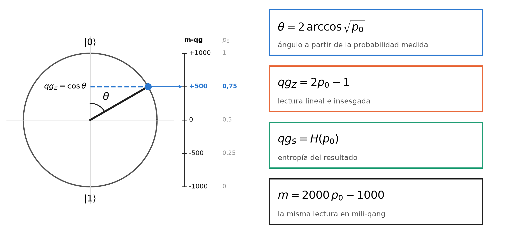
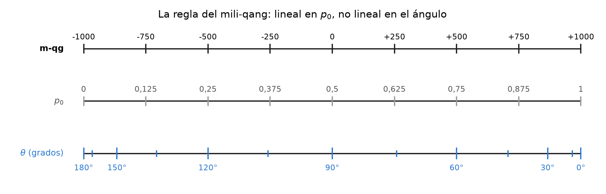
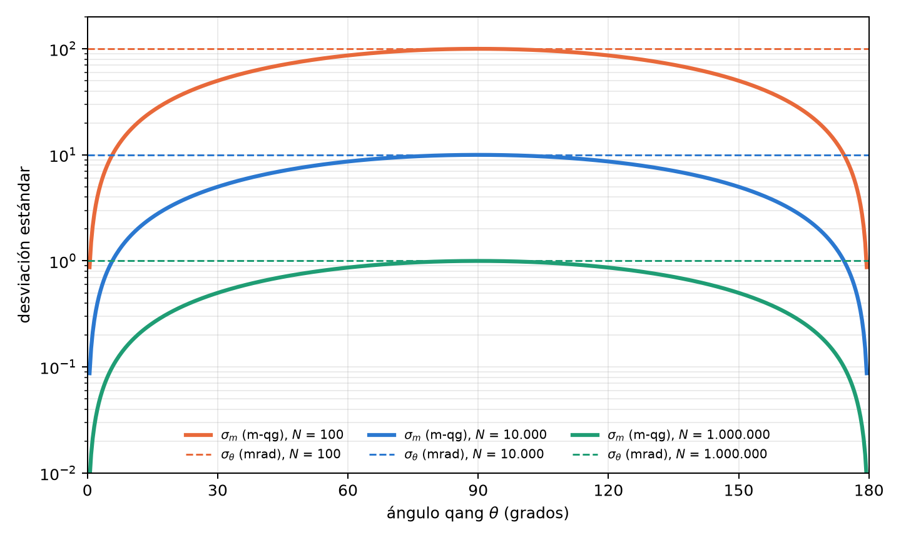
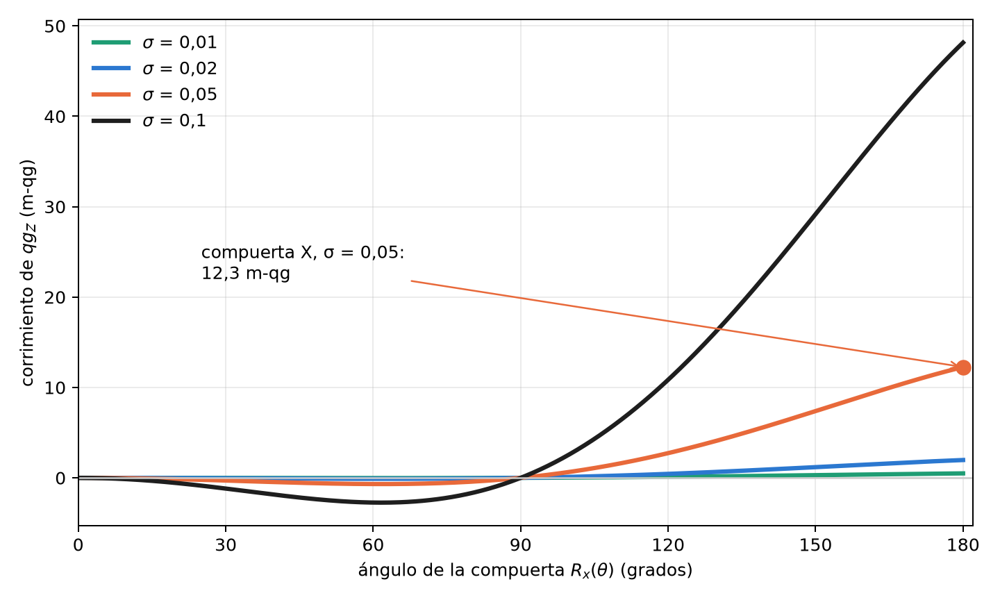
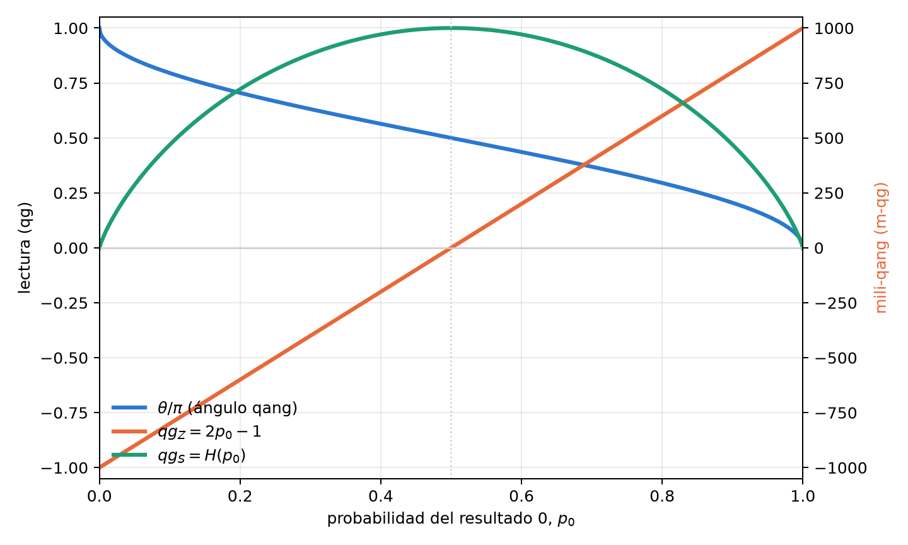

# La unidad qang: definición, mili-qang y la ecuación de probabilidad {#sec-cap01}

Un qubit se diseña con ángulos y se observa con frecuencias. Quien escribe un circuito elige rotaciones
$R_y(\theta)$; quien lo ejecuta recibe cuentas de ceros y unos. Entre ambas descripciones media una función
trigonométrica que casi nunca se nombra, y que es la fuente de varias dificultades prácticas: gradientes que
divergen, barras de error que se encogen o se inflan según el estado, y parámetros que no se pueden leer
directamente del experimento. Este capítulo construye la base del libro en tres pasos: la **definición** de la
unidad qang (qg), la **teoría del mili-qang** (su submúltiplo) y la **ecuación de probabilidad** que une ambas con
lo que se mide. Cada resultado se respalda con un gráfico calculado con el propio paquete (`qang.probability`,
§167), de modo que las figuras y el texto citan los mismos números.

## Definición del qang {#sec-definicion}

Todo estado puro de un qubit se escribe, salvo una fase global, como

$$
|\psi\rangle = \cos\frac{\theta}{2}\,|0\rangle + e^{i\varphi}\sin\frac{\theta}{2}\,|1\rangle ,
\qquad \theta\in[0,\pi],\ \varphi\in[0,2\pi).
$$

La pareja $(\theta,\varphi)$ es un punto de la esfera de Bloch y es la forma natural de *preparar* el estado: una
rotación $R_y(\theta)$ seguida de una fase $R_z(\varphi)$. Una medición en la base computacional no devuelve
$\theta$: devuelve, en cada disparo, el resultado 0 con probabilidad

$$
p_0 = \cos^2\frac{\theta}{2}\qquad\text{(regla de Born).}
$$

**Definición.** La unidad qang toma como coordenada primaria el valor esperado de $\sigma_z$, llamado *sesgo
polar*:

$$
\boxed{\;qg_Z = \langle\sigma_z\rangle = p_0 - p_1 = 2p_0 - 1 = \cos\theta\;}\qquad qg_Z\in[-1,1].
$$

De la misma probabilidad salen las otras dos lecturas de la unidad: el **ángulo qang**
$\theta=\arccos(qg_Z)\in[0,\pi]$ y la **dispersión de superposición** $qg_S=H(p_0)\in[0,1]$, la entropía de Shannon
del resultado (se estudia más abajo). La @fig-circulo resume la definición: el punto del círculo es el estado, su
proyección sobre el eje vertical es $qg_Z$, y la escala de la derecha da la misma lectura en mili-qang y en
probabilidad.

{#fig-circulo width=100%}

Tres propiedades hacen de $qg_Z$ una buena coordenada de trabajo:

1. **Es una biyección.** En $\theta\in[0,\pi]$, la función $\cos\theta$ es estrictamente decreciente y recorre
   $[-1,1]$: cada valor de $qg_Z$ corresponde a una única latitud de la esfera.
2. **Es directamente medible.** $\widehat{qg}_Z = (n_0-n_1)/N$ es el promedio de los resultados $\pm1$ de los
   disparos; no requiere inversión ni ajuste.
3. **Vale para cualquier estado.** Para un estado mixto, $qg_Z = \operatorname{Tr}(\rho\,\sigma_z)$, y se reduce a
   $\cos\theta$ cuando $\rho=|\psi\rangle\langle\psi|$ (§3).

El signo y el rango tienen una lectura física inmediata: $qg_Z=+1$ es el polo $|0\rangle$, $qg_Z=-1$ el polo
$|1\rangle$, y $qg_Z=0$ cualquier punto del ecuador, donde el resultado de la medición es máximamente incierto.

**Una unidad de ingeniería.** Una unidad útil no necesita ser una magnitud física nueva; necesita volver legible lo
que se mide. El decibelio no agrega física a la potencia: la expresa en una escala que vuelve sumables las
ganancias de una cadena de amplificadores. El qang cumple un papel análogo para el qubit: expresa su estado en la
escala en la que el experimento lo entrega, de modo que preparación, ruido y lectura se comparan en las mismas
unidades. Es una convención operativa, y como toda convención vale por lo que simplifica.

## Teoría del mili-qang {#sec-miliqang}

### Definición y escala

Las desviaciones que importan en un qubit real son pequeñas: errores de calibración, deriva, ruido de lectura.
Para expresarlas conviene un submúltiplo, el **mili-qang** (m-qg):

$$
1\ \text{qg} = 1000\ \text{m-qg},\qquad m = 1000\,qg_Z\ \in[-1000,\,+1000]\ \text{m-qg}.
$$

La escala va de $-1000$ m-qg en el polo $|1\rangle$ a $+1000$ m-qg en el polo $|0\rangle$, con el cero en el
ecuador. Un estado con $qg_Z=0{,}502$ está a $501{,}8$ m-qg; su diferencia con el ideal $0{,}5$ es de $1{,}8$ m-qg.
La misma definición vale para los otros ejes, $qg_X$ y $qg_Y$, con lo que todo el vector de Bloch se expresa en
m-qg.

### Lineal en la probabilidad, no lineal en el ángulo

Como $qg_Z=2p_0-1$, el mili-qang es **lineal en la probabilidad**: un m-qg equivale siempre a $\Delta p_0=0{,}0005$,
es decir, 0,05 puntos porcentuales, en cualquier lugar de la escala. En cambio **no es lineal en el ángulo**:

$$
\frac{dm}{d\theta} = -1000\,\sin\theta
\qquad\Longrightarrow\qquad
\Delta\theta \approx \frac{1}{1000\,\sin\theta}\ \text{rad por m-qg}.
$$

En el ecuador ($\theta=90^\circ$) un m-qg es exactamente un miliradián; a $\theta=30^\circ$ son dos. Cerca de un
polo la relación lineal deja de valer y hay que usar la exacta: un estado que está $\delta$ m-qg por debajo del polo
$|0\rangle$ forma con él el ángulo

$$
\theta_\delta = \arccos\!\left(1-\frac{\delta}{1000}\right)\approx\sqrt{\frac{2\delta}{1000}} .
$$

Un m-qg del polo son $0{,}0447$ rad ($2{,}56^\circ$); diez m-qg, $8{,}1^\circ$. La @fig-regla muestra la
consecuencia: sobre la regla del mili-qang, las marcas de probabilidad están equiespaciadas y las de ángulo se
amontonan en los polos. Por eso la unidad se define sobre la probabilidad y no sobre el ángulo: es la escala en la
que el instrumento entrega los datos.

{#fig-regla width=100%}

### Resolución por disparos

Con $N$ disparos, $\widehat{qg}_Z$ tiene varianza $\sin^2\theta/N$ (lo derivamos en la sección del arcoseno), de
modo que la desviación estándar de la lectura en mili-qang es

$$
\sigma_m = \frac{1000\,\sin\theta}{\sqrt N}\ \text{m-qg},
\qquad
N_\delta = \left(\frac{1000\,\sin\theta}{\delta}\right)^{2}
$$

donde $N_\delta$ es el número de disparos necesario para resolver $\delta$ m-qg con un sigma. En el ecuador, resolver
10 m-qg requiere $10^4$ disparos y resolver 1 m-qg, $10^6$. A $60^\circ$ y con 1000 disparos, $\sigma_m=27{,}4$ m-qg;
para bajar a 5 m-qg en ese mismo punto hacen falta 30 000 disparos. La @fig-ruido compara $\sigma_m$ con la
incertidumbre del ángulo, $\sigma_\theta=1/\sqrt N$: la lectura en m-qg es más precisa cerca de los polos, y la del
ángulo vale lo mismo en todo el círculo. Las dos curvas se tocan en el ecuador, donde un m-qg es un miliradián.

{#fig-ruido width=90%}

### Presupuesto de error de compuerta

La escala permite expresar un error de compuerta en las mismas unidades que la lectura. Si la amplitud de un pulso
tiene un error aleatorio relativo de desviación $\sigma$, el sesgo polar esperado tras $R_x(\theta)$ es

$$
\mathbb E[qg_Z] = \cos\theta\; e^{-\theta^2\sigma^2/2}
\qquad\Longrightarrow\qquad
\varepsilon_m = 1000\cos\theta\left(e^{-\theta^2\sigma^2/2}-1\right)\ \text{m-qg}
$$

(§160). El error acerca la lectura al ecuador: con $\sigma=0{,}05$, una compuerta $X$ ($\theta=\pi$) entrega
$qg_Z=-0{,}988$ en lugar de $-1$, un corrimiento de $12{,}3$ m-qg, y crece con el cuadrado del ángulo
(@fig-pulso). Una rotación de $\pi/2$ no se corre en absoluto, porque ya está en el ecuador. El capítulo 2 usa esta
fórmula para elegir, entre representaciones equivalentes de una misma compuerta, la de menor área de pulso.

{#fig-pulso width=90%}

## La ecuación de probabilidad del qang y del mili-qang {#sec-ecuacion}

Las secciones anteriores llevan a un único enunciado, que es la base de todo el libro: **todas las lecturas qang
de un qubit son funciones exactas de una sola probabilidad**, $p_0$:

$$
\boxed{\;
\theta = 2\arccos\sqrt{p_0},\qquad
qg_Z = 2p_0-1,\qquad
qg_S = H(p_0),\qquad
m = 2000\,p_0-1000\ \text{m-qg}
\;}
$$

y, en sentido inverso, la ecuación de probabilidad del mili-qang:

$$
p_0 = \frac{1000+m}{2000},\qquad \theta = \arccos\frac{m}{1000}.
$$

No hay aproximaciones: son cuatro lecturas de un mismo número. La @fig-lecturas las muestra juntas. $qg_Z$ y el
mili-qang son la misma recta, en dos escalas; el ángulo es monótono pero se empina en los polos; la entropía sube
hasta el ecuador y vuelve a bajar, por eso necesita una rama para invertirse. La @tbl-anclajes da los valores de
referencia.

{#fig-lecturas width=90%}

| $\theta$ | $p_0$ | $qg_Z$ | m-qg | estado |
|---|---|---|---|---|
| $0$ | $1$ | $+1$ | $+1000$ | polo $|0\rangle$ |
| $\pi/4$ | $0{,}854$ | $+0{,}707$ | $+707$ | |
| $\pi/3$ | $0{,}75$ | $+0{,}5$ | $+500$ | |
| $\pi/2$ | $0{,}5$ | $0$ | $0$ | ecuador ($|+\rangle$, $|{+i}\rangle$, …) |
| $2\pi/3$ | $0{,}25$ | $-0{,}5$ | $-500$ | |
| $\pi$ | $0$ | $-1$ | $-1000$ | polo $|1\rangle$ |

: Anclajes de la ecuación de probabilidad. {#tbl-anclajes}

### Más de dos resultados: la distancia estadística

La ecuación se generaliza a una medición con varios resultados. Para dos distribuciones $p=(p_k)$ y $q=(q_k)$, la
**distancia estadística de Wootters** (1981), o ángulo de Bhattacharyya, es

$$
d(p,q) = \arccos\sum_k\sqrt{p_k\,q_k}.
$$

Para dos resultados, la distancia entre $(p_0,1-p_0)$ y el polo $(1,0)$ es $\arccos\sqrt{p_0}=\theta/2$: el ángulo
qang es, salvo el factor 2, la distancia estadística entre lo que se mide y el estado de referencia. Con tres
resultados, por ejemplo, $p=(0{,}5;\,0{,}3;\,0{,}2)$ y $q=(0{,}4;\,0{,}4;\,0{,}2)$ están a $0{,}113$ rad. Esta es la
puerta por la que la unidad sale del qubit: la Parte II la usa para la información de Fisher y la métrica de
Fubini–Study, y la misma geometría vale para cualquier proporción medida, cuántica o no.

## Por qué medir en qg: la brecha geometría–probabilidad {#sec-bloch}

La relación $p_0=\cos^2(\theta/2)$ entre el parámetro de control y la cantidad observada es no lineal, y su derivada
se anula en los polos. Esto tiene consecuencias concretas. Si un algoritmo variacional quiere ajustar el estado en
función de lo que mide, la regla de la cadena introduce el factor

$$
\frac{dE}{dq} = -\frac{1}{\sin\theta}\,\frac{dE}{d\theta},
$$

que diverge en $\theta=0$ y $\theta=\pi$ (notas de investigación, §1). Y si se quiere estimar $\theta$ a partir de
$N$ disparos, la varianza de $\hat p_0$ cambia con el estado, de modo que la incertidumbre de cada lectura depende
de dónde esté el qubit (§5). Ninguno de los dos problemas es exótico: aparecen en cuanto se intenta razonar en
términos de lo que el experimento entrega, y la ecuación de probabilidad es la herramienta para tratarlos.

## Inversión y el signo de rama {#sec-inversion}

El ángulo se recupera con $\theta=\arccos(qg_Z)$. La inversión tiene un límite: $\cos\theta$ es par, de modo que
$qg_Z$ no distingue $\theta$ de $-\theta$. Mientras se trabaja en $[0,\pi]$ no hay problema, pero un optimizador que
necesita cruzar un polo queda atrapado. El remedio es medir también el signo del seno: el par $(qg_Z, s)$ con
$s=\operatorname{sign}(qg_X)$ es biunívoco en todo el círculo (§65). En la molécula de H₂ el óptimo variacional está
en $\theta\approx-0{,}22$; toda actualización que usa solo $qg_Z$ se detiene en el estado de Hartree–Fock, mientras
que la versión con signo llega a la energía exacta.

## La entropía del resultado: $qg_S$ {#sec-qgs}

El sesgo polar dice *hacia dónde* apunta el qubit; no dice cuán impredecible es la medición. Para eso está la
**dispersión de superposición**, la entropía de Shannon del resultado:

$$
qg_S = H(p_0) = -p_0\log_2 p_0 - (1-p_0)\log_2(1-p_0) \in [0,1].
$$

Como $qg_Z$ y $qg_S$ dependen de la misma población $p_0$, están ligadas por una identidad exacta y sin ramas
(§7):

$$
qg_S = H\!\left(\frac{1+qg_Z}{2}\right),
$$

válida para todo estado de un qubit, puro o mixto, cualquiera sea su preparación. Su derivada,
$\tfrac{d\,qg_S}{d\,qg_Z}=\tfrac12\log_2\tfrac{1-qg_Z}{1+qg_Z}$, diverge en los polos: es la contraparte entrópica
de la singularidad del gradiente. Cerca de un polo, un cambio mínimo del sesgo produce un cambio relativo enorme
de la entropía.

## Invertibilidad de $qg_S$ y sus barras de error {#sec-qgs-errores}

A diferencia de $qg_Z$, la entropía no es invertible en todo el dominio: $qg_S(\theta)=qg_S(\pi-\theta)$. La
población $p_0$ decrece de 1 a 0 en $[0,\pi]$ y $H$ crece hasta $p=\tfrac12$ y luego decrece, de modo que $qg_S$ es
estrictamente creciente en $[0,\pi/2]$ y estrictamente decreciente en $[\pi/2,\pi]$ (@fig-lecturas). La inversión
exige elegir una de las dos mitades (§2).

Estimar $qg_S$ con disparos finitos plantea un problema adicional: la entropía es plana en su máximo, y el método
delta da un error estándar nulo exactamente donde $qg_S\approx1$. La solución nativa de qang es construir el
intervalo de Wilson para $qg_Z$ y transformarlo con la identidad anterior; como $H$ es unimodal, la imagen es un
intervalo válido. Con 2000 repeticiones, ese intervalo mantuvo una cobertura de 0,90–0,99 en todos los casos
probados, incluso donde el intervalo de Wald o el bootstrap caían por debajo de 0,40 (§51).

## El ángulo qang como transformación arcoseno {#sec-arcoseno}

La propiedad estadística central de la unidad se obtiene propagando el ruido de disparo. Con
$\widehat{qg}_Z = 2\hat p_0-1$,

$$
\operatorname{Var}(\widehat{qg}_Z)=\frac{\sin^2\theta}{N},
\qquad
\operatorname{Var}(\hat\theta)\approx \operatorname{Var}(\widehat{qg}_Z)\left(\frac{d\theta}{d\,qg_Z}\right)^2
=\frac{\sin^2\theta}{N}\cdot\frac{1}{\sin^2\theta}=\frac1N .
$$

Los factores $\sin^2\theta$ se cancelan exactamente: **la incertidumbre del ángulo qang no depende del estado**
(§5), que es la línea punteada horizontal de la @fig-ruido. No es una coincidencia. Como $p_0=\cos^2(\theta/2)$, el
ángulo qang es, salvo la reflexión $\theta\to\pi-\theta$, la clásica transformación arcoseno de una proporción,
$\phi=2\arcsin\sqrt p$, introducida por Bartlett (1947), Anscombe (1948) y Freeman y Tukey (1950) precisamente para
estabilizar la varianza (§125).

La afirmación se verificó con sumas binomiales exactas, sin simulación: con $n=100$, $(n+\tfrac12)\operatorname{Var}
(\hat\theta)$ vale entre 1,000 y 1,001; la cobertura del intervalo $\hat\theta\pm z/\sqrt{n+1/2}$ queda entre 0,930 y
0,962 para $n\in\{30,100,1000\}$. La predicción falló en un caso, y conviene decirlo: con $np\approx2{,}5$ tanto el
intervalo angular como el de Wald pierden cobertura. La estabilización es asintótica, y el régimen de muy pocos
eventos requiere los intervalos exactos del capítulo 4.

## Estados mixtos y registros de varios qubits {#sec-mixtos}

Las definiciones se extienden sin cambios a estados mixtos y a registros:

- **Estados mixtos.** $qg_Z=\operatorname{Tr}(\rho\sigma_z)$ ya no determina el estado. La mezcla clásica de
  $|0\rangle$ con peso 0,2 y $|1\rangle$ con peso 0,8 tiene $qg_Z=-0{,}6$ y entropía de von Neumann 0,72, una
  combinación que ningún estado puro reproduce (§3). Para un qubit de longitud de Bloch $r<1$, la cancelación
  de la sección anterior deja de ser exacta:
  $\operatorname{Var}(\hat\theta)=\big[1+\tfrac{1-r^2}{r^2\sin^2\theta}\big]/N$, igual a la cota cuántica de
  Cramér–Rao $1/(Nr^2)$ en el ecuador (§45).
- **Registros.** Cada qubit tiene su perfil local, obtenido por traza parcial, y el registro tiene una entropía
  conjunta normalizada por el número de qubits (§4). El estado de Bell lo ilustra: cada qubit tiene $qg_Z=0$ y
  entropía local de 1 bit, pero la entropía conjunta normalizada es 0,5. El registro es globalmente puro y
  localmente mezclado; los perfiles locales no bastan para describirlo, y el capítulo 5 vuelve sobre este punto con
  el radio de Bloch.

## Alcance y límites de la base {#sec-alcance}

Conviene decir con precisión qué aporta esta base y qué no, antes de construir el resto del libro sobre ella.

**Lo que no es.** La unidad qang no es física nueva. El sesgo polar es el valor esperado de $\sigma_z$, el ángulo
qang es la transformación arcoseno de una proporción y el mili-qang es, matemáticamente, $1000\,\langle\sigma_z\rangle$.
Ninguna de estas lecturas contiene información que la probabilidad $p_0$ no tenga ya; la ecuación de probabilidad lo
dice explícitamente. Tampoco reduce los disparos que exige una precisión dada (capítulo 4).

**Lo que es.** Una escala de trabajo, en el sentido del decibelio: pone en las mismas unidades la preparación, el
error de compuerta, el ruido de disparo y la lectura, de modo que se suman, se comparan y se presupuestan. La
pregunta que importa es entonces empírica: ¿razonar en mili-qang predice lo que hace un procesador real?

**Primera prueba en hardware (§168).** Se respondió con un experimento pre-registrado en un qubit del procesador
superconductor IQM Garnet: 26 circuitos de 4000 disparos, con cuatro predicciones fijadas antes de la corrida. El
resultado fue mixto, y se informa completo:

- **El costo de una compuerta es medible y presupuestable en m-qg.** Encadenando de 3 a 41 compuertas $X$, el
  faltante de la lectura (corregida por los errores de lectura medidos en los polos) crece con una sola pendiente:
  **1,64 m-qg por compuerta $X$**, con $\chi^2$ por grado de libertad de 0,81. Tras 41 compuertas son 63 m-qg, ocho
  desviaciones estándar por encima de cero (@fig-hardware, izquierda). Que el crecimiento sea lineal y no
  cuadrático indica error incoherente, relajación durante los pulsos, y no una sobre-rotación coherente.
- **La escala hace visible un error que el modelo de lectura oculta.** La lectura afín predicha desde los polos
  encaja en el ecuador, pero los cuatro ángulos intermedios leen entre 16 y 55 m-qg por debajo (@fig-hardware,
  derecha). El procesador calibra bien los ángulos $0$, $\pi/2$ y $\pi$; los demás tienen un error de rotación de
  decenas de m-qg. La predicción pasó por la regla de 4 de 5, no limpiamente.
- **Una predicción falló.** Las diez copias del circuito del ecuador variaron la mitad de lo que permite el ruido de
  disparo binomial, algo que disparos independientes no pueden producir y que por azar ocurre con probabilidad
  0,013. Una sola corrida no decide si fue casualidad o una propiedad de cómo el dispositivo devuelve circuitos en
  lote.
- **Otra predicción estaba mal diseñada.** El ajuste de dos parámetros sobre cuatro puntos dejó una banda de
  extrapolación tan ancha que cualquier lectura pasaba. Se registra como defecto del diseño, no como éxito.

{#fig-hardware width=100%}

El balance: en un chip real, el mili-qang convirtió el error de una compuerta en un número presupuestable y expuso un
error de ángulo que el modelo usual no ve. Pero se probó en un qubit, una vez, y el ruido de disparo no describió la
dispersión de circuitos repetidos. La replicación en más qubits y en otro día queda pendiente, y el libro trata
esta base como sólida en lo matemático y prometedora, pero todavía no consolidada, en lo experimental.

## En código {#sec-codigo01}

El módulo `qang.probability` es la herramienta de análisis de este capítulo: lee conteos y devuelve todas las
lecturas, cada una con su intervalo.

```python
import math
from qang import probability as pb

pb.readings_from_p0(0.75)        # theta = 1.047 (60°), qg_Z = 0.5, qg_S = 0.811, 500 m-qg

# 750 ceros en 1000 disparos, frente a un objetivo qg_Z = 0.5
r = pb.analyze(750, 1000, target_qg_z=0.5)
r.milliqang                      # (500.0, 444.5, 551.7) m-qg: estimación e intervalo de Wilson
r.theta                          # (1.047, 0.986, 1.110) rad = 60.0°, 56.5°, 63.6°
r.qg_s                           # (0.811, 0.768, 0.852)
r.deviation_milliqang            # 0.0 m-qg respecto del objetivo

pb.angle_per_milliqang(math.pi / 2)        # 0.001 rad: un m-qg es un miliradián en el ecuador
pb.pole_angle(1.0)                         # 0.0447 rad: un m-qg por debajo del polo
pb.shots_for_resolution(10, math.pi / 2)   # 10000 disparos para resolver 10 m-qg
pb.pulse_error_milliqang(math.pi, 0.05)    # 12.3 m-qg: compuerta X con 5 % de error de amplitud
pb.statistical_angle([0.5, 0.3, 0.2], [0.4, 0.4, 0.2])   # 0.113 rad
```

Las figuras de este capítulo se generan con `tools/make_cap01_figures.py`, que usa las mismas funciones.

## Resumen {#sec-resumen01}

- **Definición.** El sesgo polar $qg_Z=\langle\sigma_z\rangle=2p_0-1=\cos\theta$ es biyectivo, medible directamente y
  válido para estados mixtos; el ángulo qang $\theta=\arccos qg_Z$ y la entropía $qg_S=H(p_0)$ completan la unidad.
- **Mili-qang.** $1\ \text{qg}=1000$ m-qg; la escala es lineal en la probabilidad (1 m-qg $=\Delta p_0=0{,}0005$) y
  no lineal en el ángulo (1 mrad en el ecuador, $2{,}56^\circ$ junto al polo). Resolver $\delta$ m-qg requiere
  $(1000\sin\theta/\delta)^2$ disparos, y los errores de compuerta se presupuestan en las mismas unidades.
- **Ecuación de probabilidad.** $\theta$, $qg_Z$, $qg_S$ y $m$ son funciones exactas de una sola probabilidad
  $p_0$; con varios resultados, el ángulo qang se generaliza a la distancia estadística de Wootters.
- **Estadística.** El ángulo qang es la transformación arcoseno de una proporción: su varianza es $1/N$ para todo
  estado puro, con una corrección conocida para estados mixtos.
- **Alcance.** La unidad no es física nueva sino una escala de trabajo. En hardware real (§168) midió un costo de
  1,64 m-qg por compuerta $X$, lineal en el número de compuertas, y expuso errores de ángulo de 16–55 m-qg; una
  predicción sobre el ruido de disparo falló y la replicación queda pendiente.
