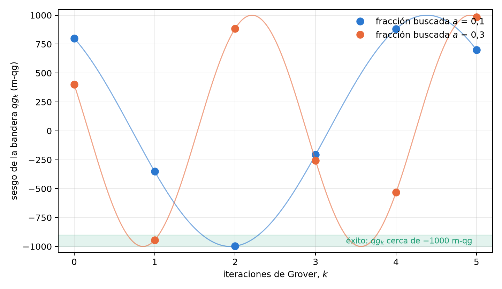

# Reflexiones, Householder y la dinámica de Grover {#sec-cap03}

El algoritmo de Grover es, en el fondo, una sucesión de reflexiones. Escrito en unidades qg, cada reflexión es una
matriz algebraica en el sesgo polar, la trayectoria del algoritmo es un polinomio de Chebyshev y la información que
aporta cada iteración tiene una fórmula cerrada. Todo descansa en la base del capítulo 1: la probabilidad de
transición entre dos estados es una probabilidad como $p_0$, con su propio ángulo qang y su lectura en m-qg, y el
sesgo de la bandera de Grover se lee en la misma escala. Este capítulo desarrolla esa lectura y la contrasta con lo
que ocurre cuando las compuertas tienen ruido, donde la lectura qg pierde frente a la herramienta más simple.

## Matrices de transición sin funciones trascendentes {#sec-transicion}

El capítulo 2 mostró que toda compuerta de un qubit tiene matriz de transición

$$
T(q)=\begin{pmatrix}\tfrac{1+q}{2}&\tfrac{1-q}{2}\\[0.5ex]\tfrac{1-q}{2}&\tfrac{1+q}{2}\end{pmatrix},
$$

doblemente estocástica y racional en $q$. Por construcción es *uniestocástica*: proviene de un unitario. Su
composición enseña la diferencia entre probabilidad clásica y amplitud cuántica. Dos canales clásicos de sesgos
$q_1$ y $q_2$ se componen multiplicando: $T(q_1)T(q_2)=T(q_1q_2)$. Dos rotaciones cuánticas sucesivas, en cambio, dan

$$
q_{12}=\cos(\theta_1+\theta_2)=q_1q_2-\sqrt{(1-q_1^2)(1-q_2^2)} .
$$

El término $-\sqrt{(1-q_1^2)(1-q_2^2)}$ es la interferencia: la parte transversal de cada estado, invisible en $T$,
que se suma en amplitud. Con $q_1=0{,}3$ y $q_2=-0{,}5$, la composición clásica da $-0{,}15$ y la cuántica $-0{,}976$:
en mili-qang, $-150$ frente a $-976$, una interferencia de 826 m-qg, cerca de la mitad de la escala. La matriz de
transición describe cada compuerta por separado, pero no la secuencia: para eso hacen falta las fases.

## El reflector de Householder en espacio qg {#sec-householder}

Una reflexión respecto del estado $|\psi\rangle$ es el operador de Householder $I-2|\psi\rangle\langle\psi|$. Para
$|\psi(q)\rangle=\sqrt{\tfrac{1+q}{2}}|0\rangle+\sqrt{\tfrac{1-q}{2}}|1\rangle$ resulta

$$
H(q)=I-2|\psi(q)\rangle\langle\psi(q)|=-q\,\sigma_z-\sqrt{1-q^2}\;\sigma_x ,
$$

una matriz hermítica, unitaria y con $H(q)^2=I$, cuyos coeficientes son los propios valores qg del estado: $q$ en
$\sigma_z$ y su parte transversal $\sqrt{1-q^2}$ en $\sigma_x$ (§166). En la esfera de Bloch es la rotación de ángulo
$\pi$ alrededor del eje del estado, compuesta con un cambio de signo global.

## El difusor de Grover como reflexión qg {#sec-difusor}

El difusor de Grover refleja respecto del estado inicial: $D=2|\psi\rangle\langle\psi|-I$. Comparando con la sección
anterior,

$$
D(q)=-H(q)=q\,\sigma_z+\sqrt{1-q^2}\;\sigma_x .
$$

En el plano de dos dimensiones del algoritmo (el estado "bueno", buscado, y el "malo", su complemento), el oráculo
es la reflexión respecto del eje malo y el difusor la reflexión respecto del estado inicial. El producto de dos
reflexiones es una rotación por el doble del ángulo entre sus ejes: esa es toda la dinámica de Grover.

## Probabilidad de transición entre estados qg {#sec-ptransicion}

La fidelidad entre dos estados puros se escribe con sus vectores qg $\mathbf r=(qg_X,qg_Y,qg_Z)$:

$$
|\langle\psi_1|\psi_2\rangle|^2=\frac{1+\mathbf r_1\cdot\mathbf r_2}{2}.
$$

Si los dos estados comparten el meridiano (la misma fase azimutal), queda en función de los sesgos polares solamente:

$$
P(q_1\to q_2)=\frac{1+q_1q_2+\sqrt{(1-q_1^2)(1-q_2^2)}}{2}.
$$

La condición importa: con azimutes distintos, los sesgos polares no bastan y hace falta la parte transversal
completa. La fórmula se verificó contra el producto interno en 200 pares aleatorios (§166).

**La probabilidad de transición en la ecuación del capítulo 1.** $P$ es una probabilidad, de modo que tiene sus
propias lecturas qang. Si $\gamma$ es el ángulo entre los dos vectores de Bloch, $\mathbf r_1\cdot\mathbf r_2=\cos\gamma$ y
$P=\cos^2(\gamma/2)$: es la regla de Born con $\gamma$ en el lugar de $\theta$. Por lo tanto

$$
2\arccos\sqrt P=\gamma,\qquad m_P = 2000\,P-1000 = 1000\;\mathbf r_1\cdot\mathbf r_2\ \text{m-qg}:
$$

el ángulo qang de la probabilidad de transición es el ángulo entre los estados, y su lectura en mili-qang es mil
veces el producto escalar de sus vectores qg. Es la distancia estadística de Wootters del capítulo 1 aplicada a dos
estados (@sec-ecuacion). Con $q_1=0{,}3$ y $q_2=-0{,}5$ en el mismo meridiano, $P=0{,}838$, $m_P=+676$ m-qg y
$\gamma=0{,}828$ rad, que es exactamente $|\theta_1-\theta_2|=|\arccos 0{,}3-\arccos(-0{,}5)|$.

## La trayectoria de Grover como polinomio de Chebyshev {#sec-chebyshev}

Sea $a=\sin^2 t$ la fracción de estados buenos, leída con un qubit bandera cuyo sesgo inicial es $qg_0=1-2a=\cos 2t$.
Cada iteración avanza el ángulo de amplitud en $2t$, de modo que tras $k$ iteraciones el ángulo es $(2k+1)t$ y

$$
qg_k=\cos\big((2k+1)\,2t\big)=T_{2k+1}(qg_0),
$$

con $T_m$ el polinomio de Chebyshev de primera especie, $T_m(\cos x)=\cos mx$ (§37). Por la ecuación de
probabilidad, la probabilidad de éxito es $P_k=(1-qg_k)/2$, y el éxito seguro es el polo $-1000$ m-qg. Por ejemplo,
con $a=0{,}1$, $qg_0=0{,}8$ y las iteraciones sucesivas dan $+800$, $-352$, $-997$ y $-206$ m-qg: el sesgo atraviesa
el polo en $k=2$ ($P_2=0{,}9986$) y luego se aleja (@fig-grover).

{#fig-grover width=90%}

La estructura de Chebyshev da gratis la información de Fisher de un disparo a profundidad $m=2k+1$. Como
$T_m'=mU_{m-1}$ y $1-T_m^2=(1-q^2)U_{m-1}^2$,

$$
F_m=\frac{m^2}{1-qg_0^2}:
$$

la profundidad multiplica por $m^2$ la información qg del capítulo 1, de manera uniforme a lo largo de la franja. Es
la forma qg del conocido factor $4m^2$ para el ángulo (Suzuki y colaboradores, 2020). En la escala del mili-qang, la
resolución sobre $qg_0$ con $N$ disparos a profundidad $m$ es $1000\sqrt{1-qg_0^2}/(m\sqrt N)$ m-qg: con $a=0{,}1$ y
100 disparos, 60 m-qg sin iterar y 12 m-qg a profundidad $m=5$.

## Límites analíticos: ángulo grueso y sobreoscilación {#sec-limites}

El número óptimo de iteraciones es $k^\ast=\operatorname{round}\!\big(\tfrac{\pi}{4t}-\tfrac12\big)$. Cuando la fracción
buscada $a=M/N$ es pequeña, $t$ es pequeño, $k^\ast\approx\tfrac{\pi}{4}\sqrt{N/M}$ y el redondeo apenas pesa. Cuando
$M/N$ no es despreciable, el ángulo por iteración es *grueso*: el sesgo salta en pasos grandes sobre la curva
$\cos((2k+1)2t)$ y puede pasarse del polo. Iterar de más no mejora; empeora, porque la rotación sigue de largo. La
lectura qg hace visible ese comportamiento: $qg_k$ recorre un coseno muestreado en puntos impares. Con $a=0{,}3$,
$k^\ast=1$ da $-944$ m-qg ($P=0{,}972$) y una iteración más salta a $+884$ m-qg ($P=0{,}058$), la curva naranja de la
@fig-grover.

### Grover con ruido

Con compuertas ruidosas el cuadro cambia, y es útil registrarlo tal como resultó (§63). En búsquedas de 4 a 6
qubits, con cada Z multicontrolada compilada en 14, 36 y 84 CNOT y ruido despolarizante en cada CNOT:

- **El ruido adelanta la mejor iteración y consume la ventaja.** Con $n=6$ y $p_2=0{,}005$ la mejor iteración pasa de
  4 a 1 y el costo por éxito verificado sube de 6,1 a 27,6 llamadas al oráculo, frente a 32 de la búsqueda clásica.
- **La fórmula qg falla bajo ruido de compuerta.** Si los resultados no buscados fueran uniformes, cada qubit
  tendría $qg_{Z,i}=\pm(NP-1)/(N-1)$, y los signos darían la respuesta y la magnitud la probabilidad de éxito sin
  conocerla. El ruido despolarizante no es uniforme tras el difusor, y la estimación sin etiquetas resultó peor que
  la frecuencia del resultado más común en todos los casos.
- **Leer la respuesta por signos pierde.** Con $n=5$, 100 disparos encuentran el elemento marcado el 66% de las veces
  con los signos qg y el 91% con la cadena de bits más frecuente.

El balance honesto: en la búsqueda de Grover el histograma de resultados es mejor estimador que la lectura qg por
qubit. qg aporta la imagen de Chebyshev y el factor de información, no un estimador superior.

## Estimación de amplitud {#sec-amplitud}

Donde la estructura de Chebyshev sí rinde es en la *estimación de amplitud*: usar profundidades crecientes para
estimar $a$ con menos consultas al oráculo que el muestreo directo. Con la estimación de máxima verosimilitud
(profundidades 0, 1, 2, 4, …, 100 disparos cada una), sin ruido, el error cae como consultas$^{-0,93\ldots-1,12}$
frente a consultas$^{-0,5}$ del Monte Carlo, y es 8,4–9,3 veces menor con 26 200 consultas (§37).

El ruido pone límites. Con despolarización $p=0{,}01$ por iteración, una verosimilitud que ignora el ruido termina
peor que Monte Carlo ($6{,}8\cdot10^{-3}$ frente a $2{,}7\cdot10^{-3}$), mientras que una que lo incluye conserva una
ventaja de 4×. Con $p=0{,}05$, ni siquiera la verosimilitud con ruido supera a Monte Carlo: más allá de una
profundidad del orden de $1/p$ las iteraciones casi no aportan señal.

En el simulador con ruido calibrado de IonQ (3 qubits, $a=0{,}3$, 36 000 consultas), la estimación fue precisa, con
error cuadrático medio de 0,0005–0,0015 y visibilidad ajustada de 0,965–0,985 por iteración, y entre 7 y 30 veces mejor
que un Monte Carlo realista, cuyo circuito de profundidad cero está sesgado por el ruido del dispositivo (§39).

## En código {#sec-codigo03}

```python
from qang import algebra, probability

algebra.householder_qg(0.45)        # -0.45 Z - 0.893 X, una reflexión: H @ H = I
algebra.grover_diffuser_qg(0.45)    # +0.45 Z + 0.893 X
P = algebra.transition_probability(0.3, -0.5)        # 0.838, mismo meridiano
algebra.transition_probability(0.3, -0.5, 0.0, 1.2)  # con azimutes distintos
probability.readings_from_p0(P)     # theta = 0.828 rad (el ángulo entre los estados), +676 m-qg
```

## Resumen {#sec-resumen03}

- La matriz de transición de una compuerta es racional en $q$, pero no se compone como la compuerta: la diferencia
  entre $q_1q_2$ y $\cos(\theta_1+\theta_2)$ es la interferencia.
- El reflector de Householder y el difusor de Grover son $\mp(q\,\sigma_z+\sqrt{1-q^2}\,\sigma_x)$.
- La probabilidad de transición entre dos estados es $(1+\mathbf r_1\cdot\mathbf r_2)/2$; en un mismo meridiano depende solo
  de los sesgos polares. Leída con la ecuación del capítulo 1, su ángulo qang es el ángulo entre los estados y su
  lectura es $1000\,\mathbf r_1\cdot\mathbf r_2$ m-qg.
- La trayectoria de Grover es $qg_k=T_{2k+1}(qg_0)$, con éxito seguro en $-1000$ m-qg, y la información de Fisher a
  profundidad $m$ es $m^2/(1-qg_0^2)$: la resolución en m-qg mejora en un factor $m$.
- Con ruido, la lectura qg por qubit pierde frente al histograma en la búsqueda; en la estimación de amplitud la
  ventaja se mantiene si el ruido entra en la verosimilitud, y termina cerca de la profundidad $1/p$.
