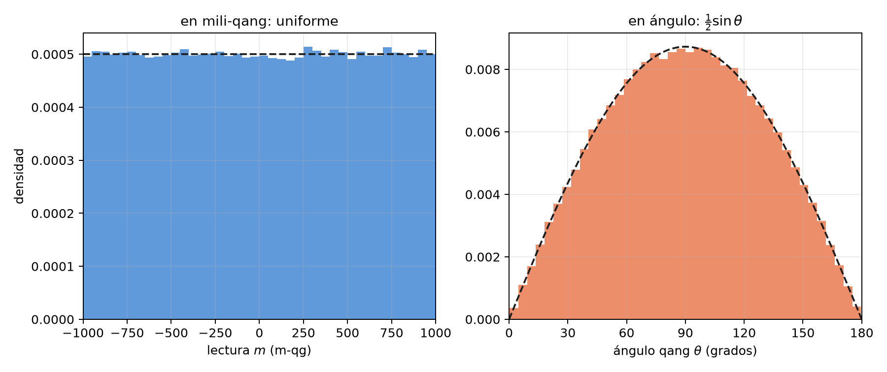
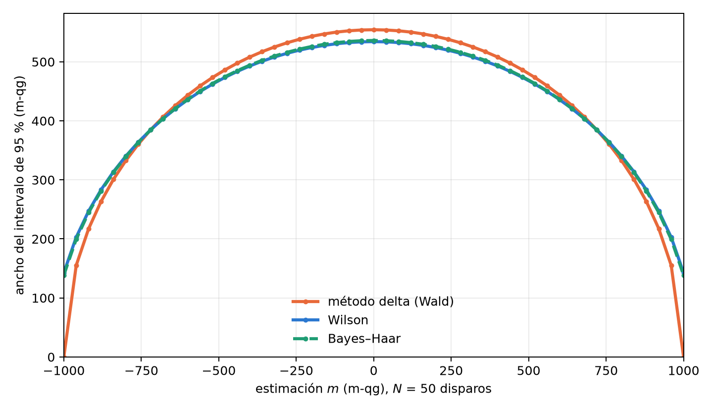

# Estadística de muestreo, inferencia bayesiana y la distribución de Haar {#sec-cap04}

Cada número que entrega un procesador cuántico es una estimación hecha con un número finito de disparos. Este
capítulo reúne las herramientas estadísticas de la unidad qg: cómo se propaga el ruido de disparo, qué distribución
previa es la natural para un qubit desconocido, cómo construir intervalos que no colapsan cerca de los polos, cómo
corregir los sesgos de las cantidades cuadráticas y cuántos disparos hace falta planificar. Todas se apoyan en la
base del capítulo 1: lo que se estima es siempre la probabilidad $p_0$, y como el mili-qang es lineal en ella, cada
intervalo y cada plan de disparos se expresa directamente en m-qg. Cierra con el fundamento matemático que explica
por qué $qg_Z$ es la lectura canónica.

## Propagación del ruido de disparo {#sec-delta}

Con $N$ disparos y $k_0$ resultados 0, el estimador natural es $\widehat{qg}_Z=2k_0/N-1$. Es insesgado y su varianza
es exactamente

$$
\operatorname{Var}(\widehat{qg}_Z)=\frac{1-qg_Z^2}{N}=\frac{\sin^2\theta}{N},
$$

que alcanza la cota de Cramér–Rao del parámetro $qg_Z$: no hay estimador insesgado mejor con la misma información.
En mili-qang es la resolución $\sigma_m=1000\sqrt{1-qg_Z^2}/\sqrt N$ del capítulo 1 (@fig-ruido).
Propagada al ángulo por el método delta, la varianza se vuelve constante, $\operatorname{Var}(\hat\theta)\approx1/N$,
como se vio en el capítulo 1 (§5). Las dos afirmaciones son compatibles: $qg_Z$ es la coordenada *curva*, con
información de Fisher $1/(1-qg_Z^2)$ por disparo, y $\theta$ la coordenada *plana*, con información 1 (capítulo 23).

El método delta es una aproximación de primer orden y falla donde la derivada se anula. Cerca de un polo,
$\widehat{qg}_Z$ vale exactamente $\pm1$ en una fracción apreciable de los experimentos, y el error estándar estimado
$\sqrt{(1-\widehat{qg}_Z^2)/N}$ se vuelve cero: el intervalo colapsa justo donde el estado es más extremo.

## La distribución de Haar en espacio qg {#sec-haar}

¿Qué se sabe de un qubit antes de medirlo? Si su estado es "cualquiera", la distribución natural es la medida de
Haar, la única invariante ante rotaciones. En unidades qg tiene una forma notable: **$qg_Z$ es uniforme en
$[-1,1]$**. Es el teorema de la caja de sombrero de Arquímedes: el área de una franja de la esfera entre dos
latitudes es proporcional a la diferencia de alturas, no de ángulos. Se comprobó con 200 000 estados de Haar (§15).

La consecuencia estadística es directa. Una previa uniforme en $qg_Z$ equivale a $p_0\sim\mathrm{Beta}(1,1)$, y con
$k_0$ ceros en $N$ disparos la posterior es

$$
p_0\mid k_0\ \sim\ \mathrm{Beta}(k_0+1,\ N-k_0+1),
$$

de la que se obtiene un intervalo de credibilidad para $qg_Z=2p_0-1$ con solo una función beta (`bayes_qg_estimate`,
implementada sin dependencias externas y verificada contra `scipy.stats.beta`).

La ecuación de probabilidad del capítulo 1 explica por qué esta previa es tan simple. Como $m=2000\,p_0-1000$ es
lineal, una distribución uniforme en $qg_Z$ es uniforme en mili-qang y uniforme en $p_0$: los tres enunciados son el
mismo. En el ángulo, en cambio, la misma medida tiene densidad $\tfrac12\sin\theta$ y se concentra en el ecuador
(@fig-haar). La previa "no informativa" depende de la escala en la que se la escribe, y la de Haar es plana
exactamente en la escala en la que se mide.

{#fig-haar width=100%}

## Intervalos exactos cerca de los polos {#sec-intervalos}

La comparación con 50 disparos muestra dónde importa la elección del intervalo (§15):

| caso | método delta | Wilson | Bayes–Haar |
|---|---|---|---|
| cerca de un polo ($\theta=0{,}08$): cobertura del intervalo de 95% | 7,6% | 92,4% | 92,4% |
| estados aleatorios de Haar: cobertura | 89,8% | 95,1% | 94,9% |

: Cobertura de intervalos de 95% con 50 disparos. {#tbl-cobertura}

Cerca del polo el método delta cubre el valor verdadero en menos de uno de cada diez experimentos; Wilson y la
posterior de Haar recuperan la cobertura nominal. Sobre estados de Haar, la media posterior tiene un error
cuadrático 4% menor que la frecuencia cruda.

La @fig-intervalos muestra la causa en mili-qang. Con 50 disparos, el ancho del intervalo del método delta cae a
cero en los extremos de la escala: con 50 ceros en 50 disparos da $[+1000,+1000]$ m-qg, un intervalo sin ancho. Con
48 ceros da $[+811,+1029]$ m-qg, que se sale de la escala por arriba. Wilson da $[+731,+978]$ y Bayes–Haar
$+885$ $[+731,+975]$ m-qg: anchos que no colapsan y quedan dentro de $[-1000,+1000]$.

{#fig-intervalos width=90%}

La lectura honesta de la tabla tiene dos partes. La previa de Haar repara el colapso del método delta y tiene una
justificación geométrica limpia; pero el intervalo de Wilson, estándar en estadística, logra la misma cobertura, y
la ganancia sobre una buena práctica frecuentista está en la estimación puntual y es modesta. **La unidad qg no
reduce el número de disparos que exige una precisión dada**; lo que aporta es hacer explícito el costo y elegir bien
el intervalo.

## Estimadores insesgados de segundo orden {#sec-qg2}

Las cantidades cuadráticas tienen un sesgo sistemático. El estimador directo $\widehat{qg}^{\,2}$ sobreestima $qg^2$ en
$(1-qg^2)/N$, porque el ruido de disparo siempre suma varianza. La corrección es exacta:

$$
\widehat{qg^2}=\frac{N\,\widehat{qg}^{\,2}-1}{N-1},\qquad \mathbb E\big[\widehat{qg^2}\big]=qg^2 ,
$$

válida para $N\ge2$ (`qg2_unbiased`). Puede dar valores negativos cuando $qg\approx0$, el precio de ser insesgado. Con
$N=20$ y $qg=0{,}6$, el estimador directo promedia 0,390 y el corregido 0,358, frente al valor verdadero 0,36.

Importa porque el radio de Bloch del capítulo 5, $r^2=qg_X^2+qg_Y^2+qg_Z^2$, es una suma de cuadrados: sin la
corrección, cada eje suma su sesgo y un estado entrelazado parece más puro de lo que es (§97). La misma corrección
interviene en la lectura del corrimiento gravitatorio con dos relojes (§126, capítulo 8).

## Planificar los disparos {#sec-plan}

La relación inversa, cuántos disparos hacen falta para un error dado, es la que se usa al preparar un experimento.
`plan_shots` convierte un error estándar objetivo del $qg_Z$ filtrado en disparos y en segundos estimados de
procesador, teniendo en cuenta la fracción de disparos que el filtro va a conservar (§143). Para un objetivo de 0,02
(20 m-qg) en dos circuitos por dispositivo planificó 3000–3400 disparos, y en 30 repeticiones el error del peor qubit
fue 0,021–0,023 (21–23 m-qg): el plan cumplió. Como referencia, la fórmula del capítulo 1 sin filtro da
$N=(1000\sin\theta/\delta)^2=2500$ disparos para 20 m-qg en el ecuador; el plan pide más porque descuenta los
disparos que el filtro va a descartar.

La predicción por qubit, en cambio, resultó 1,4–1,6 veces optimista en promedio, y su análisis es instructivo: los
qubits que fallaron eran los cercanos a un polo ($|qg|>0{,}8$, con cocientes de 2,4–3,1), cuyo $qg_Z$ el ruido aleja de
$\pm1$ y cuya varianza real es mayor que la ideal. El plan usa el peor qubit y por eso cumple; la opción segura, sin
suponer el valor de qg, es planificar para el caso peor, $qg=0$.

## Tomografía con pocos disparos y sombras clásicas {#sec-tomografia}

El vector de Bloch completo es $(qg_X,qg_Y,qg_Z)$, uno por eje de medición. Con 10 disparos por eje se compararon seis
estimadores sobre 2000 estados (§35). La versión qg aplica la previa de Haar eje por eje,
$\hat r_a=(2k_a-N)/(N+2)$, y proyecta sobre la bola:

| conjunto de estados | inversión lineal | inv. + proyección | máx. verosimilitud | **qg-Haar** | Jeffreys |
|---|---|---|---|---|---|
| puros de Haar | 0,203 | 0,157 | 0,150 | 0,165 | 0,159 |
| mixtos uniformes | 0,247 | 0,211 | 0,210 | **0,185** | 0,196 |
| puros cerca de un polo | 0,199 | 0,159 | 0,109 | 0,163 | 0,159 |
| muy mixtos ($|r|<0{,}3$) | 0,298 | 0,293 | 0,293 | **0,208** | 0,245 |

: Error cuadrático medio del vector de Bloch con 10 disparos por eje. {#tbl-tomografia}

La inversión lineal da estados no físicos en 52–88% de las corridas sobre estados puros. Sobre estados mixtos el
estimador qg-Haar es la mejor fórmula cerrada (12–29% por debajo de máxima verosimilitud); sobre estados puros, su
contracción hacia el centro es un error, y pierde frente a máxima verosimilitud, hasta 50% cerca de un polo. La
previa adecuada depende de qué estados se esperan.

¿Convendría medir con *sombras clásicas* (mediciones de Pauli aleatorias) en lugar de medir directamente las bases?
Para las cantidades que qang usa, no (§62). Con varianzas exactas por disparo sobre estados de 6 qubits, las sombras
necesitan 3–41 veces más disparos para el mismo error: 3,0–4,3× para todos los $qg_Z$, 5,8–8,1× para el testigo de
peso medio del registro, 9–12,6× para todos los correladores $ZZ$ y 41× para el desbalance filtrado. Solo igualan a la
medición directa cuando el objetivo son todas las cantidades de uno y dos qubits a la vez. Y el filtro por disparo no
existe con sombras: solo $3^{-6}=0{,}14\%$ de los disparos aleatorios tienen todos los qubits medidos en $Z$.

## El fundamento: Riesz–Fréchet {#sec-riesz}

Queda una pregunta conceptual: ¿por qué $qg_Z$ y no otra función de las poblaciones? Los operadores de un registro
de $n$ qubits forman un espacio de Hilbert de dimensión finita con el producto de Hilbert–Schmidt
$\langle A,B\rangle=\operatorname{Tr}(A^\dagger B)$, y las matrices densidad viven en él. El teorema de representación de
Riesz–Fréchet dice que todo funcional lineal continuo $f$ sobre un espacio de Hilbert tiene la forma
$f(x)=\langle y_f,x\rangle$ para un único $y_f$; en dimensión finita la continuidad es automática y el teorema se reduce
a álgebra lineal (apéndice F).

La aplicación es inmediata. $\rho\mapsto qg_Z(\rho)=\operatorname{Tr}(\rho\,\sigma_z)$ es lineal en $\rho$, así que tiene un
único representante, $\sigma_z$. Toda lectura lineal de un estado (un valor esperado, una población, un promedio por
disparo) es de esa forma, y $qg_Z$ es aquella cuyo representante es el observable $Z$. En cambio
$qg_S(\rho)=H(\langle0|\rho|0\rangle)$ es estrictamente cóncava en $\rho$: no hay operador que la represente. De ese
hecho estructural se siguen dos propiedades ya vistas: los funcionales lineales tienen estimadores insesgados por
promedio muestral y la entropía no (desigualdad de Jensen), y la identidad $qg_S=H((1+qg_Z)/2)$ muestra que $qg_S$ no
contiene información sobre el estado que el representante de $qg_Z$ no extraiga ya.

El mili-qang hereda esta propiedad: $m(\rho)=1000\,\operatorname{Tr}(\rho\,\sigma_z)$ también es lineal, con representante
$1000\,\sigma_z$, y por eso su estimador es el promedio de los disparos, sin sesgo. Es la razón de fondo por la que el
capítulo 1 definió la unidad sobre la probabilidad y no sobre el ángulo: $\theta=\arccos(qg_Z)$ no es lineal en
$\rho$, no tiene representante y su estimador directo tiene sesgo.

## Sin qang y con qang {#sec-comparacion04}

| acción | sin qang | con qang | diferencia |
|---|---|---|---|
| intervalo de confianza cerca de un polo | método delta: cobertura por debajo de 10% | Bayes–Haar, $\mathrm{Beta}(1,1)$: uniforme en m-qg, cobertura nominal | **a favor del método, no sólo de qang**: el intervalo de Wilson, sin qang, también la recupera; qang justifica la previa (Haar es uniforme en m-qg) |
| cantidades cuadráticas (radios, $qg^2$) | elevar al cuadrado la estimación: sesgo hacia arriba | $(N\widehat{qg}^{\,2}-1)/(N-1)$ | es el **estimador insesgado estándar**; qang lo empaqueta y lo aplica en todos los capítulos |
| cuántos disparos medir | varianza binomial del estado | $N=(1000\sin\theta/\delta)^2$ para resolver $\delta$ m-qg | **equivalente**; la fórmula en m-qg es la que se usa para planificar |
| medir cantidades qang | sombras clásicas | medición directa en $Z$ | 3–41 veces menos disparos, pero es una **elección de medición**, no un efecto de la unidad |
| justificar la lectura | — | Riesz–Fréchet: $qg_Z$ es la lectura lineal canónica | **a favor**: explica por qué se promedia $qg_Z$ y no el ángulo |

: Las acciones del capítulo sin la escala qang y con ella. {#tbl-comparacion04}

**Balance.** La estadística del capítulo es estadística clásica de proporciones. qang aporta la elección de
coordenada (uniforme bajo Haar, lineal por Riesz–Fréchet) que dice qué previa usar y qué promediar; la mejora de
cobertura existe también sin qang.

## En código {#sec-codigo04}

```python
import math
from qang import probability, statistics

statistics.bayes_qg_estimate(48, 50)     # posterior de Haar: qg_Z 0.885, intervalo [0.731, 0.975]
statistics.wilson_qg_estimate(48, 50)    # la alternativa frecuentista
statistics.qg2_unbiased(16, 20)          # qg^2 sin el sesgo (1 - qg^2)/N

probability.analyze(48, 50).milliqang    # (920.0, 730.8, 977.9) m-qg con el intervalo de Wilson
probability.shots_for_resolution(20, math.pi / 2)   # 2500 disparos para 20 m-qg en el ecuador
```

## Resumen {#sec-resumen04}

- $\widehat{qg}_Z$ es insesgado y alcanza la cota de Cramér–Rao; el método delta colapsa cerca de los polos, donde su
  intervalo en m-qg pierde el ancho o se sale de la escala.
- Bajo la medida de Haar, $qg_Z$ es uniforme en $[-1,1]$, es decir, uniforme en mili-qang y en $p_0$; la previa
  correspondiente es $\mathrm{Beta}(1,1)$ y da intervalos exactos con una función beta.
- Wilson y Bayes–Haar recuperan la cobertura nominal donde el método delta cubre menos de 10%; ninguno reduce los
  disparos necesarios.
- Las cantidades cuadráticas necesitan la corrección $(N\widehat{qg}^{\,2}-1)/(N-1)$; sin ella, los radios de Bloch se
  sobreestiman.
- Planificar con el peor qubit cumple el objetivo; los qubits cerca de un polo son los que el ruido más aleja.
- Para las cantidades de qang, medir directamente en $Z$ cuesta 3–41 veces menos disparos que las sombras clásicas.
- $qg_Z$, y con él el mili-qang, es la lectura lineal canónica por el teorema de Riesz–Fréchet; $qg_S$ y el ángulo no
  son lineales y no tienen representante.

## Notas bibliográficas {.unnumbered}

La cota de Cramér–Rao está en @cramer1946 y @rao1945, y la previa invariante, en @jeffreys1946. El intervalo de puntaje
es @wilson1927. Para muestrear la medida de Haar, véase @mezzadri2007; las sombras clásicas son @huang2020. El teorema
de representación de Riesz–Fréchet es @riesz1907 y @frechet1907. Las notas de investigación numeradas (§) que cita el
capítulo y los scripts que lo verifican están en el repositorio [@qangrepo]; la definición de la unidad qang, en
@monteverde2026.
