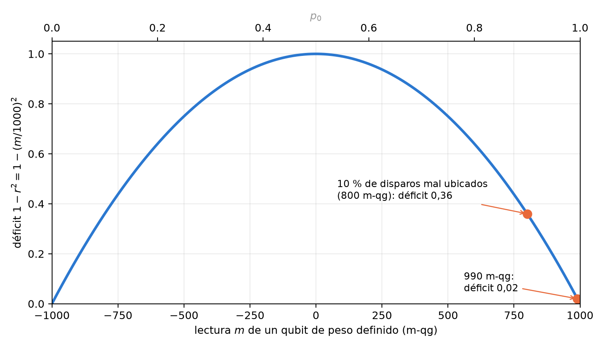
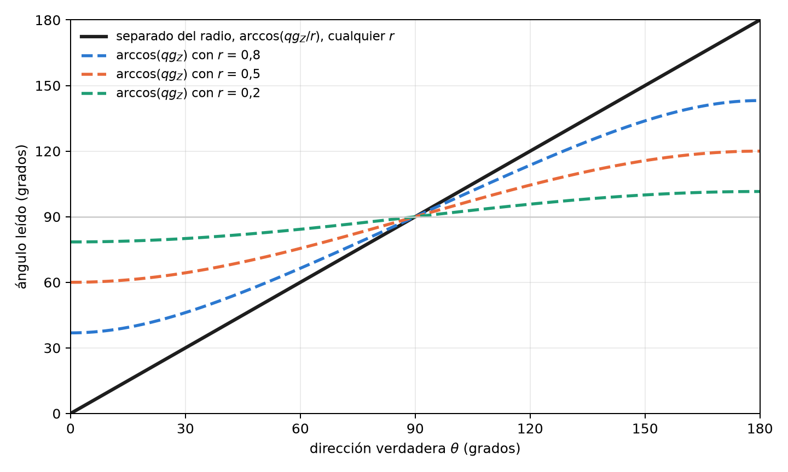
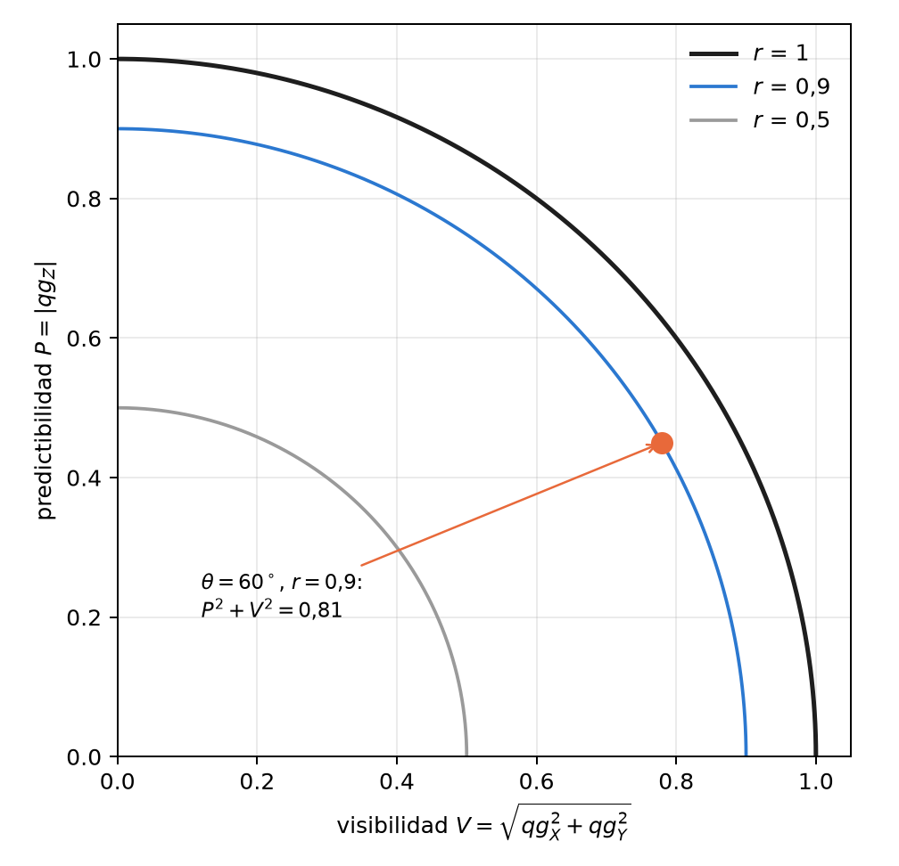

# El radio local de Bloch como medida de pureza y entrelazamiento {#sec-cap05}

La Parte I trató al qubit como un punto de la superficie de la esfera: un estado puro, una probabilidad $p_0$ y sus
cuatro lecturas. Un qubit que forma parte de un registro casi nunca es puro: está mezclado por el ruido o por su
entrelazamiento con los demás, y se ubica *dentro* de la esfera. Este capítulo agrega a la base del capítulo 1 la
cantidad que falta, el **radio local** $r$, y muestra que la ecuación de probabilidad sigue valiendo con un solo
cambio: el sesgo polar ya no es $\cos\theta$ sino $r\cos\theta$. Del radio salen una medida de entrelazamiento, una
forma de separar la dirección del estado de su pureza y la dualidad onda–partícula, todo leído en unidades qg.

## La ecuación de probabilidad con radio {#sec-radio-ecuacion}

Para un qubit en un estado mixto, su vector de Bloch $(qg_X,qg_Y,qg_Z)$ tiene longitud $r\le1$, y la regla de Born
en la base $Z$ se escribe

$$
p_0=\frac{1+qg_Z}{2}=\frac{1+r\cos\theta}{2}.
$$

Es la ecuación de probabilidad del capítulo 1 con el radio adentro: las lecturas $qg_Z=2p_0-1$ y $m=2000\,p_0-1000$
m-qg no cambian, pero ya no determinan el ángulo, porque un mismo $p_0$ puede venir de un estado puro inclinado o
de uno mezclado más cerca del polo. Cada eje tiene su propia probabilidad, $p_0^{(a)}$ en la base $a\in\{X,Y,Z\}$, y
el radio cuadrado es la suma de las tres lecturas al cuadrado (§97):

$$
r^2=qg_X^2+qg_Y^2+qg_Z^2=\frac{m_X^2+m_Y^2+m_Z^2}{10^6}=2\operatorname{Tr}\rho^2-1 .
$$

El radio es lineal en la pureza $\operatorname{Tr}\rho^2$: vale 1 en la superficie (estado puro) y 0 en el centro
(estado máximamente mezclado). La esfera de radio $r$ tiene área $4\pi r^2$, y el **déficit de superficie**
$4\pi(1-r^2)$ es el área que el qubit perdió; la biblioteca trabaja con $1-r^2$, que lleva la misma información.

## El déficit como medida de entrelazamiento {#sec-deficit}

Si el registro completo está en un estado puro, todo lo que le falta de radio a un qubit se debe a su
entrelazamiento con el resto. En ese caso $1-r_q^2=4\det\rho_q$ es el *one-tangle* del qubit $q$, que para dos
qubits es la concurrencia al cuadrado (Coffman, Kundu y Wootters, 2000), y su promedio sobre los qubits es el
entrelazamiento global de Meyer y Wallach (2002):

$$
Q=\frac1n\sum_q\left(1-r_q^2\right).
$$

Dos ejemplos fijan la escala. En el estado de Bell cada qubit está en el centro de su esfera, $r=0$, y $Q=1$. En el
estado W de 3 qubits cada uno tiene $r^2=1/9$ y $Q=0{,}889$. Si el estado global es mixto, el déficit mezcla
entrelazamiento y ruido y no puede separarlos: el radio mide entrelazamiento solo cuando se sabe, o se garantiza,
que el registro es puro. Leer $r^2$ cuesta tres configuraciones de medición para todo el registro (todos los qubits
en $X$, en $Y$ y en $Z$), no tres por qubit.

## El radio ante las compuertas y los algoritmos {#sec-radio-compuertas}

Una compuerta de un qubit rota la esfera y conserva el radio, también para qubits mixtos. SWAP intercambia los
radios de dos qubits. CNOT, CZ, iSWAP, Toffoli y Fredkin pueden llevar un qubit de una entrada producto al centro
($r=0$, desde entradas del tipo $|{+}0\rangle$ o $|{+}{+}\rangle$) y también devolverlo a la superficie; sobre estados de la base
computacional no crean déficit, porque actúan como permutaciones clásicas (§97). En los algoritmos, el radio de los
qubits de lectura dice dónde está la respuesta:

| algoritmo | $r^2$ de los qubits de lectura | lectura |
|---|---|---|
| Bernstein–Vazirani, Deutsch–Jozsa constante | 1 en cada qubit | salida producto: el $qg_Z$ local es toda la respuesta |
| Simon ($s=110$) | 0 en cada qubit | la respuesta está entera en las correlaciones |
| Grover ($n=5$), $k=0\ldots4$ | $1\to0{,}82\to0{,}66\to0{,}84\to0{,}998$ | entrelaza y desentrelaza; vuelve a 1 en el óptimo |
| conteo ($N=16$, $M=3$) | $(1-2M/N)^2=0{,}39$ | déficit $4(M/N)(1-M/N)=0{,}61$ |
| QAOA, anillo de 4, $p=1$ | 0,25 | el costo vive en $ZZ$ |

: El radio de los qubits de lectura en algoritmos estándar (§97). {#tbl-radio-algoritmos}

## Peso definido: el radio desde la base Z {#sec-peso-radio}

En un estado de peso de Hamming definido todos los $qg_X$ y $qg_Y$ locales son cero, de modo que $r_q=|qg_Z^{(q)}|$ y
el radio se lee solo con disparos en $Z$. Con la ecuación de probabilidad, el déficit queda

$$
1-r^2=1-\left(\frac{m}{1000}\right)^2=4\,p_0\,(1-p_0):
$$

**cuatro veces la varianza binomial del resultado**, la misma $p_0(1-p_0)$ que gobierna el ruido de disparo del
capítulo 1. La @fig-deficit la muestra sobre la escala del mili-qang. El déficit es nulo en los polos, máximo en el
ecuador y muy sensible cerca de un polo: un qubit a 990 m-qg tiene déficit 0,02, y uno a 800 m-qg, que es lo que da
un 10 % de disparos mal ubicados sobre un estado de la base, ya marca 0,36.

{#fig-deficit width=90%}

Este es el punto en que el filtro de simetría (capítulos 20–21) y el radio se encuentran. Bajo T1 igual en todos los
qubits, el estado filtrado es el estado puro sin ruido, así que el déficit filtrado es una medida exacta de
entrelazamiento. Las predicciones se registraron antes de correr (§98); sobre circuitos RBS de 4 y 6 qubits:

| ruido | error exacto del déficit, con qang | sin qang | MSE menor con el filtro |
|---|---|---|---|
| T1 igual | $<3\cdot10^{-15}$ | 0,061–0,370 | 30 de 30 |
| T1 desigual | 0,013–0,045 | 0,070–0,342 | 30 de 30 |
| desfase 0,01 | 0,031–0,307 | 0,080–0,352 | 24 de 30 |

: El déficit como medida de entrelazamiento bajo ruido, con y sin el filtro qg (§98). {#tbl-deficit-ruido}

Sobre estados producto el déficit filtrado es exactamente 0 con los tres ruidos, mientras que la lectura cruda marca
0,60–0,95 en cada qubit excitado solo por el decaimiento: entrelazamiento falso. Una predicción falló: se esperaba que
el error crudo fuera menor a media ocupación, y fue mayor (0,177 frente a 0,074), porque la cancelación de primer
orden vale solo en $p=1/2$ exacto.

En modelos de ruido de dispositivos reales (tres de IBM y dos de IonQ, §100), el filtro bajó el error del déficit
3,2–4,0× donde el déficit es grande, pero no sirvió como prueba de "no hay entrelazamiento": sobre un estado producto
quitó solo 15–33 % del déficit falso. La causa es la de la @fig-deficit: los errores dentro del sector dejan 10–21 %
de disparos mal ubicados, y cerca del polo eso ya se lee como 0,36. Un déficit pequeño necesita una calibración por
eco antes de interpretarse.

## Dirección y radio por separado {#sec-direccion}

El sesgo polar $qg_Z=r\cos\theta$ mezcla la dirección del vector con su longitud. La lectura habitual
$\theta=\arccos(qg_Z)$ se corre hacia el ecuador cada vez que el ruido acorta el vector. Con el radio, las dos cosas se
separan (§102):

$$
\theta=\operatorname{atan2}\!\left(\sqrt{qg_X^2+qg_Y^2},\,qg_Z\right)=\arccos\frac{qg_Z}{r}.
$$

Un estado a $30^\circ$ acortado a $r=0{,}8$ por ruido despolarizante tiene $qg_Z=0{,}693$: $\arccos(qg_Z)$ lee
$46{,}1^\circ$, y el ángulo separado lee los $30^\circ$ verdaderos. La @fig-direccion muestra el efecto para varios
radios: el ángulo ingenuo se aplana hacia $90^\circ$, y el separado no depende de $r$.

{#fig-direccion width=90%}

La separación tiene costo y no siempre gana. Con la misma cantidad total de disparos repartida en tres bases:

- **Despolarizante:** el ángulo separado es exacto y $\arccos(qg_Z)$ se equivoca hasta 0,70 rad cerca de los polos;
  con disparos, el error cuadrático medio baja 5,8×.
- **Desfase:** es donde pierde. El desfase no acorta $qg_Z$, así que $\arccos(qg_Z)$ es exacto, y el ángulo separado
  se corre 0,03–0,12 rad hacia los polos.
- **Sin ruido:** medir tres bases cuesta 1,6× en error cuadrático medio.
- **Dispositivos:** en los modelos de IBM el vector se acorta casi uniformemente y el ángulo separado es 5–9× más
  preciso. En IonQ ganó primero $\arccos(qg_Z)$, porque el compilador había eliminado pares de CX idénticos; en el
  conjunto de compuertas nativo el ángulo separado gana también ahí, 8,7–9,0× (§103).

La regla práctica: si el radio medido está cerca de 1, conviene $\arccos(qg_Z)$ con todos los disparos en $Z$; si
está claramente por debajo de 1 y el ruido no es desfase puro, conviene el ángulo separado.

## Dualidad onda–partícula e incertidumbre entrópica {#sec-dualidad}

El radio también ordena un resultado clásico de los fundamentos. La **predictibilidad** $P=|qg_Z|=|m|/1000$ mide
cuánto se sabe del camino (partícula) y la **visibilidad** $V=\sqrt{qg_X^2+qg_Y^2}$ mide el contraste de la
interferencia (onda). Su relación es exactamente el radio (Greenberger y Yasin, 1988; Englert, 1996):

$$
P^2+V^2=r^2\le1 .
$$

La desigualdad de dualidad es, en unidades qg, la afirmación de que el estado está dentro de la esfera, y es una
igualdad para los estados puros (@fig-dualidad). Un estado a $60^\circ$ con $r=0{,}9$ tiene $P=0{,}45$, $V=0{,}779$ y
$P^2+V^2=0{,}81$. Se verificó en 2000 estados aleatorios con una desviación máxima de $2{,}2\cdot10^{-16}$ (§127).

{#fig-dualidad width=60%}

La versión entrópica usa la dispersión $qg_S$ del capítulo 1 en dos bases. La relación de Maassen–Uffink, con la
corrección de Berta y colaboradores para estados mixtos, dice

$$
qg_S(Z)+qg_S(X)\ \ge\ 1+S(\rho),\qquad S(\rho)=H\!\left(\frac{1+r}{2}\right).
$$

Para el estado anterior la suma vale 1,349 y la cota 1,286. La cota es ajustada: el estado $|0\rangle$ la alcanza con
igualdad. De ahí sale una advertencia práctica. Con estimadores directos de la entropía (sin corregir), un estado puro
parece violar la relación en el 93 % de las corridas de 100 disparos, porque la entropía estimada tiene sesgo hacia
abajo; con la corrección de Miller–Madow, en el 37 %. Una prueba de la cota necesita estimadores corregidos o
intervalos, como los del capítulo 4.

## Estimar el radio con disparos {#sec-radio-disparos}

Como $r^2$ es una suma de cuadrados, hereda el sesgo de los estimadores cuadráticos del capítulo 4
(@sec-qg2): cada eje suma $(1-qg^2)/N$, y un estado entrelazado parece más puro de lo que es. La corrección exacta
$(N\widehat{qg}^{\,2}-1)/(N-1)$ se aplica eje por eje (`radius2_estimate`), y en un estado de peso definido basta con
el eje $Z$.

## En código {#sec-codigo05}

```python
import math
import numpy as np
from qang import complementarity, formulation, statistics

bell = np.array([1, 0, 0, 1]) / math.sqrt(2)
formulation.radius_profile(bell, 2)          # [0.0, 0.0]: cada qubit en el centro
w = np.zeros(8); w[[1, 2, 4]] = 1 / math.sqrt(3)
formulation.meyer_wallach(w, 3)              # 0.889: entrelazamiento global del estado W
formulation.weight_sector_radius([0.99, 0.8])    # [0.0199, 0.36]: déficit desde qg_Z (990 y 800 m-qg)

formulation.direction_from_qg(0.4, 0.0, 0.6928)  # (0.524, 0.0, 0.8): θ = 30° separado de r = 0.8
complementarity.duality_sum(0.779, 0.0, 0.45)    # 0.81 = P² + V² = r²
complementarity.entropic_sum(0.45, 0.779)        # 1.35 ≥ cota 1.29
```

Las figuras se generan con `tools/make_cap05_figures.py`.

## Resumen {#sec-resumen05}

- Con un estado mixto, la ecuación de probabilidad del capítulo 1 sigue valiendo con $qg_Z=r\cos\theta$; el radio
  local $r^2=qg_X^2+qg_Y^2+qg_Z^2=2\operatorname{Tr}\rho^2-1$ es la lectura que falta.
- Si el registro es puro, el déficit $1-r^2$ es el one-tangle y su promedio es la medida de Meyer–Wallach; con un
  estado global mixto, mezcla entrelazamiento y ruido.
- En peso definido, $1-r^2=4p_0(1-p_0)$ se lee solo en $Z$, y con el filtro bajo T1 igual es exacto; cerca de un polo,
  pocos disparos mal ubicados lo inflan, y en dispositivos un déficit chico requiere calibración.
- $\theta=\arccos(qg_Z/r)$ separa la dirección de la pureza: gana con ruido despolarizante y pierde con desfase puro.
- La dualidad onda–partícula es $P^2+V^2=r^2$, y la incertidumbre entrópica acota $qg_S(Z)+qg_S(X)$ por $1+S(\rho)$.
