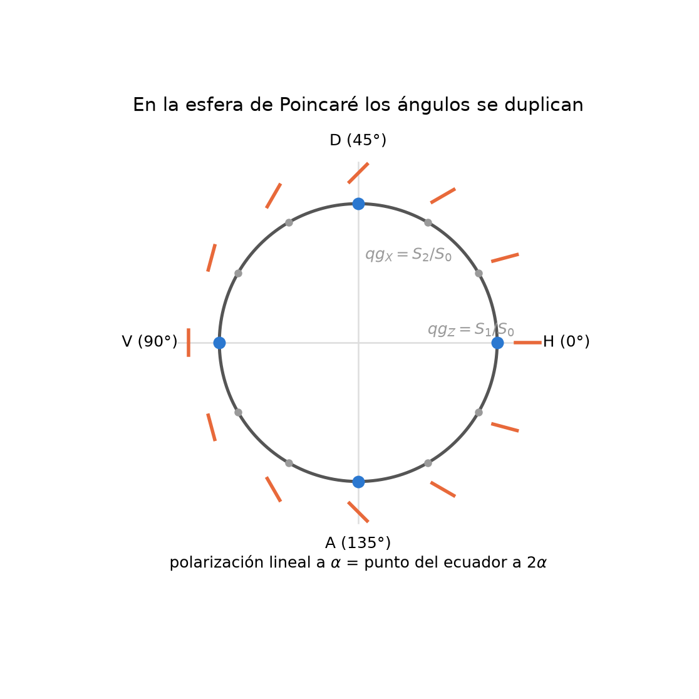
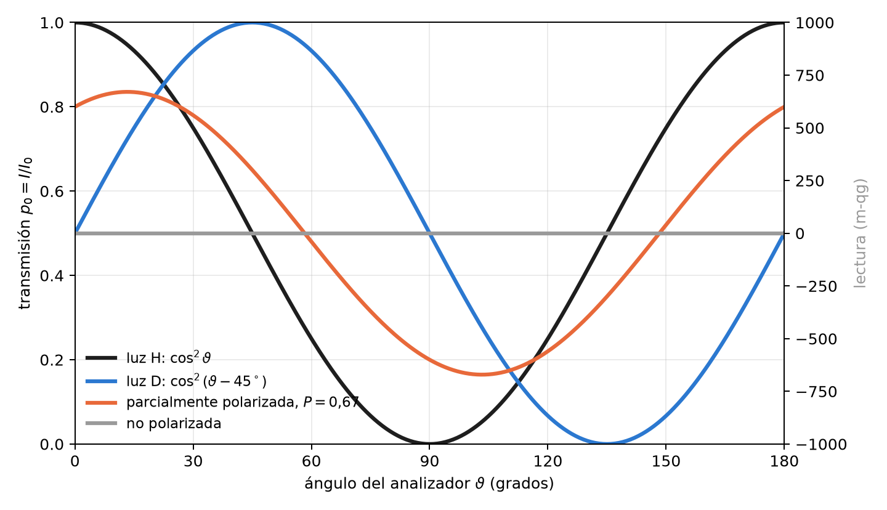
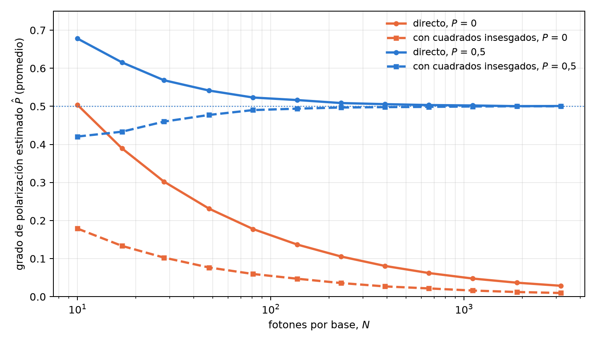

# Polarización óptica y parámetros de Stokes en unidades qg {#sec-cap06}

La polarización de un fotón es un qubit, y la óptica clásica de la polarización es, sin cambios, la física de un
qubit escrita con otros nombres. Los capítulos 1 a 5 construyeron esa física con cuatro piezas: la ecuación de
probabilidad $p_0=\cos^2(\theta/2)$ y su lectura $qg_Z=2p_0-1$ (capítulo 1), la regla de compuertas y la probabilidad
de transición entre dos vectores qg (capítulos 2 y 3), la estadística de los conteos (capítulo 4) y el radio local
que separa dirección y pureza (capítulo 5). Este capítulo no agrega ninguna pieza: muestra que el laboratorio de
óptica ya las usa todas.

La idea central es que un polarizador es una medición de dos resultados, pasa o no pasa, y que su transmisión es
exactamente la probabilidad $p_0$ de la ecuación qang. De ahí salen, en este orden, la ley de Malus (@sec-malus), los
parámetros de Stokes (@sec-stokes), el grado de polarización (@sec-grado), el cálculo de Mueller (@sec-mueller) y la
polarimetría por conteo de fotones (@sec-polarimetria), todo en qg y en mili-qang (§83). Cada identidad se deduce
aquí paso a paso; el capítulo cierra con el balance de qué cambia y qué no al usar la escala qang
(@sec-comparacion06).

## El fotón polarizado como qubit {#sec-foton-qubit}

**Intuición.** Una onda plana que se propaga en una dirección fija tiene su campo eléctrico en el plano transversal,
y ese plano tiene dos dimensiones. Dos amplitudes complejas, una por cada dirección transversal, describen por
completo la polarización: es la definición de un qubit.

**Formalismo.** Con la base horizontal y vertical, el vector de Jones es

$$
|E\rangle=E_H|H\rangle+E_V|V\rangle,\qquad |H\rangle\equiv|0\rangle,\quad |V\rangle\equiv|1\rangle,
$$

normalizado a $\langle E|E\rangle=1$ para un fotón. La luz real fluctúa, y lo que se mide son promedios
cuadráticos del campo. Esos promedios forman la matriz de coherencia, que normalizada por la intensidad es el
operador densidad de los capítulos anteriores:

$$
\rho=\frac{\langle\,|E\rangle\langle E|\,\rangle}{\operatorname{Tr}\langle\,|E\rangle\langle E|\,\rangle}
=\frac{1}{2}\left(\mathbb 1+qg_X\,\sigma_x+qg_Y\,\sigma_y+qg_Z\,\sigma_z\right)
=\frac{1}{2}\left(\mathbb 1+\mathbf r\cdot\boldsymbol\sigma\right),
$$

con $\mathbf r=(qg_X,qg_Y,qg_Z)$ el vector qg de la luz y $qg_P=\operatorname{Tr}(\rho\,\sigma_P)$, como en el
capítulo 5 (@sec-radio-ecuacion).

**La duplicación de ángulos.** La luz polarizada linealmente a un ángulo $\alpha$ respecto de la horizontal es
$|\alpha\rangle=\cos\alpha\,|H\rangle+\sin\alpha\,|V\rangle$. Sus valores qg son

$$
qg_Z=\cos^2\alpha-\sin^2\alpha=\cos2\alpha,\qquad qg_X=2\sin\alpha\cos\alpha=\sin2\alpha,\qquad qg_Y=0 .
$$

El estado está en el meridiano $qg_Y=0$ de la esfera, a un ángulo polar $\theta=2\alpha$: **el ángulo qang es el doble
del ángulo físico**. Por eso dos polarizaciones ortogonales, H y V, separadas $90^\circ$ en el laboratorio, son
puntos opuestos de la esfera, separados $180^\circ$, es decir, 500 qga (@fig-angulos). La duplicación no es una
convención: girar un polarizador $180^\circ$ lo deja igual, mientras que un punto de la esfera necesita $360^\circ$
para volver a su lugar.

{#fig-angulos width=62%}

## La ley de Malus como ecuación de probabilidad {#sec-malus}

### Luz linealmente polarizada {#sec-malus-pura}

Un polarizador ideal orientado a $\vartheta$ deja pasar la componente del campo a lo largo de su eje y absorbe la
perpendicular. Como operador es el proyector $\Pi_\vartheta=|\vartheta\rangle\langle\vartheta|$, con
$\Pi_\vartheta^2=\Pi_\vartheta$: no es una compuerta, es una medición con dos resultados. Para luz lineal a $\alpha$ y
$\Delta=\vartheta-\alpha$, la fracción transmitida es

$$
p_0=\lVert\Pi_\vartheta|\alpha\rangle\rVert^2=\lvert\langle\vartheta|\alpha\rangle\rvert^2
=\left(\cos\vartheta\cos\alpha+\sin\vartheta\sin\alpha\right)^2=\cos^2\Delta .
$$

Es la ley de Malus. Para un haz intenso es una fracción de intensidad, $I=I_0\cos^2\Delta$; para un fotón individual
es una probabilidad. La comparación con la regla de Born del capítulo 1, $p_0=\cos^2(\theta/2)$, es inmediata:
$\theta=2\Delta$, y la lectura en mili-qang es

$$
m=1000\,qg_Z=1000\cos2\Delta .
$$

Un analizador girado $30^\circ$ respecto de la luz transmite $p_0=0{,}75$: es el estado de $\theta=60^\circ$ (166,7 qga)
y $+500$ m-qg del círculo qang del capítulo 1 (@fig-circulo). Aquí conviene recordar la distinción del capítulo 1:
los $60^\circ$ son un ángulo y se expresan en qga; los $+500$ son una lectura, lineal en la probabilidad, y se expresan
en m-qg.

### Luz con cualquier polarización {#sec-malus-general}

Para luz pura o parcialmente polarizada la transmisión es $p_0=\operatorname{Tr}(\rho\,\Pi_\vartheta)$. El proyector
tiene la misma forma que $\rho$, con el vector qg del estado que el analizador deja pasar,

$$
\Pi_\vartheta=\frac12\left(\mathbb 1+\mathbf a\cdot\boldsymbol\sigma\right),\qquad
\mathbf a=(\sin2\vartheta,\,0,\,\cos2\vartheta),
$$

y con $\operatorname{Tr}(\sigma_i\sigma_j)=2\delta_{ij}$ y $\operatorname{Tr}\sigma_i=0$ queda

$$
p_0=\frac14\operatorname{Tr}\!\left[(\mathbb 1+\mathbf r\cdot\boldsymbol\sigma)(\mathbb 1+\mathbf a\cdot\boldsymbol\sigma)\right]
=\frac{1+\mathbf r\cdot\mathbf a}{2}
=\frac{1+qg_Z\cos2\vartheta+qg_X\sin2\vartheta}{2}.
$$ {#eq-malus-general}

Es la probabilidad de transición del capítulo 3 entre dos vectores qg (@sec-ptransicion), y su lectura en mili-qang es
$m=1000\,\mathbf r\cdot\mathbf a$. La componente circular $qg_Y$ no aparece: un polarizador lineal, en cualquier
orientación, es ciego a ella.

**Máximo, mínimo y contraste.** Con $P_{\text{lin}}=\sqrt{qg_Z^2+qg_X^2}$ y $\tan2\psi=qg_X/qg_Z$, el producto escalar
es $\mathbf r\cdot\mathbf a=P_{\text{lin}}\cos(2\vartheta-2\psi)$, de modo que

$$
p_0^{\max}=\frac{1+P_{\text{lin}}}{2}\ \text{en}\ \vartheta=\psi,\qquad
p_0^{\min}=\frac{1-P_{\text{lin}}}{2}\ \text{en}\ \vartheta=\psi+90^\circ,\qquad
p_0^{\max}-p_0^{\min}=P_{\text{lin}} .
$$

El contraste de la curva al girar el polarizador mide la parte lineal de la polarización, no el grado de
polarización total; los dos coinciden solo si $qg_Y=0$.

La @fig-malus muestra cuatro casos: luz H ($\cos^2\vartheta$), luz D (la misma curva corrida $45^\circ$), luz no
polarizada (siempre $\tfrac12$, es decir, 0 m-qg) y luz parcialmente polarizada con $qg_Z=0{,}6$ y $qg_X=0{,}3$. Esta
última transmite 0,80 a $0^\circ$, un máximo de 0,835 a $13{,}3^\circ$ y un mínimo de 0,165 a $103{,}3^\circ$. Como no tiene
componente circular, la diferencia entre máximo y mínimo, 0,671, es su grado de polarización. Si a esa misma luz se
le agrega $qg_Y=0{,}4$, la curva no cambia y el contraste sigue en 0,671, pero el grado de polarización sube a 0,781:
para verlo hace falta una lámina de cuarto de onda delante del polarizador (@sec-mueller).

{#fig-malus width=90%}

## Los parámetros de Stokes son valores qg {#sec-stokes}

### Definición operacional {#sec-stokes-def}

Stokes definió sus cuatro parámetros como sumas y diferencias de intensidades detrás de seis analizadores:

$$
S_0=I_H+I_V,\qquad S_1=I_H-I_V,\qquad S_2=I_D-I_A,\qquad S_3=I_R-I_L .
$$

Dividir por $S_0$ convierte cada intensidad en una probabilidad, y cada diferencia en un $2p_0-1$ en su propia base.
Con $|H\rangle=|0\rangle$ y $|V\rangle=|1\rangle$, los parámetros de Stokes normalizados son entonces los tres valores qg,
y la esfera de Poincaré es la esfera de Bloch:

| valor qg | Stokes | analizador | lectura |
|---|---|---|---|
| $qg_Z$ | $S_1/S_0$ | H / V | $p_H-p_V$ |
| $qg_X$ | $S_2/S_0$ | D / A, a $\pm45^\circ$ | $p_D-p_A$ |
| $qg_Y$ | $S_3/S_0$ | R / L, circular | $p_R-p_L$ |

: Los parámetros de Stokes normalizados como valores qg (§83). {#tbl-stokes}

La primera fila es la ecuación de probabilidad del capítulo 1. La segunda es la @eq-malus-general evaluada en
$\vartheta=\pm45^\circ$: $p_D-p_A=qg_X$. La tercera necesita la base circular, y la convención de la circular derecha
cambia de un texto a otro; aquí $|R\rangle=(|H\rangle+i|V\rangle)/\sqrt2$, de modo que $S_3>0$ significa $qg_Y>0$ (la
biblioteca acepta la convención opuesta con `circular_sign=-1`). Como cada parámetro es $2p_0-1$ en su propia base,
cada uno se expresa en mili-qang con la ecuación del capítulo 1.

### La elipse de polarización {#sec-elipse}

El extremo del campo eléctrico describe una elipse, con orientación $\psi$ de su eje mayor y elipticidad $\chi$
($\tan\chi$ es el cociente de los semiejes). En términos de esos dos ángulos, el vector qg es

$$
qg_Z=P\cos2\chi\cos2\psi,\qquad qg_X=P\cos2\chi\sin2\psi,\qquad qg_Y=P\sin2\chi ,
$$

con $P$ la longitud del vector (@sec-grado). Invirtiendo,

$$
\psi=\tfrac12\operatorname{atan2}(qg_X,qg_Z),\qquad \chi=\tfrac12\arcsin\frac{qg_Y}{P} .
$$

La elipse se lee con los ángulos del vector qg divididos por dos: es la duplicación de @sec-foton-qubit en sus dos
direcciones. Para la luz parcial del ejemplo, $\psi=13{,}3^\circ$, el ángulo donde la @fig-malus tiene su máximo, y
$\chi=0$; con $qg_Y=0{,}4$ agregado, $\chi=15{,}4^\circ$.

Una precisión sobre las dos esferas. Son la misma, pero cada tradición elige un polo distinto: la óptica pone las
polarizaciones circulares en los polos y mide $2\chi$ como latitud; qang pone en los polos los dos resultados de la
medición, H y V. El ángulo polar qang de una luz pura es por lo tanto $\cos\theta=\cos2\chi\cos2\psi$, y coincide con
$2\psi$ solo para luz lineal.

## Grado de polarización y pureza {#sec-grado}

### El grado de polarización es el radio {#sec-grado-radio}

La luz parcialmente polarizada es un estado mixto. Su grado de polarización es la longitud del vector qg, el radio
del capítulo 5 (@sec-radio-ecuacion):

$$
P=\sqrt{qg_X^2+qg_Y^2+qg_Z^2}=r,\qquad \operatorname{Tr}\rho^2=\frac{1+P^2}{2}.
$$

La segunda igualdad sale de $(\mathbf r\cdot\boldsymbol\sigma)^2=P^2\,\mathbb 1$:

$$
\operatorname{Tr}\rho^2=\frac14\operatorname{Tr}\!\left[\mathbb 1+2\,\mathbf r\cdot\boldsymbol\sigma+P^2\,\mathbb 1\right]
=\frac{2+2P^2}{4}.
$$

Los autovalores de $\rho$ son $(1\pm P)/2$, y con $\mathbf n=\mathbf r/P$ la descomposición espectral se reordena como

$$
\rho=P\,\frac{\mathbb 1+\mathbf n\cdot\boldsymbol\sigma}{2}+(1-P)\,\frac{\mathbb 1}{2} :
$$

una fracción $P$ de luz totalmente polarizada en la dirección $\mathbf n$ y una fracción $1-P$ de luz no polarizada.
Es la descomposición clásica de la óptica, y aquí es la lectura de $r$ como radio: la luz no polarizada está en el
centro de la esfera, la totalmente polarizada en su superficie.

### El despolarizador separa dirección y radio {#sec-despolarizador}

Un despolarizador ideal tiene matriz de Mueller $\operatorname{diag}(1,d,d,d)$: acorta el vector en un factor $d$ y no
cambia su dirección. Es el caso en que el capítulo 5 separa dirección y radio (@sec-direccion): con $d=0{,}7$, la luz
del ejemplo pasa de $P=0{,}671$ a $P=0{,}470$, y la orientación de su elipse sigue en $13{,}3^\circ$. El sesgo polar, en
cambio, cae de 0,60 a 0,42, y la lectura ingenua $\arccos(qg_Z)$ pasa de $53{,}1^\circ$ a $65{,}2^\circ$: un ensanchamiento
falso de 12° atribuible al ruido. El ángulo separado $\arccos(qg_Z/P)=26{,}57^\circ$ (73,8 qga en la escala del
capítulo 1) no cambia.

| lectura | antes | después de $d=0{,}7$ | ¿cambia? |
|---|---|---|---|
| grado de polarización $P$ | 0,671 | 0,470 | sí: es lo que el despolarizador hace |
| sesgo polar $qg_Z$ | 0,60 (600 m-qg) | 0,42 (420 m-qg) | sí |
| ángulo ingenuo $\arccos(qg_Z)$ | $53{,}1^\circ$ | $65{,}2^\circ$ | sí: $12^\circ$ falsos |
| ángulo separado $\arccos(qg_Z/P)$ | $26{,}57^\circ$ (73,8 qga) | $26{,}57^\circ$ (73,8 qga) | no |
| orientación de la elipse $\psi$ | $13{,}3^\circ$ | $13{,}3^\circ$ | no |

: Un despolarizador sobre la luz del ejemplo: qué lecturas mezclan dirección y pureza. {#tbl-despolarizador}

### Complementariedad {#sec-complementariedad06}

La predictibilidad en la base H/V, $P_Z=\lvert qg_Z\rvert$, dice cuánto se puede anticipar si el fotón pasará un
polarizador horizontal. La visibilidad de franjas en las bases transversales, $V=\sqrt{qg_X^2+qg_Y^2}$, dice cuánta
coherencia queda entre H y V. Por la definición de $P$, cumplen exactamente

$$
P_Z^2+V^2=P^2\le1 .
$$

La desigualdad de Greenberger–Yasin–Englert es aquí la condición de que el vector de Stokes esté dentro de la esfera
de Poincaré, con igualdad para luz totalmente polarizada.

La versión entrópica usa la entropía de medición $qg_S$ del capítulo 1. Las bases H/V y R/L son mutuamente
insesgadas, de modo que la cota de Maassen–Uffink vale 1 bit; para un estado mixto se le suma la entropía del propio
estado [@berta2010], que por los autovalores $(1\pm P)/2$ es $S(\rho)=H\big((1+P)/2\big)$:

$$
qg_S(Z)+qg_S(Y)\ \ge\ 1+H\!\left(\frac{1+P}{2}\right).
$$

Es la dualidad del capítulo 5 (@sec-dualidad) leída en polarimetría: cuanto menos polarizada la luz, más inciertos son
a la vez los dos analizadores.

## Elementos sin pérdidas: la matriz de Mueller es la regla de compuertas {#sec-mueller}

### De Jones a Mueller {#sec-jones-mueller}

Un elemento óptico lineal actúa sobre el vector de Jones con una matriz $J$, y por lo tanto sobre la matriz de
coherencia como $\rho\mapsto J\rho J^\dagger$. Escribiendo $\rho$ en la base $(\mathbb 1,\sigma_z,\sigma_x,\sigma_y)$, que
es el orden $(S_0,S_1,S_2,S_3)$ de Stokes, la acción sobre los cuatro parámetros es la matriz de Mueller

$$
M_{\mu\nu}=\frac12\operatorname{Tr}\!\left(\sigma_\mu\,J\,\sigma_\nu\,J^\dagger\right).
$$

Es, en ese orden, la matriz de transferencia de Pauli de la información cuántica. Para un elemento sin pérdidas $J=U$
es unitaria, la primera fila y la primera columna son $(1,0,0,0)$ y el bloque restante da exactamente la regla de
compuertas qang:

$$
qg'_P=qg_{U^\dagger P U}.
$$

### Las láminas de onda son rotaciones de la esfera {#sec-laminas}

Una lámina de onda con retardo $\delta$ y eje rápido a un ángulo $\varphi$ atrasa una componente lineal respecto de la
perpendicular. Salvo una fase global, su matriz de Jones es

$$
U(\delta,\varphi)=\exp\!\left(-\,i\,\frac{\delta}{2}\,\mathbf n\cdot\boldsymbol\sigma\right),\qquad
\mathbf n=(\sin2\varphi,\,0,\,\cos2\varphi),
$$

y por lo tanto **gira el vector qg un ángulo $\delta$ alrededor del eje $\mathbf n$**, que es el punto de la esfera que
corresponde a la polarización lineal del eje rápido. Las láminas de onda son compuertas de un qubit, y el capítulo 2 se
aplica tal cual (@sec-compuerta-probabilidad):

| elemento | acción sobre el vector qg | ejemplo |
|---|---|---|
| lámina de media onda, eje a $\varphi$ | giro de $180^\circ$ (500 qga) alrededor de $\mathbf n$: $\mathbf r'=2(\mathbf n\cdot\mathbf r)\mathbf n-\mathbf r$ | a $22{,}5^\circ$ lleva H a D ($qg_X=1$) |
| lámina de cuarto de onda, eje a $\varphi$ | giro de $90^\circ$ (250 qga) alrededor de $\mathbf n$ | a $45^\circ$ lleva H a circular ($qg_Y=-1$) |
| rotador de ángulo $\vartheta$ (actividad óptica) | giro de $2\vartheta$ alrededor de $qg_Y$ | conserva la elipticidad y gira la elipse $\vartheta$ |
| despolarizador ideal | $\mathbf r'=d\,\mathbf r$ | no es unitario: acorta el radio |
| polarizador a $\vartheta$ | $S_0'=\tfrac12(1+\mathbf r\cdot\mathbf a)\,S_0$, $\mathbf r'=\mathbf a$ | no es unitario: es la medición |

: Elementos ópticos como operaciones sobre el vector qg. {#tbl-elementos}

La lámina de media onda con el eje a $22{,}5^\circ$ lleva H a D porque gira la polarización física $45^\circ$ y el punto de
la esfera $90^\circ$. La lámina de cuarto de onda a $45^\circ$ gira $90^\circ$ alrededor del eje $qg_X$ y lleva el polo H al
eje circular; el signo, $qg_Y=-1$, depende de la convención de @sec-stokes-def. Esa misma lámina, puesta delante de un
polarizador, lleva el eje circular al polo H/V: es lo que permite medir $qg_Y$ con un analizador lineal y completa la
tercera fila de la @tbl-stokes.

El polarizador, en cambio, no es unitario. Su matriz de Mueller es

$$
M_{\text{pol}}=\frac12\begin{pmatrix}1&\mathbf a^{\mathsf T}\\ \mathbf a&\mathbf a\,\mathbf a^{\mathsf T}\end{pmatrix},
$$

con $\mathbf a$ en el orden $(Z,X,Y)$: la intensidad transmitida es la @eq-malus-general y la luz que sale está
totalmente polarizada en $\mathbf a$, cualquiera sea la que entra. Es el postulado de proyección escrito en
parámetros de Stokes. Todas estas identidades se verifican numéricamente en `tests/test_polarization.py` y en
`tools/verify_cap06_expansion.py`.

## Polarimetría por conteo de fotones {#sec-polarimetria}

### Un valor qg por base {#sec-conteo}

Con fuentes débiles o de un solo fotón, los parámetros de Stokes se estiman contando: $n_H,n_V$ en la base H/V,
$n_D,n_A$ en la diagonal y $n_R,n_L$ en la circular. Cada par es un experimento binomial y da un valor qg con su
intervalo, igual que una medición de un qubit (capítulo 4):

$$
\widehat{qg}_Z=\frac{n_H-n_V}{n_H+n_V},\qquad
\operatorname{Var}\big(\widehat{qg}_Z\big)=\frac{1-qg_Z^2}{N},
$$

y lo mismo para las otras dos bases. Con 1000 fotones por base y conteos $(800,200)$, $(650,350)$ y $(500,500)$:

$$
qg_Z=0{,}599\ [0{,}548;\,0{,}647],\quad qg_X=0{,}299\ [0{,}240;\,0{,}358],\quad qg_Y=0{,}000\ [-0{,}062;\,0{,}062],
$$

intervalos de Bayes–Haar del 95 %. En mili-qang, $qg_Z$ es $+599$ m-qg con una resolución de
$\sigma_m=1000\sin\theta/\sqrt N=25$ m-qg.

### El sesgo del grado de polarización {#sec-sesgo-grado}

El grado de polarización necesita más cuidado. $P$ es la raíz de una suma de cuadrados, y el cuadrado de un estimador
insesgado no es insesgado. De $E[\hat q^{\,2}]=q^2+\operatorname{Var}(\hat q)$,

$$
E\big[\widehat{qg}^{\,2}\big]=qg^2+\frac{1-qg^2}{N},
$$

que es el sesgo del capítulo 4 (@sec-qg2), y el estimador que lo cancela es $(N\,\widehat{qg}^{\,2}-1)/(N-1)$. El sesgo
es máximo donde menos conviene: en $qg=0$. Con pocos fotones, la luz no polarizada parece polarizada.

Para luz no polarizada el efecto se calcula en forma cerrada. Cada $\widehat{qg}$ es aproximadamente normal de media
cero y varianza $1/N$, de modo que $\hat P\sqrt N$ es la longitud de un vector gaussiano de tres componentes y sigue
la distribución de Maxwell:

$$
E\big[\hat P\big]\approx\sqrt{\frac{8}{\pi N}}\approx\frac{1{,}6}{\sqrt N}.
$$

La @fig-grado lo cuantifica con una simulación de este capítulo (4000 repeticiones por punto). Con luz no polarizada, el
estimador directo da en promedio $\hat P\approx0{,}50$ con 10 fotones por base, $0{,}16$ con 100 y $0{,}05$ con 1000, que
son los valores de la fórmula. Usar los cuadrados insesgados lo baja unas tres veces ($\approx0{,}18$, $0{,}055$ y
$0{,}017$), pero no lo anula: la raíz y el recorte en cero dejan un sesgo residual. Con luz de $P=0{,}5$, el estimador
directo sobreestima con pocos fotones y el insesgado subestima levemente; desde unos 200 fotones por base los dos
coinciden con el valor verdadero.

{#fig-grado width=90%}

La consecuencia práctica: para afirmar que una fuente está polarizada con pocos fotones, hace falta un intervalo
para $P$ o un umbral calibrado con luz no polarizada, no el valor puntual. La fórmula de Maxwell da la escala de ese
umbral: un $\hat P$ del orden de $1{,}6/\sqrt N$ es lo que entrega una fuente sin polarización alguna.

### Propuestas abiertas {#sec-abiertas06}

La versión de trabajo del autor traslada a la óptica programable la energía regularizada del capítulo 1, con una
penalización $\lambda_r(1-P^2)$ que castiga la despolarización del interferómetro, y una función de radiación cuya
parte azimutal se atenúa con $P$. Como en los capítulos anteriores, las penalizaciones no están definidas y ninguna de
las dos propuestas se ha verificado.

## Sin qang y con qang {#sec-comparacion06}

| acción | sin qang | con qang | diferencia |
|---|---|---|---|
| transmisión de un polarizador | ley de Malus, $I=I_0\cos^2\Delta$ | $p_0=\cos^2\Delta$ con $\theta=2\Delta$; lectura $1000\,\mathbf r\cdot\mathbf a$ m-qg | **ninguna en el valor**; qang la une a la probabilidad de transición del capítulo 3 |
| describir la polarización | parámetros de Stokes $S_1,S_2,S_3$ normalizados | son $qg_Z$, $qg_X$, $qg_Y$ | **identidad**: mismos números con otro nombre |
| grado de polarización con pocos fotones | $\sqrt{S_1^2+S_2^2+S_3^2}$: sesgado hacia arriba | cuadrados insesgados del capítulo 4 | **a favor**: el sesgo baja unas tres veces, sin desaparecer |
| láminas de onda | matrices de Mueller | la regla de compuertas $qg'_P=qg_{U^\dagger PU}$ | **reformulación** |

: Las acciones del capítulo sin la escala qang y con ella. {#tbl-comparacion06}

**Balance.** La óptica de polarización ya trabaja con valores qg bajo otro nombre (Stokes). La diferencia medible es
estadística: la corrección de los cuadrados reduce el sesgo del grado de polarización con pocos fotones. Todo lo
demás es identidad o reformulación, y el capítulo no afirma otra cosa.

## En código {#sec-codigo06}

```python
import math
import numpy as np
from qang import polarization as pz

# --- Ley de Malus: transmisión de un polarizador lineal para cualquier luz
luz = {"Z": 0.6, "X": 0.3, "Y": 0.0}
pz.malus_intensity(luz, 0.0)                      # 0.80: transmisión a 0°
pz.malus_intensity(luz, math.radians(13.28))      # 0.835: el máximo, en la orientación de la elipse

# --- Láminas de onda: compuertas de un qubit sobre el vector de Jones
H = np.array([1, 0])
pz.jones_to_qg(pz.half_wave_plate(math.radians(22.5)) @ H)   # {'X': 1.0, ...}: H → D
pz.jones_to_qg(pz.quarter_wave_plate(math.radians(45)) @ H)  # {'Y': -1.0, ...}: H → circular

# --- De Jones a Mueller: el bloque 3×3 es la rotación de ángulo δ alrededor de (sin 2φ, 0, cos 2φ)
M = pz.mueller_from_jones(pz.wave_plate(math.pi / 2, math.radians(45)))   # orden (S0, S1, S2, S3)

# --- Despolarizador: acorta el vector sin girarlo
S = pz.depolarizer(0.7) @ pz.qg_to_stokes(luz)
pz.degree_of_polarization(S)                      # 0.470 (antes 0.671)
pz.stokes_to_qg(S)                                # {'X': 0.21, 'Y': 0.0, 'Z': 0.42}

# --- Polarimetría por conteo: tres bases, intervalos de Bayes–Haar
c = pz.qg_from_counts(800, 200, 650, 350, 500, 500, method="bayes")
c["Z"], c["X"], c["P"]                            # 0.6, 0.3, 0.671 y los intervalos en c["intervals"]
```

Las figuras se generan con `tools/make_cap06_figures.py`. Los ejemplos del despolarizador y la complementariedad se
comprueban con `tools/verify_cap06.py`, y las deducciones de este capítulo (el retardador como rotación, los extremos
de Malus, el polarizador como proyector, el sesgo del cuadrado y la media de Maxwell) con
`tools/verify_cap06_expansion.py`.

## Síntesis y conexión con el capítulo 7 {#sec-resumen06}

- Un fotón polarizado es un qubit: el vector de Jones es el estado, la matriz de coherencia normalizada es $\rho$, y la
  polarización lineal a $\alpha$ está a un ángulo qang $\theta=2\alpha$.
- Un polarizador es una medición de dos resultados: su transmisión es $p_0=\cos^2\Delta$, la ecuación de probabilidad
  del capítulo 1 con $\theta=2\Delta$.
- Para cualquier luz, la ley de Malus es la probabilidad de transición $(1+\mathbf r\cdot\mathbf a)/2$ entre la luz y el
  analizador; su lectura es $1000\,\mathbf r\cdot\mathbf a$ m-qg, y el contraste al girar el polarizador es la parte
  lineal $\sqrt{qg_Z^2+qg_X^2}$.
- Los parámetros de Stokes normalizados son $qg_Z$, $qg_X$ y $qg_Y$; la elipse se lee con la mitad de los ángulos del
  vector qg.
- El grado de polarización es el radio del capítulo 5; un despolarizador lo acorta sin girar la elipse.
- Las láminas de onda son compuertas: la matriz de Mueller sin pérdidas es la regla $qg'_P=qg_{U^\dagger PU}$, y un
  retardador gira el vector qg un ángulo igual a su retardo alrededor del punto de su eje rápido.
- Por conteo de fotones, cada parámetro tiene su intervalo; el grado de polarización está sesgado hacia arriba con
  pocos fotones, la luz no polarizada da $\hat P\approx1{,}6/\sqrt N$, y los cuadrados insesgados reducen ese sesgo unas
  tres veces sin eliminarlo.

**Hacia el capítulo 7.** Todo este capítulo trató de probabilidades: lo que un polarizador deja pasar. Pero las
láminas de onda mueven el estado sobre la esfera, y un estado que recorre un camino cerrado vuelve al mismo punto con
algo que ninguna medición en una sola base registra: una fase. Si una secuencia de láminas lleva la polarización por
un triángulo H → D → R → H, la luz sale con la misma polarización y con una fase que depende solo del área encerrada
sobre la esfera de Poincaré. Es la fase de Pancharatnam, y su versión general es la fase de Berry. El capítulo 7
(@sec-cap07) la calcula con el teorema de Stokes sobre la misma esfera que aquí sirvió para leer los parámetros de
Stokes, y muestra cómo un interferómetro la convierte en una probabilidad, es decir, de nuevo en una lectura qang.

## Notas bibliográficas {.unnumbered}

Los parámetros de polarización son los de @stokes1852. La ley de Malus, la esfera de Poincaré y el cálculo de Mueller
siguen el tratamiento clásico de @bornwolf1999. La dualidad onda–partícula es @greenberger1988 y @englert1996; la
incertidumbre entrópica, @maassen1988 y, con la corrección por la entropía del estado, @berta2010. Las notas de
investigación numeradas (§) que cita el capítulo y los scripts que lo verifican están en el repositorio [@qangrepo];
la definición de la unidad qang, en @monteverde2026.
