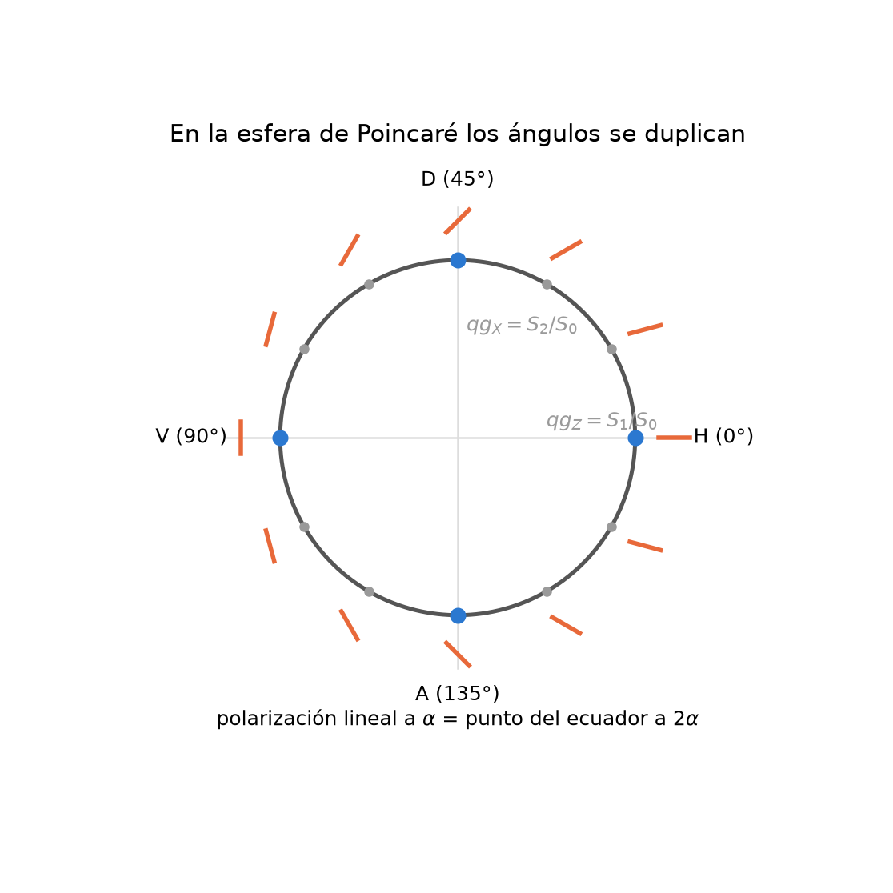
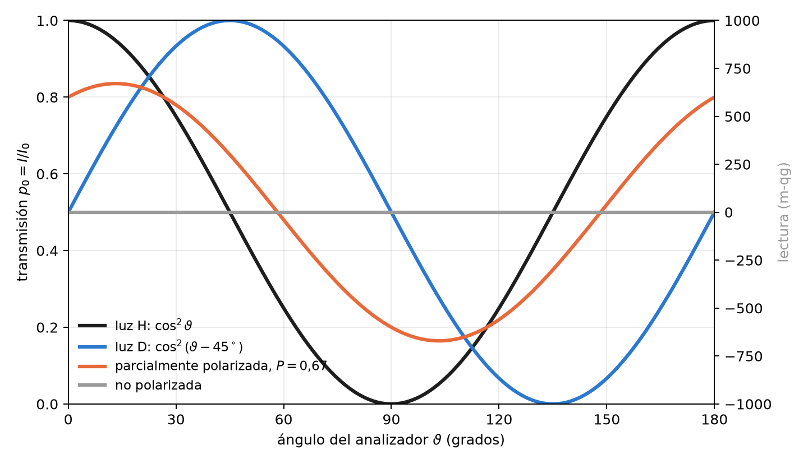
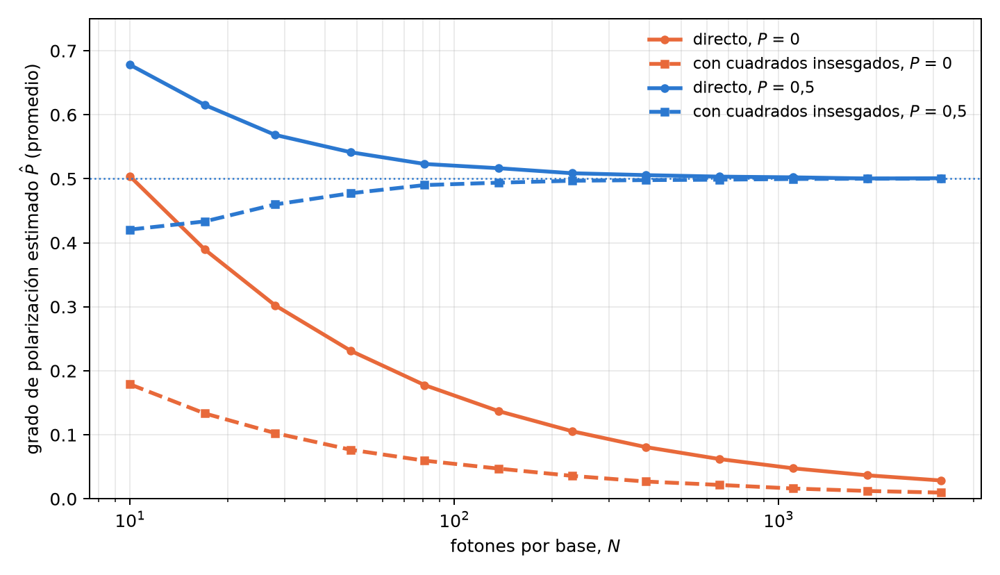

# Polarización óptica y parámetros de Stokes en unidades qg {#sec-cap06}

La polarización de un fotón es un qubit, y la óptica clásica de la polarización es, sin cambios, la física de un
qubit escrita con otros nombres. Este capítulo lee esa óptica con la base del capítulo 1. La pieza central es que un
polarizador es una medición de dos resultados, pasa o no pasa, y su transmisión es exactamente la probabilidad $p_0$
de la ecuación qang. De ahí salen la ley de Malus, los parámetros de Stokes, el grado de polarización y la
polarimetría por conteo de fotones, todo en qg y en mili-qang (§83).

## La ley de Malus como ecuación de probabilidad {#sec-malus}

Luz polarizada linealmente a un ángulo $\alpha$ atraviesa un polarizador orientado a $\vartheta$. Con $\Delta=\vartheta-\alpha$, la
fracción transmitida es la ley de Malus, que para un fotón individual es una probabilidad:

$$
p_0=\cos^2\Delta .
$$

La comparación con la regla de Born del capítulo 1, $p_0=\cos^2(\theta/2)$, es inmediata: **el ángulo qang es el doble
del ángulo físico**, $\theta=2\Delta$, y la lectura en mili-qang es $m=1000\cos2\Delta$. Por eso dos polarizaciones
ortogonales, H y V, separadas $90^\circ$ en el laboratorio, son puntos opuestos de la esfera, separados $180^\circ$
(@fig-angulos). Un analizador girado $30^\circ$ respecto de la luz transmite $p_0=0{,}75$: es el estado de
$\theta=60^\circ$ y $+500$ m-qg del círculo qang del capítulo 1 (@fig-circulo).

{#fig-angulos width=62%}

Para luz con cualquier polarización, pura o parcial, la transmisión por un polarizador lineal a $\vartheta$ es

$$
p_0=\frac{1+qg_Z\cos2\vartheta+qg_X\sin2\vartheta}{2}=\frac{1+\mathbf r\cdot\mathbf a}{2},
\qquad \mathbf a=(\sin2\vartheta,\,0,\,\cos2\vartheta),
$$

con $\mathbf r=(qg_X,qg_Y,qg_Z)$ el vector qg de la luz y $\mathbf a$ el del estado que el analizador deja pasar. Es la
probabilidad de transición del capítulo 3 entre dos vectores qg (@sec-ptransicion), y su lectura en mili-qang es
$m=1000\,\mathbf r\cdot\mathbf a$. La @fig-malus muestra cuatro casos: luz H ($\cos^2\vartheta$), luz D (la misma curva
corrida $45^\circ$), luz no polarizada (siempre $\tfrac12$, es decir, 0 m-qg) y luz parcialmente polarizada con
$qg_Z=0{,}6$ y $qg_X=0{,}3$. Esta última transmite 0,80 a $0^\circ$, un máximo de 0,835 a $13{,}3^\circ$ y un mínimo de
0,165 a $103{,}3^\circ$; la diferencia entre máximo y mínimo, 0,671, es su grado de polarización.

{#fig-malus width=90%}

## Los parámetros de Stokes son valores qg {#sec-stokes}

La esfera de Poincaré es la esfera de Bloch. Con $|H\rangle=|0\rangle$ y $|V\rangle=|1\rangle$, los parámetros de Stokes
normalizados son los tres valores qg, cada uno la diferencia de las dos probabilidades de un analizador:

| valor qg | Stokes | analizador | lectura |
|---|---|---|---|
| $qg_Z$ | $S_1/S_0$ | H / V | $p_H-p_V$ |
| $qg_X$ | $S_2/S_0$ | D / A, a $\pm45^\circ$ | $p_D-p_A$ |
| $qg_Y$ | $S_3/S_0$ | R / L, circular | $p_R-p_L$ |

: Los parámetros de Stokes normalizados como valores qg (§83). {#tbl-stokes}

La convención de la circular derecha cambia de un texto a otro; aquí $R=(|H\rangle+i|V\rangle)/\sqrt2$, de modo que
$S_3>0$ significa $qg_Y>0$ (la biblioteca acepta la convención opuesta con `circular_sign=-1`). Como cada parámetro es
$2p_0-1$ en su propia base, cada uno se expresa en mili-qang con la ecuación del capítulo 1.

La elipse de polarización se lee con los ángulos del vector qg, divididos por dos: su orientación es
$\psi=\tfrac12\operatorname{atan2}(qg_X,qg_Z)$ y su elipticidad $\chi=\tfrac12\arcsin(qg_Y/P)$. Para la luz parcial del
ejemplo, $\psi=13{,}3^\circ$: el ángulo donde la @fig-malus tiene su máximo.

## Grado de polarización y pureza {#sec-grado}

La luz parcialmente polarizada es un estado mixto. Su grado de polarización es la longitud del vector qg, el radio
del capítulo 5 (@sec-radio-ecuacion):

$$
P=\sqrt{qg_X^2+qg_Y^2+qg_Z^2}=r,\qquad \operatorname{Tr}\rho^2=\frac{1+P^2}{2}.
$$

La luz no polarizada está en el centro de la esfera. Un despolarizador ideal tiene matriz de Mueller
$\operatorname{diag}(1,d,d,d)$: acorta el vector en un factor $d$ y no cambia su dirección. Es el caso en que el
capítulo 5 separa dirección y radio (@sec-direccion): con $d=0{,}7$, la luz del ejemplo pasa de $P=0{,}671$ a
$P=0{,}470$, y la orientación de su elipse sigue en $13{,}3^\circ$.

## Elementos sin pérdidas: la matriz de Mueller es la regla de compuertas {#sec-mueller}

Una matriz de Mueller actúa sobre $(S_0,S_1,S_2,S_3)$; en el orden $(I,Z,X,Y)$ es la matriz de transferencia de Pauli.
Para un elemento sin pérdidas, con matriz de Jones unitaria $U$, es exactamente la regla de compuertas qang:

$$
qg'_P=qg_{U^\dagger P U}.
$$

Las láminas de onda son compuertas de un qubit, y el capítulo 2 se aplica tal cual (@sec-compuerta-probabilidad):
una lámina de media onda con el eje a $22{,}5^\circ$ lleva H a D ($qg_X=1$), porque gira la polarización física $45^\circ$
y el punto de la esfera $90^\circ$; una lámina de cuarto de onda a $45^\circ$ lleva H a una polarización circular
($qg_Y=-1$ con la convención de arriba). El polarizador, en cambio, no es unitario: es la medición. Todas estas
identidades se verifican numéricamente en `tests/test_polarization.py`.

## Polarimetría por conteo de fotones {#sec-polarimetria}

Con fuentes débiles o de un solo fotón, los parámetros de Stokes se estiman contando: $n_H,n_V$ en la base H/V,
$n_D,n_A$ en la diagonal y $n_R,n_L$ en la circular. Cada par da un valor qg con su intervalo, igual que una medición
de un qubit (capítulo 4). Con 1000 fotones por base y conteos $(800,200)$, $(650,350)$ y $(500,500)$:

$$
qg_Z=0{,}599\ [0{,}548;\,0{,}647],\quad qg_X=0{,}299\ [0{,}240;\,0{,}358],\quad qg_Y=0{,}000\ [-0{,}062;\,0{,}062],
$$

intervalos de Bayes–Haar del 95 %. En mili-qang, $qg_Z$ es $+599$ m-qg con una resolución de
$\sigma_m=1000\sin\theta/\sqrt N=25$ m-qg.

El grado de polarización necesita más cuidado. $P$ es la raíz de una suma de cuadrados, y cada cuadrado hereda el
sesgo $(1-qg^2)/N$ del capítulo 4 (@sec-qg2): con pocos fotones, la luz no polarizada parece polarizada. La
@fig-grado lo cuantifica con una simulación de este capítulo (4000 repeticiones por punto). Con luz no polarizada, el
estimador directo da en promedio $\hat P\approx0{,}50$ con 10 fotones por base, $0{,}16$ con 100 y $0{,}05$ con 1000.
Usar los cuadrados insesgados lo baja unas tres veces ($\approx0{,}18$, $0{,}055$ y $0{,}017$), pero no lo anula: la raíz
y el recorte en cero dejan un sesgo residual. Con luz de $P=0{,}5$, el estimador directo sobreestima con pocos fotones
y el insesgado subestima levemente; desde unos 200 fotones por base los dos coinciden con el valor verdadero.

{#fig-grado width=90%}

La consecuencia práctica: para afirmar que una fuente está polarizada con pocos fotones, hace falta un intervalo
para $P$ o un umbral calibrado con luz no polarizada, no el valor puntual.

## Sin qang y con qang {#sec-comparacion06}

| acción | sin qang | con qang | diferencia |
|---|---|---|---|
| transmisión de un polarizador | ley de Malus, $I=I_0\cos^2\Delta$ | $p_0=\cos^2\Delta$ con $\theta=2\Delta$; lectura $1000\,\mathbf r\cdot\mathbf a$ m-qg | **ninguna en el valor**; qang la une a la probabilidad de transición del capítulo 3 |
| describir la polarización | parámetros de Stokes $S_1,S_2,S_3$ normalizados | son $qg_Z$, $qg_X$, $qg_Y$ | **identidad**: mismos números con otro nombre |
| grado de polarización con pocos fotones | $\sqrt{S_1^2+S_2^2+S_3^2}$: sesgado hacia arriba | cuadrados insesgados del capítulo 4 | **a favor**: el sesgo baja unas tres veces, sin desaparecer |
| láminas de onda | matrices de Mueller | la regla de compuertas $qg'_P=qg_{U^\dagger PU}$ | **reformulación** |

: Las acciones del capítulo sin la escala qang y con ella. {#tbl-comparacion06}

**Balance.** La óptica de polarización ya trabaja con valores qg bajo otro nombre (Stokes). La diferencia medible es
estadística: la corrección de los cuadrados reduce el sesgo del grado de polarización con pocos fotones.

## En código {#sec-codigo06}

```python
import math
import numpy as np
from qang import polarization as pz

luz = {"Z": 0.6, "X": 0.3, "Y": 0.0}
pz.malus_intensity(luz, 0.0)                      # 0.80: transmisión a 0°
pz.malus_intensity(luz, math.radians(13.28))      # 0.835: el máximo, en la orientación de la elipse

H = np.array([1, 0])
pz.jones_to_qg(pz.half_wave_plate(math.radians(22.5)) @ H)   # {'X': 1.0, ...}: H → D
pz.jones_to_qg(pz.quarter_wave_plate(math.radians(45)) @ H)  # {'Y': -1.0, ...}: H → circular

c = pz.qg_from_counts(800, 200, 650, 350, 500, 500, method="bayes")
c["Z"], c["X"], c["P"]                            # 0.6, 0.3, 0.671 y los intervalos en c["intervals"]
```

Las figuras se generan con `tools/make_cap06_figures.py`.

## Resumen {#sec-resumen06}

- Un polarizador es una medición de dos resultados: su transmisión es $p_0=\cos^2\Delta$, la ecuación de probabilidad
  del capítulo 1 con el ángulo qang igual al doble del físico, $\theta=2\Delta$.
- Para cualquier luz, la ley de Malus es la probabilidad de transición $(1+\mathbf r\cdot\mathbf a)/2$ entre la luz y el
  analizador; su lectura es $1000\,\mathbf r\cdot\mathbf a$ m-qg.
- Los parámetros de Stokes normalizados son $qg_Z$, $qg_X$ y $qg_Y$; la elipse se lee con la mitad de los ángulos del
  vector qg.
- El grado de polarización es el radio del capítulo 5; un despolarizador lo acorta sin girar la elipse.
- Las láminas de onda son compuertas: la matriz de Mueller sin pérdidas es la regla $qg'_P=qg_{U^\dagger PU}$.
- Por conteo de fotones, cada parámetro tiene su intervalo; el grado de polarización está sesgado hacia arriba con
  pocos fotones, y los cuadrados insesgados reducen ese sesgo unas tres veces sin eliminarlo.

## Notas bibliográficas {.unnumbered}

Los parámetros de polarización son los de @stokes1852. La ley de Malus, la esfera de Poincaré y el cálculo de Mueller
siguen el tratamiento clásico de @bornwolf1999. Las notas de investigación numeradas (§) que cita el capítulo y los
scripts que lo verifican están en el repositorio [@qangrepo]; la definición de la unidad qang, en @monteverde2026.
