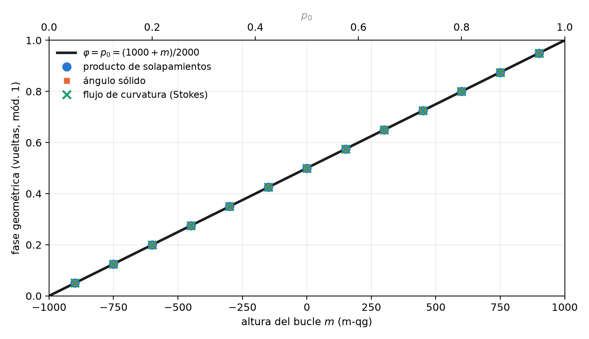
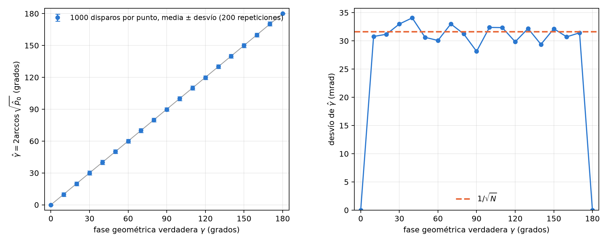

# Fases geométricas y el teorema de Stokes en la esfera {#sec-cap07}

La fase no es una probabilidad. El capítulo 2 mostró que las fases de una compuerta no aparecen en la matriz de
transición: una medición en $Z$ no las ve. Este capítulo trata una fase que sí tiene significado físico, la **fase
geométrica** que adquiere un qubit llevado alrededor de un bucle cerrado, y muestra que la base del capítulo 1 la
alcanza dos veces. Primero, su valor: para un bucle a altura constante, la fase en vueltas *es* la probabilidad $p_0$.
Después, su medición: un interferómetro la convierte en una probabilidad, y el ángulo qang de esa probabilidad es la
fase (§84).

## La conexión y la curvatura de Berry {#sec-berry}

Si un estado $|\psi(\mathbf R)\rangle$ depende de parámetros $\mathbf R$ y se lo lleva lentamente por un camino cerrado, además
de la fase dinámica acumula una fase que depende solo de la geometría del camino. Su densidad es la **conexión de
Berry**, $\mathbf A=i\langle\psi|\nabla\psi\rangle$, y su rotor es la **curvatura**. Para un qubit, con el estado descrito por su
vector qg sobre la esfera, la curvatura es un monopolo de intensidad $\tfrac12$ en el centro: sobre la esfera unitaria
su componente normal vale $\tfrac12$ en todas partes.

## Stokes en la esfera {#sec-stokes-esfera}

El teorema de Stokes convierte la integral de línea de la conexión alrededor del bucle $C$ en el flujo de la
curvatura a través de la superficie que encierra. Como la curvatura es uniforme, el flujo es $\tfrac12$ por el área, es
decir, por el ángulo sólido $\Omega(C)$:

$$
\gamma(C)=-\frac{\Omega(C)}{2}\pmod{2\pi}.
$$

La fase es invariante de gauge (no depende de la fase que se elija para cada estado del camino) y cambia de signo al
recorrer el bucle al revés.

## Bucles a altura constante: la fase es la probabilidad {#sec-cono}

Un bucle alrededor del eje $Z$ a sesgo polar constante $qg_Z$ encierra el casquete que está por encima, de ángulo
sólido $\Omega=2\pi(1-qg_Z)$. En vueltas, la unidad $qg_\Phi$ de la biblioteca,

$$
\varphi=\frac{\gamma}{2\pi}=\frac{qg_Z-1}{2}=-p_1\equiv p_0\pmod 1 ,
\qquad \varphi=\frac{1000+m}{2000}\ \text{vueltas}.
$$

**La fase geométrica de un bucle a altura constante, medida en vueltas, es la probabilidad $p_0$ de su altura**, y
con el mili-qang es una función lineal de la lectura. La razón es la misma que hizo uniforme la distribución de Haar
en el capítulo 4 (@sec-haar): por el teorema de Arquímedes, la fracción de la esfera que queda en el casquete por
encima de la altura $qg_Z$ es $(1-qg_Z)/2=p_1$. El ángulo sólido es $4\pi p_1$ y la fase, $-2\pi p_1$.

Algunos valores: un bucle a $+500$ m-qg ($p_0=0{,}75$) acumula $0{,}75$ vueltas, es decir, $-\tfrac14$ de vuelta; uno en
el ecuador acumula media vuelta, $\pi$; uno pegado al polo $|0\rangle$, nada. La @fig-cono muestra la recta junto con los
tres cálculos independientes de la sección siguiente.

{#fig-cono width=90%}

El ecuador merece una nota. Allí la fase vale $\pi$, y $+\pi$ y $-\pi$ son el mismo ángulo. Un cálculo numérico puede
devolver cualquiera de los dos según el redondeo, y una comparación que no lo tenga en cuenta falla aunque el
resultado sea correcto. Eso es exactamente lo que le pasaba a una de las pruebas de la biblioteca, corregida para
comparar sobre el círculo.

## Tres cálculos independientes {#sec-tres-calculos}

La biblioteca calcula la fase de tres maneras que no comparten código y verifica que coinciden (14 pruebas):

1. **Producto de solapamientos** (Pancharatnam): $\gamma=-\arg\prod_k\langle\psi_k|\psi_{k+1}\rangle$ sobre el bucle discretizado,
   invariante de gauge.
2. **Ángulo sólido**, como abanico de triángulos esféricos (fórmula de Van Oosterom y Strackee). Coincide con el
   producto de solapamientos a $10^{-10}$.
3. **Flujo de la curvatura** a través del casquete, integrado numéricamente. Coincide con la integral de línea a
   $10^{-5}$: es el teorema de Stokes verificado en números.

## Medir la fase: el interferómetro y la ecuación de probabilidad {#sec-interferometro}

Una medición en $Z$ no ve la fase. Para medirla hace falta un **interferómetro**: un qubit de control en $|+\rangle$
gobierna si el sistema recorre el bucle, y al final se mide el control en la base $X$ (prueba de Hadamard). Con la
fase dinámica cancelada, por ejemplo con un eco, la probabilidad de leer 0 en el control es

$$
p_0=\frac{1+\cos\gamma}{2}=\cos^2\frac{\gamma}{2}:
$$

la regla de Born del capítulo 1 con $\gamma$ en el lugar de $\theta$. Por lo tanto **el ángulo qang de la probabilidad
medida es la fase geométrica**, $\hat\gamma=2\arccos\sqrt{\hat p_0}$, y su lectura en mili-qang es $m=1000\cos\gamma$.

Todo lo que la base dice de ese ángulo se aplica a la fase. En particular, por ser la transformación arcoseno
(@sec-arcoseno), su incertidumbre es $1/\sqrt N$ **para cualquier valor de la fase**. La @fig-interferometro lo
verifica con una simulación de este capítulo: con 1000 disparos por punto, el desvío de $\hat\gamma$ queda en torno a
32 mrad (unos $1{,}8^\circ$) de $10^\circ$ a $170^\circ$. En $0$ y en $\pi$ el desvío es cero porque el resultado es determinista,
siempre 0 o siempre 1, y ahí hacen falta los intervalos exactos del capítulo 4.

{#fig-interferometro width=100%}

Hay un límite, el mismo del capítulo 1. Como $\cos\gamma$ es par, una sola probabilidad da $|\gamma|$ en $[0,\pi]$, no su
signo. El remedio es el del signo de rama (@sec-inversion): medir también la otra cuadratura, corriendo la fase de
referencia un cuarto de vuelta, que da $\sin\gamma$. Las dos probabilidades juntas fijan la fase en todo el círculo.

## La fase de Pancharatnam y el octante {#sec-octante}

Para la luz polarizada la misma fase es la de Pancharatnam en la esfera de Poincaré, y el capítulo 6 ya dejó listas
las coordenadas (@sec-malus). El circuito H → D → R → H recorre un octante de la esfera: tres arcos de un cuarto de
círculo máximo que encierran un octavo de su área, $\Omega=4\pi/8=\pi/2$. La fase es $\gamma=-\pi/4$, un octavo de vuelta hacia atrás
($0{,}875$ vueltas módulo 1), y la biblioteca la reproduce a partir de los tres vectores qg.

## En código {#sec-codigo07}

```python
import math
import numpy as np
from qang import geometric

geometric.cone_phase_turns(0.5)       # 0.75 vueltas = p0 a +500 m-qg
geometric.cone_phase_turns(0.0)       # 0.5: el ecuador, media vuelta

# bucle discretizado a qg_Z = 0.8: la fase por solapamientos, en vueltas
r = math.sqrt(1 - 0.8 ** 2)
bucle = [np.array([r * math.cos(a), r * math.sin(a), 0.8]) for a in np.linspace(0, 2 * math.pi, 400, endpoint=False)]
geometric.geometric_phase_qg(bucle).phi        # 0.9 (= p0 = 0.9)

octante = [np.array([0, 0, 1.0]), np.array([1.0, 0, 0]), np.array([0, 1.0, 0])]   # H, D, R
geometric.geometric_phase_qg(octante).phi       # 0.875: -1/8 de vuelta
```

Las figuras se generan con `tools/make_cap07_figures.py`.

## Resumen {#sec-resumen07}

- La fase geométrica de un bucle cerrado es menos la mitad del ángulo sólido que encierra: el teorema de Stokes con
  la curvatura de Berry, un monopolo de intensidad $\tfrac12$.
- Para un bucle a altura constante, la fase en vueltas es $p_0$ (módulo 1), es decir, $(1000+m)/2000$: la misma razón
  de Arquímedes que hace uniforme la medida de Haar en m-qg.
- Tres cálculos independientes (solapamientos, ángulo sólido, flujo de curvatura) coinciden a $10^{-10}$ y $10^{-5}$.
- Un interferómetro convierte la fase en la probabilidad $\cos^2(\gamma/2)$; su ángulo qang es la fase, con
  incertidumbre $1/\sqrt N$ para cualquier valor, y el signo requiere una segunda cuadratura.
- El circuito de polarización H → D → R → H encierra un octante y acumula $-\pi/4$.
