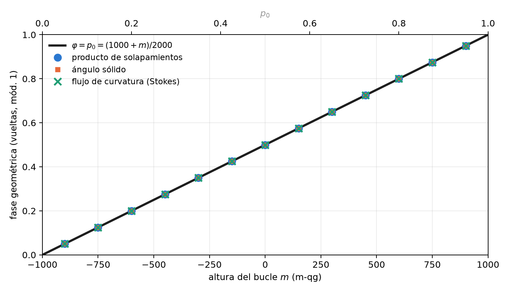
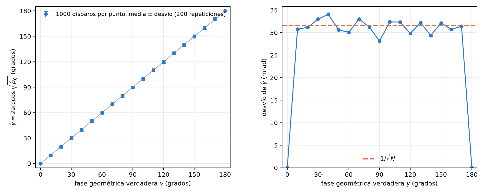

# Fases geométricas y el teorema de Stokes en la esfera {#sec-cap07}

La fase no es una probabilidad. El capítulo 2 mostró que las fases de una compuerta no aparecen en la matriz de
transición: una medición en $Z$ no las ve. El capítulo 6 cerró con la otra cara del mismo hecho: una secuencia de
láminas de onda puede devolver la luz a su polarización inicial, con todas sus lecturas intactas, y sin embargo
dejarle una fase. Este capítulo trata esa fase, la **fase geométrica** que adquiere un qubit llevado alrededor de un
bucle cerrado, y muestra que la base del capítulo 1 la alcanza dos veces. Primero, su valor: para un bucle a altura
constante, la fase en vueltas *es* la probabilidad $p_0$. Después, su medición: un interferómetro la convierte en una
probabilidad, y el ángulo qang de esa probabilidad es la fase (§84).

El recorrido es el siguiente. Se define la conexión de Berry y se calcula su curvatura sobre la esfera
(@sec-berry); el teorema de Stokes reduce la fase a un ángulo sólido (@sec-stokes-esfera); el caso de altura
constante da la identidad con $p_0$ (@sec-cono); tres cálculos independientes la comprueban (@sec-tres-calculos); la
prueba de Hadamard la mide (@sec-interferometro), y la óptica del capítulo 6 da el ejemplo más antiguo, el octante
de Pancharatnam (@sec-octante).

## La conexión y la curvatura de Berry {#sec-berry}

### De dónde sale una fase que no es dinámica {#sec-berry-origen}

**Intuición.** Un estado cuántico es un rayo: $|\psi\rangle$ y $e^{i\chi}|\psi\rangle$ describen lo mismo. Para comparar las
fases de dos estados distintos hace falta una regla, y la regla natural es local: dos estados vecinos están "en
fase" si su producto interno es real y positivo. Llevar esa regla a lo largo de un camino es un transporte paralelo,
y al cerrar el camino sobre una superficie curva el estado no vuelve con la fase con que salió. Es lo que le ocurre a
una flecha transportada sin girar alrededor de un triángulo sobre una esfera: vuelve rotada en un ángulo igual al
área encerrada.

**Formalismo.** Sea $H(\mathbf R)$ un hamiltoniano que depende de parámetros $\mathbf R$, con autoestado
$|\psi(\mathbf R)\rangle$ de energía $E(\mathbf R)$, y sea $\mathbf R(t)$ un camino cerrado recorrido lentamente. En la
aproximación adiabática el sistema sigue al autoestado, y solo puede diferir de él en una fase:

$$
|\Psi(t)\rangle=e^{i\gamma(t)}\,e^{-\frac{i}{\hbar}\int_0^t E\,dt'}\,|\psi(\mathbf R(t))\rangle .
$$

Al sustituir en la ecuación de Schrödinger y proyectar sobre $\langle\psi|$, el término dinámico se cancela y queda
$\dot\gamma=i\langle\psi|\nabla_{\mathbf R}\psi\rangle\cdot\dot{\mathbf R}$. La fase acumulada en una vuelta es

$$
\gamma(C)=\oint_C\mathbf A\cdot d\mathbf R,\qquad \mathbf A=i\langle\psi|\nabla_{\mathbf R}\psi\rangle ,
$$

donde $\mathbf A$ es la **conexión de Berry**. Es real, porque derivar $\langle\psi|\psi\rangle=1$ da
$\langle\psi|\nabla\psi\rangle$ imaginario puro, y no depende de la velocidad del recorrido: solo del camino.

**Invariancia de gauge.** Al cambiar la fase de cada estado, $|\psi\rangle\to e^{i\chi(\mathbf R)}|\psi\rangle$, la conexión
cambia como un potencial vector, $\mathbf A\to\mathbf A-\nabla\chi$. Sobre un camino cerrado $\chi$ debe volver a su
valor salvo un múltiplo de $2\pi$, de modo que $\gamma(C)$ no cambia módulo $2\pi$. La conexión no es observable; su
integral cerrada sí.

### La curvatura sobre la esfera {#sec-berry-curvatura}

Para un qubit, los parámetros son los dos ángulos del vector qg sobre la esfera. Con la parametrización del
capítulo 1,

$$
|\psi(\theta,\phi)\rangle=\cos\frac\theta2\,|0\rangle+e^{i\phi}\sin\frac\theta2\,|1\rangle ,
$$

las componentes de la conexión son

$$
A_\theta=i\langle\psi|\partial_\theta\psi\rangle=0,\qquad
A_\phi=i\langle\psi|\partial_\phi\psi\rangle=-\sin^2\frac\theta2=-p_1 .
$$

La conexión azimutal es, con signo cambiado, la probabilidad de medir 1. La **curvatura** es su rotor,

$$
F_{\theta\phi}=\partial_\theta A_\phi-\partial_\phi A_\theta=-\frac12\sin\theta ,
$$

y como $\sin\theta\,d\theta\,d\phi$ es el elemento de área de la esfera unitaria, la curvatura por unidad de área vale
$\tfrac12$ en todas partes, con el signo que fija la convención $\mathbf A=i\langle\psi|\nabla\psi\rangle$. Es el campo de
un monopolo de intensidad $\tfrac12$ en el centro de la esfera. A diferencia de la conexión, la curvatura es invariante
de gauge: $\nabla\times\nabla\chi=0$.

## Stokes en la esfera {#sec-stokes-esfera}

El teorema de Stokes convierte la integral de línea de la conexión alrededor del bucle $C$ en el flujo de la
curvatura a través de la superficie $S$ que encierra:

$$
\gamma(C)=\oint_C\mathbf A\cdot d\mathbf R=\iint_S F_{\theta\phi}\,d\theta\,d\phi=-\frac12\iint_S\sin\theta\,d\theta\,d\phi .
$$

Como la curvatura es uniforme, el flujo es $\tfrac12$ por el área, es decir, por el ángulo sólido $\Omega(C)$:

$$
\gamma(C)=-\frac{\Omega(C)}{2}\pmod{2\pi}.
$$

Tres propiedades se leen de la fórmula.

- **Es invariante de gauge**: no depende de la fase que se elija para cada estado del camino, porque la curvatura no
  depende de ella.
- **Cambia de signo al recorrer el bucle al revés**, porque el ángulo sólido tiene signo: es positivo si el bucle se
  recorre en sentido antihorario visto desde fuera de la esfera.
- **No depende de cuál de las dos superficies se elija.** Un bucle divide la esfera en dos regiones, de ángulos
  sólidos $\Omega$ y $\Omega-4\pi$ con la misma orientación. Las dos dan fases que difieren en $2\pi$: la ambigüedad es
  la del módulo. Esto exige que el flujo total sea un múltiplo de $2\pi$, y el monopolo de intensidad $\tfrac12$ es el
  más chico que lo cumple.

## Bucles a altura constante: la fase es la probabilidad {#sec-cono}

### La identidad {#sec-cono-identidad}

Un bucle alrededor del eje $Z$ a sesgo polar constante $qg_Z$ es el caso más simple, y se puede integrar sin el
teorema: $A_\phi$ es constante sobre el bucle, y

$$
\gamma=\oint A_\phi\,d\phi=-2\pi\sin^2\frac\theta2=-2\pi p_1 .
$$

Con el teorema, el bucle encierra el casquete que está por encima, de ángulo sólido $\Omega=2\pi(1-qg_Z)=4\pi p_1$, y
el resultado es el mismo. En vueltas, la unidad $qg_\Phi$ de la biblioteca,

$$
\varphi=\frac{\gamma}{2\pi}=\frac{qg_Z-1}{2}=-p_1\equiv p_0\pmod 1 ,
\qquad \varphi=\frac{1000+m}{2000}\ \text{vueltas}.
$$

**La fase geométrica de un bucle a altura constante, medida en vueltas, es la probabilidad $p_0$ de su altura**, y
con el mili-qang es una función lineal de la lectura. La razón es la misma que hizo uniforme la distribución de Haar
en el capítulo 4 (@sec-haar): por el teorema de Arquímedes, el área de una franja de la esfera es proporcional a su
altura, de modo que la fracción de la esfera que queda en el casquete por encima de la altura $qg_Z$ es
$(1-qg_Z)/2=p_1$. El ángulo sólido es $4\pi p_1$ y la fase, $-2\pi p_1$.

Algunos valores: un bucle a $+500$ m-qg ($p_0=0{,}75$) acumula $0{,}75$ vueltas, es decir, $-\tfrac14$ de vuelta; uno en
el ecuador acumula media vuelta, $\pi$; uno pegado al polo $|0\rangle$, nada. La @fig-cono muestra la recta junto con los
tres cálculos independientes de la sección siguiente.

En la escala angular del capítulo 1 (@sec-qga), que mide en milésimas de vuelta, la misma frase se lee sin conversión:
**la fase de un bucle a altura constante es $1000\,p_0$ qga** (módulo 1000). El bucle a $+500$ m-qg acumula 750 qga, el
del ecuador 500 qga y el octante de la última sección, $-125$ qga (875 qga). La lectura en m-qg y la fase en qga son
entonces dos escalas lineales de la misma probabilidad: $\varphi_{qga}=(1000+m)/2$. Conviene no confundirlas: los m-qg
son una lectura, lineal en $p_0$; los qga son aquí una fase, un ángulo. Que una sea función lineal de la otra es el
contenido de esta sección, no una identidad de unidades.

{#fig-cono width=90%}

### Un ejemplo sin aproximación adiabática: la precesión {#sec-precesion}

La deducción de @sec-berry-origen supuso un recorrido lento, pero la fase geométrica no depende de eso. Para
cualquier evolución cíclica, se define como la fase total menos la dinámica [@aharonov1987]. El bucle a altura
constante lo ilustra: lo recorre un qubit que precesa bajo $H=\tfrac{\hbar\omega}{2}\sigma_z$, sin ninguna lentitud.
Tras un período $T=2\pi/\omega$,

$$
e^{-i\pi\sigma_z}|\psi\rangle=-|\psi\rangle\ \Rightarrow\ \gamma_{\text{total}}=-\pi,\qquad
\gamma_{\text{din}}=-\frac1\hbar\int_0^T\langle H\rangle\,dt=-\pi\cos\theta ,
$$

$$
\gamma_{\text{geo}}=\gamma_{\text{total}}-\gamma_{\text{din}}=-\pi(1-\cos\theta)=-2\pi p_1 .
$$

La fase total es la misma para todas las alturas; lo que cambia con la altura es cómo se reparte entre la parte
dinámica, proporcional a $qg_Z$, y la geométrica, proporcional a $p_1$. Por eso para medir la geométrica hay que
cancelar la dinámica, por ejemplo con un eco (@sec-interferometro).

### El ecuador {#sec-ecuador}

El ecuador merece una nota. Allí la fase vale $\pi$, y $+\pi$ y $-\pi$ son el mismo ángulo. Un cálculo numérico puede
devolver cualquiera de los dos según el redondeo, y una comparación que no lo tenga en cuenta falla aunque el
resultado sea correcto. Eso es exactamente lo que le pasaba a una de las pruebas de la biblioteca, corregida para
comparar sobre el círculo. La regla general es comparar fases por su diferencia reducida a $(-\pi,\pi]$, nunca por
resta directa.

## Tres cálculos independientes {#sec-tres-calculos}

La biblioteca calcula la fase de tres maneras que no comparten código y verifica que coinciden (14 pruebas).

### Producto de solapamientos {#sec-solapamientos}

Para un bucle discretizado en estados $|\psi_1\rangle,\dots,|\psi_n\rangle$, con $|\psi_{n+1}\rangle\equiv|\psi_1\rangle$, la fase
es la de Pancharatnam:

$$
\gamma=-\arg\prod_{k=1}^{n}\langle\psi_k|\psi_{k+1}\rangle .
$$

Es invariante de gauge por construcción: cada estado aparece una vez como bra y una vez como ket, y cualquier fase
que se le agregue se cancela. Y es la discretización de la integral de la conexión: para dos estados vecinos,
$\langle\psi_k|\psi_{k+1}\rangle\approx1+\langle\psi|\nabla\psi\rangle\cdot\delta\mathbf R=1-i\,\mathbf A\cdot\delta\mathbf R$, de modo que el
producto tiende a $\exp(-i\oint\mathbf A\cdot d\mathbf R)$ y su argumento, cambiado de signo, a $\gamma(C)$. Entre dos
puntos consecutivos el producto supone implícitamente el arco de círculo máximo que los une: un bucle de pocos
puntos es un polígono geodésico.

### Ángulo sólido {#sec-angulo-solido}

El segundo cálculo no usa estados, solo los vectores qg. Descompone el bucle en un abanico de triángulos esféricos y
suma sus ángulos sólidos con la fórmula de Van Oosterom y Strackee: para tres vectores unitarios
$\mathbf a,\mathbf b,\mathbf c$,

$$
\tan\frac{\Omega}{2}=\frac{\mathbf a\cdot(\mathbf b\times\mathbf c)}
{1+\mathbf a\cdot\mathbf b+\mathbf b\cdot\mathbf c+\mathbf c\cdot\mathbf a} .
$$

El numerador da el signo de la orientación. Coincide con el producto de solapamientos a $10^{-10}$.

### Flujo de la curvatura {#sec-flujo}

El tercero integra numéricamente la curvatura $\tfrac12$ sobre el casquete. Coincide con la integral de línea a
$10^{-5}$: es el teorema de Stokes verificado en números.

| cálculo | qué usa | qué supone | acuerdo |
|---|---|---|---|
| producto de solapamientos | los estados del bucle | arcos geodésicos entre puntos | referencia |
| ángulo sólido (Van Oosterom–Strackee) | los vectores qg | abanico de triángulos esféricos | $10^{-10}$ |
| flujo de la curvatura | la altura del casquete | integración numérica en una grilla | $10^{-5}$ |

: Los tres cálculos de la fase geométrica en `qang.geometric`. {#tbl-tres-calculos}

## Medir la fase: el interferómetro y la ecuación de probabilidad {#sec-interferometro}

### La prueba de Hadamard {#sec-hadamard}

Una medición en $Z$ no ve la fase. Para medirla hace falta un **interferómetro**: un qubit de control en $|+\rangle$
gobierna si el sistema recorre el bucle, y al final se mide el control en la base $X$ (prueba de Hadamard). Si el
bucle, con la fase dinámica cancelada, por ejemplo con un eco, devuelve $e^{i\gamma}|\psi\rangle$, el estado conjunto es

$$
\frac{1}{\sqrt2}\left(|0\rangle+e^{i\gamma}|1\rangle\right)\otimes|\psi\rangle :
$$

la fase global del sistema pasó a ser una fase relativa del control, y una fase relativa sí es observable. La
probabilidad de leer 0 tras la compuerta de Hadamard final es

$$
p_0=\left|\frac{1+e^{i\gamma}}{2}\right|^2=\frac{1+\cos\gamma}{2}=\cos^2\frac{\gamma}{2}:
$$

la regla de Born del capítulo 1 con $\gamma$ en el lugar de $\theta$. Por lo tanto **el ángulo qang de la probabilidad
medida es la fase geométrica**, $\hat\gamma=2\arccos\sqrt{\hat p_0}$, y su lectura en mili-qang es $m=1000\cos\gamma$.

### La incertidumbre es uniforme {#sec-fase-incertidumbre}

Todo lo que la base dice de ese ángulo se aplica a la fase. En particular, por ser la transformación arcoseno
(@sec-arcoseno), su incertidumbre es $1/\sqrt N$ **para cualquier valor de la fase**. La cuenta es una línea: de
$d\gamma/dp_0=-1/\sqrt{p_0(1-p_0)}$ y $\operatorname{Var}(\hat p_0)=p_0(1-p_0)/N$,

$$
\operatorname{Var}(\hat\gamma)=\left(\frac{d\gamma}{dp_0}\right)^2\frac{p_0(1-p_0)}{N}=\frac1N .
$$

La @fig-interferometro lo verifica con una simulación de este capítulo: con 1000 disparos por punto, el desvío de
$\hat\gamma$ queda en torno a 32 mrad (unos $1{,}8^\circ$) de $10^\circ$ a $170^\circ$. En $0$ y en $\pi$ el desvío es cero
porque el resultado es determinista, siempre 0 o siempre 1, y ahí hacen falta los intervalos exactos del capítulo 4.

{#fig-interferometro width=100%}

### El signo y la segunda cuadratura {#sec-cuadratura}

Hay un límite, el mismo del capítulo 1. Como $\cos\gamma$ es par, una sola probabilidad da $|\gamma|$ en $[0,\pi]$, no su
signo. El remedio es el del signo de rama (@sec-inversion): medir también la otra cuadratura, corriendo la fase de
referencia un cuarto de vuelta (250 qga), que da $p_0'=(1+\sin\gamma)/2$. Con las dos lecturas
$qg_c=2p_0-1=\cos\gamma$ y $qg_s=2p_0'-1=\sin\gamma$, la fase queda fijada en todo el círculo:

$$
\hat\gamma=\operatorname{atan2}\big(\widehat{qg}_s,\ \widehat{qg}_c\big).
$$

El signo tiene un costo en disparos. Con $N$ disparos en cada cuadratura, propagando las dos varianzas
$(1-qg^2)/N$,

$$
\operatorname{Var}(\hat\gamma)=\frac{\cos^2\gamma\,(1-\sin^2\gamma)+\sin^2\gamma\,(1-\cos^2\gamma)}{N}
=\frac{1-\tfrac12\sin^22\gamma}{N},
$$

entre $1/(2N)$ y $1/N$ según la fase. Los mismos $2N$ disparos en una sola cuadratura darían $1/(2N)$ para cualquier
fase, pero sin el signo.

| estrategia | disparos | $N\cdot\operatorname{Var}(\hat\gamma)$ | rango de la fase |
|---|---|---|---|
| una cuadratura | $N$ | 1 | $[0,\pi]$: solo $\lvert\gamma\rvert$ |
| una cuadratura | $2N$ | $\tfrac12$ | $[0,\pi]$: solo $\lvert\gamma\rvert$ |
| dos cuadraturas | $N+N$ | $1-\tfrac12\sin^22\gamma$, entre $\tfrac12$ y 1 | todo el círculo |

: Costo de fijar el signo de la fase. La tercera fila se comprueba por simulación en `tools/verify_cap07_expansion.py`. {#tbl-cuadraturas}

## La fase de Pancharatnam y el octante {#sec-octante}

Para la luz polarizada la misma fase es la de Pancharatnam en la esfera de Poincaré, y el capítulo 6 ya dejó listas
las coordenadas (@sec-malus): H es el polo $qg_Z=+1$, D el punto $qg_X=+1$ y R el punto $qg_Y=+1$. El circuito
H → D → R → H recorre un octante de la esfera: tres arcos de un cuarto de círculo máximo que encierran un octavo de su
área, $\Omega=4\pi/8=\pi/2$.

La fase se calcula a mano con tres productos internos. Con $|D\rangle=(|H\rangle+|V\rangle)/\sqrt2$ y
$|R\rangle=(|H\rangle+i|V\rangle)/\sqrt2$,

$$
\langle H|D\rangle\,\langle D|R\rangle\,\langle R|H\rangle=\frac{1}{\sqrt2}\cdot\frac{1+i}{2}\cdot\frac{1}{\sqrt2}=\frac{1+i}{4},
$$

cuyo argumento es $\pi/4$. La fase es $\gamma=-\pi/4$, un octavo de vuelta hacia atrás ($0{,}875$ vueltas módulo 1, 875
qga), y la biblioteca la reproduce a partir de los tres vectores qg. La fórmula del ángulo sólido da lo mismo: el
producto mixto de los tres vectores vale 1 y los tres productos escalares se anulan, $\tan(\Omega/2)=1$.

El ejemplo muestra además qué mide el producto de tres solapamientos. Su módulo, $\sqrt2/4$, es el producto de tres
amplitudes de transición, cada una de módulo $\cos(45^\circ)$ porque los vectores qg están a $90^\circ$ y el capítulo 6
divide los ángulos por dos; su argumento es la geometría. En el laboratorio, cada producto interno es una proyección
con un polarizador, y la fase aparece al hacer interferir la luz que recorrió el circuito con la que no lo hizo.

## Sin qang y con qang {#sec-comparacion07}

| acción | sin qang | con qang | diferencia |
|---|---|---|---|
| fase geométrica de un bucle a altura constante | $-\tfrac12$ del ángulo sólido, $\Omega=2\pi(1-\cos\theta)$ | la fase en vueltas es $p_0=(1000+m)/2000$ | **equivalente**; con qang se lee de una sola probabilidad medida |
| medir la fase en un interferómetro | invertir $\cos^2(\gamma/2)$ con el método delta | el ángulo qang es la fase, con incertidumbre $1/\sqrt N$ para cualquier valor | **mismo resultado** en el interior: el método delta también da $1/\sqrt N$; qang lo da sin derivar. En $0$ y $\pi$ los dos dan ancho cero y hacen falta los intervalos del capítulo 4 |
| el signo de la fase | segunda cuadratura | segunda cuadratura | **ninguna**: el límite es el mismo |

: Las acciones del capítulo sin la escala qang y con ella. {#tbl-comparacion07}

**Balance.** La fase de Berry es la misma con o sin qang; lo que la escala agrega es leerla de una sola probabilidad
y tener su barra de error sin derivar nada. No agrega precisión.

## En código {#sec-codigo07}

```python
import math
import numpy as np
from qang import geometric, qga

# --- Bucles a altura constante: la fase en vueltas es p0
geometric.cone_phase_turns(0.5)       # 0.75 vueltas = p0 a +500 m-qg
geometric.cone_phase_turns(0.0)       # 0.5: el ecuador, media vuelta
qga.cone_phase_qga(0.5)               # 750.0 qga: la misma fase en milésimas de vuelta

# --- Los tres cálculos sobre un bucle discretizado a qg_Z = 0.8 (p0 = 0.9)
r = math.sqrt(1 - 0.8 ** 2)
bucle = [np.array([r * math.cos(a), r * math.sin(a), 0.8]) for a in np.linspace(0, 2 * math.pi, 400, endpoint=False)]
geometric.geometric_phase_qg(bucle).phi        # 0.9: producto de solapamientos, en vueltas
omega = geometric.solid_angle(bucle)           # 1.2566 = 4π p1: abanico de triángulos esféricos
geometric.berry_phase_from_solid_angle(omega)  # -0.6283 = -Ω/2
geometric.curvature_flux(0.8)                  # 0.6283 = Ω/2: flujo de la curvatura por el casquete

# --- El octante de Pancharatnam: H → D → R → H
octante = [np.array([0, 0, 1.0]), np.array([1.0, 0, 0]), np.array([0, 1.0, 0])]   # H, D, R
geometric.geometric_phase_qg(octante).phi       # 0.875: -1/8 de vuelta
geometric.solid_angle(octante)                  # 1.5708 = π/2

# --- Medición con dos cuadraturas: módulo y signo de la fase
gamma = -math.pi / 4
p_c, p_s = (1 + math.cos(gamma)) / 2, (1 + math.sin(gamma)) / 2   # 0.854 y 0.146
2 * math.acos(math.sqrt(p_c))                   # 0.785: una cuadratura da |γ|
math.atan2(2 * p_s - 1, 2 * p_c - 1)            # -0.785: las dos dan γ con su signo
```

Las figuras se generan con `tools/make_cap07_figures.py`. La fase en qga se comprueba con `tools/verify_cap07.py`, y
las deducciones de este capítulo (la conexión y la curvatura en coordenadas, la invariancia de gauge, el producto del
octante, la fórmula del ángulo sólido, la precesión, la prueba de Hadamard y la varianza con dos cuadraturas) con
`tools/verify_cap07_expansion.py`.

## Síntesis y puente hacia el capítulo 8 {#sec-resumen07}

- La fase geométrica es la integral cerrada de la conexión de Berry $\mathbf A=i\langle\psi|\nabla\psi\rangle$; sobre la esfera,
  $A_\phi=-p_1$ y la curvatura es la de un monopolo de intensidad $\tfrac12$.
- Por el teorema de Stokes, la fase de un bucle cerrado es menos la mitad del ángulo sólido que encierra; es
  invariante de gauge y cambia de signo con el sentido del recorrido.
- Para un bucle a altura constante, la fase en vueltas es $p_0$ (módulo 1), es decir, $(1000+m)/2000$, o $1000\,p_0$
  qga: la misma razón de Arquímedes que hace uniforme la medida de Haar en m-qg.
- La fase geométrica no requiere lentitud: en la precesión es la fase total menos la dinámica.
- Tres cálculos independientes (solapamientos, ángulo sólido, flujo de curvatura) coinciden a $10^{-10}$ y $10^{-5}$.
- Un interferómetro convierte la fase en la probabilidad $\cos^2(\gamma/2)$; su ángulo qang es la fase, con
  incertidumbre $1/\sqrt N$ para cualquier valor. El signo requiere una segunda cuadratura, y con $N$ disparos en cada
  una la varianza es $(1-\tfrac12\sin^22\gamma)/N$.
- El circuito de polarización H → D → R → H encierra un octante y acumula $-\pi/4$; su producto de solapamientos es
  $(1+i)/4$.

**Hacia el capítulo 8.** Este capítulo terminó midiendo un ángulo con una probabilidad, y encontró que su
incertidumbre es $1/\sqrt N$ sin importar el valor del ángulo. Ese resultado apareció dos veces, aquí y en el
capítulo 4, como una propiedad de la transformación arcoseno. El capítulo 8 (@sec-cap08) le da su nombre propio: es
la cota de Cramér–Rao, y la cantidad que la fija es la información de Fisher de un disparo. Vista así, la pregunta
deja de ser cuánto vale una fase y pasa a ser cuánto enseña cada disparo sobre ella, en qué punto conviene operar un
interferómetro y qué se gana, y qué no, al entrelazar los qubits que la miden.

## Notas bibliográficas {.unnumbered}

La fase geométrica es la de @berry1984, anticipada en óptica por @pancharatnam1956. Su extensión a evoluciones cíclicas
no adiabáticas es @aharonov1987, y la formulación general con la conexión de Pancharatnam, @samuel1988. Las notas de
investigación numeradas (§) que cita el capítulo y los scripts que lo verifican están en el repositorio [@qangrepo]; la
definición de la unidad qang, en @monteverde2026.
