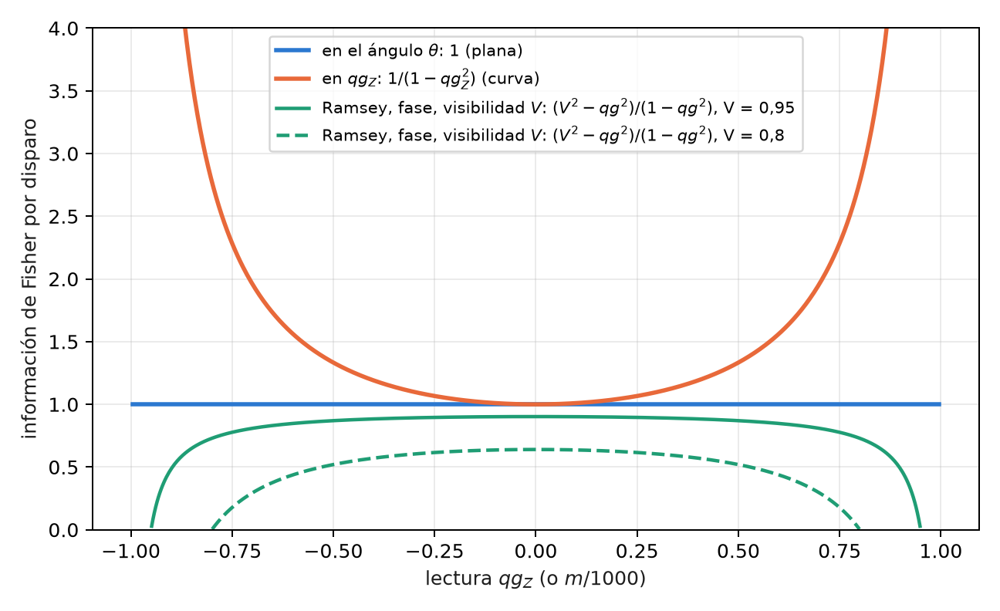
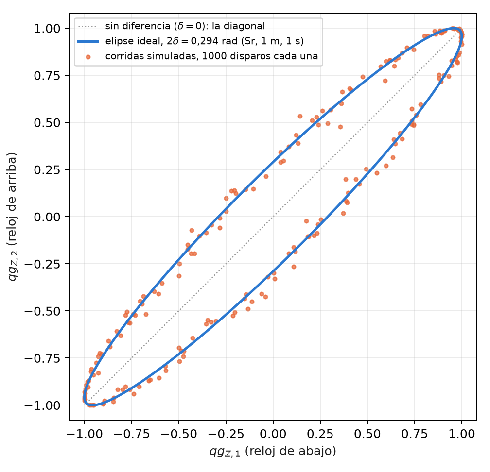
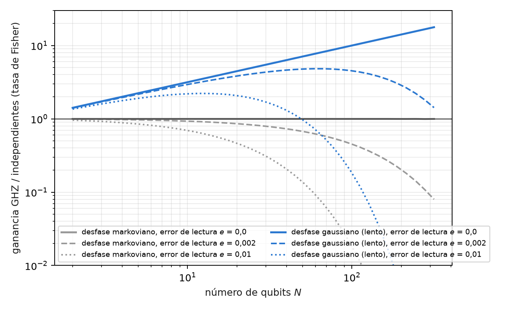

# Información de Fisher, relojes, gravedad y metrología {#sec-cap08}

La metrología es la disciplina de medir un parámetro con la menor incertidumbre posible, y su herramienta central es
la información de Fisher: cuánto enseña cada disparo sobre el parámetro. El capítulo 7 terminó midiendo una fase con
una probabilidad y encontró que su incertidumbre es $1/\sqrt N$ para cualquier valor de la fase; el capítulo 4 había
encontrado lo mismo para el ángulo qang. Este capítulo muestra que no es una coincidencia de la transformación
arcoseno: es la cota de Cramér–Rao, y el ángulo qang es la coordenada en la que esa cota es uniforme.

Todo se escribe sobre la base del capítulo 1. La ecuación de probabilidad $p_0=\cos^2(\theta/2)$ fija cuánta
información lleva cada lectura (@sec-fisher-base), y de ahí salen la resolución en mili-qang, la geometría que
gobierna la optimización de circuitos variacionales (@sec-fubini), la comparación de dos relojes atómicos a un metro
de altura (@sec-relojes), el punto de operación de un interferómetro (@sec-ramsey), la ventaja y los límites del
entrelazamiento (@sec-ghz) y la termometría de un qubit (@sec-termicos).

## Desde la base: la información de un disparo {#sec-fisher-base}

### Definición y cota de Cramér–Rao {#sec-fisher-def}

**Intuición.** Un disparo enseña algo sobre un parámetro solo si su probabilidad cambia al cambiar el parámetro, y
enseña más cuanto mayor es ese cambio comparado con el ruido propio del resultado. La información de Fisher es ese
cociente: sensibilidad al cuadrado sobre varianza.

**Formalismo.** Para una medición con resultados $k$ de probabilidad $p_k(\lambda)$, la información de Fisher sobre
$\lambda$ es

$$
F_\lambda=\sum_k\frac{\left(\partial_\lambda p_k\right)^2}{p_k},
$$

y para un resultado binario, con $p_1=1-p_0$, se reduce a $F_\lambda=(\partial_\lambda p_0)^2/[p_0(1-p_0)]$. Su
significado operacional es la cota de Cramér–Rao: todo estimador insesgado construido con $N$ disparos
independientes cumple

$$
\operatorname{Var}(\hat\lambda)\ \ge\ \frac{1}{N\,F_\lambda}.
$$

Dos propiedades se usan en todo el capítulo. La información es **aditiva**: $N$ disparos independientes llevan
$N F_\lambda$. Y **cambia con la coordenada como un tensor**: para otra parametrización $\mu(\lambda)$,
$F_\mu=F_\lambda\,(d\lambda/d\mu)^2$.

### El ángulo es la coordenada plana {#sec-fisher-plana}

Un disparo en la base $Z$ es una moneda con probabilidad $p_0=\cos^2(\theta/2)$. Con
$dp_0/d\theta=-\tfrac12\sin\theta$ y $p_0(1-p_0)=\tfrac14\sin^2\theta$, su información de Fisher sobre el ángulo es

$$
F_\theta=\frac{(dp_0/d\theta)^2}{p_0(1-p_0)}=\frac{\sin^2\theta/4}{\sin^2\theta/4}=1 ,
$$

constante en toda la esfera. Sobre la lectura $qg_Z=\cos\theta$, por la regla de cambio de coordenada con
$d\theta/dqg_Z=-1/\sin\theta$, es

$$
F_{qg}=F_\theta\left(\frac{d\theta}{dqg_Z}\right)^2=\frac{1}{1-qg_Z^2},
$$

que crece hacia los polos. **El ángulo qang es la coordenada plana de la información y $qg_Z$ la coordenada curva**
(@fig-fisher). Las dos descripciones son la misma física: la varianza $1/N$ del ángulo del capítulo 1 es la cota de
Cramér–Rao en la coordenada plana, y la varianza $(1-qg_Z^2)/N$ de la lectura es la misma cota en la coordenada curva
(§167). En la escala angular del capítulo 1 (@sec-qga), con $\theta=2\pi a/1000$ para un ángulo $a$ en qga, la misma
información constante vale

$$
F_{qga}=\left(\frac{2\pi}{1000}\right)^2=4\pi^2\cdot10^{-6}\ \text{qga}^{-2}
$$

por disparo: es la Q-Fisher de la Fundamentación, y su cota de Cramér–Rao es la desviación de $159{,}15/\sqrt N$ qga en
todo el círculo. El cambio de unidad multiplica la información por una constante; no la crea.

{#fig-fisher width=90%}

### ¿Se puede hacer mejor con otra medición? {#sec-fisher-cuantica}

La información de Fisher depende de la medición elegida. Su máximo sobre todas las mediciones es la información de
Fisher cuántica, que para un estado puro generado por $e^{-i\theta G}$ vale $F_Q=4\operatorname{Var}(G)$
[@braunstein1994]. Para la rotación $R_Y(\theta)=e^{-i\theta\sigma_y/2}$ aplicada a $|0\rangle$, el estado es real,
$\langle\sigma_y\rangle=0$, y

$$
F_Q=4\left(\frac{\langle\sigma_y^2\rangle}{4}-\frac{\langle\sigma_y\rangle^2}{4}\right)=1 .
$$

La medición en $Z$ ya alcanza el máximo: sobre un meridiano no hay medición mejor. Para un estado mixto de radio $r$
(capítulo 5), la información cuántica sobre un giro de su vector es $F_Q=r^2$, y la mejor medición proyectiva la
alcanza. El radio local es entonces, además de pureza y grado de polarización, la fracción de información que
sobrevive al ruido; es la visibilidad $V$ de @sec-ramsey.

### La resolución en mili-qang {#sec-resolucion}

Expresada en mili-qang, la cota da la resolución de una lectura:

$$
\sigma_m=\frac{1000\,|\sin\theta|}{\sqrt N}\ \text{m-qg},\qquad N=\left(\frac{1000\sin\theta}{\delta}\right)^2
\ \text{disparos para resolver } \delta\ \text{m-qg}.
$$

En el ecuador, resolver 10 m-qg exige $10^4$ disparos y resolver 1 m-qg, $10^6$; a 60° del polo, 5 m-qg cuestan
30 000. Cerca de un polo la lectura es más precisa en m-qg, pero un m-qg corresponde allí a un ángulo mayor: un
estado a $\delta$ m-qg del polo está a $\arccos(1-\delta/1000)\approx\sqrt{2\delta/1000}$ radianes, 2,56° para 1 m-qg. Las
dos afirmaciones no se contradicen: son la coordenada curva y la plana del mismo hecho.

| | en el ángulo ($\theta$, qga) | en la lectura ($qg_Z$, m-qg) |
|---|---|---|
| información por disparo | $1$ rad$^{-2}$ $=4\pi^2\cdot10^{-6}$ qga$^{-2}$ | $1/(1-qg_Z^2)$ |
| desviación con $N$ disparos | $1/\sqrt N$ rad $=159{,}15/\sqrt N$ qga | $1000\lvert\sin\theta\rvert/\sqrt N$ m-qg |
| dependencia del estado | ninguna | máxima en el ecuador, nula en los polos |
| uso | estimar, comparar, optimizar | leer, promediar, mitigar |

: La misma cota de Cramér–Rao en las dos escalas del capítulo 1. {#tbl-fisher-escalas}

## Geometría de la información y el gradiente natural {#sec-fubini}

### De un parámetro a muchos: la métrica de Fubini–Study {#sec-fubini-metrica}

Con muchos parámetros $\boldsymbol\theta$, la información de Fisher cuántica es una matriz, cuatro veces la métrica de
Fubini–Study:

$$
g_{ij}=\operatorname{Re}\Big[\langle\partial_i\psi|\partial_j\psi\rangle-\langle\partial_i\psi|\psi\rangle\langle\psi|\partial_j\psi\rangle\Big],
\qquad F_Q=4g .
$$

$g$ mide la distancia entre estados vecinos: $ds^2=g_{ij}\,d\theta_i\,d\theta_j$ es cuánto cambia el estado, no cuánto
cambian los parámetros. Para un parámetro que entra por una rotación $e^{-i\theta_iP_i/2}$ en la última capa,
$|\partial_i\psi\rangle=-\tfrac{i}{2}P_i|\psi\rangle$ y

$$
g_{ij}=\frac{\langle P_iP_j\rangle-\langle P_i\rangle\langle P_j\rangle}{4}.
$$

En un ansatz real de rotaciones $R_Y$ y compuertas CZ, todo estado del circuito es real, $\langle Y_k\rangle=0$ antes de
cada rotación y cada entrada diagonal de la métrica vale exactamente $\tfrac14$: los ángulos son planos uno por uno, y
toda la curvatura está en los términos cruzados, que dentro de una capa son correladores $\langle Y_iY_j\rangle/4$, medibles
con un circuito por capa (§159). Es el resultado de @sec-fisher-plana con muchos qubits: $4g_{ii}=1$ es la información
unitaria del ángulo.

### El gradiente natural {#sec-gradiente-natural}

El descenso ordinario da pasos iguales en los parámetros. El **gradiente natural** [@amari1998] da pasos iguales en
la distancia entre estados:

$$
\boldsymbol\theta\ \leftarrow\ \boldsymbol\theta-\eta\,g^{-1}\,\nabla E(\boldsymbol\theta).
$$

Dos consecuencias prácticas, verificadas en una cadena de Ising de 4 qubits con 20 semillas: el descenso en
coordenadas qg **no converge nunca** (0 de 20), porque la coordenada curva distorsiona los pasos; y el gradiente
natural con la métrica de bloques qg$_{YY}$ es 1,3 veces más rápido que el descenso en el ángulo, y 4,6 veces con la
métrica completa. La ganancia viene de la métrica, no de cambiar de coordenada: el gradiente natural en qg es el
descenso euclidiano en $\theta$. La regla es optimizar en el ángulo y leer en qg.

### El gradiente en hardware: la regla de desplazamiento {#sec-desplazamiento}

Falta decir de dónde sale $\nabla E$. En una simulación se conoce el estado y la diferenciación automática da
cualquier derivada. En un dispositivo solo hay valores esperados estimados con disparos, y la derivada tiene que
salir de evaluar el mismo circuito en otros puntos. Para una rotación $e^{-i\theta P/2}$ la energía es
$E(\theta)=a+b\cos\theta+c\sin\theta$, y de ahí

$$
\frac{\partial E}{\partial\theta}=\frac12\left[E\!\left(\theta+\frac\pi2\right)-E\!\left(\theta-\frac\pi2\right)\right],
$$

exacta, con un desplazamiento de un cuarto de vuelta (250 qga) y sin paso pequeño que amplifique el ruido de disparo.

| | diferenciación automática | diferencias finitas | regla de desplazamiento |
|---|---|---|---|
| dónde se usa | simulación clásica | hardware o simulación | hardware o simulación |
| qué necesita | el estado interno | dos evaluaciones a $\theta\pm\varepsilon$ | dos evaluaciones a $\theta\pm\pi/2$ |
| exactitud | exacta | sesgo de orden $\varepsilon^2$ | exacta |
| ruido de disparo | no hay | amplificado por $1/\varepsilon$ | no amplificado |
| costo por parámetro | una pasada hacia atrás | 2 circuitos | 2 circuitos |

: Tres maneras de obtener el gradiente de un circuito variacional. {#tbl-gradientes}

El costo de dos evaluaciones por parámetro no se reduce cambiando de coordenada: existen dos funciones de la forma
$a+b\cos\theta+c\sin\theta$ con el mismo valor en un punto desplazado y derivadas distintas, de modo que una sola
evaluación no determina la derivada (§159). Tampoco las mesetas estériles dependen de la coordenada: pasar a qga
multiplica todas las derivadas por $2\pi/1000$. El capítulo 23 trata las mesetas, y el capítulo 36 (@sec-cap36), los
ansatz de estructura variable.

## Dos relojes y la gravedad {#sec-relojes}

### La elipse {#sec-elipse-relojes}

Un reloj atómico mide una fase, y dos relojes a distinta altura avanzan a ritmos distintos: el corrimiento al rojo
gravitatorio. Leídos con el mismo láser, dan $qg_{Z,1}=\cos(\varphi+\delta)$ y $qg_{Z,2}=\cos(\varphi-\delta)$, donde $\varphi$ es
una fase común aleatoria (el ruido del láser) y $2\delta$ la diferencia buscada. Con $x=qg_{Z,1}$, $y=qg_{Z,2}$, las
fórmulas de suma dan

$$
x+y=2\cos\varphi\cos\delta,\qquad x-y=-2\sin\varphi\sin\delta ,
$$

y eliminar $\varphi$ con $\cos^2\varphi+\sin^2\varphi=1$ deja

$$
\frac{(x+y)^2}{4\cos^2\delta}+\frac{(x-y)^2}{4\sin^2\delta}=1
\quad\Longleftrightarrow\quad
x^2+y^2-2xy\,c=1-c^2,\qquad c=\cos2\delta .
$$

Aunque $\varphi$ sea desconocida, los pares de lecturas caen sobre una elipse con ejes en las diagonales, de semiejes
$\sqrt2\cos\delta$ y $\sqrt2\sin\delta$: la diferencia se lee de la *forma* de la nube, sin controlar la fase común
(@fig-relojes). Con $\delta=0$ la elipse degenera en la diagonal $x=y$; la gravedad la abre.

Para dos relojes de estroncio ($\nu=429{,}228$ THz) separados una altura $h=1$ m, el corrimiento fraccional es
$gh/c^2=1{,}09\cdot10^{-16}$ y la fase diferencial acumulada en un tiempo $t$ es
$2\delta=2\pi\nu\,gh\,t/c^2=0{,}294$ rad en un segundo.

{#fig-relojes width=70%}

### El ajuste y el sesgo de los cuadrados {#sec-ajuste-elipse}

Si la fase común es uniforme en el círculo, los momentos de las lecturas son
$\langle x^2\rangle=\langle y^2\rangle=\tfrac12$ y $\langle xy\rangle=\tfrac12\cos2\delta$, y tanto el estimador de momentos,
$c=\langle xy\rangle/\sqrt{\langle x^2\rangle\langle y^2\rangle}$, como el ajuste por mínimos cuadrados de la elipse usan los cuadrados
de las lecturas. Ahí interviene el estimador insesgado de $qg^2$ del capítulo 4 (@sec-qg2): cada $\hat x^2$ medido con
$N$ disparos está inflado en $(1-x^2)/N$, y sin la corrección el sesgo del ruido de disparo achata la elipse y simula
una diferencia de fase que no existe. Las cuatro predicciones registradas se cumplieron (§126):

| prueba | resultado |
|---|---|
| sesgo relativo, 1000 disparos, 200 corridas, cuatro valores de $\delta$ | +0,09%, +0,12%, +0,05%, −0,07% |
| desvío del ajuste de elipse frente al estimador de momentos ($\delta=0{,}15$) | 0,0022 frente a 0,0075 |
| sesgo con 100 disparos, sin y con la corrección | +11,8% y +0,9% |
| estroncio, 1 m, 1 s | $\delta=0{,}1471$; estimado $0{,}1472\pm0{,}0022$ (68σ) |

: Comparación de relojes por ajuste de elipse, simulada. {#tbl-relojes}

En este modelo idealizado, la dispersión equivale a unos 1,5 cm de altura cada 200 corridas. Los límites están
declarados: sin decoherencia del láser durante el tiempo de Ramsey, con contraste 1 y ruido de proyección binomial.

## Sensado Ramsey: dónde operar {#sec-ramsey}

### La información sobre la fase {#sec-ramsey-info}

Un interferómetro de Ramsey convierte una fase en una probabilidad: $qg=a+bV\cos(\varphi-\alpha)$, con visibilidad $V$,
punto de operación $\alpha$ y el mapa de lectura $(a,b)$ del capítulo 27. Es el interferómetro del capítulo 7
(@sec-interferometro) con contraste imperfecto. Con lectura ideal, $a=0$ y $b=1$, la probabilidad es $p_0=(1+qg)/2$
y

$$
F=\frac{(\partial_\varphi p_0)^2}{p_0(1-p_0)}=\frac{V^2\sin^2(\varphi-\alpha)/4}{(1-qg^2)/4}=\frac{V^2-qg^2}{1-qg^2},
$$

donde se usó $V^2\sin^2(\varphi-\alpha)=V^2-qg^2$.

Con $V=1$ es plana, $F=1$ en todas partes: la ganancia $1/(1-qg^2)$ de los polos se cancela exactamente con el
jacobiano, que es el resultado de @sec-fisher-plana. Con $V<1$ la cancelación se rompe. El numerador se anula en las
franjas extremas, $qg=\pm V$, donde la pendiente es cero pero el ruido $1-V^2$ no lo es, y la información es máxima en
el centro de la franja, $qg=0$, donde vale $V^2$ (@fig-fisher). Es la práctica conocida de operar en cuadratura,
escrita en qg (§36).

### Tres matices medidos {#sec-ramsey-matices}

- **La asimetría de lectura corre el óptimo, pero no importa:** la ganancia de moverse al nuevo óptimo es de 0,17%
  con la lectura calibrada, y de 1,6% incluso con un error de lectura de 10%.
- **Con pocos disparos ayuda una previa:** con 10 disparos, la media posterior bayesiana es unas 2 veces mejor que la
  inversión directa, porque el rango previo de la fase aporta información.
- **Con visibilidad 0,9, operar en el polo empeora con más disparos** (el error escalado pasa de 1,09 a 2,50 entre 10 y
  1000 disparos): allí las fases pequeñas se vuelven invisibles. El centro de la franja sigue su cota (1,11–1,24,
  con cota 1,12).

El tercero es la lectura estadística de la fórmula: en la franja extrema $F=0$, y un estimador sin información no
mejora con más disparos.

## Metrología GHZ: cuándo el entrelazamiento gana {#sec-ghz}

### Las dos tasas de información {#sec-ghz-tasas}

Con $N$ qubits se puede medir una frecuencia $\omega$ de dos maneras: $N$ relojes de Ramsey independientes, o un estado
GHZ, cuya paridad $X_1\cdots X_N$ es un único valor qg de todo el registro, $qg_P=V_N\cos(N\omega t)$, que oscila $N$ veces
más rápido. La ventaja se paga con la visibilidad, que cae como la $N$-ésima potencia de la de un qubit.

En el centro de la franja la información por disparo sobre la fase es $V^2$ (@sec-ramsey-info), y sobre la frecuencia
se multiplica por el cuadrado de la derivada de la fase: $t^2$ para un qubit, $N^2t^2$ para la paridad. Cada disparo
dura $t$, de modo que la información por unidad de tiempo es (§58):

$$
\text{independientes: } N\,t\,e^{-2t/T_2}(1-2e)^2,\qquad \text{GHZ: } N^2\,t\,e^{-2Nt/T_2}(1-2e)^{2N},
$$

con $e$ el error de lectura por qubit y desfase markoviano, $V_1=e^{-t/T_2}(1-2e)$. Con desfase gaussiano, lento, la
visibilidad de un qubit es $e^{-(t/T_2)^2}$ y los exponentes pasan a $-2t^2/T_2^2$ y $-2Nt^2/T_2^2$.

### El tiempo óptimo y la ganancia en forma cerrada {#sec-ghz-cerrada}

Cada tasa tiene un tiempo de interrogación óptimo. En el caso markoviano, $t\,e^{-2t/T_2}$ es máximo en $t=T_2/2$
para los qubits independientes y en $t=T_2/(2N)$ para el GHZ: el estado entrelazado oscila $N$ veces más rápido y se
desfasa $N$ veces más rápido, y las dos cosas se cancelan. En el gaussiano, los óptimos son $T_2/2$ y
$T_2/(2\sqrt N)$, y la cancelación es parcial. El cociente de las dos tasas optimizadas es

$$
\frac{\text{GHZ}}{\text{independientes}}=N^{s}\,(1-2e)^{2(N-1)},\qquad
s=\begin{cases}0&\text{markoviano}\\ \tfrac12&\text{gaussiano.}\end{cases}
$$

| $N$ | markoviano, $e=0$ | $e=0{,}002$ | $e=0{,}01$ | gaussiano, $e=0$ | $e=0{,}002$ | $e=0{,}01$ |
|---|---|---|---|---|---|---|
| 2 | 1,000 | 0,992 | 0,960 | 1,414 | 1,403 | 1,358 |
| 10 | 1,000 | 0,930 | 0,695 | 3,162 | 2,942 | 2,198 |
| 30 | 1,000 | 0,793 | 0,310 | 5,477 | 4,341 | 1,697 |
| 100 | 1,000 | 0,452 | 0,018 | 10,00 | 4,522 | 0,183 |

: Ganancia de la tasa de información de Fisher, GHZ sobre qubits independientes. {#tbl-ghz}

{#fig-ghz width=90%}

La tabla resume tres resultados conocidos, aquí en una sola lectura qg. Con desfase markoviano no hay ganancia para
ningún $N$ [@huelga1997], y con error de lectura los qubits independientes son estrictamente mejores.
Con desfase gaussiano, lento, la ganancia crece como $\sqrt N$, el límite tipo Zenón [@matsuzaki2011;
@chin2012]. Y la lectura la limita: la paridad arrastra $(1-2e)^N$, de modo que hay un tamaño óptimo
del estado GHZ, más allá del cual agregar qubits empeora la medición (@fig-ghz).

La forma cerrada da ese tamaño. Maximizar $\sqrt N\,(1-2e)^{2N}$ en $N$ da

$$
N^\ast=-\frac{1}{4\ln(1-2e)}\approx\frac{1}{8e} :
$$

62 qubits con $e=0{,}002$, con una ganancia máxima de 4,83, y 12 qubits con $e=0{,}01$, con una ganancia de 2,22. Un
error de lectura de 1 % por qubit limita la ventaja del entrelazamiento a poco más de un factor 2.

## Estados térmicos: $qg_Z=\tanh(\beta h)$ {#sec-termicos}

### La lectura como termómetro {#sec-termico-lectura}

Un qubit con $H=-hZ$ en equilibrio a temperatura $T$ (con $k_B=1$) está en el estado de Gibbs
$\rho=e^{-\beta H}/\mathcal Z$, con $\mathcal Z=2\cosh(\beta h)$. Las poblaciones son $p_0=e^{\beta h}/\mathcal Z$ y
$p_1=e^{-\beta h}/\mathcal Z$, y su sesgo polar es

$$
qg_Z=p_0-p_1=\tanh(\beta h),\qquad \beta=1/T .
$$

A temperatura cero el qubit está en el polo, $qg_Z=1$; a temperatura infinita, en el centro de la esfera. Toda la
termodinámica del qubit es entonces función de una sola lectura (§25):

| magnitud | en qg | de dónde sale |
|---|---|---|
| energía | $U=-h\,qg$ | $U=\operatorname{Tr}(\rho H)=-h\langle Z\rangle$ |
| entropía (bits) | $S=qg_S(qg)$, exacta porque $\rho$ es diagonal en $Z$ | autovalores $(1\pm qg)/2$ |
| energía libre | $F=-T\ln\!\big(2/\sqrt{1-qg^2}\big)$ | $F=-T\ln\mathcal Z$ y $\cosh x=1/\sqrt{1-\tanh^2x}$ |
| capacidad calorífica | $C/k_B=\operatorname{artanh}(qg)^2\,(1-qg^2)$ | $C=dU/dT=(\beta h)^2\operatorname{sech}^2(\beta h)$ |
| ángulo de preparación | $\theta=\arccos(qg)=\pi/2-\operatorname{gd}(\beta h)$ (función de Gudermann) | $\sin\operatorname{gd}(x)=\tanh x$ |

: Termodinámica de un qubit en unidades qg. {#tbl-termico}

El estado térmico es mixto: está en el eje $Z$ a radio $r=qg_Z$, no sobre la esfera. El "ángulo de preparación" de la
última fila es el del estado puro con la misma lectura, que reproduce las poblaciones pero no la entropía; es la
distinción entre dirección y radio del capítulo 5.

### Termometría óptima {#sec-termometria}

Una medición en $Z$ es una medición de energía, y por lo tanto la óptima sobre un estado de Gibbs. Su información de
Fisher sobre $T$ es la varianza de la energía sobre $T^4$, y como $C=\operatorname{Var}(H)/T^2$,

$$
F_T=\frac{\operatorname{Var}(H)}{T^4}=\frac{C}{T^2}
\quad\Longrightarrow\quad
\left(\frac{\delta T}{T}\right)^2\ \ge\ \frac{1}{N\,C} .
$$

La mejor precisión relativa está en el máximo de la capacidad calorífica. Derivando $x^2\operatorname{sech}^2x$ con
$x=\beta h$, la condición es $x\tanh x=1$, es decir,

$$
qg\cdot\operatorname{artanh}(qg)=1\quad\Rightarrow\quad qg^\ast=0{,}8336,\qquad \beta h=1{,}1997 ,
$$

con $C_{\max}=0{,}439\,k_B$. Es el pico de la anomalía de Schottky, el punto de operación óptimo conocido de un
termómetro de dos niveles [@correa2015], aquí como una condición de una línea sobre la lectura:
$m^\ast=+833{,}6$ m-qg, un ángulo de $33{,}53^\circ$ (93,2 qga). La sección es una reescritura exacta de termodinámica de
libro de texto, verificada contra $e^{-\beta H}$ a $5\cdot10^{-12}$; no se esperaba ni se encontró una ventaja.

## Sin qang y con qang {#sec-comparacion08}

| acción | sin qang | con qang | diferencia |
|---|---|---|---|
| resolución de una lectura | varianza de $\langle Z\rangle$, $(1-\langle Z\rangle^2)/N$, distinta en cada punto | información 1 por disparo en el ángulo; $\sigma_m=1000\lvert\sin\theta\rvert/\sqrt N$ | es la **cota de Cramér–Rao** de siempre; el ángulo la vuelve uniforme |
| optimizar un circuito variacional | descenso en los ángulos de las compuertas | descenso en coordenadas qg: **no converge** (0 de 20); gradiente natural con correladores $qg_{YY}$: 1,3× a 4,6× | **en contra** de usar $qg_Z$ como coordenada; la ganancia es de la **métrica**, no de qang |
| comparar dos relojes | ajuste de elipse con cuadrados ingenuos: sesgo +11,8% con 100 disparos | con $qg^2$ insesgado: +0,9% | **a favor** del estimador; es la corrección estándar, aplicada en la escala qg |
| punto óptimo de termometría | máximo de la capacidad calorífica (Schottky) | $qg\cdot\operatorname{artanh}(qg)=1$, $qg^\ast=0{,}8336$ | **mismo punto**; qang lo da como una condición de una línea sobre la lectura |
| ganancia GHZ | tasas de Fisher | las mismas tasas, con una paridad qg | **ninguna**: los tres resultados son conocidos |

: Las acciones del capítulo sin la escala qang y con ella. {#tbl-comparacion08}

**Balance.** En metrología qang ordena: pone la cota de Cramér–Rao en una coordenada plana y da condiciones de una
línea. El único resultado contra la coordenada qg es explícito: para optimizar, el ángulo y la métrica, no $qg_Z$.

## En código {#sec-codigo08}

```python
import math
import numpy as np
from qang import clock_comparison as cc
from qang import fisher, probability, qga

# --- Una lectura en todas las unidades qang, con sus intervalos
r = probability.analyze(750, 1000)   # 750 ceros en 1000 disparos
# p0, qg_Z, m = 500.0 [444.5, 551.7] m-qg, theta = 60.0° [56.5°, 63.6°], qg_S, con intervalos

# --- Información de Fisher y presupuesto de disparos
fisher.fisher_theta(1.0)                               # 1.0: plana en el ángulo
fisher.fisher_qg(0.6)                                  # 1.5625 = 1/(1 - 0.36): curva en la lectura
qga.angle_sigma_qga(1000)                              # 5.03 qga = 159.15/sqrt(1000)
probability.shots_for_resolution(5, math.radians(60))  # 30000 disparos para 5 m-qg a 60°

# --- Métrica y gradiente de un ansatz real RY + CZ (4 qubits, 2 capas)
theta = np.random.default_rng(0).uniform(0, 2 * math.pi, 8)
np.diag(fisher.full_metric(theta, 4, 2))               # [0.25, ..., 0.25]: los ángulos son planos uno por uno
H = fisher.tfim_hamiltonian(4)                         # cadena de Ising en campo transverso
grad = fisher.gradient(theta, H, 4, 2)                 # regla de desplazamiento: 2 evaluaciones por parámetro
theta_nuevo = theta - 0.1 * np.linalg.solve(fisher.full_metric(theta, 4, 2) + 1e-6 * np.eye(8), grad)  # paso natural

# --- Dos relojes de estroncio a 1 m: la fase diferencial y su estimación por la elipse
dos_delta = cc.redshift_phase(429.228e12, 1.0, 1.0)    # 0.294 rad en 1 s
x, y = cc.simulate_pairs(dos_delta / 2, 200, 1000, np.random.default_rng(126))
c = cc.ellipse_estimate(x, y, n_shots=1000)["c"]       # ajuste con cuadrados insesgados
cc.differential_phase_from_c(c)                        # 0.149 con esta semilla; el valor verdadero es delta = 0.147
```

Las figuras se generan con `tools/make_cap08_figures.py`. La información de Fisher en qga y el óptimo de Schottky se
comprueban con `tools/verify_cap08.py`, y las deducciones de este capítulo (el cambio de coordenada, la información
cuántica, la diagonal de la métrica, la regla de desplazamiento, la elipse, la información de Ramsey, la forma
cerrada de la ganancia GHZ y la termodinámica del qubit) con `tools/verify_cap08_expansion.py`.

## Síntesis y puente hacia el capítulo 9 {#sec-resumen08}

- Por disparo, la información es 1 en el ángulo y $1/(1-qg_Z^2)$ en $qg_Z$; la resolución en m-qg es
  $1000|\sin\theta|/\sqrt N$, la cota de Cramér–Rao. La medición en $Z$ ya alcanza la información cuántica, que para un
  estado mixto es $r^2$.
- La métrica del gradiente natural en un ansatz real tiene diagonal $\tfrac14$ y correladores $qg_{YY}$; optimizar en
  coordenadas qg no converge, y la ganancia viene de la métrica. El gradiente se obtiene en hardware con la regla de
  desplazamiento, a dos evaluaciones por parámetro en cualquier coordenada.
- Dos relojes con fase común aleatoria trazan una elipse; su forma da el corrimiento gravitatorio a 1 m con 68σ en el
  modelo, si se corrige el sesgo de los cuadrados.
- Un interferómetro de Ramsey con visibilidad $V<1$ se opera en el centro de la franja; su información es
  $(V^2-qg^2)/(1-qg^2)$.
- El estado GHZ no gana con desfase markoviano, gana $\sqrt N$ con desfase lento y lo pierde con el error de lectura
  elevado a la $N$: la ganancia es $N^s(1-2e)^{2(N-1)}$, con un tamaño óptimo cercano a $1/(8e)$.
- Un qubit térmico tiene $qg_Z=\tanh(\beta h)$; su mejor punto de termometría es $qg^\ast=0{,}8336$, el pico de Schottky.

**Hacia el capítulo 9.** Con este capítulo termina la segunda parte del libro: la esfera tiene ya su radio
(capítulo 5), su lectura óptica (capítulo 6), sus fases (capítulo 7) y su medida de información (este capítulo). La
tercera parte la aplica a un sistema que la naturaleza entrega ya armado. Un neutrino nace en un estado de sabor y
viaja en estados de masa que acumulan fases distintas: es un interferómetro de Ramsey sin aparato, cuya fase es
$\Delta m^2L/2E$, cuya visibilidad la fija el ángulo de mezcla y cuya franja se lee como una probabilidad de
oscilación. El capítulo 9 (@sec-cap09) escribe esa probabilidad como una lectura qang, con su ángulo, su barra de
error y, por primera vez en el libro, con datos de un dispositivo real.

## Notas bibliográficas {.unnumbered}

La geometría de la información de un estado cuántico es @braunstein1994, y el gradiente natural, @amari1998. El método
de campos separados es @ramsey1950; para metrología cuántica en general, véase @giovannetti2004. Los relojes ópticos que
miden la dilatación gravitatoria son @chou2010. Los resultados GHZ bajo desfase son @huelga1997, @matsuzaki2011 y
@chin2012, y la termometría óptima con un sistema de dos niveles, @correa2015. Las notas de investigación numeradas (§)
que cita el capítulo y los scripts que lo verifican están en el repositorio [@qangrepo]; la definición de la unidad
qang, en @monteverde2026.
