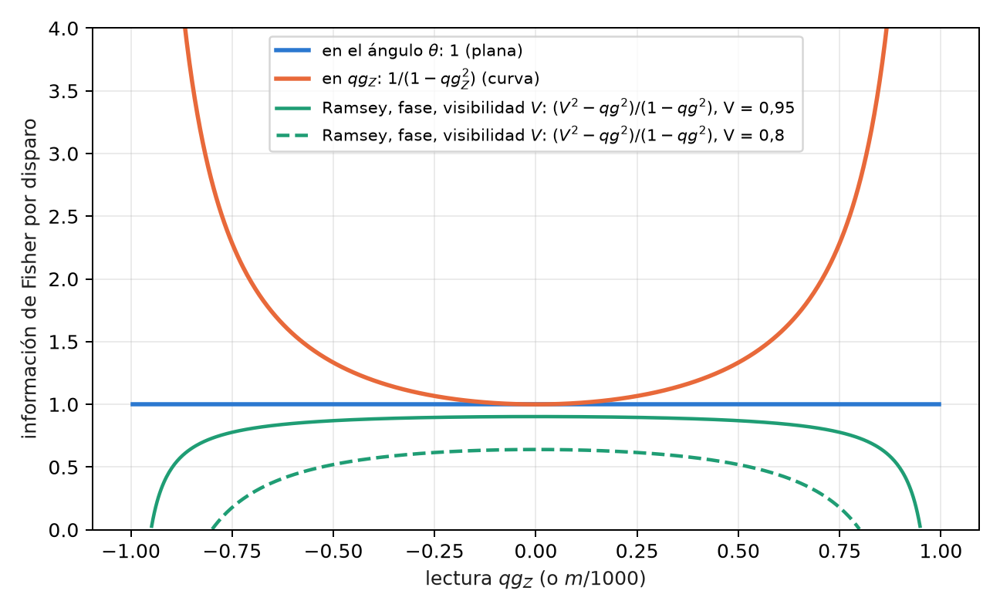
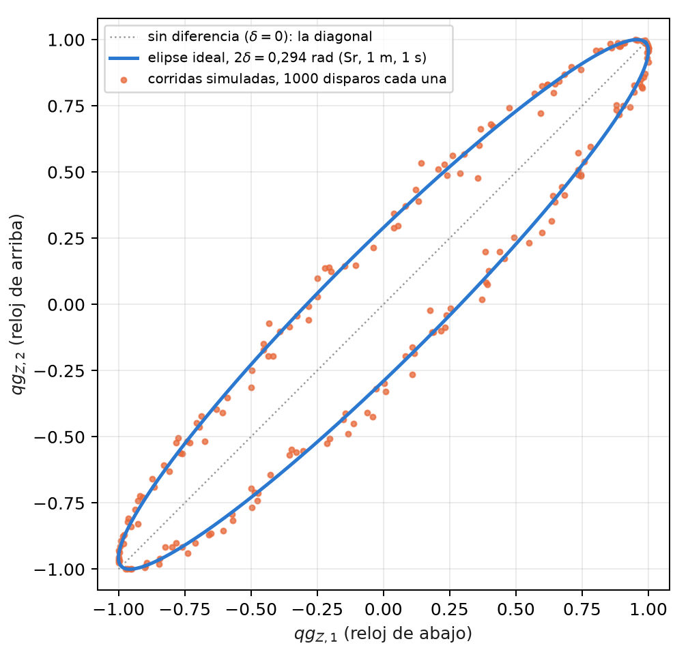
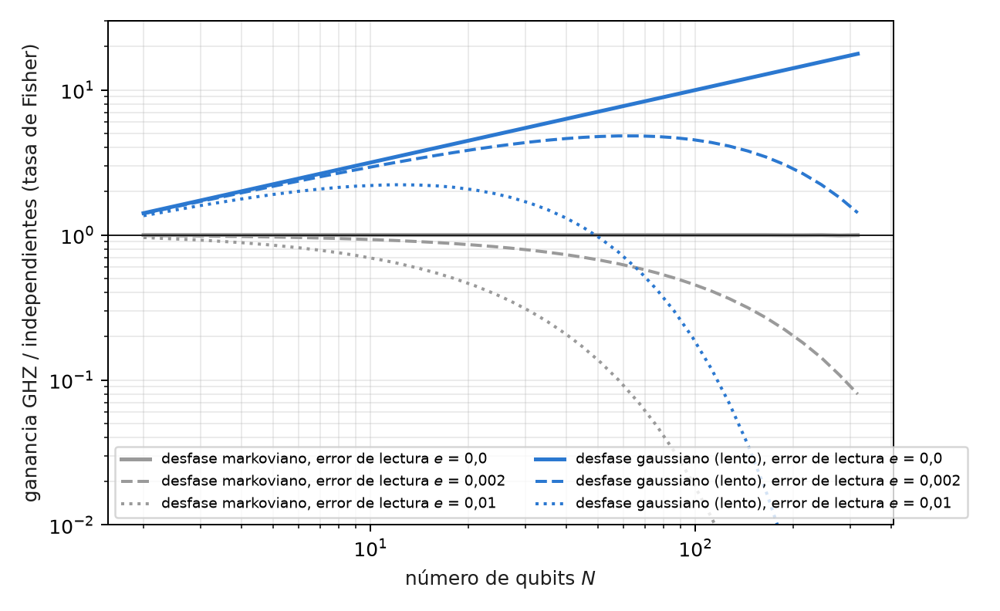

# Información de Fisher, relojes, gravedad y metrología {#sec-cap08}

La metrología es la disciplina de medir un parámetro con la menor incertidumbre posible, y su herramienta central es
la información de Fisher: cuánto enseña cada disparo sobre el parámetro. Este capítulo la escribe sobre la base del
capítulo 1. La ecuación de probabilidad $p_0=\cos^2(\theta/2)$ fija cuánta información lleva cada lectura, y de ahí salen
la resolución en mili-qang, el punto de operación de un interferómetro, la comparación de dos relojes atómicos a un
metro de altura, la ventaja (y los límites) del entrelazamiento y la termometría de un qubit.

## Desde la base: la información de un disparo {#sec-fisher-base}

Un disparo en la base $Z$ es una moneda con probabilidad $p_0$. Su información de Fisher sobre el ángulo es

$$
F_\theta=\frac{(dp_0/d\theta)^2}{p_0(1-p_0)}=\frac{\sin^2\theta/4}{\sin^2\theta/4}=1 ,
$$

constante en toda la esfera; sobre la lectura $qg_Z=\cos\theta$, en cambio, es $F_{qg}=1/(1-qg_Z^2)$, que crece hacia los
polos. **El ángulo qang es la coordenada plana de la información y $qg_Z$ la coordenada curva** (@fig-fisher). Las dos
descripciones son la misma física: la varianza $1/N$ del ángulo del capítulo 1 es la cota de Cramér–Rao en la
coordenada plana (§167).

{#fig-fisher width=90%}

Expresada en mili-qang, la cota da la resolución de una lectura:

$$
\sigma_m=\frac{1000\,|\sin\theta|}{\sqrt N}\ \text{m-qg},\qquad N=\left(\frac{1000\sin\theta}{\delta}\right)^2
\ \text{disparos para resolver } \delta\ \text{m-qg}.
$$

En el ecuador, resolver 10 m-qg exige $10^4$ disparos y resolver 1 m-qg, $10^6$; a 60° del polo, 5 m-qg cuestan
30 000. Cerca de un polo la lectura es más precisa en m-qg, pero un m-qg corresponde allí a un ángulo mayor: un
estado a $\delta$ m-qg del polo está a $\arccos(1-\delta/1000)\approx\sqrt{2\delta/1000}$ radianes, 2,56° para 1 m-qg.

## Geometría de la información y el gradiente natural {#sec-fubini}

La versión de muchos parámetros de la información de Fisher es la métrica de Fubini–Study, y gobierna el
**gradiente natural**: el descenso que mide los pasos en distancia entre estados y no en distancia entre parámetros.
En un ansatz real de rotaciones $R_Y$ y compuertas CZ, todo estado del circuito es real, $\langle Y_k\rangle=0$ antes de
cada rotación y cada entrada diagonal de la métrica vale exactamente $\tfrac14$: los ángulos son planos uno por uno, y
toda la curvatura está en los términos cruzados, que dentro de una capa son correladores $\langle Y_iY_j\rangle/4$, medibles
con un circuito por capa (§159).

Dos consecuencias prácticas, verificadas en una cadena de Ising de 4 qubits con 20 semillas: el descenso en
coordenadas qg **no converge nunca** (0 de 20), porque la coordenada curva distorsiona los pasos; y el gradiente
natural con la métrica de bloques qg$_{YY}$ es 1,3 veces más rápido que el descenso en el ángulo, y 4,6 veces con la
métrica completa. La ganancia viene de la métrica, no de cambiar de coordenada: el gradiente natural en qg es el
descenso euclidiano en $\theta$. La regla es optimizar en el ángulo y leer en qg.

## Dos relojes y la gravedad {#sec-relojes}

Un reloj atómico mide una fase, y dos relojes a distinta altura avanzan a ritmos distintos: el corrimiento al rojo
gravitatorio. Leídos con el mismo láser, dan $qg_{Z,1}=\cos(\varphi+\delta)$ y $qg_{Z,2}=\cos(\varphi-\delta)$, donde $\varphi$ es
una fase común aleatoria (el ruido del láser) y $2\delta$ la diferencia buscada. Aunque $\varphi$ sea desconocida, los pares
de lecturas caen sobre la elipse

$$
x^2+y^2-2xy\,c=1-c^2,\qquad c=\cos2\delta ,
$$

de modo que la diferencia se lee de la *forma* de la nube, sin controlar la fase común (@fig-relojes). Para dos
relojes de estroncio separados 1 m, $2\delta=2\pi\nu\,gh\,t/c^2=0{,}294$ rad en un segundo.

{#fig-relojes width=70%}

El ajuste de la elipse necesita los cuadrados de las lecturas, y ahí interviene el estimador insesgado de $qg^2$ del
capítulo 4: sin la corrección, el sesgo del ruido de disparo achata la elipse. Las cuatro predicciones registradas se
cumplieron (§126):

| prueba | resultado |
|---|---|
| sesgo relativo, 1000 disparos, 200 corridas, cuatro valores de $\delta$ | +0,09%, +0,12%, +0,05%, −0,07% |
| desvío del ajuste de elipse frente al estimador de momentos ($\delta=0{,}15$) | 0,0022 frente a 0,0075 |
| sesgo con 100 disparos, sin y con la corrección | +11,8% y +0,9% |
| estroncio, 1 m, 1 s | $\delta=0{,}1471$; estimado $0{,}1472\pm0{,}0022$ (68σ) |

: Comparación de relojes por ajuste de elipse, simulada. {#tbl-relojes}

En este modelo idealizado, la dispersión equivale a unos 1,5 cm de altura cada 200 corridas. Los límites están
declarados: sin decoherencia del láser durante el tiempo de Ramsey, con contraste 1 y ruido de proyección binomial.

## Sensado Ramsey: dónde operar {#sec-ramsey}

Un interferómetro de Ramsey convierte una fase en una probabilidad: $qg=a+bV\cos(\varphi-\alpha)$, con visibilidad $V$,
punto de operación $\alpha$ y el mapa de lectura $(a,b)$ del capítulo 27. Con lectura ideal, la información por disparo
sobre la fase es

$$
F=\frac{V^2-qg^2}{1-qg^2}.
$$

Con $V=1$ es plana, $F=1$ en todas partes: la ganancia $1/(1-qg^2)$ de los polos se cancela exactamente con el
jacobiano. Con $V<1$ el óptimo es el centro de la franja, $qg=0$, y la información se anula en la franja brillante
(@fig-fisher). Es la práctica conocida de operar en cuadratura, escrita en qg (§36). Tres matices medidos:

- **La asimetría de lectura corre el óptimo, pero no importa:** la ganancia de moverse al nuevo óptimo es de 0,17%
  con la lectura calibrada, y de 1,6% incluso con un error de lectura de 10%.
- **Con pocos disparos ayuda una previa:** con 10 disparos, la media posterior bayesiana es unas 2 veces mejor que la
  inversión directa, porque el rango previo de la fase aporta información.
- **Con visibilidad 0,9, operar en el polo empeora con más disparos** (el error escalado pasa de 1,09 a 2,50 entre 10 y
  1000 disparos): allí las fases pequeñas se vuelven invisibles. El centro de la franja sigue su cota (1,11–1,24,
  con cota 1,12).

## Metrología GHZ: cuándo el entrelazamiento gana {#sec-ghz}

Con $N$ qubits se puede medir una frecuencia $\omega$ de dos maneras: $N$ relojes de Ramsey independientes, o un estado
GHZ, cuya paridad $X_1\cdots X_N$ es un único valor qg de todo el registro, $qg_P=V_N\cos(N\omega t)$, que oscila $N$ veces
más rápido. La ventaja se paga con la visibilidad, que cae como la $N$-ésima potencia de la de un qubit. En el
centro de la franja la información por disparo es $V^2$, y por unidad de tiempo (§58):

$$
\text{independientes: } N\,t\,e^{-2t/T_2}(1-2e)^2,\qquad \text{GHZ: } N^2\,t\,e^{-2Nt/T_2}(1-2e)^{2N},
$$

con $e$ el error de lectura por qubit. Optimizando el tiempo de interrogación:

| $N$ | markoviano, $e=0$ | $e=0{,}002$ | $e=0{,}01$ | gaussiano, $e=0$ | $e=0{,}002$ | $e=0{,}01$ |
|---|---|---|---|---|---|---|
| 2 | 1,000 | 0,992 | 0,960 | 1,414 | 1,403 | 1,358 |
| 10 | 1,000 | 0,930 | 0,695 | 3,162 | 2,942 | 2,198 |
| 30 | 1,000 | 0,793 | 0,310 | 5,477 | 4,341 | 1,697 |
| 100 | 1,000 | 0,452 | 0,018 | 10,00 | 4,522 | 0,183 |

: Ganancia de la tasa de información de Fisher, GHZ sobre qubits independientes. {#tbl-ghz}

{#fig-ghz width=90%}

La tabla resume tres resultados conocidos, aquí en una sola lectura qg. Con desfase markoviano no hay ganancia para
ningún $N$ (Huelga y colaboradores, 1997), y con error de lectura los qubits independientes son estrictamente mejores.
Con desfase gaussiano, lento, la ganancia crece como $\sqrt N$, el límite tipo Zenón (Matsuzaki y colaboradores, 2011;
Chin, Huelga y Plenio, 2012). Y la lectura la limita: la paridad arrastra $(1-2e)^N$, de modo que hay un tamaño óptimo
del estado GHZ, más allá del cual agregar qubits empeora la medición (@fig-ghz).

## Estados térmicos: $qg_Z=\tanh(\beta h)$ {#sec-termicos}

Un qubit con $H=-hZ$ en equilibrio a temperatura $T$ (con $k_B=1$) está en el estado de Gibbs, y su sesgo polar es

$$
qg_Z=\tanh(\beta h),\qquad \beta=1/T .
$$

Toda la termodinámica del qubit es entonces función de una sola lectura (§25):

| magnitud | en qg |
|---|---|
| energía | $U=-h\,qg$ |
| entropía (bits) | $S=qg_S(qg)$, exacta porque $\rho$ es diagonal en $Z$ |
| energía libre | $F=-T\ln\!\big(2/\sqrt{1-qg^2}\big)$ |
| capacidad calorífica | $C/k_B=\operatorname{artanh}(qg)^2\,(1-qg^2)$ |
| ángulo de preparación | $\theta=\arccos(qg)=\pi/2-\operatorname{gd}(\beta h)$ (función de Gudermann) |

: Termodinámica de un qubit en unidades qg. {#tbl-termico}

**Termometría.** Una medición en $Z$ es una medición de energía, y por lo tanto la óptima sobre un estado de Gibbs; su
información de Fisher sobre $T$ es $C/T^2$. La mejor precisión relativa está en el máximo de la capacidad calorífica:

$$
qg\cdot\operatorname{artanh}(qg)=1\quad\Rightarrow\quad qg^\ast=0{,}8336,\qquad \beta h=1{,}1997 ,
$$

el pico de la anomalía de Schottky, el punto de operación óptimo conocido de un termómetro de dos niveles (Correa y
colaboradores, 2015), aquí como una condición de una línea sobre la lectura. La sección es una reescritura exacta de
termodinámica de libro de texto, verificada contra $e^{-\beta H}$ a $5\cdot10^{-12}$; no se esperaba ni se encontró una
ventaja.

## En código {#sec-codigo08}

```python
from qang import probability

r = probability.analyze(750, 1000)   # 750 ceros en 1000 disparos, en todas las unidades qang
# p0, qg_Z, m = 500.0 [444.5, 551.7] m-qg, theta = 60.0° [56.5°, 63.6°], qg_S, con intervalos
```

## Resumen {#sec-resumen08}

- Por disparo, la información es 1 en el ángulo y $1/(1-qg_Z^2)$ en $qg_Z$; la resolución en m-qg es
  $1000|\sin\theta|/\sqrt N$, la cota de Cramér–Rao.
- La métrica del gradiente natural en un ansatz real tiene diagonal $\tfrac14$ y correladores $qg_{YY}$; optimizar en
  coordenadas qg no converge, y la ganancia viene de la métrica.
- Dos relojes con fase común aleatoria trazan una elipse; su forma da el corrimiento gravitatorio a 1 m con 68σ en el
  modelo, si se corrige el sesgo de los cuadrados.
- Un interferómetro de Ramsey con visibilidad $V<1$ se opera en el centro de la franja; su información es
  $(V^2-qg^2)/(1-qg^2)$.
- El estado GHZ no gana con desfase markoviano, gana $\sqrt N$ con desfase lento y lo pierde con el error de lectura
  elevado a la $N$.
- Un qubit térmico tiene $qg_Z=\tanh(\beta h)$; su mejor punto de termometría es $qg^\ast=0{,}8336$, el pico de Schottky.
