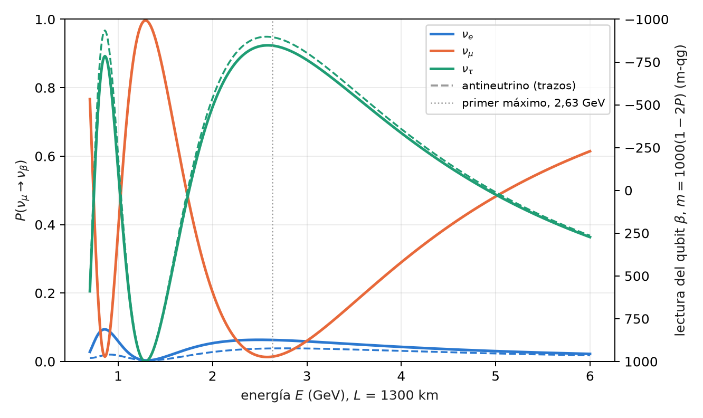

# Cinemática cuántica de la oscilación de sabor en el vacío {#sec-cap09}

Un neutrino nace y se detecta en un estado de sabor ($\nu_e$, $\nu_\mu$ o $\nu_\tau$), pero viaja en estados de masa. Como
los estados de masa acumulan fases distintas, el sabor cambia por el camino: es la oscilación de sabor, y en el vacío
es exactamente una rotación de dos o tres niveles. Este capítulo la escribe sobre la base del capítulo 1. Una
probabilidad de oscilación es una probabilidad qang como cualquier otra, con su ángulo, su lectura en mili-qang y su
barra de error; la oscilación de dos sabores es una precesión sobre un cono de la esfera; y los tres sabores caben en
tres qubits con un circuito que conserva el peso, de modo que el filtro qg se aplica. El capítulo termina con el primer
dato de hardware real del proyecto, tomado en IQM Garnet.

Todo lo de este capítulo es en el vacío. Una línea de base de 1300 km atraviesa la Tierra y tiene efectos de materia
apreciables; esos efectos son el tema del capítulo 10.

## Desde la base: la probabilidad de oscilación en m-qg {#sec-osc-base}

Con dos sabores en un qubit, $|0\rangle=\nu_e$ y $|1\rangle=\nu_\mu$, la probabilidad de sobrevivir es $p_0=1-P$, con
$P=P(\nu_e\to\nu_\mu)$. La ecuación de probabilidad del capítulo 1 le asigna todas sus lecturas:

$$
qg_Z=1-2P,\qquad m=1000\,(1-2P)\ \text{m-qg},\qquad \vartheta=\arccos qg_Z=2\arcsin\sqrt P ,
$$

y su resolución por disparos, $\sigma_m=1000\,|\sin\vartheta|/\sqrt N=2000\sqrt{P(1-P)}/\sqrt N$ m-qg. Un 1% de
probabilidad de aparición son 20 m-qg; una diferencia de probabilidad de 0,025 son 50 m-qg. Con tres sabores en
tres qubits (más abajo) cada qubit lleva la probabilidad de un sabor y se lee igual: $m_\beta=1000\,(1-2P_\beta)$.

La escala no agrega física: es la misma probabilidad. Lo que agrega es una regla común para comparar la señal con
el ruido de disparo, y, como se ve enseguida, una coordenada en la que el ángulo de mezcla se lee directamente.

## La oscilación como rotación sobre un cono {#sec-cono-osc}

En la base de sabor, ir a la base de masa es una rotación $R_Y(-2\theta)$, con $\theta$ el ángulo de mezcla; en la base
de masa los dos estados adquieren la fase relativa

$$
\Delta=\frac{\Delta m^2L}{2E}=2\times1{,}267\,\frac{\Delta m^2[\mathrm{eV}^2]\,L[\mathrm{km}]}{E[\mathrm{GeV}]},
$$

que es un $R_Z(\Delta)$; y volver al sabor es $R_Y(2\theta)$. El circuito de un qubit es entonces
$R_Y(2\theta)\,R_Z(\Delta)\,R_Y(-2\theta)$, y su lectura (§151)

$$
qg_Z=\cos^2 2\theta+\sin^2 2\theta\,\cos\Delta,\qquad P(\nu_e\to\nu_\mu)=\sin^2 2\theta\,\sin^2\frac{\Delta}{2}.
$$

La primera fórmula es la **ley de cosenos esférica**. El eje de masa está a $2\theta$ del polo; el vector de Bloch, que
parte del polo, precesiona alrededor de ese eje sobre un cono de semiángulo $2\theta$, y después de girar $\Delta$ está a
una distancia de arco $\vartheta=\arccos qg_Z$ del polo. Es el triángulo esférico de dos lados $2\theta$ y ángulo
comprendido $\Delta$. El ángulo qang de la lectura es la distancia recorrida sobre la esfera (@fig-cono-osc).

{#fig-cono-osc width=100%}

## El ángulo de mezcla es un cuarto del ángulo qang {#sec-cuarto}

En el máximo de oscilación, $\Delta=\pi$, la ley de cosenos se reduce a $qg_Z=\cos^2 2\theta-\sin^2 2\theta=\cos4\theta$, y
por lo tanto

$$
\theta_{\text{mezcla}}=\frac{\vartheta}{4}=\frac{\arccos qg_Z}{4}\qquad(\theta\le\pi/4).
$$

El ángulo de mezcla se lee como un cuarto de ángulo qang, sin invertir ningún $\sin^2$. Hay que decir con precisión
qué es y qué no es esto. Es exacto sólo en el máximo: en otra fase la relación entre $\vartheta$ y $\theta$ no es lineal, y
la trigonometría sigue ahí. Y no es física nueva: es la transformación arcoseno de una proporción del capítulo 4
(§125), que en el máximo coincide con la geometría del cono.

La condición $\theta\le\pi/4$ tampoco es un detalle. Para $\theta>\pi/4$ el ángulo $4\theta$ pasa de $\pi$ y $\arccos$ devuelve
$2\pi-4\theta$, es decir, $\pi/2-\theta$. Como $\sin^22\theta$ es simétrica bajo $\theta\to\pi/2-\theta$, ninguna medición de dos
sabores distingue los dos valores: es la **degeneración de octante**, la misma que tiene el ángulo atmosférico
$\theta_{23}$ (49° en los valores usados aquí; la lectura en el máximo daría 41°). La escala qg la hace visible, no la
resuelve.

## Barras de error que no dependen del ángulo {#sec-barras}

El ángulo qang hereda la varianza estabilizada de la transformación arcoseno: su desvío por ruido de disparo es
$1/\sqrt{N+\frac12}$, el mismo en toda la esfera (capítulo 4, §125). Dividido por cuatro:

$$
\sigma_\theta=\frac{1}{4\sqrt{N+\frac12}} ,
$$

que no depende de $\theta$. Con 1000 disparos es 0,0079 rad (0,45°). Leída en mili-qang, la misma medición sí
depende del punto: para $\theta=0{,}1$ el máximo está en $m=1000\cos0{,}4=921$ m-qg con $\sigma_m=12$ m-qg. La
predicción registrada (N1) se cumplió con 2000 repeticiones binomiales:

| $\theta$ (rad) | 0,1 | 0,3 | 0,5 | 0,7 |
|---|---|---|---|---|
| media de $\hat\theta$ | 0,0999 | 0,2999 | 0,5000 | 0,7006 |
| desvío de $\hat\theta$ (teoría 0,0079) | 0,0079 | 0,0077 | 0,0078 | 0,0081 |

: El ángulo de mezcla leído como $\arccos(qg_Z)/4$ en el máximo, 1000 disparos, 2000 repeticiones. {#tbl-barras}

## Tres sabores en tres qubits {#sec-tres}

Con tres sabores, el estado de sabor $k$ es el estado de peso 1 con sólo el qubit $k$ excitado: $\nu_e=|100\rangle$,
$\nu_\mu=|010\rangle$, $\nu_\tau=|001\rangle$ (en el orden de qubits 0, 1, 2). La matriz PMNS en su forma estándar,

$$
U=R_{23}\,U_\delta\,R_{13}\,U_\delta^\dagger\,R_{12},\qquad U_\delta=\operatorname{diag}(1,1,e^{i\delta_{CP}}),
$$

es tres rotaciones reales y dos fases. Cada rotación $R_{ij}$ es una compuerta RBS (un $XX+YY$) entre los qubits $i$ y
$j$; cada fase es una compuerta de fase sobre un qubit; y la propagación, en la base de masa, es una compuerta de fase
por qubit. **Todas las compuertas conservan el peso de Hamming**, de modo que una medición con peso distinto de 1
es un error, y se puede descartar: es el filtro de simetría qg del capítulo 21 (§77). Para antineutrinos basta $\delta_{CP}\to-\delta_{CP}$.
El circuito reproduce las probabilidades analíticas del vacío a $10^{-15}$.

La @fig-espectro muestra el caso de la predicción: un $\nu_\mu$ inicial, $L=1300$ km (una línea de base del tipo de DUNE),
$\delta_{CP}=-\pi/2$ y valores de mezcla del tipo de NuFIT en ordenamiento normal. El primer máximo de oscilación está en
2,63 GeV, donde la supervivencia cae a $P(\nu_\mu\to\nu_\mu)=0{,}013$, es decir, $m_\mu=974$ m-qg.

{#fig-espectro width=90%}

## Supresión del ruido con el filtro qg {#sec-filtro}

El circuito de tres sabores, compilado, tiene 18 compuertas de dos qubits en IBM. Se corrió en **modelos de ruido
simulados** de tres dispositivos (FakeBrisbane con compuertas ECR, FakeTorino y FakeFez con CZ), con 8 energías entre
0,8 y 5 GeV y 4000 disparos. El error es la media de $|\hat P-P|$ sobre los tres sabores y las ocho energías (§151):

| dispositivo simulado | crudo | corrección de lectura | filtro qg | filtro + lectura | conservado | crudo / filtro + lectura |
|---|---|---|---|---|---|---|
| FakeBrisbane | 0,048 | 0,038 | 0,014 | 0,013 | 85–87% | 3,8× |
| FakeTorino | 0,034 | 0,028 | 0,010 | 0,010 | 90–92% | 3,4× |
| FakeFez | 0,025 | 0,024 | 0,009 | 0,009 | 93–94% | 3,0× |

: Error medio de las probabilidades de tres sabores, modelos de ruido simulados. {#tbl-filtro}

El error baja entre 3,0 y 3,8 veces, y casi toda la ganancia es del filtro, no de la corrección de lectura. Las cuatro
predicciones registradas se cumplieron, incluida la posición del mínimo de $P(\nu_\mu\to\nu_\mu)$ en 2,6 GeV en los tres
dispositivos.

**En hardware real** (§165). El mismo circuito se corrió en IQM Garnet, un procesador superconductor de 20 qubits,
compilado a sus compuertas nativas con 12 CZ; 8 energías, 300 disparos cada una, con predicciones registradas antes
del trabajo. Las cuatro se cumplieron, y la @fig-garnet muestra los datos:

| prueba | resultado |
|---|---|
| error con filtro menor que el crudo | 0,039 < 0,062 |
| razón crudo / filtro $\ge 1{,}5$ | 1,59 (por poco) |
| mínimo filtrado de $P(\nu_\mu\to\nu_\mu)$ en 2,6 GeV | sí; **el crudo lo pone en 0,8 GeV** |
| fracción conservada $\ge 0{,}5$ | 0,88 |

: El circuito de tres sabores en IQM Garnet, 8 × 300 disparos, sin corrección de lectura. {#tbl-garnet}

{#fig-garnet width=90%}

Tres lecturas de este dato. En el hardware real **el filtro devuelve el máximo de oscilación a su lugar**. El chip
anduvo mejor que su modelo simulado (0,062 crudo contra 0,126) y por eso el filtro ganó menos (1,6× contra 2,2× en el
ensayo): salen menos disparos del sector, y hay menos para quitar. Y lo que queda está **dentro del sector**, donde
el filtro no ve: en el máximo, $P(\nu_\mu\to\nu_\mu)$ se lee 0,10 contra 0,013 exacto (unos 175 m-qg de diferencia), y el
error de $\nu_\tau$ apenas se mueve (0,062 → 0,052). Es una corrida en un día, con 300 disparos por circuito.

## La asimetría CP en el vacío {#sec-cp}

La violación de CP aparece como una diferencia entre neutrinos y antineutrinos:

$$
A_{CP}=P(\nu_\mu\to\nu_e)-P(\bar\nu_\mu\to\bar\nu_e) .
$$

En 2,6 GeV con $\delta_{CP}=-\pi/2$ vale 0,0250 (0,0630 contra 0,0380), es decir, **50 m-qg** en el qubit de $\nu_e$. Con
20 000 disparos por circuito, el ruido de disparo de la diferencia es de unos 4,4 m-qg: la señal está a unos 11σ.
La supervivencia, en cambio, no distingue: en el vacío CPT impone $P(\nu_\mu\to\nu_\mu)=P(\bar\nu_\mu\to\bar\nu_\mu)$ (las
curvas naranjas de la @fig-espectro coinciden).

| dispositivo simulado | crudo | filtro + lectura |
|---|---|---|
| FakeBrisbane | 0,024 (48 m-qg) | 0,026 (51 m-qg) |
| FakeTorino | 0,017 (35 m-qg) | 0,022 (44 m-qg) |
| FakeFez | 0,020 (41 m-qg) | 0,022 (44 m-qg) |

: Asimetría CP en 2,6 GeV, exacta 0,0250 (50 m-qg), 20 000 disparos, modelos de ruido simulados. {#tbl-cp}

**La asimetría sobrevive incluso sin el filtro.** Es la diferencia entre dos circuitos casi idénticos (sólo cambia el
signo de dos fases), así que el corrimiento que el ruido produce en común se cancela en la resta, igual que en el
clasificador de fidelidad de §149. Lo que no se cancela es la contracción, que achica las dos probabilidades y con
ellas la diferencia: por eso el crudo de FakeTorino lee 35 m-qg y no 50. El filtro reduce el error a la mitad en los
dispositivos con CZ.

## Qué es y qué no es el vínculo entre neutrinos y qang {#sec-alcance09}

Es modelado: la oscilación es una rotación, y el ángulo qang lee el ángulo de mezcla directamente en el máximo, con
una barra de error conocida. No elimina la trigonometría en general, y no acelera los métodos variacionales para gases
densos de neutrinos: esos son problemas de muchos cuerpos (capítulo 10). Los límites están declarados: vacío
solamente, parámetros fijos, ruido de dispositivos simulado salvo la corrida única de IQM Garnet.

## Sin qang y con qang {#sec-comparacion09}

| acción | sin qang | con qang | diferencia |
|---|---|---|---|
| leer el ángulo de mezcla en el máximo | $\theta=\tfrac12\arcsin\sqrt{P}$ y método delta | $\theta=\arccos(qg_Z)/4$, $\sigma_\theta=1/(4\sqrt{N+\frac12})$ | **mismo orden principal**: el método delta también da $1/(4\sqrt N)$; qang lo obtiene sin derivar, con la corrección $+\frac12$ para pocos disparos; en $P=0$ o $1$ exactos los dos necesitan los intervalos del capítulo 4 |
| ver la degeneración de octante | simetría de $\sin^22\theta$ | la lectura en el máximo devuelve $\pi/2-\theta$ | **ninguna**: la escala la hace visible, no la resuelve |
| comparar la señal CP con el ruido | $\Delta P=0{,}025$ frente a $\sigma_P$ | 50 m-qg frente a 4,4 m-qg | **unidad**: el cociente (11σ) es el mismo |
| reducir el error del circuito de tres sabores | corrección de lectura: poco efecto | filtro de peso: 3,0–3,8× (simulado), 1,6× en Garnet | la ganancia es del **filtro de simetría**, no de la escala qang |

: Las acciones del capítulo sin la escala qang y con ella. {#tbl-comparacion09}

**Balance.** La geometría del cono y la lectura del ángulo de mezcla son la contribución propia de qang, con una barra
de error que no hay que derivar. La mejora contra el ruido, que es la cifra más grande del capítulo, pertenece al
filtro.

## En código {#sec-codigo09}

```python
import math
from qang import neutrino as nu

# dos sabores: la lectura y el ángulo de mezcla en el máximo
q = nu.two_flavour_qg_z(theta=0.1, delta=math.pi)   # cos(0.4) = 0.921 -> 921 m-qg
nu.mixing_angle_from_maximum(q)                      # 0.1
nu.mixing_angle_std(1000)                            # 0.0079 rad

# tres sabores: probabilidades exactas, circuito de peso 1 y asimetría CP
P = nu.three_flavour_probabilities(L=1300, E=2.6, delta_cp=-math.pi / 2)   # P[mu] = [0.063, 0.013, 0.924]
qc = nu.three_flavour_circuit("mu", L=1300, E=2.6, delta_cp=-math.pi / 2)
nu.cp_asymmetry(L=1300, E=2.6, delta_cp=-math.pi / 2)                    # 0.0250
```

## Resumen {#sec-resumen09}

- Una probabilidad de oscilación $P$ se lee como $m=1000(1-2P)$ m-qg, con ángulo $2\arcsin\sqrt P$ y resolución
  $2000\sqrt{P(1-P)/N}$ m-qg.
- Con dos sabores, $qg_Z=\cos^22\theta+\sin^22\theta\cos\Delta$ es la ley de cosenos esférica de la precesión sobre un cono
  de semiángulo $2\theta$.
- En el máximo, $\theta=\arccos(qg_Z)/4$ con desvío $1/(4\sqrt{N+\frac12})$, independiente de $\theta$; para $\theta>\pi/4$ la
  lectura devuelve $\pi/2-\theta$ (degeneración de octante).
- Tres sabores son tres qubits en el sector de peso 1; PMNS son tres RBS y dos fases, y el filtro qg baja el error
  3,0–3,8 veces en modelos simulados.
- En IQM Garnet, el filtro gana 1,6× y devuelve el máximo de oscilación a 2,6 GeV; el error que queda está dentro del
  sector.
- La asimetría CP en 2,6 GeV son 50 m-qg y sobrevive sin filtro, porque el corrimiento común se cancela en la resta.

## Notas bibliográficas {.unnumbered}

La matriz de mezcla de leptones viene de @pontecorvo1968 y @maki1962; los parámetros de oscilación usados son del tipo
del ajuste global NuFIT [@esteban2020] y del *Review of Particle Physics* [@pdg2024]. La compuerta RBS es la de las
redes ortogonales de @landman2022. Las notas de investigación numeradas (§) que cita el capítulo y los scripts que lo
verifican están en el repositorio [@qangrepo]; la definición de la unidad qang, en @monteverde2026.
