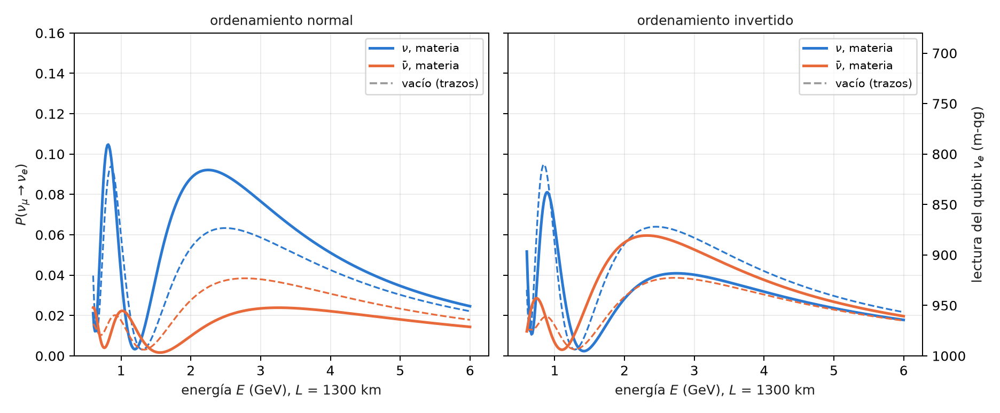

# Efectos de materia, neutrinos solares y oscilaciones colectivas {#sec-cap10}

El capítulo 9 dejó al neutrino en el vacío. Pero un haz de 1300 km atraviesa la Tierra, los neutrinos solares
nacen en el centro del Sol, y en una supernova los neutrinos son tan densos que interactúan entre sí. En los tres
casos el medio agrega un término al hamiltoniano de sabor, y la pregunta del capítulo es la misma en los tres: **qué
número sigue conservado**, porque eso decide si el filtro qg se aplica, y en qué base. Sobre la base del capítulo 1,
cada efecto del medio se lee como un corrimiento en mili-qang, en la misma escala que el ruido de disparo.

## Desde la base: el medio como corrimiento en m-qg {#sec-materia-base}

Cada qubit de sabor (o de masa) se lee como en el capítulo 9, $m=1000\,(1-2P)$ m-qg, de modo que un efecto del medio
que cambia una probabilidad en $\delta P$ es un corrimiento de $2000\,\delta P$ m-qg, comparable directamente con la
resolución $\sigma_m=2000\sqrt{P(1-P)/N}$. Tres ejemplos de este capítulo, en esa escala:

| efecto | $\delta P$ | en m-qg |
|---|---|---|
| materia sobre $P(\nu_\mu\to\nu_e)$, 1300 km, 2,6 GeV, ordenamiento normal | 0,063 → 0,087 | 48 |
| asimetría falsa de la materia con $\delta_{CP}=0$ | 0,042 | 84 |
| caída MSW de $P_{ee}$ solar, 0,5 → 10 MeV, leída en el qubit $\nu_2$ | $p_2$: 0,35 → 0,93 | 1173 |

: Efectos del medio como corrimientos en mili-qang. {#tbl-materia-mqg}

Con 1000 disparos y $P\approx0{,}07$, la resolución es de unos 16 m-qg: el efecto de la Tierra se ve a 3σ en un solo
circuito, y la caída solar es casi toda la escala.

## El efecto MSW en la Tierra {#sec-msw-tierra}

Los electrones de la Tierra dispersan los $\nu_e$ hacia adelante y les suman al hamiltoniano de sabor un potencial
$A=2\sqrt2\,G_FN_eE$, que en las unidades de oscilación es

$$
A=1{,}52\times10^{-4}\,Y_e\,\rho[\mathrm{g/cm^3}]\,E[\mathrm{GeV}]\ \mathrm{eV}^2 ,
$$

con signo opuesto para los antineutrinos (Mikheyev–Smirnov–Wolfenstein). En la corteza ($\rho=2{,}85$ g/cm³,
$Y_e=0{,}5$) y a 2,6 GeV, $A=5{,}6\times10^{-4}$ eV², un 22% de $\Delta m^2_{31}$: no es una corrección menor.

El potencial actúa sólo sobre $\nu_e$, es decir, es una fase sobre el qubit 0. El circuito alterna el paso exacto de
vacío del capítulo 9 con esa fase (Trotter de segundo orden, o de Strang), y **cada compuerta sigue conservando el
peso**: el filtro qg se aplica igual que en el vacío (§152). Con $L=1300$ km y entre 0,8 y 5 GeV:

| prueba | resultado |
|---|---|
| M1 error de Trotter sin ruido, $r=2$ / $4$ (pedido $<0{,}005$ / $<0{,}001$) | 0,0052 / 0,0011 — **falló** por poco |
| M2 asimetría sólo de materia con $\delta_{CP}=0$, 2,6 GeV | 0,042 (la señal CP del vacío era 0,025) |
| M3 mejor error crudo / filtro + lectura | Brisbane 0,046 / 0,017, Torino 0,027 / 0,009, Fez 0,023 / 0,014 (mediana 2,8×) |
| M4 pasos óptimos con filtro $\ge$ sin filtro | $r^\ast=1$ en todos los casos (se cumple en vacío) |
| M5 $A_{CP}(\delta_{CP}=0)$, filtro + lectura, $r=2$ | 0,035, 0,035, 0,029 (exacta 0,042; Trotter $r=2$: 0,033) |

: El efecto MSW como circuito de Trotter, modelos de ruido simulados. {#tbl-msw}

Tres lecciones. **La materia imita la violación CP**: con $\delta_{CP}=0$, donde el vacío no da ninguna asimetría, la
Tierra produce 84 m-qg de diferencia entre $\nu$ y $\bar\nu$, más que los 50 m-qg de la señal CP del capítulo 9; por
eso los experimentos de línea de base larga tienen que modelar la materia, y el circuito filtrado la ve. **No hay
compromiso de profundidad**: un solo paso de Trotter ya tiene menos error (0,012) que el ruido, así que $r^\ast=1$ con
o sin filtro, y M4 se cumple sólo porque ambos valen 1. Y **la distancia de M5 al valor exacto es error de Trotter,
no ruido**: los valores filtrados están a 0,004 del valor de Trotter con $r=2$.

## El ordenamiento de masas leído a través de la materia {#sec-ordenamiento}

El vacío no distingue el signo de $\Delta m^2_{31}$; la materia sí, porque lo que importa es el signo del producto
$A\,\Delta m^2_{31}$. En ordenamiento normal ($\Delta m^2_{31}>0$) la materia refuerza $\nu_\mu\to\nu_e$ y debilita la de
antineutrinos; en el invertido, al revés (@fig-materia). Con los valores exactos a 2,6 GeV:

| | $\nu$, vacío | $\nu$, materia | $\bar\nu$, vacío | $\bar\nu$, materia |
|---|---|---|---|---|
| normal | 0,063 | 0,087 | 0,038 | 0,021 |
| invertido | 0,063 | 0,041 | 0,039 | 0,058 |

: $P(\nu_\mu\to\nu_e)$ a 1300 km y 2,6 GeV, $\delta_{CP}=-\pi/2$. {#tbl-ordenamiento}

{#fig-materia width=100%}

En los modelos de ruido simulados, con el circuito de Trotter de $r=2$ y el filtro, **el ordenamiento se lee bien en
los tres dispositivos**, con el signo correcto de la asimetría $\nu/\bar\nu$ (§163). Los valores filtrados quedan
0,010–0,033 por encima de la referencia del circuito sin ruido (la predicción O3 falló): el ruido dentro del sector
corre probabilidad hacia los otros sabores. Pero el sesgo es común, y la diferencia entre ordenamientos sobrevive:
0,034–0,036 contra 0,037 en la referencia.

## Neutrinos solares: el Sol entero es una sola rotación {#sec-sol}

Un $\nu_e$ nace en el núcleo del Sol, donde $(\rho Y_e)\approx100$ g/cm³, y sale hacia el vacío. A energías bajas la
materia apenas importa y llega a la Tierra con la probabilidad promediada del vacío; por encima de la resonancia
(unos 2 MeV en el núcleo), la densidad central gira el ángulo de mezcla en materia $\theta_m$ casi hasta 90°, el neutrino
sigue adiabáticamente el autoestado pesado y sale del Sol como $\nu_2$. Las fases se pierden en el camino a la Tierra,
así que lo que llega es una población en la base de masa, y la probabilidad de supervivencia (§156)

$$
P_{ee}=c_{13}^4\left(\cos^2\theta_{12}\,p_1+\sin^2\theta_{12}\,p_2\right)+s_{13}^4
$$

es **lineal en $qg_Z$ del qubit $\nu_2$**. Cae de 0,54 a 0,30 entre 0,5 y 15 MeV (@fig-sol); en el qubit $\nu_2$ eso es
pasar de $+304$ a $-868$ m-qg, más de la mitad de la escala.

{#fig-sol width=90%}

El circuito usa dos sabores efectivos ($\nu_3$ desacoplado; coincide con tres sabores a 0,001) y un Sol escalado: un
perfil exponencial de 100 km de altura de escala, cortado en $r$ capas uniformes en $\theta_m$. Cada capa es un
propagador exacto de $2\times2$, $R_Z\cdot\mathrm{RBS}\cdot R_Z$ sobre dos qubits en el sector de peso 1, y el filtro se
aplica. Las seis predicciones registradas se cumplieron:

| lectura (error medio de $P_{ee}$ contra el circuito sin ruido) | Brisbane | Torino | Fez |
|---|---|---|---|
| capas $r=8$, crudo / filtro + lectura | 0,025 / 0,011 | 0,018 / 0,008 | 0,027 / 0,015 |
| compilado (una sola RBS), crudo / filtro + lectura | 0,008 / 0,002 | 0,005 / 0,002 | 0,006 / 0,003 |
| un qubit, crudo / lectura | 0,004 / 0,002 | 0,031 / 0,003 | 0,004 / 0,002 |
| caída MSW $P_{ee}(0{,}5)-P_{ee}(10\ \text{MeV})$, $r=8$ filtrado (exacta 0,231) | 0,218 | 0,218 | 0,202 |

: Neutrinos solares en modelos de ruido simulados. {#tbl-sol}

El filtro gana 1,9–2,3× en el circuito de capas, como en la Tierra. Pero el resultado importante es otro: **la física
hace innecesario el circuito**. Como las fases se pierden antes de la detección, el observable es una sola población,
y el circuito compilado (todo el Sol en la única RBS que carga $p_2$) le gana a cualquier circuito de capas incluso sin
filtro; con dos sabores, un qubit con corrección de lectura es tan bueno como cualquier otra cosa. La respuesta
adiabática es clásica, $\sin^2\theta_m$ en el núcleo. Una computadora cuántica sólo podría aportar donde la coherencia
sobrevive: la regeneración día–noche en la Tierra, o los efectos colectivos de la sección siguiente.

**Pendiente: el Sol real.** El perfil es escalado (el real tiene una altura de escala de unos $6\times10^4$ km y es
mucho más adiabático, con la misma respuesta adiabática), y el error de discretización de las capas (0,009 con $r=8$)
es del tamaño del ruido filtrado. La comparación con un perfil de densidad del Modelo Solar Estándar no está hecha:
queda como propuesta, no como resultado.

## Oscilaciones colectivas: lo que se conserva es el número de masa {#sec-colectivas}

En una supernova la densidad de neutrinos es tan alta que se dispersan entre sí. Con $N$ neutrinos de dos sabores, un
qubit cada uno y la aproximación de un solo ángulo, el hamiltoniano en la base de masa es

$$
H_m=-\sum_i\frac{\omega_i}{2}Z_i+\frac{\mu}{2N}\sum_{i<j}\boldsymbol\sigma_i\cdot\boldsymbol\sigma_j ,
$$

con $\omega_i=\Delta m^2/2E_i$ y $\mu$ el acoplamiento neutrino–neutrino. La sección §151 había nombrado estos gases
como un blanco natural del filtro porque "se conserva el número total de sabor". **Eso vale sólo para el término
neutrino–neutrino.** El producto $\boldsymbol\sigma_i\cdot\boldsymbol\sigma_j$ es el mismo en cualquier base, pero el término de
vacío es diagonal sólo en la base de masa: lo que se conserva es **el número de $\nu_2$**, no el de sabor (§154).
La @fig-colectivas lo muestra con la evolución exacta de cuatro neutrinos: el número de $\nu_2$ es constante y el de
$\nu_x$ se mueve, poco con el ángulo del experimento y más con un ángulo grande.

{#fig-colectivas width=100%}

Un estado inicial de sabor es una superposición de sectores de masa con probabilidades conocidas y conservadas (para
$\nu_e\nu_e\nu_x\nu_x$ con $\theta=0{,}195$: 0,863 en el sector de dos $\nu_2$ y 0,067 en cada vecino). La función
`reweight_sectors` reescala cada sector a su probabilidad; cuando la distribución es una delta, es el filtro.

**Las siete predicciones registradas fallaron, por una sola razón**: el error de Trotter sin ruido (0,095) era mayor
que todo el error con ruido contra la evolución exacta (0,074–0,088), de modo que cada lectura se calificó sobre todo
por el error de Trotter. Un análisis posterior, no registrado, calificado contra el circuito sin ruido, da lo que las
predicciones querían medir:

| dispositivo simulado | base de masa, crudo / filtro | sabor inicial en base de masa, crudo / repesado | base de sabor, crudo / lectura |
|---|---|---|---|
| FakeBrisbane | 0,054 / 0,025 | 0,054 / 0,034 | 0,057 / 0,055 |
| FakeTorino | 0,032 / 0,011 | 0,031 / 0,019 | 0,035 / 0,031 |
| FakeFez | 0,028 / 0,012 | 0,027 / 0,016 | 0,027 / 0,026 |

: Oscilaciones colectivas, $N=4$, análisis posterior contra el circuito sin ruido. {#tbl-colectivas}

El filtro sobre el número de masa conservado gana 2,2–2,8×; la distribución conocida sobre sectores, 1,6–1,7×; y en
la base de sabor, donde no se conserva nada, no hay ganancia más allá de la corrección de lectura. La lección para el
próximo registro quedó escrita: calificar contra el circuito sin ruido cuando no se sabe que el error de Trotter es
chico, o medir ese error antes de fijar las predicciones.

## Sin qang y con qang {#sec-comparacion10}

| acción | sin qang | con qang | diferencia |
|---|---|---|---|
| cuantificar un efecto del medio | cambio de probabilidad $\delta P$ | corrimiento de $2000\,\delta P$ m-qg | **unidad**: permite tabular la Tierra, la asimetría falsa y el Sol en una escala común con el ruido |
| leer la supervivencia solar | $P_{ee}$ lineal en la población $p_2$ | lineal en $qg_Z$ del qubit $\nu_2$ | **equivalente** |
| simular la Tierra con ruido | circuito de Trotter sin filtrar | con filtro de peso: 2,8× en mediana | del **filtro**, no de qang |
| oscilaciones colectivas | lectura en base de sabor: sin ganancia | filtro en la base de masa: 2,2–2,8× (análisis posterior) | del **número conservado**; qang no decide qué número se conserva |

: Las acciones del capítulo sin la escala qang y con ella. {#tbl-comparacion10}

**Balance.** En este capítulo qang es la escala de presentación. Todo lo que mejora la simulación viene de identificar
el número conservado y filtrar por él, y la tabla lo dice así.

## En código {#sec-codigo10}

```python
import math
from qang import neutrino as nu
from qang.sectors import reweight_sectors

# la Tierra: probabilidades exactas en materia y el circuito de Trotter que conserva el peso
P = nu.matter_probabilities(L=1300, E=2.6, delta_cp=-math.pi / 2, rho=2.85)        # P[mu, e] = 0.087
qc = nu.matter_trotter_circuit("mu", L=1300, E=2.6, delta_cp=-math.pi / 2, rho=2.85, steps=2)
nu.cp_asymmetry(L=1300, E=2.6, delta_cp=0.0, rho=2.85)                              # 0.042: materia, no CP
Pio = nu.matter_probabilities(1300, 2.6, -math.pi / 2, 2.85, params=nu.NUFIT_IO)    # P[mu, e] = 0.041

# el Sol: la respuesta adiabática y el circuito compilado (una sola RBS)
nu.solar_pee_adiabatic(0.010)                                                      # 0.315 a 10 MeV
qc_sol = nu.solar_circuit(0.010, h=100.0, X=800.0, r=8, compiled=True)

# oscilaciones colectivas: los sectores de masa conservados de un estado de sabor
nu.mass_sector_probabilities("eexx", theta=0.195)              # [0.001, 0.067, 0.863, 0.067, 0.001]
```

## Resumen {#sec-resumen10}

- Un efecto del medio que cambia una probabilidad en $\delta P$ es un corrimiento de $2000\,\delta P$ m-qg, comparable con
  el ruido de disparo en la misma escala.
- La Tierra agrega una fase sobre el qubit $\nu_e$; el circuito de Trotter conserva el peso, el filtro gana 2,8× en
  mediana, y un solo paso alcanza.
- La materia imita la violación CP (84 m-qg con $\delta_{CP}=0$) y revela el ordenamiento de masas: el signo del
  corrimiento se invierte entre normal e invertido.
- En el Sol, $P_{ee}$ es lineal en $qg_Z$ del qubit $\nu_2$ y cae 1173 m-qg; como las fases se pierden, el Sol entero es
  una sola rotación, y la respuesta es clásica.
- En las oscilaciones colectivas se conserva el número de $\nu_2$, no el de sabor: el filtro funciona en la base de
  masa (2,2–2,8×, análisis posterior) y no en la de sabor; las siete predicciones registradas fallaron por error de
  Trotter.
- Queda pendiente la comparación con un perfil de densidad solar realista.

## Notas bibliográficas {.unnumbered}

El efecto de materia es @wolfenstein1978 y @mikheyev1985; los parámetros, @esteban2020 y @pdg2024. Para las oscilaciones
colectivas de neutrinos, véase la revisión @duan2010. Las notas de investigación numeradas (§) que cita el capítulo y
los scripts que lo verifican están en el repositorio [@qangrepo]; la definición de la unidad qang, en @monteverde2026.
