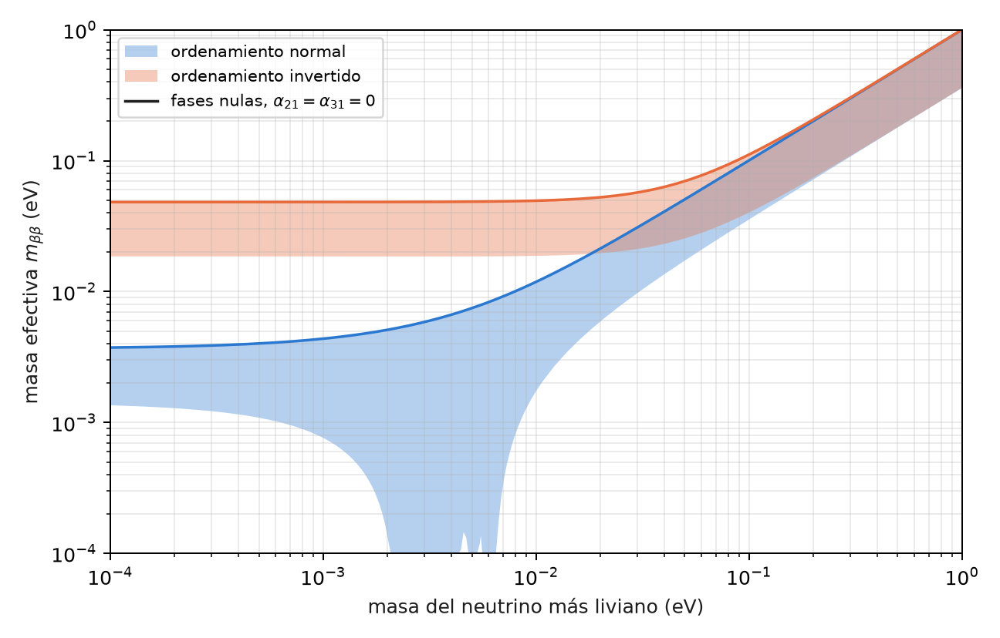
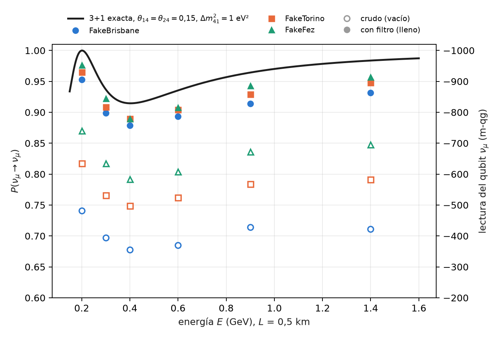

# Fases de Majorana, doble beta sin neutrinos y neutrinos estériles {#sec-cap11}

Los capítulos 9 y 10 leyeron lo que un circuito de oscilación ve: ángulos de mezcla, la fase CP, el ordenamiento de
masas a través de la materia. Este capítulo trata dos preguntas abiertas de la física de neutrinos que tienen una
respuesta clara en términos qg, una negativa y otra positiva. Las fases de Majorana no cambian ninguna probabilidad
de oscilación, y por lo tanto ninguna lectura qang: el compilador las borra. Un neutrino estéril, en cambio, es un
qubit más en el sector de peso 1, y el filtro lo trata como a cualquier otro sabor. Al final, como cierre de la Parte
III, los cuatro números cuánticos del átomo escritos con la misma regla.

## Desde la base: lo que no cambia una probabilidad no cambia una lectura {#sec-majorana-base}

Todas las lecturas del capítulo 1 son funciones de probabilidades: $qg_Z=2p_0-1$, $m=1000\,qg_Z$, el ángulo
$\arccos qg_Z$ y la entropía $qg_S$. Por eso un parámetro físico que no cambia ninguna probabilidad de medición es
invisible para todas ellas a la vez, sin excepción y con cualquier número de disparos. La pregunta "¿lo ve un
circuito?" se reduce a "¿cambia alguna probabilidad?", y se responde antes de correr nada.

Al revés, un parámetro que sí cambia una probabilidad en $\delta P$ aparece como $2000\,\delta P$ m-qg en el qubit del sabor
correspondiente, como en los capítulos 9 y 10. El neutrino estéril de este capítulo es de ese tipo: con los
parámetros hipotéticos que se usan abajo, baja la supervivencia de $\nu_\mu$ en 0,085, es decir, 171 m-qg.

## Las fases de Majorana son invisibles para las oscilaciones {#sec-majorana-invisible}

Si el neutrino es su propia antipartícula (una partícula de Majorana), la matriz de mezcla tiene dos fases más,

$$
U_M=U\,\operatorname{diag}\!\left(1,\ e^{i\alpha_{21}/2},\ e^{i\alpha_{31}/2}\right).
$$

La matriz agregada es diagonal en la base de masa, y la propagación también lo es. Las dos conmutan, y en el
operador de evolución $U_M\,D\,U_M^\dagger$ la fase se cancela con su inversa: $U_M D U_M^\dagger=U D U^\dagger$. Ninguna
probabilidad de oscilación depende de $\alpha_{21}$ ni de $\alpha_{31}$, ni en el vacío ni en la materia (en la materia
el hamiltoniano es $U_M\,\mathrm{diag}(0,\Delta m^2_{21},\Delta m^2_{31})\,U_M^\dagger+V$, y la cancelación ya ocurre en el
primer término, antes de sumar el potencial). Numéricamente la diferencia máxima entre las nueve probabilidades con y sin fases es
$4\times10^{-16}$, el redondeo de la máquina (§163).

En el circuito de tres sabores del capítulo 9 las fases son compuertas de fase en la base de masa, insertadas a
cada lado de la propagación (`majorana_circuit`). Lo instructivo es lo que hace el transpilador: en los tres
dispositivos simulados, **el circuito compilado con fases $(\alpha_{21},\alpha_{31})=(\pi/2,\,3\pi/4)$ es idéntico al
compilado sin ellas** (en FakeFez, 18 CZ, 48 $R_Z$ y 47 $\sqrt X$ en los dos). El optimizador junta cada compuerta de fase con su
inversa y las elimina. No es una "eliminación analítica" pensada por nadie, sino la consecuencia directa de que el
operador no cambia: un compilador que simplifica fases consecutivas encuentra la identidad sola.

## Las fases de Majorana en la doble beta sin neutrinos {#sec-dobleb}

Donde las fases sí se ven es en un proceso que viola el número leptónico: la desintegración doble beta sin neutrinos,
$(A,Z)\to(A,Z+2)+2e^-$, posible sólo si el neutrino es de Majorana. Su tasa es proporcional al cuadrado de la masa
efectiva

$$
m_{\beta\beta}=\left|\sum_i U_{ei}^2\,m_i\right| ,
$$

y como entra $U_{ei}^2$ y no $|U_{ei}|^2$, las fases no se cancelan: pueden sumar las tres contribuciones o hacerlas
interferir destructivamente. Con el neutrino más liviano sin masa, recorrer las dos fases da (§163)

| ordenamiento | masas (meV) | $m_{\beta\beta}$ (meV) |
|---|---|---|
| normal | 0; 8,6; 50,1 | 1,4 a 3,7 |
| invertido | 49,2; 49,9; 0 | 18,7 a 48,3 |

: Masa efectiva de la doble beta sin neutrinos con el neutrino más liviano sin masa, recorriendo las fases de Majorana. {#tbl-mbb}

La @fig-mbb muestra las dos bandas en función de la masa más liviana. En ordenamiento invertido la banda tiene un
piso de unos 19 meV, que es el objetivo de la próxima generación de experimentos. En ordenamiento normal, entre unos 2
y 7 meV de masa más liviana, las fases pueden anular $m_{\beta\beta}$ por completo: una cancelación que ningún
experimento de doble beta podría distinguir de un neutrino de Dirac.

{#fig-mbb width=85%}

La lectura qg de esta sección es sólo la de la sección anterior, dicha al revés: un circuito de oscilación no puede
medir lo que esta figura grafica. Lo que sí hace la escala es separar con claridad las dos preguntas, la de
oscilación (probabilidades, lecturas qang) y la de masa (una amplitud con fases, fuera de cualquier lectura de un
qubit de sabor).

## El neutrino estéril: un cuarto qubit en el sector de peso 1 {#sec-esteril}

Un neutrino estéril $\nu_s$ es un cuarto sabor que no interactúa por la fuerza débil, pero que se mezcla con los
otros tres. En el modelo 3+1 hay un cuarto estado de masa con $\Delta m^2_{41}\sim1$ eV², mucho mayor que los otros dos,
y la mezcla real es una secuencia de seis rotaciones,

$$
U=R_{34}\,R_{24}\,R_{14}\,R_{23}\,R_{13}\,R_{12}
$$

(sin fases CP, para mantenerlo simple). En el circuito, cada sabor es un qubit con un solo 1: el estéril es
simplemente **un qubit más en el sector de peso 1** (`sterile_circuit`). Cada rotación es una RBS y la propagación,
una compuerta de fase por qubit; todo conserva el peso y el filtro se aplica sin cambios.

A distancias cortas, donde las oscilaciones de los tres sabores todavía no empezaron, la supervivencia es efectivamente
de dos niveles,

$$
P(\nu_\mu\to\nu_\mu)\approx1-4|U_{\mu4}|^2\left(1-|U_{\mu4}|^2\right)\sin^2\frac{\Delta_{41}}{2} .
$$

Con los valores hipotéticos $\theta_{14}=\theta_{24}=0{,}15$ y $\Delta m^2_{41}=1$ eV², $|U_{\mu4}|^2=0{,}022$ y la amplitud es
0,085; a $L=0{,}5$ km el primer mínimo cae en 0,40 GeV (@fig-esteril). Es el mismo caso del capítulo 9, con la misma
geometría: un cono de precesión con ángulo de mezcla efectivo, ahora entre $\nu_\mu$ y $\nu_s$.

En los modelos de ruido simulados, las tres predicciones registradas para el estéril se cumplieron:

| prueba | resultado |
|---|---|
| S1 error filtrado menor que el crudo en las 18 combinaciones (energía, dispositivo) | sí |
| S2 mediana de la razón crudo / filtrado $\ge 2$ | 5,5 |
| S3 mínimo filtrado de $P(\nu_\mu\to\nu_\mu)$ en 0,4 GeV en los tres dispositivos | sí |

: El estéril 3+1 en modelos de ruido simulados, 4 qubits, 8000 disparos. {#tbl-esteril}

En el mínimo (exacta 0,915), FakeBrisbane lee 0,678 crudo y 0,879 filtrado; FakeTorino, 0,749 y 0,890; FakeFez,
0,792 y 0,890. **La ganancia es mayor que con tres sabores** (5,5× contra 3,0–3,8×) porque el circuito tiene cuatro
qubits: hay más formas de que un disparo salga del sector de peso 1, y el filtro las descarta todas.

{#fig-esteril width=90%}

Lo que queda está, otra vez, dentro del sector: los valores filtrados siguen 0,025 a 0,036 por debajo del exacto en
el mínimo, porque el ruido que mueve un 1 de un qubit a otro conserva el peso y el filtro no lo ve.

**Pendiente: los datos.** Los ángulos de mezcla de esta sección son hipotéticos, elegidos para que la señal se vea;
no son un ajuste. Los límites fenomenológicos y la comparación de modelos 3+1 con los experimentos de línea de base
corta no están hechos: quedan como propuesta.

## Los cuatro números cuánticos en términos qg {#sec-numeros}

El capítulo 10 terminó con una pregunta sobre qué número se conserva. La misma pregunta, aplicada al átomo, da una
lectura qg de los cuatro números cuánticos (§155). Es una traducción, no física nueva.

- **El número magnético.** Un registro de $n$ qubits en su subespacio simétrico es un espín $j=n/2$, y en cada
  disparo el número magnético se lee del **peso de Hamming**: $m=n/2-w$. El filtro de peso es la proyección sobre
  un valor de $m$, y $qg_Z=\langle J_z\rangle/j$ para cualquier momento angular.
- **$m_s$** es un qubit, con $qg_Z=2m_s$. **$m_l$** de un orbital $l$ es el peso de un registro simétrico de $2l$
  qubits: los tres orbitales $p$ complejos son $|00\rangle$, $(|01\rangle+|10\rangle)/\sqrt2$ y $|11\rangle$. Los reales $p_x$
  y $p_y$ mezclan $m_l=\pm1$, y por eso tienen $qg_Z=0$ como $p_z$, pero con entropía 0,63 en lugar de cero.
- **$l$** es la simetría de permutación, y se lee con valores qg de SWAP: para dos qubits,
  $\langle J^2\rangle=1+qg_{\text{SWAP}}$.
- **$n$**: por la simetría oculta SO(4) del hidrógeno, la capa $n$ son dos espines $(n-1)/2$, es decir, dos registros
  simétricos de $n-1$ qubits; $m_l$ es $(n-1)$ menos el peso total de los $2(n-1)$ qubits, y el filtro de peso lo fija.

El ángulo qang de un autoestado $|l,m\rangle$ es $\arccos(m/l)$. El ángulo del modelo vectorial de los libros de texto
es $\arccos\!\big(m/\sqrt{l(l+1)}\big)$, y siempre queda más cerca del ecuador (@fig-angulos-lm), porque $|l,m\rangle$ tiene una
dispersión transversal $\langle J_x^2+J_y^2\rangle=l(l+1)-m^2>0$:

| $l$, $m$ | ángulo qang | modelo vectorial | $\langle J_x^2+J_y^2\rangle$ |
|---|---|---|---|
| 1, +1 | 0° | 45,0° | 1 |
| 2, +2 | 0° | 35,3° | 2 |
| 2, +1 | 60,0° | 65,9° | 5 |
| 3, +3 | 0° | 30,0° | 3 |
| 3, +1 | 70,5° | 73,2° | 11 |

: El ángulo qang de $|l,m\rangle$ frente al ángulo del modelo vectorial. {#tbl-numeros}

{#fig-angulos-lm width=85%}

$qg_Z$ mide hacia dónde apunta $\langle\mathbf J\rangle$; el modelo vectorial dibuja un vector de largo $\sqrt{l(l+1)}$. Los dos
coinciden sólo en $m=0$. En una demostración (no registrada) con el modelo de ruido de FakeTorino, $p_z$ ($m_l=0$) se
filtra a $m_l=\pm1$ en el 19% de los disparos con la disposición de qubits por defecto y en el 2,2% con la cadena que
elige `ibm.best_chain`; en los dos casos el filtro de peso devuelve $P(m_l=0)=1$.

## En código {#sec-codigo11}

```python
import math
from qang import neutrino as nu
from qang import angular

# Majorana: ninguna probabilidad cambia, en vacío o en materia
nu.majorana_invisible(1300, 2.6, -math.pi / 2, math.pi / 2, 3 * math.pi / 4, rho=2.85)   # 4e-16
nu.m_bb(0.0, a21=0.0, a31=0.0, ordering="IO")                                           # 0.048 eV

# el estéril: un cuarto qubit en el sector de peso 1
P = nu.sterile_probabilities(L=0.5, E=0.4, dm41=1.0, theta14=0.15, theta24=0.15)        # P[mu, mu] = 0.915
qc = nu.sterile_circuit("mu", L=0.5, E=0.4, dm41=1.0, theta14=0.15, theta24=0.15)

# los números cuánticos: el ángulo qang y el del modelo vectorial
math.degrees(angular.qang_angle_of_eigenstate(2, 1)), math.degrees(angular.vector_model_angle(2, 1))   # 60.0, 65.9
```

## Resumen {#sec-resumen11}

- Toda lectura qang es función de probabilidades: un parámetro que no cambia ninguna probabilidad es invisible para
  todas a la vez.
- Las fases de Majorana se cancelan en $U_MDU_M^\dagger$ (diferencia $4\times10^{-16}$); el transpilador entrega el mismo
  circuito con y sin ellas.
- La doble beta sin neutrinos sí las ve: $m_{\beta\beta}$ va de 1,4 a 3,7 meV (normal) y de 18,7 a 48,3 meV (invertido)
  con el neutrino más liviano sin masa, y puede anularse en ordenamiento normal.
- Un neutrino estéril es un cuarto qubit en el sector de peso 1; con mezcla hipotética, el filtro gana 5,5× y ubica el
  mínimo en 0,4 GeV. Los límites con datos reales quedan pendientes.
- Los cuatro números cuánticos se leen en qg: $m$ del peso de Hamming, $l$ de SWAP, $n$ del tamaño del registro; el
  ángulo qang $\arccos(m/l)$ no es el del modelo vectorial.
