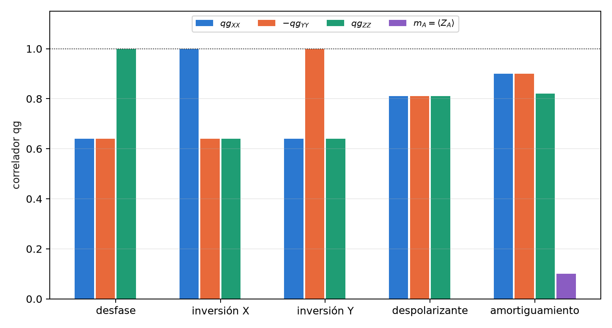

# Teleportación óptica y el límite del par de Bell {#sec-cap12}

La Parte IV lleva la escala qang a las redes de comunicación cuántica. Este capítulo trata la teleportación de un
qubit a través de una red óptica pasiva: una oficina central comparte un estado entrelazado con un usuario a través
de una fibra y un divisor pasivo $1{:}N$, y el fotón llega con probabilidad baja. La pregunta es qué estado conviene
compartir. La respuesta habitual, un par de Bell, deja de ser la óptima en cuanto el canal pierde fotones, y el estado
óptimo queda fijado por un solo número: la lectura $qg_Z$ de uno de sus qubits. El capítulo cierra con la lectura
qg de los pares de Bell en una red, que es lo que el capítulo 13 usa como predictor de la fidelidad.

## Desde la base: la fidelidad es una probabilidad {#sec-tele-base}

La fidelidad de teleportar un estado de entrada es la probabilidad de que Bob, después de deshacer la preparación,
mida 0: es un $p_0$ del capítulo 1, con su lectura $m=1000(2p_0-1)$ m-qg y su barra de error. La fidelidad media
sobre la esfera de Bloch se obtiene exactamente con seis entradas, los estados cardinales $|0\rangle$, $|1\rangle$, $|\pm\rangle$,
$|\pm i\rangle$, porque forman un diseño esférico de orden 3.

El estado que se comparte es $\cos\alpha|00\rangle+\sin\alpha|11\rangle$, y cada uno de sus qubits tiene

$$
qg_Z=\cos^2\alpha-\sin^2\alpha=\cos2\alpha,\qquad \alpha=\frac{\arccos qg_Z}{2}.
$$

El ángulo del recurso es la mitad del ángulo qang de cualquiera de sus qubits. El par de Bell, $\alpha=\pi/4$, es el
ecuador: $qg_Z=0$, $m=0$. Un recurso menos entrelazado se inclina hacia $|00\rangle$ ($m>0$); uno "más que
maximalmente entrelazado", en el sentido de esta sección, se inclina hacia $|11\rangle$ ($m<0$). Toda la regla de
diseño de este capítulo es una lectura en m-qg de un solo qubit.

## Teleportación con un par de Bell {#sec-bennett}

En el protocolo de Bennett y colaboradores (1993), Alicia mide su qubit de entrada y su mitad del recurso en la base
de Bell, le comunica a Bob dos bits clásicos, y Bob aplica una de cuatro correcciones de Pauli. Con un par de Bell
perfecto la fidelidad es 1. Con un recurso imperfecto, la fidelidad media depende sólo de su fracción de singlete
$f=\langle\Phi^+|\rho|\Phi^+\rangle$:

$$
F=\frac{2f+1}{3},
$$

y la teleportación supera a cualquier estrategia clásica (medir y reenviar) sólo si $F>2/3$, es decir, $f>1/2$. En el
circuito, la medición de Bell va en forma diferida (CX, H, CX, CZ), sin mediciones intermedias.

## Un canal que pierde fotones {#sec-canal-perdidas}

En una red óptica pasiva de bajada (§157) el segundo qubit del recurso es un fotón presente o ausente (carril simple)
que viaja por una fibra de transmisión $T=10^{-0{,}02L}$ ($L$ en km, 0,2 dB/km) y llega a un divisor $1{:}N$. Para el
modo de Bob las dos cosas son divisores de haz, es decir, compuertas RBS que conservan el número de fotones, y el
fotón llega con probabilidad

$$
\eta=\frac{T}{N}.
$$

Un fotón perdido deja a Bob en $|0\rangle$: el canal es un amortiguamiento de amplitud, que no trata igual a las dos
ramas del recurso. La rama $|00\rangle$ no tiene nada que perder; la rama $|11\rangle$ pierde su fotón con probabilidad
$1-\eta$. Por eso conviene poner menos peso en la rama frágil, y el óptimo deja de estar en $\alpha=\pi/4$.

## La regla de diseño {#sec-regla}

La fracción de singlete del recurso después del canal es

$$
f=\frac{(\cos\alpha+\sqrt\eta\,\sin\alpha)^2}{2\,(\cos^2\alpha+\kappa\sin^2\alpha)} ,
$$

con $\kappa=1$ en el protocolo sin asistencia, en el que sólo actúan Alicia y Bob. En el protocolo **asistido**, los
otros $N-1$ usuarios informan si el fotón llegó a ellos, y esos disparos se descartan: es un **filtro de sector**
sobre el registro de los otros usuarios, y la única pérdida que queda sin anunciar es la de la fibra, con
$\kappa=\eta+1-T$. Maximizar $f$ da

$$
\tan\alpha^\ast=\frac{\sqrt\eta}{\kappa},\qquad F^\ast=\frac{2+\eta/\kappa}{3},\qquad
qg_Z^\ast=\cos2\alpha^\ast=\frac{\kappa^2-\eta}{\kappa^2+\eta} .
$$

El índice maestro original escribía la regla como $\sqrt{\eta/\kappa}$; la forma correcta es $\sqrt\eta/\kappa$, que es la
que verifica el código. La regla entera es la tercera fórmula: **un qubit del recurso medido en $Z$ fija $\alpha$**. En
los cuatro enlaces del experimento:

| enlace | protocolo | $\eta$ | $\alpha^\ast$ (rad) | $F^\ast$ | $m^\ast$ (m-qg) | par de Bell | conservado en $\alpha^\ast$ |
|---|---|---|---|---|---|---|---|
| 0 km, 1:4 | sin asistencia | 0,250 | 0,464 | 0,750 | +600 | 0,708 | 1 |
| 0 km, 1:4 | asistido | 0,250 | 1,107 | 1,000 | −600 | 0,933 | 0,40 |
| 0 km, 1:8 | sin asistencia | 0,125 | 0,340 | 0,708 | +778 | **0,639** | 1 |
| 0 km, 1:8 | asistido | 0,125 | 1,231 | 1,000 | −778 | 0,876 | 0,22 |
| 20 km, 1:4 | sin asistencia | 0,100 | 0,306 | 0,700 | +819 | **0,622** | 1 |
| 20 km, 1:4 | asistido | 0,100 | 0,423 | 0,714 | +663 | 0,672 | 0,95 |
| 20 km, 1:8 | sin asistencia | 0,050 | 0,219 | 0,683 | +905 | **0,583** | 1 |
| 20 km, 1:8 | asistido | 0,050 | 0,330 | 0,692 | +790 | 0,635 | 0,96 |

: La regla de diseño en los cuatro enlaces; en negrita, los casos en que el par de Bell no supera el límite clásico. {#tbl-regla}

Tres lecturas de la tabla. **Sin asistencia, el par de Bell puede no servir**: en un divisor 1:8, o a 20 km, queda
por debajo de 2/3, y sólo el recurso óptimo, inclinado hacia $|00\rangle$, supera el límite clásico. **Con asistencia y
sin fibra, el óptimo tiene $F^\ast=1$** en $\tan\alpha^\ast=\sqrt N>1$: el recurso está más inclinado hacia $|11\rangle$ que un
par de Bell, y el filtrado del divisor lo devuelve exactamente a un par de Bell; el precio es la fracción conservada.
En ese caso $\kappa=\eta$ y $qg_Z^\ast=-(1-\eta)/(1+\eta)$, exactamente la lectura opuesta del caso sin asistencia: $-600$
contra $+600$ m-qg con $N=4$. **Con fibra**, la pérdida sin anunciar vuelve a dominar y el óptimo asistido regresa al
lado de $|00\rangle$ (@fig-diseno-qpon).

{#fig-diseno-qpon width=100%}

Es la versión de variables discretas de un resultado de variables continuas: en una red óptica pasiva, la
teleportación sin asistencia tiene una compresión (squeezing) óptima finita, y la asistida, una que tiende a infinito a
distancia corta (Yaghoobianzadeh y Salehi, 2026). El recurso no maximalmente entrelazado es el análogo de la
compresión finita.

## La regla en dispositivos simulados {#sec-regla-ruido}

El circuito tiene cinco qubits (entrada, Alicia, Bob, el entorno de la fibra y los otros usuarios), con la fibra y el
divisor como compuertas RBS. Se corrió con 14 ángulos del recurso más $\pi/4$, seis entradas y 4000 disparos, en tres
**modelos de ruido simulados** (§157). Cinco de las seis predicciones registradas se cumplieron:

| prueba | resultado |
|---|---|
| Q1 mejor ángulo sin asistencia a menos de 0,1 rad de $\alpha^\ast$ | 12 de 12 |
| Q2 0 km, 1:8: par de Bell por debajo de 2/3, mejor ángulo por encima | 0,624–0,627 y 0,690–0,701 en los tres |
| Q3 la asistida supera a la no asistida | 12 de 12 |
| Q4 óptimo asistido por encima de $\pi/4$ a 0 km | 1,0–1,2 rad en los tres |
| Q5 $\lvert F_{\text{mejor}}-F^\ast\rvert<0{,}05$ | **falló**: 19 de 24; los 5 fallos son asistidos a 0 km ($F^\ast=1$, medido 0,897–0,957) |
| Q6 fracción conservada a menos de 0,03 de $\cos^2\alpha+\kappa\sin^2\alpha$ | 12 de 12 (mayor diferencia 0,028) |

: La regla de diseño en tres modelos de ruido simulados. {#tbl-qpon-ruido}

{#fig-alfa-qpon width=90%}

**La regla de diseño sobrevive al ruido de los dispositivos** (@fig-alfa-qpon): en un divisor 1:8 sólo el recurso
óptimo supera el 2/3 clásico. Y la escala qang, aquí, **no agrega nada contra el ruido**: el circuito de
teleportación (H, CX) no conserva el peso, de modo que el único filtro es el anuncio de los otros usuarios. Por eso
los fallos de Q5 están donde $F^\ast$ está cerca de 1: el ruido de las compuertas pesa más cuanto más alta es la
fidelidad que se busca. El capítulo 13 pregunta qué cambia cuando todas las compuertas conservan el número de fotones.

Los límites están declarados: sólo bajada, carril simple, ruido de dispositivos simulado, y ninguna ineficiencia de
detector ni cuenta oscura más allá de los errores de lectura de los modelos.

## Pares de Bell en una red, leídos en qg {#sec-bell-red}

Antes de teleportar conviene saber qué tan bueno es el par compartido. Un par que debería ser $|\Phi^+\rangle$ queda
descrito por cinco lecturas qg: tres correladores de dos qubits, $qg_{XX}$, $qg_{YY}$, $qg_{ZZ}$, y los sesgos polares de
cada lado, $m_A=\langle Z_A\rangle$ y $m_B=\langle Z_B\rangle$. Bastan tres configuraciones de medición (§57). La fidelidad
con $|\Phi^+\rangle$ es exacta para cualquier estado,

$$
F_{\Phi^+}=\frac{1+qg_{XX}-qg_{YY}+qg_{ZZ}}{4},
$$

y con ella la fidelidad de teleportación que el par va a dar, $F=(2F_{\Phi^+}+1)/3=(3+qg_{XX}-qg_{YY}+qg_{ZZ})/6$, sin
correr la teleportación (el capítulo 13 la pone a prueba). Los pesos de los cuatro estados de Bell dicen qué error
domina: $\Phi^-$ es una inversión de fase, $\Psi^+$ una
inversión de bit, $\Psi^-$ las dos. Con ruido $p=0{,}1$ sobre cada mitad:

| ruido | $qg_{XX}$ | $qg_{YY}$ | $qg_{ZZ}$ | $m_A=m_B$ | $F_{\Phi^+}$ | error dominante |
|---|---|---|---|---|---|---|
| desfase | +0,64 | −0,64 | **+1,00** | 0 | 0,820 | $\Phi^-$ |
| inversión X | **+1,00** | −0,64 | +0,64 | 0 | 0,820 | $\Psi^+$ |
| inversión Y | +0,64 | **−1,00** | +0,64 | 0 | 0,820 | $\Psi^-$ |
| despolarizante | +0,81 | −0,81 | +0,81 | 0 | 0,858 | todos iguales |
| amortiguamiento | +0,90 | −0,90 | +0,82 | **+0,10** | 0,905 | $\Psi^+$ |

: Firmas qg del ruido sobre un par de Bell, $p=0{,}1$ en cada mitad. {#tbl-bell-firmas}

{#fig-bell-firmas width=90%}

Cada ruido de Pauli deja un correlador intacto, y sólo el amortiguamiento (la relajación T1 de una memoria) mueve los
sesgos locales (@fig-bell-firmas). Esa lectura decide cómo **destilar**. El protocolo DEJMPS combina el peso de
$\Phi^+$ con el error que ocupa una posición fija, y unas rotaciones locales eligen qué error va allí. El orden de los
libros de texto puede empeorar las cosas: con ruido de inversión Y, una ronda baja la fidelidad de 0,820 a 0,705, y con
amortiguamiento casi no gana (0,828). La regla "el error estimado más chico en esa posición", leída de los tres
correladores con 200 disparos por configuración, alcanza la mejor salida en los tres casos: 0,954, 0,954 y 0,915
(contra un óptimo de 0,920).

## Sin qang y con qang {#sec-comparacion12}

| acción | sin qang | con qang | diferencia |
|---|---|---|---|
| elegir el recurso óptimo | optimizar el coeficiente de Schmidt $\alpha$ | una lectura: $qg_Z^\ast=(\kappa^2-\eta)/(\kappa^2+\eta)$ en un qubit; el signo de $m^\ast$ dice de qué lado del par de Bell está | **a favor** en diseño y verificación: se calibra midiendo un qubit en $Z$ |
| decidir si el par de Bell sirve | calcular $F(\pi/4)$ | el par de Bell es $m=0$; el óptimo, $m^\ast$ | **equivalente** en el valor; qang lo ubica en la escala |
| reducir el ruido de los dispositivos | — | el filtro no se aplica: la teleportación no conserva el peso | **ninguna** |
| diagnosticar un par de Bell | tomografía completa | tres correladores qg y dos sesgos; la firma elige la destilación (0,705 → 0,954 con inversión Y) | **a favor**: tres configuraciones en lugar de nueve, y una regla de decisión directa |

: Las acciones del capítulo sin la escala qang y con ella. {#tbl-comparacion12}

**Balance.** Es el capítulo donde la lectura qang más se parece a una herramienta de ingeniería: un número fija el
recurso y tres correladores diagnostican el par. Contra el ruido no aporta, y está dicho.

## En código {#sec-codigo12}

```python
import math
from qang import qpon

eta, kappa = qpon.link(length_km=0, n_users=8, assisted=False)   # (0.125, 1.0)
qpon.optimal_angle(eta, kappa)                                   # 0.340 rad
qpon.optimal_fidelity(eta, kappa)                                # 0.708
qpon.average_fidelity(math.pi / 4, eta, kappa)                   # 0.639: el par de Bell, por debajo de 2/3
qpon.optimal_qg_z(eta, kappa)                                    # 0.778 -> +778 m-qg
qpon.resource_angle_from_qg_z(0.778)                             # 0.340: el recurso, desde una lectura

qc = qpon.teleport_circuit(alpha=0.340, transmission=1.0, n_users=8, input_index=2)   # entrada |+>
qpon.fidelity_from_correlators(xx=0.81, yy=-0.81, zz=0.81)       # 0.905 = (2 F_Phi+ + 1)/3, F_Phi+ = 0.858
```

## Resumen {#sec-resumen12}

- La fidelidad de teleportación es una probabilidad; el recurso $\cos\alpha|00\rangle+\sin\alpha|11\rangle$ tiene $qg_Z=\cos2\alpha$
  en cada qubit, y el par de Bell es $m=0$.
- En un canal que pierde fotones ($\eta=T/N$) el óptimo no es el par de Bell: $\tan\alpha^\ast=\sqrt\eta/\kappa$,
  $F^\ast=(2+\eta/\kappa)/3$, $qg_Z^\ast=(\kappa^2-\eta)/(\kappa^2+\eta)$.
- Sin asistencia, en un divisor 1:8 o a 20 km el par de Bell queda por debajo de 2/3 y el recurso óptimo, por encima;
  con asistencia y sin fibra, $F^\ast=1$ con un recurso del lado de $|11\rangle$.
- La regla sobrevive al ruido simulado (cinco de seis predicciones); el filtro qg no ayuda aquí porque la
  teleportación no conserva el peso.
- Un par de Bell se lee con tres correladores y dos sesgos; cada ruido de Pauli deja uno intacto, y esa firma elige la
  ronda de destilación correcta.
