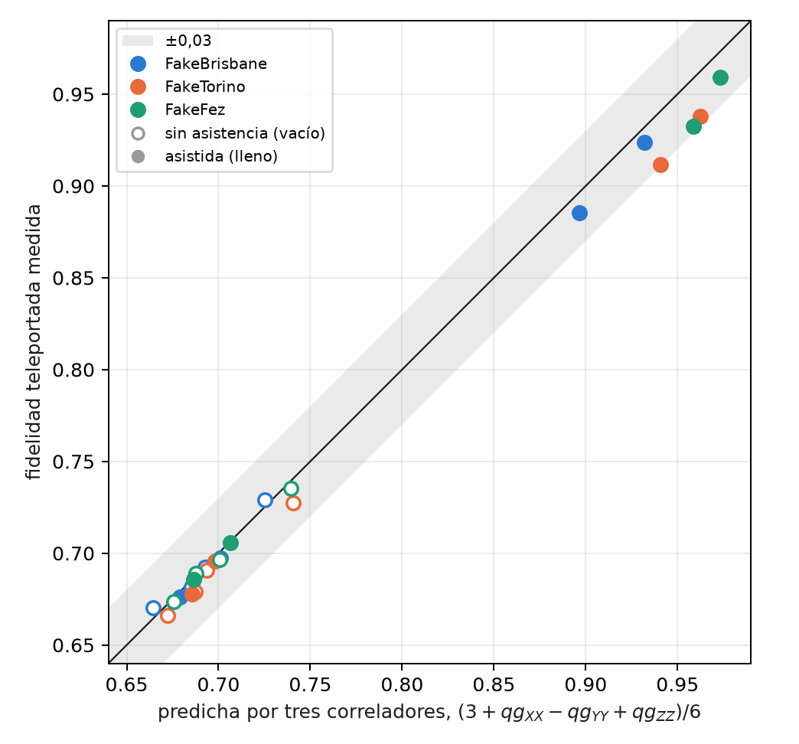
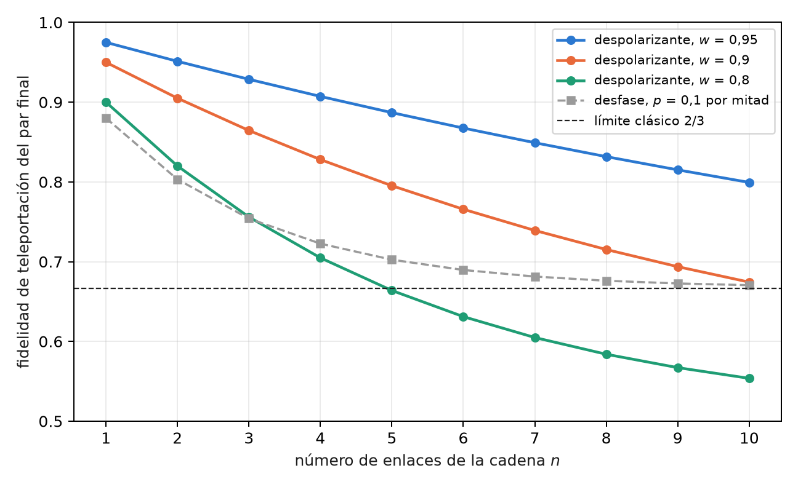

# Doble carril, filtro de sector y fidelidad a larga distancia {#sec-cap13}

El capítulo 12 terminó con una limitación: el filtro qg no ayudaba contra el ruido de los dispositivos, porque el
circuito de teleportación no conserva el peso. Este capítulo hace las dos preguntas que siguen. La primera es si la
fidelidad que va a dar un recurso se puede leer antes de teleportar, con pocas mediciones; la respuesta es sí, con
tres correladores qg. La segunda es qué pasa si todas las compuertas conservan el número de fotones; la respuesta es
el doble carril, en el que el filtro anuncia cada pérdida, y que a 20 km supera al óptimo sin ruido de carril simple
hasta que los falsos anuncios ponen un piso. El capítulo cierra la Parte IV con el intercambio de entrelazamiento en
cadena, leído con los mismos correladores.

## Desde la base: tres lecturas qg predicen una fidelidad {#sec-correladores-base}

Cada correlador de dos qubits es una lectura qg como las del capítulo 1: la paridad de dos bits medidos en una base,
$qg_{PP}=1-2P(\text{paridad impar})$, con su lectura en m-qg y su barra de error $\sqrt{(1-qg^2)/N}$. El capítulo 12 mostró
que la fidelidad con $|\Phi^+\rangle$ es lineal en tres de ellos; la fidelidad media de teleportación también (§158):

$$
F=\frac{3+qg_{XX}-qg_{YY}+qg_{ZZ}}{6}.
$$

Es una **lectura lineal del recurso solo**, sin la medición de Bell: tres circuitos con 4–5 compuertas de dos qubits,
contra 10–11 de la teleportación. Al ser lineal, su barra de error es la combinación de las tres: con $N$ disparos por
correlador, $\sigma_F=\sqrt{\sum(1-qg^2)/N}/6$, unos 0,0025 con $N=10\,000$ cerca de $F\approx0{,}7$.

## La fidelidad desde tres correladores {#sec-prediccion}

En los cuatro enlaces del capítulo 12, con los dos protocolos y en tres **modelos de ruido simulados**, se comparó la
fidelidad predicha por los correladores con la teleportada. En las 24 combinaciones la diferencia es como máximo
0,029 (@fig-correladores): **tres circuitos cortos predicen la fidelidad teleportada**.

{#fig-correladores width=70%}

Las predicciones registradas querían algo más: que la diferencia aislara el ruido de la medición de Bell. Eso falló.
La predicción quedó por debajo del óptimo sin ruido en 5 de 24 casos (A1), no siempre por encima de la teleportada
(A2, 3 de 24, todos dentro de dos errores de disparo) y la diferencia no siempre fue mayor con asistencia (A3, 2 de
12). La razón es que los tres circuitos de correladores leen dos qubits de datos y el anuncio, así que llevan casi todo
el ruido que ve la teleportación. **Sirven como predictor, no como descomposición.**

## Doble carril: cada pérdida se anuncia {#sec-doble-carril}

En carril simple, un qubit es un fotón presente o ausente, y perder el fotón convierte un $|1\rangle$ en un $|0\rangle$ válido:
la pérdida no se ve. En **doble carril**, cada qubit es un fotón en dos modos, $|0_L\rangle=|10\rangle$ y $|1_L\rangle=|01\rangle$. Las
compuertas lógicas se construyen para conservar el número de fotones: el CNOT lógico es un SWAP controlado de los
modos del blanco, el CZ lógico un CZ entre modos, y las compuertas de un qubit actúan sobre el subespacio
$\{|10\rangle,|01\rangle\}$. Toda pérdida deja el par de Bob con peso 0, y el filtro qg (peso 1 en cada par) **anuncia todas las
pérdidas, la de la fibra incluida, sin ayuda de los otros usuarios**.

Sin ruido de compuertas, el resultado es limpio:

$$
F_{\text{filtrada}}=1\ \text{a cualquier distancia},\qquad \text{conservado}=\eta,\qquad
F_{\text{cruda}}=\frac{1+\eta}{2},
$$

donde la cruda supone que Bob adivina cuando no llega fotón, y queda por debajo del óptimo de carril simple
$(2+\eta)/3$. El filtro convierte pérdida en tasa: la fidelidad no baja con la distancia, baja la cantidad de pares
útiles. El precio es el circuito: 65–66 compuertas de dos qubits, seis veces las de carril simple.

## Lo que mide el doble carril en dispositivos simulados {#sec-doble-ruido}

Con el par de Bell ($\alpha=\pi/4$), seis entradas y 10 000 disparos (§158), de las cinco predicciones del doble carril
se cumplió una sola (B4: la cruda queda por debajo de carril simple en las 12 combinaciones, 0,516–0,595). Las otras
cuatro fallaron, y la mayoría por la misma causa:

| dispositivo simulado | filtrada, (0 km, 1:4) → (20 km, 1:8) | conservado / $\eta$ | 20 km: filtrada frente a $F^\ast$ sin ruido de carril simple |
|---|---|---|---|
| FakeBrisbane | 0,786; 0,720; 0,709; 0,650 | 0,91 → 1,98 | 0,709 / 0,714 (1:4); 0,650 / 0,692 (1:8) |
| FakeTorino | 0,847; 0,790; 0,783; 0,727 | 0,97 → 2,14 | 0,783 / 0,714; 0,727 / 0,692 |
| FakeFez | 0,869; 0,814; 0,791; 0,710 | 0,98 → 1,74 | 0,791 / 0,714; 0,710 / 0,692 |

: Doble carril con el filtro qg en tres modelos de ruido simulados; enlaces en el orden (0, 4), (0, 8), (20, 4), (20, 8). {#tbl-doble}

**Los falsos anuncios ponen un piso** (B1, B2 y B5 fallaron). Cuando el fotón se pierde, un error de compuerta o de
lectura puede dejar igual el par de Bob con peso 1: a 20 km, $(\text{conservado}-\eta)/(1-\eta)$ es del 3 al 6%. Esos disparos
llevan una fidelidad de alrededor de 1/2, y a medida que $\eta$ baja pesan más entre los conservados. Con una
probabilidad de falso anuncio $p_f$, la fidelidad filtrada es

$$
F_{\text{filtrada}}=\frac{\eta\,F_0+(1-\eta)\,p_f/2}{\eta+(1-\eta)\,p_f},
$$

que cae con la distancia aunque el canal no agregue ningún error (@fig-doble-carril). Es el piso de cuentas oscuras de
un enlace anunciado real, producido aquí por errores de compuerta y de lectura.

{#fig-doble-carril width=90%}

**Aun así, anunciar gana a 20 km.** En un análisis posterior, no registrado, en FakeTorino y FakeFez la filtrada de doble
carril supera al óptimo de carril simple **sin ruido** en los dos divisores: 0,783 y 0,791 contra 0,714 con 1:4; 0,727 y
0,710 contra 0,692 con 1:8. Lo logra con seis veces las compuertas de dos qubits. La cruda pierde en todos lados
(B4), así que la ganancia es del filtro. B3, la versión registrada de esa comparación (contra la teleportada con ruido),
falló sólo en FakeBrisbane a (20 km, 1:8).

La comparación con el trabajo de variables continuas es cualitativa: allí la fidelidad es determinista y cae con la
distancia y con $N$; aquí el filtro mantiene alta la fidelidad y paga en tasa (conservado $\approx\eta$), hasta que los
falsos anuncios, no la pérdida, ponen el límite.

## Intercambio de entrelazamiento en cadena {#sec-intercambio}

Para ir más lejos que un enlace, una red encadena pares: un nodo intermedio hace una medición de Bell entre sus dos
mitades, y los extremos quedan entrelazados (intercambio de entrelazamiento, *entanglement swapping*). Esta sección es
nueva en el libro: es álgebra exacta de matrices densidad, verificada en el script de figuras, sin corrida en
dispositivos.

Para pares diagonales en la base de Bell, que son los que dejan los ruidos de Pauli del capítulo 12, el resultado en
qg es una regla de una línea: **los correladores se multiplican**. Después de intercambiar dos pares, con la corrección
de Pauli que corresponde a cada resultado,

$$
qg_{PP}^{(1\to3)}=qg_{PP}^{(1\to2)}\cdot qg_{PP}^{(2\to3)},\qquad P\in\{X,Y,Z\},
$$

y en una cadena de $n$ enlaces iguales, cada correlador queda elevado a la $n$. Con pares despolarizados de parámetro $w$
($qg_{XX}=qg_{ZZ}=w$, $qg_{YY}=-w$), la fidelidad de teleportación del par final es $F=(1+w^n)/2$, y supera el límite clásico
mientras $w^n>1/3$, es decir, hasta $n\le\ln3/\ln(1/w)$: 21 enlaces con $w=0{,}95$, 10 con $w=0{,}9$ y 4 con $w=0{,}8$
(@fig-intercambio).

{#fig-intercambio width=85%}

La lectura por correladores dice además qué error se acumula. Con desfase, $qg_{ZZ}=1$ en cada enlace y por lo tanto en
toda la cadena, mientras $qg_{XX}$ y $qg_{YY}$ decaen como $0{,}64^n$: el par final conserva las correlaciones en $Z$ y pierde
las de fase, y su fidelidad tiende a 2/3 desde arriba. Es la misma firma de la tabla de ruidos del capítulo 12,
propagada por la cadena, y es la que decide dónde conviene destilar.

La conexión con el doble carril es directa: en una cadena de pares de doble carril, cada medición de Bell intermedia
también conserva el número de fotones, y el filtro anuncia las pérdidas de todos los enlaces a la vez. Ese experimento
no está hecho.

## Lo que queda pendiente {#sec-pendiente13}

Tres temas del índice no tienen todavía respaldo en el repositorio, y quedan como propuestas, no como resultados:

- el enrutamiento y la conmutación cuántica pasiva en topologías metropolitanas con varios portadores;
- una cadena de repetidores con doble carril y filtro en dispositivos simulados, que pondría a prueba la regla de
  multiplicación de esta sección con ruido real de compuertas;
- la teleportación de compuertas (*gate teleportation*) y su lectura en correladores qg.

## Sin qang y con qang {#sec-comparacion13}

| acción | sin qang | con qang | diferencia |
|---|---|---|---|
| predecir la fidelidad de teleportación | teleportar y medir (10–11 compuertas de dos qubits) | tres correladores del recurso (4–5 compuertas): error máximo 0,029 en 24 casos | **a favor** en costo de circuito; la fórmula es conocida, qang la vuelve una lectura lineal con barra de error |
| anunciar pérdidas | carril simple: la pérdida no se ve | doble carril con filtro de peso: toda pérdida se anuncia | del **filtro y la codificación**, no de la escala |
| propagar ruido por una cadena de intercambios | componer canales | los correladores qg se multiplican; $F=(1+w^n)/2$ | **a favor** en claridad: una regla de una línea y la firma de qué error se acumula |

: Las acciones del capítulo sin la escala qang y con ella. {#tbl-comparacion13}

**Balance.** Los correladores qg son la parte de qang que más rinde en redes: predicen y propagan con reglas lineales.
La ganancia grande del capítulo, el doble carril, es de la codificación y el filtro.

## En código {#sec-codigo13}

```python
from qang import qpon

# la fidelidad de teleportación, desde tres correladores del recurso
qpon.fidelity_from_correlators(xx=0.84, yy=-0.81, zz=0.73)       # 0.897
qc = qpon.resource_circuit(alpha=1.231, transmission=1.0, n_users=8, basis="X")

# doble carril: formas cerradas sin ruido y el circuito de 8 qubits
qpon.dual_rail_fidelities(alpha=0.7854, eta=0.05)                # filtrada 1.0, cruda 0.525, conservado 0.05
qc_dual = qpon.dual_rail_teleport_circuit(alpha=0.7854, eta=0.05, input_index=2)
```

## Resumen {#sec-resumen13}

- La fidelidad de teleportación es lineal en tres correladores qg del recurso,
  $F=(3+qg_{XX}-qg_{YY}+qg_{ZZ})/6$; en 24 casos simulados predice la teleportada a 0,029, aunque no aísla el ruido de la
  medición de Bell.
- En doble carril todas las compuertas conservan el número de fotones y el filtro anuncia cada pérdida: sin ruido,
  $F=1$ a cualquier distancia con tasa $\eta$.
- Con ruido, los falsos anuncios (3–6% a 20 km) ponen un piso y la fidelidad filtrada cae con la distancia; aun así,
  en dos de tres modelos supera al óptimo sin ruido de carril simple a 20 km (análisis posterior).
- En una cadena de intercambios, los correladores de pares diagonales en Bell se multiplican; con despolarización,
  $F=(1+w^n)/2$, y con desfase $qg_{ZZ}$ sobrevive entero.
- Enrutamiento, repetidores en dispositivos y teleportación de compuertas quedan pendientes.
