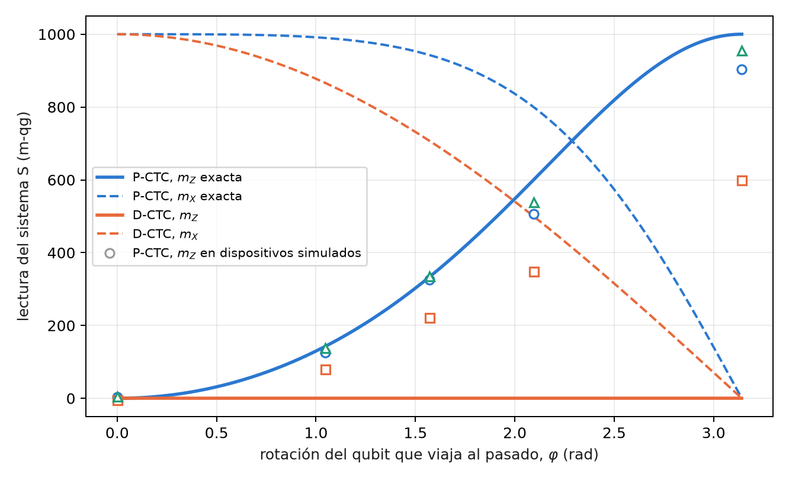
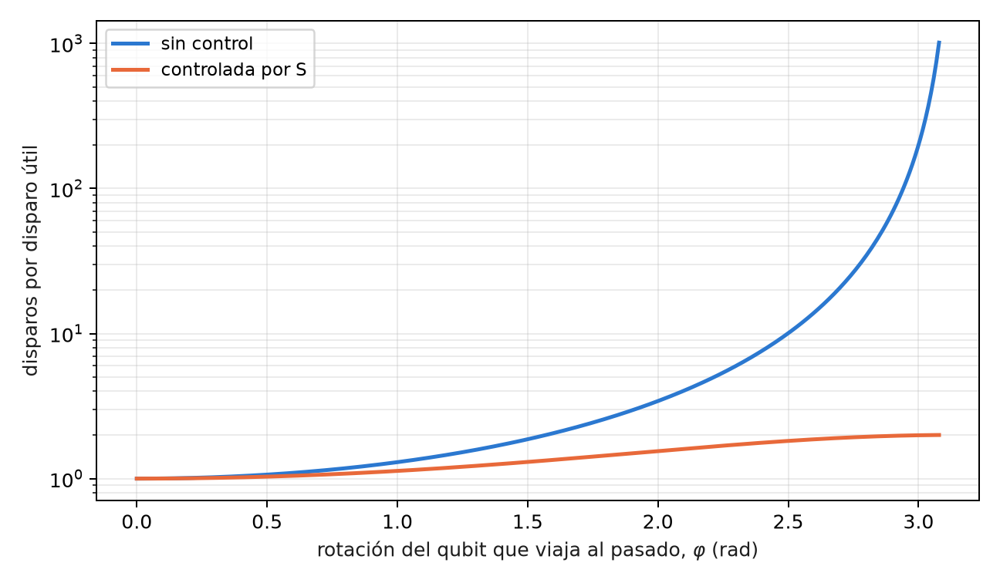

# Curvas temporales cerradas posseleccionadas (P-CTC) y resolución de paradojas {#sec-cap14}

La Parte V trata dos modelos de la teoría de la información que usan el vocabulario de la relatividad: los bucles
temporales y la evaporación de agujeros negros. Conviene decirlo desde el principio: **son modelos de teoría de la
información, no afirmaciones sobre el espacio-tiempo** (§164). Los dos son teleportación con posselección sobre un
resultado de Bell, es decir, un filtro sobre el sector de Bell, y por eso entran en este libro. Este capítulo trata
el bucle temporal en las dos formulaciones conocidas, la posseleccionada (P-CTC) y la de Deutsch (D-CTC), y lo que
una lectura qg distingue entre ellas.

## Desde la base: la probabilidad de éxito tiene ángulo qang $\varphi$ {#sec-pctc-base}

En el modelo más simple, el qubit que "viaja al pasado" sufre una rotación $R_X(\varphi)$, y la posselección tiene
éxito con probabilidad

$$
P_{\text{éxito}}=\cos^2\frac{\varphi}{2}.
$$

Es la ecuación de probabilidad del capítulo 1 con $p_0=P_{\text{éxito}}$, de modo que su ángulo qang es exactamente la
rotación, $\arccos(2P-1)=\varphi$, su lectura es $m=1000\cos\varphi$, y la tasa de éxito medida con $N$ intentos da $\varphi$
con incertidumbre $1/\sqrt N$. La paradoja del abuelo, $\varphi=\pi$, está en el polo sur: $P=0$, $m=-1000$.

## Dos maneras de cerrar un bucle temporal {#sec-dctc-pctc}

**Deutsch (D-CTC, 1991).** [@deutsch1991] El sistema en el bucle tiene que ser consistente consigo mismo: su estado $\rho_C$ es un
punto fijo de la evolución, $\rho_C=\operatorname{Tr}_S[U(\rho_S\otimes\rho_C)U^\dagger]$. Siempre existe al menos un punto
fijo, de modo que nunca hay paradoja, pero puede haber varios, y hace falta una regla adicional para elegir; la
habitual es tomar el de máxima entropía.

**Posselección (P-CTC; Bennett y Svetlichny, Lloyd y colaboradores, 2011).** [@svetlichny2011; @lloyd2011] El qubit que viaja al pasado, $C$, es la
mitad de un par de Bell $(C,A)$. Después de que $C$ interactúa con el sistema $S$, se proyecta $(C,A)$ otra vez sobre el
estado de Bell: es una teleportación de $C$ hacia su propio pasado, con la medición de Bell forzada a su resultado
trivial. La evolución efectiva de $S$ es

$$
\rho_S\mapsto\frac{\operatorname{Tr}_C(U)\,\rho_S\,\operatorname{Tr}_C(U)^\dagger}{\operatorname{Tr}[\ldots]},
$$

que no es lineal por la normalización. En el circuito, la proyección es una medición de Bell y quedarse con los
disparos que dan 00: un filtro sobre el sector de Bell.

## La ley de éxito y la paradoja del abuelo {#sec-abuelo}

Con $R_X(\varphi)$ sobre $C$ solo, $\operatorname{Tr}_C(U)=\operatorname{Tr}R_X(\varphi)/2=\cos(\varphi/2)$, y el éxito es $\cos^2(\varphi/2)$. En
$\varphi=\pi$ el qubit invierte su propio pasado: es la paradoja del abuelo, y en P-CTC **tiene probabilidad cero**. No
se resuelve: no ocurre. En D-CTC el mismo caso tiene como punto fijo el estado máximamente mezclado, y ocurre con
probabilidad 1, como una moneda.

En tres **modelos de ruido simulados**, con 8000 disparos (§164), la ley de éxito se cumple dentro de 0,05 salvo en
$\varphi=0$ en dos dispositivos (C1 falló: 0,950 y 0,931 contra 1), y la paradoja queda suprimida hasta el piso de ruido
en dos de tres (C2 falló en FakeTorino):

| dispositivo simulado | éxito en $\varphi=0$ (exacto 1) | éxito en $\varphi=\pi$, la paradoja (exacto 0) |
|---|---|---|
| FakeBrisbane | 0,950 | 0,019 |
| FakeTorino | 0,931 | 0,056 |
| FakeFez | 0,983 | 0,009 |

: La ley de éxito de la P-CTC en los extremos, modelos de ruido simulados. {#tbl-pctc-extremos}

{#fig-pctc-exito width=100%}

La @fig-pctc-exito muestra algo propio de la lectura en ángulo. En el interior, el ángulo qang de la tasa medida
reproduce $\varphi$ a pocos centésimos de radián; en los polos se aparta hasta medio radián. Es la no linealidad del
mili-qang en ángulo del capítulo 1: junto al polo, 1 m-qg son 2,56°, y los 34–138 m-qg de error de los dispositivos en
$\varphi=0$ se vuelven 0,26–0,53 rad.

## La rotación controlada por el sistema {#sec-controlada}

Si es el sistema $S$ el que controla la rotación de $C$, la traza parcial es un operador sobre $S$:

$$
\operatorname{Tr}_C(U)=\operatorname{diag}\!\left(1,\ \cos\tfrac{\varphi}{2}\right),
$$

y la rama de $S$ que produciría la paradoja queda atenuada por $c=\cos(\varphi/2)$. Desde $|+\rangle$, el estado
posseleccionado de $S$ tiene

$$
qg_Z(S)=\frac{1-c^2}{1+c^2},\qquad qg_X(S)=\frac{2c}{1+c^2},
$$

con éxito $(1+c^2)/2$. En $\varphi=\pi$, $qg_Z(S)=1$: el sistema queda forzado a la rama que no invierte el pasado. En los
modelos simulados, FakeFez sigue la curva a 0,061 en todo el rango, FakeBrisbane lee 0,903 en $\varphi=\pi$, y FakeTorino
pierde la mayor parte de la supresión (0,600): la predicción C3 falló.

## Lo que una lectura qg distingue entre D-CTC y P-CTC {#sec-dctc-numerico}

Esta sección es nueva en el libro: es álgebra exacta de matrices densidad, calculada en el script de figuras, sin
corrida en dispositivos. Se toma el mismo circuito controlado, con $S$ en $|+\rangle$, y se calcula la salida de $S$ en
las dos formulaciones.

En D-CTC, el canal sobre $C$ es $\rho_C\mapsto\tfrac12\rho_C+\tfrac12R_X\rho_CR_X^\dagger$, y es punto fijo todo estado que conmute con
$R_X(\varphi)$. Con la regla de máxima entropía, $\rho_C=I/2$, y la salida de $S$ es

$$
qg_Z(S)=0,\qquad qg_X(S)=\cos\frac{\varphi}{2},\qquad r=\cos\frac{\varphi}{2}.
$$

Las dos formulaciones se separan en lecturas distintas (@fig-dctc):

| $\varphi$ | P-CTC: $m_Z$, $m_X$ (m-qg) | D-CTC: $m_Z$, $m_X$ (m-qg) | éxito P-CTC |
|---|---|---|---|
| 0 | 0, 1000 | 0, 1000 | 1 |
| $\pi/3$ | 143, 990 | 0, 866 | 0,875 |
| $\pi/2$ | 333, 943 | 0, 707 | 0,750 |
| $2\pi/3$ | 600, 800 | 0, 500 | 0,625 |
| $\pi$ | 1000, 0 | 0, 0 | 0,500 |

: El sistema S después del bucle controlado, en las dos formulaciones. {#tbl-dctc}

{#fig-dctc width=90%}

La diferencia es cualitativa. **P-CTC cambia las poblaciones** de $S$ (la rama paradójica pierde peso) y deja un estado
puro; **D-CTC no toca las poblaciones** y sólo le quita coherencia. Una lectura en $Z$ de $S$ ya decide entre los dos
modelos, y los dispositivos simulados, con todo su ruido, están del lado de P-CTC, como debe ser, porque el circuito
es el de P-CTC.

La ambigüedad de Deutsch también se lee. Con $\varphi=\pi/2$, el estado $|+\rangle$ también es punto fijo, y da la misma
$qg_Z(S)=0$ y la misma $qg_X(S)=0{,}707$, pero $qg_Y(S)=-0{,}707$ y radio 1, contra $qg_Y=0$ y radio 0,707 con $I/2$. Las dos
soluciones de D-CTC difieren en el radio local del capítulo 5: la regla de máxima entropía elige el punto fijo que deja a $S$
más mezclado.

## El costo de la posselección {#sec-costo-pctc}

"Viajar en el tiempo" en este modelo cuesta disparos. Cada disparo útil exige, en promedio, $1/P_{\text{éxito}}$ disparos:
2 en $\varphi=\pi/2$, 4 en $2\pi/3$, 400 a una décima de radián de la paradoja (@fig-costo-pctc). Con la rotación controlada
el costo nunca pasa de 2, porque la mitad de la superposición de $S$ no paga nada. Es la misma cuenta que el filtro de
sector de los capítulos anteriores, con una diferencia: aquí la fracción descartada no es ruido sino la física del
modelo, y no se puede reducir.

{#fig-costo-pctc width=80%}

## Lo que queda pendiente {#sec-pendiente14}

Dos temas del índice no tienen todavía respaldo y quedan como propuestas: la no linealidad de las P-CTC aplicada a
discriminar estados no ortogonales (falta el circuito y la predicción), y una corrida de la comparación D-CTC frente a
P-CTC en dispositivos, que exigiría preparar el punto fijo de Deutsch y no sólo posseleccionar.

## Sin qang y con qang {#sec-comparacion14}

| acción | sin qang | con qang | diferencia |
|---|---|---|---|
| leer la rotación del bucle | invertir $\cos^2(\varphi/2)$ | el ángulo qang de la tasa de éxito es $\varphi$, con $\sigma=1/\sqrt N$ | **equivalente** en el interior; en los polos la lectura en ángulo **amplifica** el error (34–138 m-qg se vuelven 0,26–0,53 rad), y eso cuenta **en contra** |
| verificar la supresión de la paradoja | probabilidad de éxito y estado de S por tomografía | $m_Z(S)$: 903, 600 y 955 m-qg contra 1000 | **unidad**; la supresión es de la posselección |
| distinguir D-CTC de P-CTC | comparar matrices densidad | P-CTC mueve $m_Z$; D-CTC no lo mueve y baja $m_X$ | **a favor**: una sola lectura en $Z$ decide el modelo |
| distinguir los puntos fijos de D-CTC | entropía de cada solución | el radio local del capítulo 5: 0,707 frente a 1 | **a favor**: la ambigüedad se vuelve una lectura |
| reducir el ruido | — | la posselección es el filtro; la escala qang no agrega nada | **ninguna** |

: Las acciones del capítulo sin la escala qang y con ella. {#tbl-comparacion14}

**Balance.** En este capítulo qang rinde como herramienta de diagnóstico: dice con una o dos lecturas qué modelo de
bucle está operando y cuál de las soluciones de Deutsch se eligió. La ley de éxito es la ecuación de probabilidad del
capítulo 1, y con ella vienen también sus límites junto a los polos.

## En código {#sec-codigo14}

```python
import math
from qang import postselection as ps

ps.pctc_success(2 * math.pi / 3)                 # 0.25: éxito de la posselección
math.acos(2 * ps.pctc_success(2.0) - 1)          # 2.0: el ángulo qang es la rotación
ps.pctc_controlled_qg_z(math.pi)                 # 1.0: la rama paradójica, suprimida
qc = ps.pctc_circuit(math.pi, controlled=True)   # S, C, A; éxito = C y A leen 0
```

## Resumen {#sec-resumen14}

- Los bucles temporales de este capítulo son modelos de información: teleportación con posselección sobre un
  resultado de Bell.
- En P-CTC, la probabilidad de éxito es $\cos^2(\varphi/2)$ y su ángulo qang es $\varphi$; la paradoja del abuelo tiene
  probabilidad cero y, en dos de tres modelos simulados, queda en el piso de ruido.
- Con la rotación controlada, $qg_Z(S)=(1-c^2)/(1+c^2)$: la rama paradójica se suprime; FakeTorino pierde la mayor parte de
  la supresión.
- D-CTC no cambia las poblaciones de S y sólo le quita coherencia; una lectura en $Z$ separa los dos modelos, y el
  radio local separa los puntos fijos de Deutsch.
- La posselección cuesta $1/P$ disparos por disparo útil; es física del modelo, no ruido, y no se reduce.

## Notas bibliográficas {.unnumbered}

El modelo autoconsistente de curvas temporales cerradas es @deutsch1991; el modelo por posselección y su prueba
experimental, @lloyd2011, y la comparación entre ambos, @svetlichny2011. Las notas de investigación numeradas (§) que
cita el capítulo y los scripts que lo verifican están en el repositorio [@qangrepo]; la definición de la unidad qang, en
@monteverde2026.
