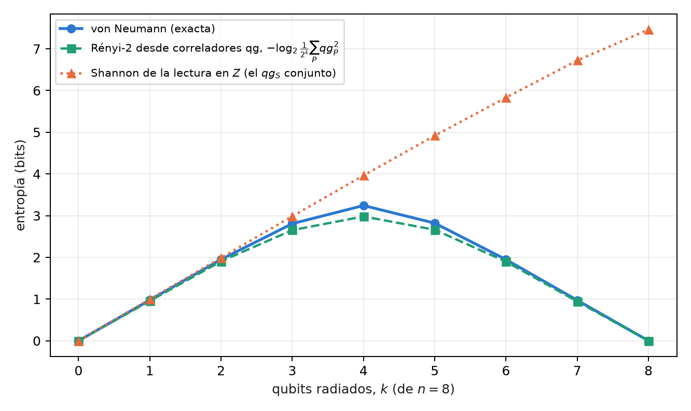

# Termodinámica de agujeros negros, caos cuántico y el decodificador de Yoshida–Kitaev {#sec-cap15}

Este es el segundo modelo de la Parte V, y vale la misma advertencia que en el capítulo 14: **es un modelo de teoría de
la información, no una afirmación sobre agujeros negros reales** (§164). Un agujero negro de pocos qubits, una unitaria
que esparce la información y una teleportación con posselección sobre un resultado de Bell: el mismo filtro sobre el
sector de Bell del capítulo anterior, ahora puesto a recuperar un mensaje que cayó al horizonte.

## Desde la base: éxito 1/4 y el ecuador de la fidelidad {#sec-yk-base}

El protocolo produce dos números, y los dos son probabilidades, de modo que la ecuación de probabilidad del capítulo 1
los lee directamente. La posselección tiene éxito con probabilidad $P=1/4$: su lectura es $m_P=1000(2P-1)=-500$ y su
ángulo qang $\arccos(-1/2)=2\pi/3$. La fidelidad $F$ del par recuperado con un par de Bell es la probabilidad de que la
medición de Bell dé su resultado trivial, y se lee igual, $m_F=1000(2F-1)$.

La escala tiene aquí una virtud concreta: **el umbral que importa cae en el ecuador**. Una fidelidad de Bell mayor que
$1/2$ certifica entrelazamiento, y $F=1/2$ es $m_F=0$. Sin scrambling, el par sale máximamente mezclado, $F=1/4$, y lee
$-500$; con scrambling, $F=1$, y lee $1000$. Decodificar es cruzar el ecuador.

## La paradoja de la información y la complementariedad {#sec-hawking}

@hawking1976 mostró que un agujero negro radia con espectro térmico, y que la radiación no parece depender de lo que
cayó adentro. Si el agujero se evapora por completo, un estado puro terminaría en uno mixto: la evolución no sería
unitaria. La complementariedad [@susskind1993] y, sobre todo, el argumento de @page1993 llevaron
a la posición contraria, hoy mayoritaria: la información sale en la radiación, codificada en correlaciones finas.

@hayden2007 preguntaron cuándo sale. Su respuesta, para un agujero negro que ya pasó la mitad de su vida y
cuya dinámica esparce la información rápido, es "casi enseguida": un mensaje de pocos qubits arrojado al agujero puede
reconstruirse con apenas unos qubits más de radiación, si se tiene la radiación temprana. @yoshida2017
dieron un decodificador explícito, y es el que se corre en este capítulo.

## Scrambling: un micro-agujero negro de 3 qubits {#sec-scrambling}

El agujero negro de juguete tiene 3 qubits: el mensaje $A$ y dos qubits $B_1,B_2$ que ya estaban adentro. Su dinámica es
una unitaria $U$ sobre los tres, y que $U$ "esparza la información" tiene una definición operativa: **todo operador de
Pauli de un qubit termina, después de $U$, actuando sobre los tres qubits**. Para un Clifford se verifica sin
aproximaciones, evolucionando los 9 Paulis $X,Y,Z$ de cada qubit. `find_scrambler` toma el primer Clifford aleatorio
(semilla 164) que cumple la condición, y sus 9 Paulis tienen peso 3.

El scrambling es la versión cuántica del caos: un error local (un Pauli) se vuelve, después de la dinámica, un error de
todo el sistema, y ninguna medición de un qubit lo detecta. Por eso no sorprende que un agujero negro "oculte" el mensaje,
y por eso sí sorprende que se pueda recuperar.

## El protocolo de Hayden–Preskill y el decodificador {#sec-yk}

El circuito tiene 8 qubits. El mensaje $A$ está entrelazado con una referencia $R$, que es quien lo arroja; el agujero
negro $B$ está entrelazado con la radiación temprana $B'$, en manos del observador exterior. Después de $U$ sobre
$(A,B_1,B_2)$, un qubit $D$ (la salida de $B_2$) se radia. El observador tiene $D$ y $B'$, y además prepara una copia del
experimento: un par $(A',R')$ y la unitaria conjugada $U^*$ sobre $(A',B'_1,B'_2)$. Luego **posselecciona $(D,D')$ sobre
el estado de Bell**. Si tiene éxito, el entrelazamiento de $A$ con $R$ pasó a $R'$: el mensaje se teleportó desde el
interior.

Para un scrambler, la posselección tiene éxito con probabilidad $1/d_A^2=1/4$ y la fidelidad del par $(R,R')$ es 1. Sin
scrambling ($U=I$), la posselección casi siempre tiene éxito, porque $D$ no lleva nada de $A$, y la fidelidad es la de
un par al azar, $1/4$. La posselección es, como en el capítulo 14, un filtro sobre el sector de Bell de $(D,D')$.

## La ley exacta $P\cdot F=1/4$ {#sec-ley-pf}

Esta sección es nueva en el libro. En el decodificador probabilístico de Yoshida y Kitaev, el éxito y la fidelidad no
son independientes:

$$
P\,F=\frac{1}{d_A^{2}}=\frac14 .
$$

El script de figuras lo verifica en estado exacto sobre 60 Cliffords aleatorios y 25 unitarias de Haar de 3 qubits, y
en todos los tamaños de la sección siguiente: en 3 qubits la desviación máxima es $3\times10^{-16}$. En la escala del capítulo 1
la ley es una hipérbola,

$$
(1000+m_P)(1000+m_F)=10^{6},\qquad\text{o bien}\qquad \cos\frac{\theta_P}{2}\,\cos\frac{\theta_F}{2}=\frac12 ,
$$

y tiene una consecuencia práctica: **sin ruido, el éxito ya dice la fidelidad**. Un éxito de $1/4$ ($m_P=-500$) exige
$F=1$; un éxito de 1 ($m_P=1000$) exige $F=1/4$. Entre los Cliffords aleatorios de 3 qubits, 27 de 60 decodifican
perfecto.

Con ruido la ley se rompe, y en qué dirección se rompe es lo que la vuelve útil. El ruido total lleva a $(D,D')$ al
estado mezclado, cuyo éxito es *también* $1/4$, con $F=1/4$: el éxito solo no distingue un decodificador perfecto de uno
destruido por el ruido. El producto sí: $4PF$ vale 1 en el primero y $1/4$ en el segundo.

## En modelos de ruido simulados {#sec-yk-ruido}

Con 8000 disparos en tres **modelos de ruido simulados** (§164), el circuito con scrambler, 90 compuertas de dos qubits
después de transpilar, da:

| dispositivo simulado | éxito $P$ ($m_P$) | fidelidad $F$ ($m_F$) | $4PF$ | sin scrambling: $F$ ($m_F$) |
|---|---|---|---|---|
| exacto | 0,250 (−500) | 1 (1000) | 1 | 0,250 (−500) |
| FakeBrisbane | 0,260 (−481) | 0,547 (93) | 0,568 | 0,248 (−504) |
| FakeTorino | 0,248 (−504) | 0,578 (156) | 0,573 | 0,250 (−501) |
| FakeFez | 0,246 (−508) | 0,742 (484) | 0,731 | 0,250 (−500) |

: El decodificador de Yoshida–Kitaev en tres modelos de ruido simulados. {#tbl-yk}

{#fig-yk width=100%}

Las tres corridas con scrambler cruzan el ecuador (H3), y el éxito queda a menos de 0,05 de $1/4$ (H2). Pero la
@fig-yk muestra por qué H2 no es evidencia de decodificación: el éxito de los tres dispositivos es el mismo que daría
el ruido total. Lo que separa a FakeFez de los otros dos es la fidelidad, y $4PF$ lo resume en un número: 0,73 contra
0,57. La predicción H1 (ventaja de fidelidad mayor que 0,3 sobre el caso sin scrambling en los tres) falló por 0,001 en
FakeBrisbane.

## Agujeros negros más grandes {#sec-yk-grande}

Esta sección también es nueva: estados exactos, conteo de compuertas y una simulación con el modelo de ruido de
FakeFez, sin corrida en dispositivos. El circuito se generaliza a un agujero negro de $n$ qubits con $k$ qubits
radiados: $2n+2$ qubits en total, 16 para $n=7$.

Dos resultados ordenan el tema. El primero: **con un solo qubit radiado, un agujero negro genérico no alcanza**. Para una
unitaria de Haar el éxito promedio es $P\approx\tfrac14+4^{-k}-4^{-k-1}$, y por la ley, $F=1/(4P)$: con $k=1$, $F\approx4/7=0{,}57$,
apenas arriba del ecuador, sea $n=3$, 5 o 7. Hay que radiar algo más que el mensaje: con $k=2$, $F\approx0{,}84$; con $k=3$,
$F\approx0{,}95$ (@fig-tamano, izquierda). Es la versión cuantitativa de "unos qubits más" de Hayden y Preskill. El scrambler
Clifford de 3 qubits, con $F=1$ y $k=1$, es un caso especial, no el típico.

El segundo: **el costo en compuertas separa los dos tipos de scrambler**. Un scrambler Clifford se transpila como circuito Clifford: 35,
126 y 252 compuertas de dos qubits para $n=3$, 5 y 7. Una unitaria de Haar se sintetiza como unitaria genérica, y su costo
crece como $4^n$: 92, 1908 y 32 680 (@fig-tamano, derecha). Hay además una lección para la corrida de la §164: el mismo
scrambler de 3 qubits, pasado al transpilador como matriz, se sintetizó con 90 compuertas; pasado como Clifford, con 35,
y en el modelo de FakeFez la fidelidad sube de 0,742 a 0,887 (simulación nueva con otra semilla, no la corrida guardada).

| agujero negro | qubits radiados | compuertas de dos qubits (FakeFez) | éxito en FakeFez (exacto 0,25) | $F$ en FakeFez ($m_F$; exacta 1) | $4PF$ en FakeFez |
|---|---|---|---|---|---|
| 3 qubits | 1 | 35 | 0,253 | 0,887 (773) | 0,899 |
| 5 qubits | 2 | 126 | 0,191 | 0,802 (605) | 0,613 |
| 7 qubits | 3 | 252 | 0,105 | 0,882 (764) | 0,370 |

: El decodificador con scramblers Clifford perfectos de 3, 5 y 7 qubits, exacto y en el modelo de ruido de FakeFez. {#tbl-yk-grande}

{#fig-tamano width=100%}

La @tbl-yk-grande muestra hasta dónde llega el filtro. La fidelidad se mantiene entre 0,80 y 0,89 aun con 252
compuertas, y no porque el ruido no actúe: la posselección sobre $k$ pares de Bell descarta los disparos en los que el
ruido tocó a $(D,D')$, y con más pares descarta más. El éxito cae de 0,253 a 0,105 frente al $1/4$ exacto (con ruido total
sería $4^{-k}$, $1/64$ para $k=3$). La fidelidad sola diría que el decodificador de 7 qubits es tan bueno como el de 3;
$4PF$ dice que entrega 0,37 de lo que debería, porque paga en disparos lo que la fidelidad no muestra. Es la regla de los
filtros de sector de los capítulos anteriores: el filtro mejora lo que queda a costa de la tasa, y $4PF$ pone las dos
cosas en un número. Con ruido, la ley se rompe ahora por el otro lado: en 3 qubits cae la fidelidad, en 7 cae el éxito.

## La curva de Page en juguete {#sec-page}

@page1993 predijo cómo crece el entrelazamiento de la radiación de un agujero negro que se evapora unitariamente: sube
mientras la radiación es la parte menor, llega a su máximo cuando se radió la mitad, y baja a cero al final, porque el
estado total es puro. Un juguete exacto: un estado de Haar de 8 qubits, con los primeros $k$ como radiación.

El índice proponía leer esta curva con $qg_S$. **No funciona**, y conviene decir por qué. $qg_S$ es la entropía de
Shannon de una lectura en $Z$, y un estado aleatorio se ve al azar en cualquier base: la lectura conjunta de los $k$
qubits radiados tiene entropía cercana a $k$ en toda la evaporación, también cuando la radiación ya es casi pura
(@fig-page, triángulos). Es el límite que ya documenta `qang.circuits` con los estados de grafo como contraejemplo:
$qg_S$ depende de la base y no mide entrelazamiento.

Lo que sí funciona usa las mismas lecturas qg, al cuadrado. La pureza de la radiación es la suma de los cuadrados de sus
correladores de Pauli,

$$
\operatorname{Tr}\rho^{2}=\frac{1}{2^{k}}\sum_{P\in\{I,X,Y,Z\}^{k}}qg_P^{\,2},
$$

y $S_2=-\log_2\operatorname{Tr}\rho^2$, la entropía de Rényi de orden 2, es una cota inferior de la de von Neumann que sigue
la curva de Page: en $k=4$, la mitad, $S_2=2{,}98$ bits contra $S=3{,}24$, y las dos vuelven a cero en $k=8$, mientras la entropía de Shannon de la lectura en $Z$ llega a 7,46. El costo es la cara desfavorable: $4^k-1$ correladores, 255 para $k=4$. (El script
la calcula desde los correladores hasta $k=4$; más allá usa $\operatorname{Tr}\rho^2$ directamente, que es la misma cantidad.)

{#fig-page width=85%}

## Agujeros de gusano atravesables {#sec-gusano}

El decodificador de Yoshida–Kitaev es, en circuito, el mismo protocolo que en la literatura holográfica se llama
teleportación por un agujero de gusano atravesable [@gao2017; @maldacena2017]: dos
sistemas entrelazados, una dinámica de scrambling en cada uno (la de un lado conjugada) y un acoplamiento entre ellos
que deja pasar un qubit. La conjetura ER = EPR [@maldacena2013] propone que esos pares entrelazados son,
en una teoría gravitatoria dual, un puente de Einstein–Rosen. El circuito no decide nada de eso; sí permite leer el
resultado con las herramientas de este libro.

La fidelidad del par recuperado es lineal en tres correladores qg, como en el capítulo 13:

$$
F=\frac{1+qg_{XX}-qg_{YY}+qg_{ZZ}}{4}.
$$

En estado exacto, con scrambler, $(qg_{XX},qg_{YY},qg_{ZZ})=(1,-1,1)$ y $F=1$; sin scrambling, $(0,0,0)$ y $F=1/4$.
El experimento de @jafferis2022 en un procesador de Google usó un modelo de 7 qubits aprendido para
imitar esta física, y su interpretación como agujero de gusano fue discutida [@kobrin2023]. Este libro
no corre ese experimento; la lectura en correladores queda como herramienta, no como evidencia.

## Lo que queda pendiente {#sec-pendiente15}

Ninguno de los resultados nuevos de este capítulo (la ley $PF=1/4$ como diagnóstico, los agujeros negros de 5 y 7 qubits,
la curva de Page con correladores) tiene corrida en dispositivos. Una corrida en hardware real del decodificador de 3
qubits, con 90 compuertas de dos qubits, sería el siguiente paso y tiene costo en créditos; queda fuera de este libro por
ahora.

## Sin qang y con qang {#sec-comparacion15}

| acción | sin qang | con qang | diferencia |
|---|---|---|---|
| decidir si el mensaje se recuperó | comparar $F$ con 1/2 | el signo de $m_F$: decodificar es cruzar el ecuador | **unidad**: el umbral queda en cero, pero es el mismo umbral |
| juzgar la calidad del decodificador | $P$ y $F$ por separado | la ley $(1000+m_P)(1000+m_F)=10^6$ y su resumen $4PF$ | **a favor**, con matiz: la ley es de Yoshida y Kitaev, no de qang; la escala la vuelve una hipérbola legible y muestra que $m_P=-500$ no prueba nada |
| prever cuánta radiación hace falta | la fórmula de Haar | la misma fórmula, $F=1/(4P)$ | **ninguna** |
| la curva de Page | entropía de von Neumann por tomografía | $qg_S$ en $Z$ | **en contra**: $qg_S$ no ve la curva |
| la curva de Page, otra vez | tomografía | Rényi-2 desde la suma de $qg_P^2$ | **equivalente**: es tomografía de Pauli escrita en qg, con su costo $4^k-1$ |
| la fidelidad del agujero de gusano | medición de Bell del par (una configuración) | tres correladores qg | **ninguna** en costo, porque la medición de Bell ya da $F$; **a favor** como diagnóstico: los tres correladores dicen qué componente falla |
| reducir el ruido | — | la posselección es el filtro; la escala no agrega nada | **ninguna** |

: Las acciones del capítulo sin la escala qang y con ella. {#tbl-comparacion15}

**Balance.** El aporte más claro de qang en este capítulo es de lectura: la ley exacta del decodificador se vuelve una
curva en el plano de las dos lecturas, y en ese plano se ve de inmediato que el éxito correcto no es evidencia de
decodificación. Donde el índice prometía más, la curva de Page con $qg_S$, el resultado es negativo, y lo que la
reemplaza es tomografía de Pauli, no una propiedad de la escala.

## En código {#sec-codigo15}

```python
from qiskit.quantum_info import Statevector
from qang import postselection as ps

scr = ps.find_scrambler()                        # Clifford de 3 qubits, semilla 164
qc = ps.yk_decoder_circuit(scr, measure=False)   # 8 qubits: R, A, B1, B2, B1', B2', A', R'
probs = Statevector(qc).probabilities_dict()
ps.yk_from_counts({k: round(1e6 * v) for k, v in probs.items()})
# {'success': 0.25, 'fidelity': 1.0}: P F = 1/4
```

## Resumen {#sec-resumen15}

- El decodificador de Yoshida–Kitaev es teleportación con posselección sobre el sector de Bell de un qubit radiado y
  su copia: un modelo de información, no de gravedad.
- En la escala del capítulo 1, el éxito $1/4$ es $m_P=-500$ y la fidelidad que certifica la recuperación, $F>1/2$, es
  $m_F>0$: decodificar es cruzar el ecuador.
- La ley exacta $PF=1/4$ es una hipérbola en m-qg; con ruido, el éxito sigue en $1/4$ pero la fidelidad cae, y $4PF$
  (0,57–0,73 en tres modelos simulados) mide la calidad del decodificador.
- Con un solo qubit radiado, un agujero negro genérico da $F\approx0{,}57$; hacen falta 2 o 3 qubits radiados para
  $F\approx0{,}84$–$0{,}95$.
- Un scrambler Clifford cuesta 35, 126 y 252 compuertas de dos qubits en 3, 5 y 7 qubits; con 7, la fidelidad en FakeFez
  sigue en 0,88 pero el éxito cae a 0,105 y $4PF$ a 0,37: el filtro conserva la calidad y cobra en tasa.
- $qg_S$ no ve la curva de Page; la Rényi-2 desde los correladores qg sí, al costo de $4^k-1$ lecturas.

## Notas bibliográficas {.unnumbered}

La paradoja de la información parte de @hawking1976; la complementariedad es @susskind1993, y la curva de Page,
@page1993. El protocolo de recuperación es @hayden2007, y su decodificador, @yoshida2017. Los agujeros de gusano
atravesables son @gao2017 y @maldacena2017, y ER = EPR, @maldacena2013; el experimento es @jafferis2022, y la discusión
de su interpretación, @kobrin2023. Las notas de investigación numeradas (§) que cita el capítulo y los scripts que lo
verifican están en el repositorio [@qangrepo]; la definición de la unidad qang, en @monteverde2026.
